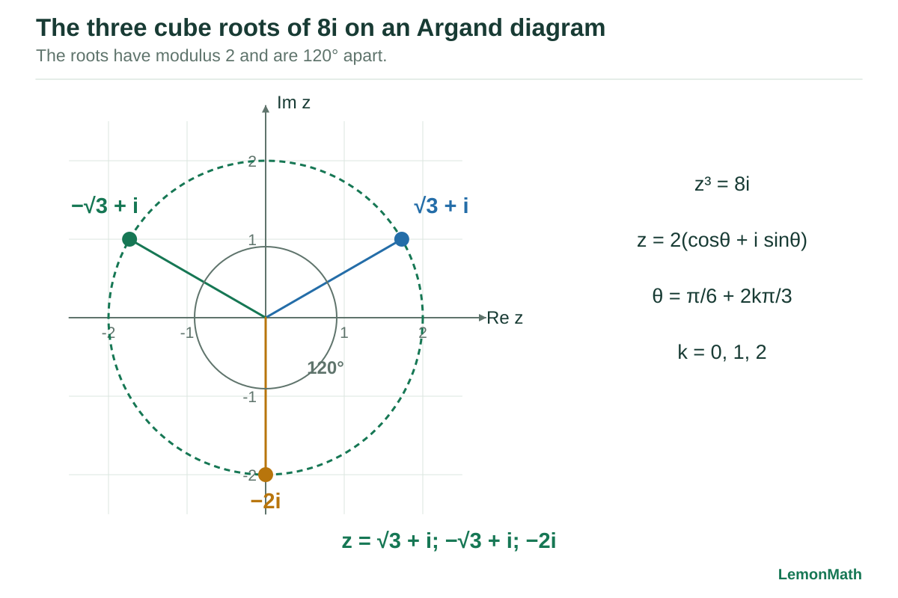

:::goals
- Calculate with complex numbers in Cartesian form, including division and conjugates.
- Convert between Cartesian, modulus-argument and Euler forms, and use De Moivre's theorem.
- Find the $n$th roots of a complex number and the complex roots of real polynomials.
- Write proofs by mathematical induction, by contradiction, and disprove statements with a counterexample.
:::

These HL topics appear in Paper 1 and Paper 2, and often in the long Section B questions, where a complex number problem can lead into a trigonometric identity or a proof. What they share is that they reward tidy writing: arguments in radians, roots listed completely, and the formal structure of an induction proof written out every time. Getting used to this habit early saves you from losing marks over small things.

## Complex numbers in Cartesian form

A complex number is $z=a+bi$, with $i^2=-1$. Every complex number has a partner. Its **conjugate** is $z^*=a-bi$: the same number with the sign of the imaginary part flipped. Its **modulus** is $|z|=\sqrt{a^2+b^2}$, which tells you how far the number is from zero. Why do we need the conjugate? Because multiplying a complex number by its conjugate makes the imaginary part vanish. That is the trick behind division: multiply the numerator and denominator by the conjugate of the denominator, and the denominator becomes real.

:::example Products and quotients
Let $z=3+4i$ and $w=1-2i$. Find $zw$, $\dfrac zw$ and $|z|$. [5 marks]

**Solution.** $zw=3-6i+4i-8i^2=11-2i$.

$\dfrac zw=\dfrac{(3+4i)(1+2i)}{(1-2i)(1+2i)}=\dfrac{3+6i+4i+8i^2}{5}=\dfrac{-5+10i}{5}=-1+2i$.

$|z|=\sqrt{9+16}=5$.
:::

## Modulus-argument and Euler form

$$z=r(\cos\theta+i\sin\theta)=r\operatorname{cis}\theta=re^{i\theta},$$
where $r=|z|$ is the length and $\theta=\arg z$ is the angle, usually taken in $-\pi<\theta\le\pi$. Why is this form worth using? Because multiplying becomes simple: you multiply the moduli and add the arguments. **De Moivre's theorem** follows, and gives $\left(re^{i\theta}\right)^n=r^ne^{in\theta}$: to raise a complex number to a power, raise its modulus to that power and multiply its argument by the power.

:::example A power with De Moivre
Let $z=1+i\sqrt3$.
(a) Write $z$ in the form $re^{i\theta}$. [2 marks]
(b) Hence find $z^6$. [2 marks]

**Solution.** (a) $r=\sqrt{1+3}=2$ and $\theta=\arctan\sqrt3=\dfrac\pi3$ (first quadrant), so $z=2e^{i\pi/3}$.

(b) $z^6=2^6e^{2\pi i}=64$.
:::

## Roots of complex numbers and polynomials

A quadratic equation has two roots; the equation $z^n=re^{i\theta}$ has $n$ distinct roots, and we can write all of them down:
$$z=r^{1/n}e^{i(\theta+2k\pi)/n},\quad k=0,1,\dots,n-1.$$
If you plot the roots on an Argand diagram, you will see them sitting on a circle of radius $r^{1/n}$, equally spaced, like the corners of a regular polygon. For a polynomial with **real coefficients**, the non-real roots always come in conjugate pairs. For example, if $2+i$ is a root, so is $2-i$. You will use this straight away in the second example below.

:::example Cube roots
Solve $z^3=8i$, giving your answers in the form $a+bi$. [6 marks]

**Solution.** $8i=8e^{i\pi/2}$, so $z=2e^{i(\pi/6+2k\pi/3)}$ for $k=0,1,2$:

$k=0$: $2e^{i\pi/6}=\sqrt3+i$. $k=1$: $2e^{i5\pi/6}=-\sqrt3+i$. $k=2$: $2e^{i3\pi/2}=-2i$.

:::

:::example A cubic with a complex root
Given that $2+i$ is a root of $z^3-5z^2+9z-5=0$, find the other roots. [5 marks]

**Solution.** The coefficients are real, so $2-i$ is also a root, and $(z-2-i)(z-2+i)=z^2-4z+5$ is a factor. Dividing: $z^3-5z^2+9z-5=\left(z^2-4z+5\right)(z-1)$. The roots are $2+i$, $2-i$ and $1$.
:::

## Proof by induction

:::note The four parts graders look for
1. **Basis:** check that the statement is true for the first value, usually $n=1$.
2. **Assumption:** assume it is true for $n=k$. This is only an assumption, not something you have proved yet.
3. **Inductive step:** use the assumption to prove that it is also true for $n=k+1$.
4. **Conclusion:** write one complete sentence: "Since the statement is true for $n=1$, and true for $n=k+1$ whenever it is true for $n=k$, it is true for all $n\in\mathbb{Z}^+$ by mathematical induction."

Think of a row of dominoes: the basis knocks over the first one, and the inductive step guarantees that whenever one falls, the next one falls too. If a part is missing, the row does not fall all the way, so write out all four parts every time.
:::

:::example A sum by induction
Prove by induction that $\displaystyle\sum_{r=1}^{n}r(r+1)=\frac{n(n+1)(n+2)}{3}$ for all $n\in\mathbb{Z}^+$. [7 marks]

**Solution.** **Basis:** for $n=1$, LHS $=1\cdot2=2$ and RHS $=\dfrac{1\cdot2\cdot3}{3}=2$.

**Assumption:** suppose $\displaystyle\sum_{r=1}^{k}r(r+1)=\frac{k(k+1)(k+2)}{3}$.

**Step:** $\displaystyle\sum_{r=1}^{k+1}r(r+1)=\frac{k(k+1)(k+2)}{3}+(k+1)(k+2)=\frac{(k+1)(k+2)(k+3)}{3}$, which is the formula with $n=k+1$.

**Conclusion:** true for $n=1$, and true for $n=k+1$ whenever true for $n=k$, so true for all $n\in\mathbb{Z}^+$ by induction.
:::

## Contradiction and counterexample

There are two ways of arguing that you should keep ready. The first is **contradiction**: assume the statement is false, and follow the argument until you reach something impossible. Then the assumption cannot have been right, so the statement is true. The second is for when you want to knock a statement down: one **counterexample** is enough, because a single failing case brings down a "for all" statement.

:::example A counterexample
Show that the statement "$n^2+n+41$ is prime for every positive integer $n$" is false. [2 marks]

**Solution.** For $n=40$: $40^2+40+41=1681=41^2$, which is not prime. (The expression is prime for $n=1$ to $39$, which is why checking a few cases is not a proof.)
:::

:::warning Common traps
- **Argument in the wrong quadrant.** $\arctan\dfrac ba$ gives the right angle only for $a>0$; draw $z$ on an Argand diagram first, then calculate.
- **Missing roots.** $z^n=w$ always has $n$ roots; list all of them, and do not stop after the first few.
- **Induction without a conclusion**, or with "assume true for all $n$" instead of "for $n=k$".
- **Using the assumption backwards:** start from the $k+1$ case and use the $n=k$ statement inside it.
- **Proof by examples.** Checking a few cases never proves a "for all" statement.

Do not worry if you have made a few of these slips; many students do. The cure is a habit: run through this list at the end of each question.
:::

:::terms
- complex conjugate, modulus, argument | số phức liên hợp, môđun, acgumen
- Argand diagram | mặt phẳng phức (biểu đồ Argand)
- modulus-argument form, Euler form | dạng lượng giác, dạng mũ (Euler)
- De Moivre's theorem | định lí De Moivre
- roots of unity | căn bậc $n$ của đơn vị
- proof by induction | chứng minh quy nạp
- proof by contradiction | chứng minh phản chứng
- counterexample | phản ví dụ
:::

## Similar exercises

:::exercise Cartesian arithmetic
Find $(2-i)^2$ and $\dfrac{1}{2-i}$ in the form $a+bi$. [4 marks]

::hint
**What you need:** expand; multiply by $\dfrac{2+i}{2+i}$.

::solution
Compute $(2-i)^2$. Using the expansion of the square of a difference and $i^2=-1$:
$$(2-i)^2=4-4i+i^2=4-4i-1=3-4i.$$

Compute $\dfrac{1}{2-i}$. Multiply the numerator and the denominator by the complex conjugate of the denominator, $2+i$:
$$\frac{1}{2-i}=\frac{2+i}{(2-i)(2+i)}=\frac{2+i}{4-i^2}=\frac{2+i}{5}.$$

Separating the real and imaginary parts, we get $\dfrac{1}{2-i}=\dfrac25+\dfrac15i$.

So $(2-i)^2=3-4i$ and $\dfrac{1}{2-i}=\dfrac25+\dfrac15i$.

**Answer.** $(2-i)^2=3-4i$; $\dfrac{1}{2-i}=\dfrac25+\dfrac15i$.
:::

:::exercise Euler form
Write $-2-2i$ in the form $re^{i\theta}$, $-\pi<\theta\le\pi$. [3 marks]

::hint
**What you need:** the point is in the third quadrant.

::solution
Let $z=-2-2i$ and write $z=re^{i\theta}$ with $r>0$, $-\pi<\theta\le\pi$.

Modulus: $r=|z|=\sqrt{(-2)^2+(-2)^2}=\sqrt8=2\sqrt2$.

Argument: the real and imaginary parts of $z$ are both negative, so the point representing $z$ lies in the third quadrant. We have $\tan\theta=\dfrac{-2}{-2}=1$, so the reference angle is $\dfrac\pi4$. With $-\pi<\theta\le\pi$ and the third quadrant, we get
$$\theta=-\pi+\frac\pi4=-\frac{3\pi}{4}.$$

Check: $2\sqrt2\cos\left(-\dfrac{3\pi}{4}\right)=2\sqrt2\cdot\left(-\dfrac{\sqrt2}{2}\right)=-2$ and $2\sqrt2\sin\left(-\dfrac{3\pi}{4}\right)=-2$.

So $-2-2i=2\sqrt2e^{-3\pi i/4}$.

**Answer.** $2\sqrt2e^{-3\pi i/4}$.
:::

:::exercise Fourth roots
Solve $z^4=16$. [4 marks]

::hint
**What you need:** $16=16e^{i0}$; four roots spaced by $\dfrac\pi2$.

::solution
Write $z=re^{i\theta}$ with $r>0$. Since $16=16e^{i\cdot0}$, the equation $z^4=16$ becomes
$$r^4e^{4i\theta}=16e^{i\cdot0}.$$

Comparing moduli: $r^4=16$, so $r=2$ (since $r>0$).

Comparing arguments: $4\theta=2k\pi$ with $k\in\mathbb{Z}$, so $\theta=\dfrac{k\pi}{2}$.

Hence $z=2e^{ik\pi/2}$. The values $k=0,1,2,3$ give four distinct solutions; $k=4$ returns to the solution for $k=0$, so there are no new solutions.

Computing each solution:
- $k=0$: $z=2e^{0}=2$;
- $k=1$: $z=2e^{i\pi/2}=2i$;
- $k=2$: $z=2e^{i\pi}=-2$;
- $k=3$: $z=2e^{3i\pi/2}=-2i$.

So the equation $z^4=16$ has four solutions $2$, $2i$, $-2$, $-2i$.

**Answer.** $2$, $2i$, $-2$, $-2i$.
:::

:::exercise Equating parts
Find $z=a+bi$ such that $z+2z^*=6-i$. [3 marks]

::hint
**What you need:** $z+2z^*=3a-bi$; compare real and imaginary parts.

::solution
For $z=a+bi$ ($a,b\in\mathbb{R}$), the complex conjugate is $z^*=a-bi$.

We have
$$z+2z^*=(a+bi)+2(a-bi)=3a-bi.$$

The equation $z+2z^*=6-i$ becomes $3a-bi=6-i$.

Two complex numbers are equal when their real parts are equal and their imaginary parts are equal, so
$$3a=6\ \text{and}\ -b=-1.$$

Hence $a=2$ and $b=1$.

Check: $2+i+2(2-i)=2+i+4-2i=6-i$.

So $z=2+i$.

**Answer.** $z=2+i$.
:::

:::exercise Divisibility by induction
Prove by induction that $3^{2n}-1$ is divisible by $8$ for all $n\in\mathbb{Z}^+$. [6 marks]

::hint
**What you need:** $3^{2(k+1)}-1=9\cdot3^{2k}-1=9\left(3^{2k}-1\right)+8$.

::solution
Let $P(n)$ be the statement "$3^{2n}-1$ is divisible by $8$". We prove by induction that $P(n)$ is true for all $n\in\mathbb{Z}^+$.

Basis: for $n=1$ we have $3^2-1=8$, which is divisible by $8$. So $P(1)$ is true.

Inductive hypothesis: assume $P(k)$ is true for some positive integer $k$, that is $3^{2k}-1=8m$ for some integer $m$.

Inductive step: we show that $P(k+1)$ is true. We have
$$\begin{aligned}3^{2(k+1)}-1&=3^{2k+2}-1=9\cdot3^{2k}-1\\&=9\left(3^{2k}-1\right)+8\\&=9(8m)+8=8(9m+1).\end{aligned}$$

Since $9m+1$ is an integer, $3^{2(k+1)}-1$ is a multiple of $8$. So $P(k+1)$ is true.

Conclusion: $P(1)$ is true, and $P(k)$ true implies $P(k+1)$ true. By the principle of mathematical induction, $P(n)$ is true for all $n\in\mathbb{Z}^+$.

So $3^{2n}-1$ is divisible by $8$ for all $n\in\mathbb{Z}^+$.

**Answer.** $3^{2n}-1$ is divisible by $8$ for all $n\in\mathbb{Z}^+$.
:::

## Application exercises

:::exercise A trigonometric identity from De Moivre
Use De Moivre's theorem with $n=3$ to show that $\cos3\theta=4\cos^3\theta-3\cos\theta$. [6 marks]

::hint
**What you need:** expand $(\cos\theta+i\sin\theta)^3$ with the binomial theorem and compare real parts; use $\sin^2\theta=1-\cos^2\theta$.

::solution
Let $c=\cos\theta$ and $s=\sin\theta$ (for real $\theta$, $c$ and $s$ are real numbers).

By De Moivre's theorem with $n=3$:
$$(c+is)^3=\cos3\theta+i\sin3\theta.$$

Expanding the left-hand side with the binomial theorem, using $i^2=-1$ and $i^3=-i$:
$$(c+is)^3=c^3+3c^2(is)+3c(is)^2+(is)^3=c^3+3ic^2s-3cs^2-is^3.$$

The real part of the left-hand side is $c^3-3cs^2$. Since equal complex numbers have equal real parts,
$$\cos3\theta=c^3-3cs^2.$$

Substituting $s^2=1-c^2$:
$$\cos3\theta=c^3-3c\left(1-c^2\right)=c^3-3c+3c^3=4c^3-3c.$$

So $\cos3\theta=4\cos^3\theta-3\cos\theta$.

**Answer.** $\cos3\theta=4\cos^3\theta-3\cos\theta$.
:::

:::exercise Roots of unity
Let $\omega=e^{2\pi i/3}$. Show that $1+\omega+\omega^2=0$, and describe the three cube roots of $1$ on an Argand diagram. [4 marks]

::hint
**What you need:** $\omega^3=1$ and $\omega\ne1$; factor $\omega^3-1$.

::solution
We have $\omega=e^{2\pi i/3}=\cos\dfrac{2\pi}{3}+i\sin\dfrac{2\pi}{3}=-\dfrac12+\dfrac{\sqrt3}{2}i$, so $\omega\ne1$.

Also $\omega^3=e^{2\pi i}=1$, so $\omega^3-1=0$.

Factorising:
$$\omega^3-1=(\omega-1)\left(\omega^2+\omega+1\right)=0.$$

Since $\omega\ne1$, we have $\omega-1\ne0$. Therefore $\omega^2+\omega+1=0$, that is $1+\omega+\omega^2=0$.

The cube roots of $1$ are the solutions of $z^3=1$, that is $z=e^{2k\pi i/3}$ for $k=0,1,2$. These are $1$, $\omega$ and $\omega^2=e^{4\pi i/3}=-\dfrac12-\dfrac{\sqrt3}{2}i$.

All three have modulus $1$, so they lie on the unit circle. Their arguments are $0$, $\dfrac{2\pi}{3}$, $\dfrac{4\pi}{3}$, equally spaced by $\dfrac{2\pi}{3}$, so the three points divide the unit circle into three equal arcs and the chords joining them are equal.

So $1+\omega+\omega^2=0$, and the three cube roots of $1$ are the vertices of an equilateral triangle inscribed in the unit circle on an Argand diagram.

**Answer.** $1+\omega+\omega^2=0$; the roots $1$, $\omega$, $\omega^2$ are the vertices of an equilateral triangle inscribed in the unit circle.
:::

:::exercise Induction with derivatives
Prove by induction that $\dfrac{d^n}{dx^n}\left(xe^x\right)=(x+n)e^x$ for all $n\in\mathbb{Z}^+$. [6 marks]

::hint
**What you need:** differentiate $(x+k)e^x$ with the product rule.

::solution
Let $P(n)$ be the statement "$\dfrac{d^n}{dx^n}\left(xe^x\right)=(x+n)e^x$". We prove by induction that $P(n)$ is true for all $n\in\mathbb{Z}^+$.

Basis: for $n=1$, using the product rule,
$$\frac{d}{dx}\left(xe^x\right)=1\cdot e^x+xe^x=(x+1)e^x.$$
So $P(1)$ is true.

Inductive hypothesis: assume $P(k)$ is true for some positive integer $k$, that is
$$\frac{d^k}{dx^k}\left(xe^x\right)=(x+k)e^x.$$

Inductive step: we show that $P(k+1)$ is true. Differentiating both sides of the hypothesis and using the product rule:
$$\begin{aligned}\frac{d^{k+1}}{dx^{k+1}}\left(xe^x\right)&=\frac{d}{dx}\big((x+k)e^x\big)\\&=1\cdot e^x+(x+k)e^x\\&=(x+k+1)e^x=\big(x+(k+1)\big)e^x.\end{aligned}$$

This is exactly the formula for $P(k+1)$.

Conclusion: $P(1)$ is true, and $P(k)$ true implies $P(k+1)$ true. By the principle of mathematical induction, $P(n)$ is true for all $n\in\mathbb{Z}^+$.

So $\dfrac{d^n}{dx^n}\left(xe^x\right)=(x+n)e^x$ for all $n\in\mathbb{Z}^+$.

**Answer.** $\dfrac{d^n}{dx^n}\left(xe^x\right)=(x+n)e^x$ for all $n\in\mathbb{Z}^+$.
:::

:::exercise Challenge: an irrational logarithm
Prove by contradiction that $\log_23$ is irrational. [5 marks]

::hint
**What you need:** suppose $\log_23=\dfrac pq$ with positive integers $p$, $q$; then $2^p=3^q$.

::solution
Assume, for contradiction, that $\log_23$ is rational.

Since $3>1$, we have $\log_23>0$. So we can write $\log_23=\dfrac pq$ with $p,q\in\mathbb{Z}^+$.

By the definition of a logarithm, $2^{p/q}=3$. Raising both sides to the power $q$, we get
$$2^p=3^q.$$

Since $p\ge1$, $2^p$ is even. On the other hand, $3$ is odd, so $3^q$ (a product of $q$ odd factors) is odd.

A number cannot be both even and odd, so $2^p=3^q$ is impossible. Hence the initial assumption is false.

So $\log_23$ is irrational.

**Answer.** $\log_23$ is irrational.
:::

:::quiz
::mc TH
What is $i^{23}$?
A. $1$
B. $i$
C. $-1$
D. $-i$
::key D
$23=4\cdot5+3$, so $i^{23}=i^3=-i$.

::mc TH
What is $\arg(-1+i)$?
A. $\dfrac{3\pi}{4}$
B. $\dfrac{\pi}{4}$
C. $-\dfrac{\pi}{4}$
D. $\dfrac{5\pi}{4}$
::key A
The point $(-1,1)$ is in the second quadrant. Option D is outside $-\pi<\theta\le\pi$.

::mc TH
What are the roots of $z^2-4z+13=0$?
A. $4\pm3i$
B. $-2\pm3i$
C. $2\pm3i$
D. $2\pm9i$
::key C
$z=\dfrac{4\pm\sqrt{16-52}}{2}=\dfrac{4\pm6i}{2}$.

::mc TH
Which step is not part of a proof by induction?
A. Showing the statement is true for $n=1$
B. Checking the statement for $n=1$ to $n=10$ and concluding
C. Assuming the statement is true for $n=k$
D. Proving the statement for $n=k+1$
::key B
Checking cases is not a proof; the other three are the structure of induction.

::tf NB TH TH TH
Let $z=2e^{i\pi/4}$.
a) $|z|=2$.
b) $z^2=4i$.
c) $\operatorname{Re}z=2$.
d) $z^4=16$.
::key T T F F
a) True. b) True: $4e^{i\pi/2}=4i$. c) False: $\operatorname{Re}z=2\cos\dfrac\pi4=\sqrt2$. d) False: $z^4=16e^{i\pi}=-16$.

::sa TH
Find $\left|(1+i)^6\right|$.
::key 8
$|1+i|^6=\left(\sqrt2\right)^6=8$.

::sa NB
How many distinct roots does $z^5=1$ have?
::key 5
An equation $z^n=w$ with $w\ne0$ has $n$ distinct roots.
:::
