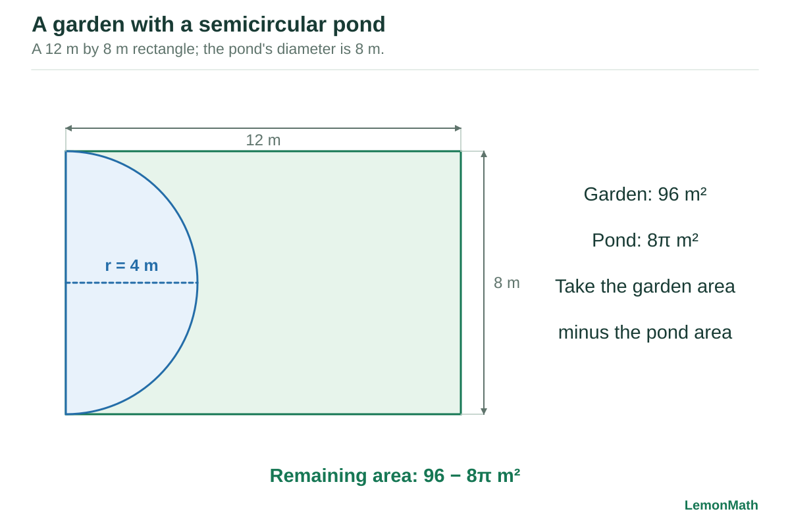

:::goals
- Use vertical angles, linear pairs and the angles formed by parallel lines and a transversal.
- Use the angle sum of a triangle and of a polygon.
- Find the area of composite figures and the volume and surface area of prisms, cylinders, cones and spheres.
- Predict how area and volume change when lengths are scaled.
:::

If you worry about having to memorise lots of geometry formulas, here is some good news: you do not need to. Geometry and Trigonometry has about 5 to 7 questions on the test, and the formulas for area and volume are on the reference sheet in Bluebook. So the SAT does not test memory. It tests whether you can **choose** the right formula, break a figure into simple parts and set up an equation from an angle relationship. Many questions here are student-produced responses, so careful arithmetic matters.

## Lines and angles

:::note Angle facts
- Angles on a straight line add up to $180^\circ$; angles around a point add up to $360^\circ$.
- Vertical angles are equal.
- When a transversal crosses two **parallel** lines: corresponding angles are equal, alternate interior angles are equal, and same-side interior angles add up to $180^\circ$.
- The angles of a triangle add up to $180^\circ$; the interior angles of a polygon with $n$ sides add up to $(n-2)\cdot180^\circ$.

These four facts underlie every angle question in this lesson. Whenever you see parallel lines, think of alternate interior and corresponding angles first.
:::

:::example Parallel lines
Two parallel lines are cut by a transversal. Two alternate interior angles measure $(3x+10)^\circ$ and $(5x-30)^\circ$. What is the value of $x$?

**Solution.** Alternate interior angles are equal: $3x+10=5x-30\iff40=2x\iff x=20$. You type **20**. (Each angle measures $70^\circ$.)
:::

:::example A regular polygon
What is the measure of each interior angle of a regular hexagon?
A. $108^\circ$
B. $120^\circ$
C. $135^\circ$
D. $720^\circ$

**Solution.** The interior angles add up to $(6-2)\cdot180^\circ=720^\circ$, and a regular hexagon has 6 equal angles: $720^\circ\div6=120^\circ$. The answer is **B**. Option D is the sum, not one angle.
:::

## Area and composite figures

Composite figures look messy, but they are usually made of a few familiar shapes. To find the area, split the figure into rectangles, triangles and circles, then add or subtract. Why split? Because you already know how to find the area of each simple shape.

:::example A rectangle with a semicircle cut out
A garden is a rectangle 12 meters long and 8 meters wide. A semicircular pond with diameter 8 meters lies along one of the 8-meter sides, inside the garden. What is the area of the garden not covered by the pond, in square meters?
A. $96-16\pi$
B. $96-8\pi$
C. $96-32\pi$
D. $96-4\pi$

**Solution.** The rectangle has area $12\cdot8=96$. The pond is half a circle of radius $4$: $\dfrac12\pi\cdot4^2=8\pi$. The remaining area is $96-8\pi$: answer **B**. Option A uses the whole circle; option C uses the diameter as the radius.

:::

## Volume and surface area

:::theorem Volumes (on the reference sheet)
- Rectangular prism: $V=\ell wh$. Cylinder: $V=\pi r^2h$.
- Cone: $V=\dfrac13\pi r^2h$. Pyramid: $V=\dfrac13\ell wh$.
- Sphere: $V=\dfrac43\pi r^3$; its surface area is $4\pi r^2$.
:::

:::example A sphere
A sphere has volume $36\pi$ cubic centimeters. What is the radius of the sphere, in centimeters?

**Solution.** $\dfrac43\pi r^3=36\pi\iff r^3=27\iff r=3$. You type **3**. Its surface area is then $4\pi\cdot9=36\pi$ square centimeters.
:::

## Scaling

:::theorem Scale factor
If every length of a figure is multiplied by $k$, then its area is multiplied by $k^2$ and its volume by $k^3$.
:::

:::example Similar solids
Two similar solids have corresponding edges in the ratio $2:3$. The smaller solid has volume 40 cubic inches. What is the volume of the larger solid, in cubic inches?

**Solution.** The scale factor is $k=\dfrac32$, so the volume is multiplied by $\left(\dfrac32\right)^3=\dfrac{27}{8}$: $40\cdot\dfrac{27}{8}=135$. You type **135**.
:::

:::warning Common traps
- **Radius or diameter.** Read which one is given. Many students slip here, and many wrong options come straight from using the diameter in $\pi r^2$.
- **Forgetting $\dfrac13$** in the volume of a cone or a pyramid. These two solids take up less room than a cylinder or a prism with the same base and height.
- **Scaling linearly.** Doubling the radius of a circle multiplies its area by $4$, not $2$. Area has two dimensions, so the scale factor is multiplied by itself.
- **Answers in terms of $\pi$.** If the options contain $\pi$, keep $\pi$ as a symbol; do not multiply by $3.14$. The options are already written with $\pi$, so putting in a number only makes them harder to match.
:::

:::tip Using the reference sheet
Besides the area and volume formulas, the reference sheet also states that a circle has $360^\circ$ or $2\pi$ radians and gives the special right triangles. Open it and read it carefully once before the test, so you know exactly what it contains. On test day, open it only for the formula you need, so you do not lose time.
:::

:::terms
- parallel lines | hai đường thẳng song song
- transversal | đường thẳng cắt (cát tuyến)
- vertical angles | góc đối đỉnh
- alternate interior angles | góc so le trong
- corresponding angles | góc đồng vị
- interior angle | góc trong
- composite figure | hình ghép
- rectangular prism | hình hộp chữ nhật
- cylinder / cone / sphere | hình trụ / hình nón / hình cầu
- surface area | diện tích toàn phần (diện tích bề mặt)
- scale factor | tỉ số đồng dạng (hệ số tỉ lệ)
:::

## Similar exercises

:::exercise Student-produced response
Two angles form a linear pair. Their measures are $(2x+15)^\circ$ and $(4x-3)^\circ$. What is the value of $x$?

::hint
**What you need:** angles of a linear pair add up to $180^\circ$.

**Steps:**
1. $(2x+15)+(4x-3)=180$.
2. Solve for $x$.

::solution
Two angles that form a linear pair have measures that add up to $180^\circ$. We have the equation
$$(2x+15)+(4x-3)=180.$$

Simplifying the left-hand side, we get
$$\begin{aligned}6x+12&=180\\ 6x&=168\\ x&=28.\end{aligned}$$

Check: the two angles are $2\cdot28+15=71^\circ$ and $4\cdot28-3=109^\circ$, and $71^\circ+109^\circ=180^\circ$.

So $x=28$.

**Answer.** $28$.
:::

:::exercise Student-produced response
The angles of a triangle are in the ratio $2:3:4$. What is the measure, in degrees, of the largest angle?

::hint
**What you need:** the angles add up to $180^\circ$, split into $2+3+4$ equal parts.

**Steps:**
1. One part is $180\div9$.
2. Multiply by $4$.

::solution
Let one part measure $k^\circ$ ($k>0$). Then the three angles of the triangle measure $2k^\circ$, $3k^\circ$, $4k^\circ$.

The angles of a triangle add up to $180^\circ$, so
$$\begin{aligned}2k+3k+4k&=180\\ 9k&=180\\ k&=20.\end{aligned}$$
So one part is $20^\circ$.

The largest angle corresponds to the largest part, $4$, so its measure is $4\cdot20^\circ=80^\circ$.

So the largest angle measures $80^\circ$.

**Answer.** $80^\circ$.
:::

:::exercise Multiple choice
What is the measure of each interior angle of a regular octagon?
A. $120^\circ$
B. $135^\circ$
C. $140^\circ$
D. $1{,}080^\circ$

::hint
**What you need:** $(n-2)\cdot180^\circ$ with $n=8$.

**Steps:**
1. Compute the sum.
2. Divide by $8$.

::solution
A polygon with $n$ sides has interior angles that add up to $(n-2)\cdot180^\circ$. For an octagon, $n=8$.

The sum of the interior angles of an octagon is
$$(8-2)\cdot180^\circ=6\cdot180^\circ=1{,}080^\circ.$$

A regular octagon has $8$ equal interior angles, so each interior angle measures
$$1{,}080^\circ\div8=135^\circ.$$

So the answer is **B**.

**Answer.** B.
:::

:::exercise Multiple choice
A cone has radius 4 centimeters and height 6 centimeters. What is its volume, in cubic centimeters?
A. $32\pi$
B. $96\pi$
C. $16\pi$
D. $48\pi$

::hint
**What you need:** $V=\dfrac13\pi r^2h$.

**Steps:**
1. $r^2=16$.
2. $\dfrac13\cdot16\cdot6$.

::solution
The volume of a cone with base radius $r$ and height $h$ is $V=\dfrac13\pi r^2h$.

With $r=4$ cm and $h=6$ cm, we have
$$V=\frac13\pi\cdot4^2\cdot6=\frac13\pi\cdot16\cdot6=32\pi\ (\text{cm}^3).$$

So the answer is **A**.

*Remark.* Option B forgets the factor $\dfrac13$ and so gets $\pi r^2h=96\pi$.

**Answer.** A.
:::

:::exercise Multiple choice
The length and the width of a rectangle are both tripled. How does the area change?
A. It is tripled.
B. It is multiplied by 6.
C. It is multiplied by 9.
D. It is multiplied by 27.

::hint
**What you need:** area scales by $k^2$.

**Steps:**
1. $k=3$.

::solution
Let the original length and width of the rectangle be $a$ and $b$ ($a>0$, $b>0$). The original area is $S=ab$.

After both are tripled, the length is $3a$ and the width is $3b$, so the new area is
$$S'=3a\cdot3b=9ab=9S.$$

So the area is multiplied by $3^2=9$.

So the answer is **C**.

*Remark.* Option D (multiplied by $27$) is the factor for volume, since volume is multiplied by $3^3=27$.

**Answer.** C.
:::

## Application exercises

:::exercise Wrapping a box
A box is a rectangular prism 30 centimeters long, 20 centimeters wide and 10 centimeters high. What is its total surface area?

::hint
**What you need:** a prism has three pairs of equal rectangular faces.

**Steps:**
1. Compute $30\cdot20$, $30\cdot10$ and $20\cdot10$.
2. Add them and double.

::solution
The total surface area of a rectangular prism with dimensions $a$, $b$, $c$ is $S=2(ab+bc+ca)$.

With length $30$ cm, width $20$ cm and height $10$ cm, we have the products
$$30\cdot20=600,\qquad 30\cdot10=300,\qquad 20\cdot10=200.$$

Therefore
$$S=2(600+300+200)=2\cdot1{,}100=2{,}200\ (\text{cm}^2).$$

So the total surface area of the box is $2{,}200$ square centimeters.

**Answer.** $2{,}200$ square centimeters.
:::

:::exercise An aquarium
An aquarium is 60 centimeters long, 40 centimeters wide and 30 centimeters high. It is filled with water to a depth of 25 centimeters. How many liters of water does it contain? (1 liter = 1,000 cubic centimeters)

::hint
**What you need:** the water forms a prism of height 25 centimeters.

**Steps:**
1. $60\cdot40\cdot25$ cubic centimeters.
2. Divide by $1{,}000$.

::solution
The water in the tank forms a rectangular prism with a base of $60$ cm $\times$ $40$ cm and a height equal to the depth of the water, $25$ cm (not the $30$ cm height of the tank).

The volume of the water is
$$V=60\cdot40\cdot25=60{,}000\ (\text{cm}^3).$$

Since $1$ liter $=1{,}000$ cubic centimeters, the number of liters is
$$60{,}000\div1{,}000=60.$$

So the aquarium contains $60$ liters of water.

**Answer.** $60$ liters.
:::

:::exercise A running track
A circular track has an inner radius of 30 meters and an outer radius of 35 meters. What is the area of the track, to the nearest square meter?

::hint
**What you need:** area of the outer circle minus area of the inner circle.

**Steps:**
1. $\pi(35^2-30^2)$.
2. Round.

::solution
The circular track is the region between two concentric circles, so its area is the difference between the areas of the outer disc and the inner disc: $A=\pi R^2-\pi r^2$, with $R=35$ m and $r=30$ m.

We have
$$A=\pi\left(35^2-30^2\right)=\pi(1{,}225-900)=325\pi.$$

With a calculator, $325\pi\approx1{,}021$ to the nearest whole number.

So the area of the track is approximately $1{,}021$ square meters.

**Answer.** $1{,}021$ square meters.
:::

:::exercise Challenge
A sphere fits exactly inside a cube with volume 64 cubic centimeters, touching all six faces. What fraction of the cube's volume does the sphere fill? Give the exact value and a decimal rounded to the nearest hundredth.

::hint
**What you need:** the diameter of the sphere equals the edge of the cube.

**Steps:**
1. Edge $=4$, so radius $=2$.
2. Divide the volume of the sphere by $64$.

::solution
Let $a$ (cm) be the edge of the cube ($a>0$). The volume of the cube is $a^3=64$, so $a=\sqrt[3]{64}=4$.

The sphere fits exactly inside the cube and touches all six faces, so the diameter of the sphere equals the edge of the cube, that is $2R=4$ and $R=2$ cm.

The volume of the sphere is
$$V_{\text{sphere}}=\frac43\pi R^3=\frac43\pi\cdot8=\frac{32\pi}{3}\ (\text{cm}^3).$$

The ratio of the volume of the sphere to the volume of the cube is
$$\frac{V_{\text{sphere}}}{V_{\text{cube}}}=\frac{32\pi}{3\cdot64}=\frac{\pi}{6}\approx0.52.$$

For any edge $a$ we have $R=\dfrac a2$ and $V_{\text{sphere}}=\dfrac43\pi\cdot\dfrac{a^3}{8}=\dfrac{\pi a^3}{6}$, so a sphere always fills $\dfrac{\pi}{6}$ of the cube around it, whatever its size.

So the sphere fills $\dfrac{\pi}{6}$ of the volume of the cube, approximately $0.52$.

**Answer.** $\dfrac{\pi}{6}\approx0.52$.
:::

:::quiz
::mc TH
Two angles on a straight line measure $x^\circ$ and $3x^\circ$. What is the value of $x$?
A. $30$
B. $45$
C. $60$
D. $90$
::key B
$x+3x=180$, so $x=45$.

::mc NB
What is the volume of a cube with edge length 5?
A. $25$
B. $75$
C. $150$
D. $125$
::key D
$5^3=125$. Option A is the area of one face; option C is the surface area.

::mc TH
What is the area of a circle with diameter 10?
A. $10\pi$
B. $100\pi$
C. $25\pi$
D. $5\pi$
::key C
The radius is $5$, so the area is $25\pi$. Option B uses the diameter as the radius; option A is the circumference.

::mc NB
What is the sum of the interior angles of a pentagon?
A. $540^\circ$
B. $360^\circ$
C. $720^\circ$
D. $900^\circ$
::key A
$(5-2)\cdot180^\circ=540^\circ$.

::tf NB TH TH TH
A rectangular prism has edges 3, 4 and 12 centimeters.
a) Its volume is 144 cubic centimeters.
b) Its surface area is 192 square centimeters.
c) The distance between opposite corners (the space diagonal) is 13 centimeters.
d) If all edges are doubled, the volume is doubled.
::key T T T F
a) True: $3\cdot4\cdot12$. b) True: $2(12+36+48)=192$. c) True: $\sqrt{9+16+144}=13$. d) False: the volume is multiplied by $2^3=8$.

::sa TH
A cylinder has radius 2 and height 5. Its volume is $k\pi$. What is the value of $k$?
::key 20
$\pi\cdot2^2\cdot5=20\pi$.

::sa TH
Two similar triangles have a scale factor of 3. The smaller triangle has area 6. What is the area of the larger triangle?
::key 54
The area is multiplied by $3^2=9$: $6\cdot9=54$.
:::
