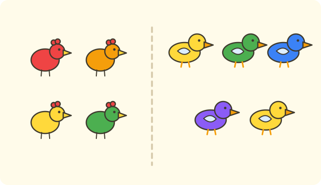

:::goals
- Understand that addition means putting two groups together.
- Read and write additions within $10$, for example $3+2=5$.
- Work them out by counting on and know you can swap the two numbers.
- Solve a word problem with one addition.
:::

Lan has $3$ marbles. Mai gives Lan $2$ more marbles. How many marbles does Lan have altogether?

You already know that $5$ is made of $3$ and $2$. In this lesson you learn to write that as a sum.

## Let's explore

Lan has $3$ marbles. Mai gives $2$ more. Put the two groups together and count on from $3$.

- Say the first number: "three".
- Count on two more: "four, five".
- The last number is five.

So Lan has $5$ marbles altogether. We write $3+2=5$ and read it "three plus two equals five".

:::graph On the number line: from 3 count on 2 steps to 5
alt: A number line with the points 3, 4, 5; the stretch from 3 to 5 shows counting on two steps
x: -1..11
y: -1..1
segment: (3, 0) (5, 0)
point: (3, 0) "3" below
point: (4, 0) "4" below
point: (5, 0) "5" below
:::

:::theorem Addition
1. Putting two groups together is addition. The plus sign is $+$ and the equals sign is $=$.
2. To work out $3+2$, count on $2$ numbers from $3$: you get $5$.
3. Swap the two numbers and the answer stays the same: $3+2=2+3$.
4. Adding $0$ does not change the number: $7+0=7$.
:::

This works because when you put the group of $3$ and the group of $2$ together, no marble is lost. You just count them all.

## Examples

We start with a very small sum.

:::example Work out $4+1$
**Solution.** Say the first number "four", then count on one more: "five".

So $4+1=5$.
:::

Now count on more numbers.

:::example Work out $5+3$
**Solution.** Say the first number "five", then count on three more: "six, seven, eight".

So $5+3=8$.
:::

When the first number is small, swap to make counting easier.

:::example Work out $2+6$
**Solution.** Swapping the two numbers does not change the answer, so $2+6=6+2$. Count on two numbers from the bigger number $6$: "seven, eight".

So $2+6=8$.
:::

What about adding $0$?

:::example Work out $7+0$
**Solution.** Adding $0$ means adding nothing, so the number stays the same.

So $7+0=7$.
:::

Last, solve a word problem.

:::example Hens and ducks
Grandma has $4$ hens and $5$ ducks. How many hens and ducks does she have altogether?

**Solution.** "Altogether" means putting the two groups together, so we add. Count on $4$ numbers from the bigger number $5$: "six, seven, eight, nine":
$$4+5=5+4=9.$$
So Grandma has $9$ birds.
:::

:::warning Mistakes to watch out for
- **Counting the first number again.** Wrong: $3+2=6$ because you count "three, four, five, six". Why it is wrong: you counted on $3$ numbers instead of $2$. Right: count on exactly $2$ numbers: four, five. So $3+2=5$.
- **Putting the equals sign in the wrong place.** Wrong: writing $5=3+2$ and then mixing up how to read it. Why it is wrong: it is easy to mix up the answer and the sum. Right: write the sum first, the answer after the $=$ sign.
- **No unit in a word problem.** Wrong: "Answer: $9$". Right: "Answer: $9$ birds".
:::

## Key terms

:::terms
- addition | phép cộng
- plus ($+$) | cộng
- equals ($=$) | bằng
- put together | gộp
- altogether | tất cả
- swap | đổi chỗ
- number line | tia số
:::

## Summary

- Putting two groups together is addition: $3+2=5$.
- Count on from the first number as many times as the second number says.
- Swap the two numbers and the answer stays the same.
- Adding $0$ does not change the number.
- Questions with "altogether" usually need addition; remember the unit.

## Practice

Each exercise comes with what you need and how to start. Try it yourself first, then open the solution.

:::exercise
Work out $2+3$.

::hint
**What you need:** count on from the first number as many times as the second number.

**Steps:**
1. Say the first number: two.
2. Count on three more.

::solution
To work out $2+3$, from $2$ we count on three numbers: "three, four, five".

The last number we count is $5$, so $2+3=5$.

So $2+3=5$.

**Answer.** $2+3=5$.
:::

:::exercise
Work out $6+2$.

::hint
**What you need:** count on two numbers from the first number.

**Steps:**
1. Say the first number: six.
2. Count on two more.

::solution
To work out $6+2$, from $6$ we count on two numbers: "seven, eight".

The last number we count is $8$, so $6+2=8$.

So $6+2=8$.

**Answer.** $6+2=8$.
:::

:::exercise
Remember the last lesson: $7$ is made of $3$ and $4$. Write the matching sum and work out $3+4$.

::hint
**What you need:** if $7$ is made of $3$ and $4$, then putting $3$ and $4$ together gives $7$.

**Steps:**
1. Count on $3$ numbers from $4$.
2. Check with the number you know.

::solution
In the last lesson we learnt that $7$ is made of $3$ and $4$. The matching sum is $3+4=7$.

We work it out again by counting on. From $4$ we count on three numbers: "five, six, seven".

The last number we count is $7$, which equals the $7$ we already know.

So $3+4=7$.

**Answer.** $3+4=7$.
:::

:::exercise
Find the missing number:
a) $3+\square=5$.
b) $\square+4=6$.

::hint
**What you need:** $5$ is made of $3$ and what? $6$ is made of what and $4$?

**Steps:**
1. Count from $3$ to $5$.
2. Count from $4$ to $6$.

::solution
a) We need the number with $3+\square=5$. From $3$ to $5$ we count: "four, five", which is $2$ numbers, so the missing number is $2$. Check: $3+2=5$. Correct.

b) We need the number with $\square+4=6$. From $4$ to $6$ we count: "five, six", which is $2$ numbers, so the missing number is $2$. Check: $2+4=6$. Correct.

So the missing number in part a) is $2$ and in part b) it is $2$.

**Answer.** a) $2$. b) $2$.
:::

:::exercise
Nam says: "$4+3=8$ because I counted four, five, six, seven, eight." Is Nam right? Why?

::hint
**What you need:** count on only as many numbers as the second number, and do not count the first number again.

**Steps:**
1. How many numbers must you count on from $4$?
2. Count again correctly.

::solution
We work out $4+3$. From $4$ we only count on $3$ numbers: "five, six, seven". The last number is $7$, so $4+3=7$.

Nam counted "four, five, six, seven, eight", which is $5$ numbers. Nam counted the first number $4$ again, so he got $8$.

So Nam is wrong, and $4+3=7$.

**Answer.** No. $4+3=7$.
:::

:::exercise
Mai writes $5+0=0$. Where did Mai go wrong? Write it correctly.

::hint
**What you need:** adding $0$ does not change the number.

**Steps:**
1. How much do you add when you add $0$?
2. Compare with Mai's answer.

::solution
Adding $0$ to a number means adding nothing, so the number does not change. So $5+0=5$.

Mai's $5+0=0$ is wrong, because Mai thought that adding $0$ makes the result $0$. In fact the result is still the number we started with, which is $5$.

So Mai is wrong, and written correctly it is $5+0=5$.

**Answer.** $5+0=5$.
:::

:::exercise
Ha has $6$ exercise books. Mum buys $3$ more. How many exercise books does Ha have altogether?

::hint
**What you need:** "altogether" means putting together: use addition.

**Steps:**
1. What do we know? Ha has $6$ books and gets $3$ more. What is asked? How many books altogether.
2. Work out $6+3$ and write the answer with its unit.

::solution
Solution

Mum buys more books for Ha, so we add. The number of exercise books Ha has altogether is:
$$6+3=9\ \text{(books)}.$$

Check: count on three from $6$: "seven, eight, nine". Correct.

So Ha has $9$ exercise books altogether.

**Answer.** $9$ exercise books.
:::

:::exercise Challenge
$10$ flowers are put into two vases. The red vase has $4$ flowers. How many flowers are in the blue vase? Write the right sum.

::hint
**What you need:** $10$ is made of $4$ and the missing number; count from $4$ to $10$.

**Steps:**
1. Count from $4$ to $10$.
2. Write the sum: $4+\square=10$.

::solution
Solution

$10$ flowers are put into two vases, and the red vase has $4$ flowers. The number of flowers in the blue vase is the number we must add to $4$ to make $10$.

From $4$ to $10$ we count: "five, six, seven, eight, nine, ten", which is $6$ numbers. So the blue vase has $6$ flowers.

The right sum is:
$$4+6=10.$$

Check: $4+6=10$. Correct.

So the blue vase has $6$ flowers.

**Answer.** The blue vase has $6$ flowers; $4+6=10$.
:::

## Mini test

:::quiz
::mc NB
$4+3$ equals
A. $6$.
B. $7$.
C. $8$.
D. $1$.
::key B
Count on $3$ numbers from $4$: five, six, seven. Option D is $4-3$, a subtraction by mistake.

::mc NB
$5+0$ equals
A. $0$.
B. $6$.
C. $5$.
D. $4$.
::key C
Adding $0$ does not change the number. Option A is the mistake of thinking the answer is $0$.

::mc TH
Which sum equals $8$?
A. $5+2$.
B. $7+2$.
C. $4+3$.
D. $6+2$.
::key D
$6+2=8$. The other sums are $7$, $7$ and $9$.

::mc TH
There are $3$ cats and $6$ dogs. How many animals are there altogether?
A. $9$ animals.
B. $3$ animals.
C. $10$ animals.
D. $8$ animals.
::key A
"Altogether" means putting together: $3+6=9$. Option B takes only one group.

::tf NB TH NB NB
Look at the sum $2+6$.
a) $2+6=8$.
b) $6+2=8$.
c) $2+6=7$.
d) $2+6=9$.
::key T T F F
a) True: count on two from $6$ to get $8$. b) True: swap the two numbers. c) False. d) False.

::sa TH
Work out $5+4$.
::key 9
Count on $4$ numbers from $5$: six, seven, eight, nine.

::sa TH
Work out $7+3$.
::key 10
Count on $3$ numbers from $7$: eight, nine, ten.
:::
