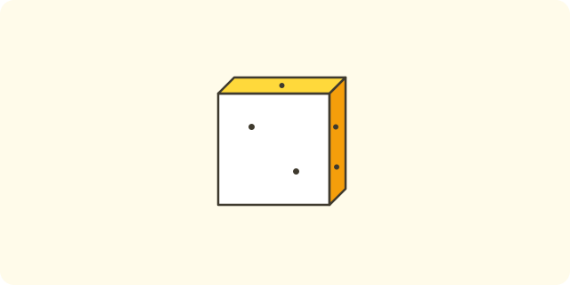
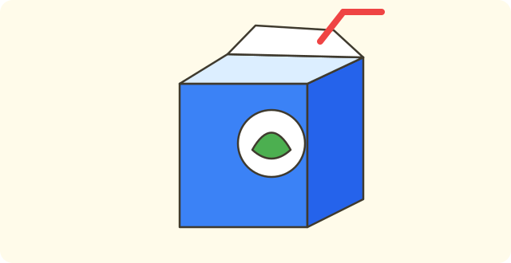
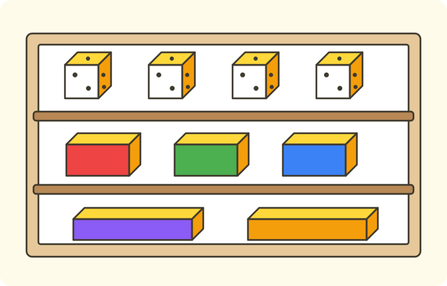
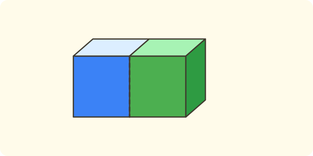

:::goals
- Spot cubes and cuboids.
- Know that each has $6$ faces and name the shape of the faces.
- Find these solid shapes in things around you.
:::

You have a dice and a box of chalk. Both are solid shapes, not flat like a sheet of paper. How are they different, and what do you call them?

In the last lesson you learned addition and subtraction. In this lesson you meet solid shapes.

## Let's explore

Hold the dice and feel its flat faces.

- The dice has $6$ faces.
- Each face is a square, and the squares are all the same.

Hold the box of chalk and feel its flat faces.

- The chalk box also has $6$ faces.
- Each face is a rectangle.

:::diagram A cube
alt: A drawing of a cube seen from an angle; visible edges are solid lines and hidden edges are dashed lines
point A 0,0 ""
point B 2,0 ""
point C 2,2 ""
point D 0,2 ""
point E 1,1 ""
point F 3,1 ""
point G 3,3 ""
point H 1,3 ""
segment A B
segment B C
segment C D
segment D A
segment D H
segment C G
segment H G
segment B F
segment F G
segment A E dashed
segment E F dashed
segment E H dashed
:::

:::theorem Two familiar solid shapes
1. A cube has $6$ faces, and each face is a square. For example: a dice.
2. A cuboid has $6$ faces, and each face is a rectangle. For example: a chalk box, a milk carton.
3. Squares and rectangles are flat shapes, but cubes and cuboids are solid shapes.
:::

This works because you only need to look at the faces: square faces mean a cube, rectangle faces mean a cuboid.

## Examples

We start with a familiar object.

:::example A dice
What solid shape is a dice?

**Solution.** Every face of the dice is a square, and they are all the same.

So the dice is a cube.
:::

Now name another solid shape.

:::example A milk carton
A milk carton has $6$ faces. All the faces are rectangles. What solid shape is it?

**Solution.** A solid shape whose faces are rectangles is a cuboid.

So the milk carton is a cuboid.
:::

Next, count the faces.

:::example Counting faces
How many faces does a cube have?

**Solution.** Count the faces of the dice: the top, the bottom and four faces around. You count: "one, two, three, four, five, six".

So a cube has $6$ faces.
:::

Last, count some solid shapes.

:::example Stacking blocks
You have $5$ cubes and $3$ cuboids. How many solid shapes do you have altogether?

**Solution.** "Altogether" means putting together, so we add:
$$5+3=8\ \text{(solid shapes)}.$$
So you have $8$ solid shapes.
:::

:::warning Mistakes to watch out for
- **Mixing up a flat shape and a solid shape.** Wrong: a square drawn on paper is a cube. Why it is wrong: a square is flat, and you cannot hold it like a block. Right: a square is a flat shape; a dice is a cube.
- **Mixing up a cuboid and a cube.** Wrong: a chalk box is a cube because it has $6$ faces. Why it is wrong: the faces of a chalk box are rectangles, not equal squares. Right: a chalk box is a cuboid.
- **Missing some faces.** Wrong: a cube has $4$ faces. Why it is wrong: you forgot the top and the bottom. Right: it has $6$ faces.
:::

## Key terms

:::terms
- cube | khối lập phương
- cuboid | khối hộp chữ nhật
- face | mặt
- solid shape | hình khối
- flat shape | hình phẳng
- dice | xúc xắc
:::

## Summary

- A cube has $6$ square faces (a dice).
- A cuboid has $6$ rectangle faces (a chalk box, a milk carton).
- Squares and rectangles are flat shapes; cubes and cuboids are solid shapes.

## Practice

Each exercise comes with what you need and how to start. Try it yourself first, then open the solution.

:::exercise
What solid shape is a dice?

::hint
**What you need:** a solid shape with square faces, all the same, is a cube.

**Steps:**
1. What shape are the faces of a dice?
2. Choose the name.

::solution
The faces of a dice are equal squares.

**Answer.** A cube.
:::

:::exercise
What solid shape is a chalk box?

::hint
**What you need:** a solid shape with rectangle faces is a cuboid.

**Steps:**
1. What shape are the faces of a chalk box?
2. Choose the name.

::solution
The faces of a chalk box are rectangles.

**Answer.** A cuboid.
:::

:::exercise
Remember the last lesson: work out $9-5$. Then check with addition.

::hint
**What you need:** count back five numbers from $9$; check with addition.

**Steps:**
1. Count back: eight, seven, six, five, four.
2. Work out $\square+5$.

::solution
Counting back gives $4$. Check: $4+5=9$. Correct.

**Answer.** $9-5=4$.
:::

:::exercise
a) What shape are the faces of a cube?
b) What shape are the faces of a cuboid?

::hint
**What you need:** remember the faces of a dice and a chalk box.

**Steps:**
1. Feel the faces of a dice.
2. Feel the faces of a chalk box.

::solution
a) The faces of a cube are squares. b) The faces of a cuboid are rectangles.

**Answer.** a) Squares. b) Rectangles.
:::

:::exercise
Nam says: "A chalk box is a cube because it has $6$ faces." Is Nam right? Why?

::hint
**What you need:** the faces of a cube are equal squares.

**Steps:**
1. Are the faces of a chalk box long and short?
2. Choose the right name.

::solution
The faces of a chalk box are rectangles, not squares. Nam is wrong.

**Answer.** No. A chalk box is a cuboid.
:::

:::exercise
Mai says: "A square drawn on paper is a cube." Where did Mai go wrong? Say it correctly.

::hint
**What you need:** a square is a flat shape; a cube is a solid shape.

**Steps:**
1. Can you hold a square drawn on paper like a dice?
2. Say it correctly.

::solution
A square on paper is a flat shape. A cube is a solid shape with $6$ square faces, like a dice.

**Answer.** A square is a flat shape; a dice is a cube.
:::

:::exercise
The table shows how many things are on a shelf:

| Thing | Dice | Biscuit boxes | Pencil cases |
|---|---|---|---|
| Number | $4$ | $3$ | $2$ |

a) How many cubes are there?
b) How many cuboids are there altogether?

::hint
**What you need:** a dice is a cube; a biscuit box and a pencil case are cuboids.

**Steps:**
1. Find the number of dice.
2. Put the biscuit boxes and pencil cases together.

::solution
a) There are $4$ dice. b) $3+2=5$.

**Answer.** a) $4$ cubes. b) $5$ cuboids.
:::

:::exercise Challenge
You put two cubes side by side to make a long block. What solid shape is the new block? What shape is its long face?

::hint
**What you need:** two squares side by side make a rectangle.

**Steps:**
1. Put two squares side by side. What shape do you get?
2. Choose the name of the solid shape.

::solution
The long face is two squares joined, which is a rectangle. The new block has rectangle faces.

**Check.** The block looks like a chalk box. Correct.

**Answer.** A cuboid; its long face is a rectangle.
:::

## Mini test

:::quiz
::mc
A dice is the shape of a
A. cuboid.
B. cube.
C. not a solid shape.
D. cannot tell.
::key B
The faces of a dice are equal squares.

::mc
A long pencil case has rectangle faces. It is the shape of a
A. cube.
B. not a solid shape.
C. cuboid.
D. cannot tell.
::key C
A solid shape with rectangle faces is a cuboid. Option A is the mistake of mixing it up with a dice.

::mc
Each face of a cube is a
A. circle.
B. triangle.
C. rectangle.
D. square.
::key D
The faces of a cube are squares. Option C mixes it up with a cuboid.

::mc
Which thing is the shape of a cuboid?
A. A ball.
B. A biscuit box.
C. A dice.
D. A clock face.
::key B
A biscuit box has rectangle faces. A dice is a cube.

::tf
Look at these solid shapes.
a) A dice is a cube.
b) The faces of a cube are circles.
c) A chalk box is the shape of a cuboid.
d) A cuboid has $4$ faces.
::key T F T F
a) True. b) False: the faces are squares. c) True. d) False: a cuboid has $6$ faces.

::sa
How many faces does a cube have?
::key 6
Count: the top, the bottom and four faces around, $6$ faces in all.

::sa
You have $3$ cubes and $4$ cuboids. How many solid shapes do you have altogether?
::key 7
Put together: $3+4=7$.
:::
