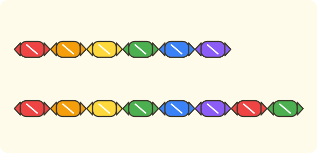

:::goals
- Compare two numbers from $0$ to $10$.
- Use the signs $>$, $<$, $=$ correctly.
- Find the greatest and the least number in a group.
- Put numbers in order from least to greatest.
:::

Lan has $6$ sweets and Nam has $8$ sweets. Who has more sweets? How do you write that with signs?

In the last lesson you matched pairs to find which group has more. Now you compare two numbers straight away, with no matching.

## Let's explore

Look at the numbers in a row on a number line.

- A number on the right is counted later, so it is greater.
- A number on the left is counted earlier, so it is less.

The number $6$ is to the left of $8$. So $6$ is less than $8$, and $8$ is greater than $6$.

:::graph On the number line, the number on the right is greater
alt: A number line from 0 to 10 with 6 and 8 marked; 8 is to the right of 6
x: -1..11
y: -1..1
segment: (0, 0) (10, 0)
point: (6, 0) "6" below
point: (8, 0) "8" below
:::

You use these signs. The open mouth of each sign faces the greater number.

- $8>6$ is read "eight is greater than six".
- $6<8$ is read "six is less than eight".
- $5=5$ is read "five is equal to five".

:::theorem Comparing two numbers
1. The number on the right of the number line (counted later) is greater.
2. Two numbers that are the same are equal.
3. The signs $>$ and $<$ always open towards the greater number.
:::

This works because when you count, each number is one more thing than the number before. The number counted later has more things.

## Examples

We start with the question from the beginning.

:::example Lan's and Nam's sweets
Lan has $6$ sweets and Nam has $8$ sweets. Compare $8$ and $6$.

**Solution.** On the number line, $8$ is to the right of $6$, so $8$ is greater than $6$.

So $8>6$, and Nam has more sweets.
:::

Sometimes the two numbers are the same.

:::example Two equal numbers
Write the right sign: $4 \;\square\; 4$.

**Solution.** The two numbers are the same, so they are equal.

So $4=4$.
:::

Next, the first number is less than the second.

:::example Fill in the sign
Write the right sign: $3 \;\square\; 9$.

**Solution.** On the number line, $3$ is to the left of $9$, so $3$ is less than $9$. The mouth of the sign opens towards $9$.

So $3<9$.
:::

Last, put three numbers in order.

:::example Putting numbers in order
Put the numbers $7, 2, 9$ in order from least to greatest.

**Solution.** First find the least number: $2$. Of the other two, $7$ is less than $9$.

So the order is $2, 7, 9$.

**Check.** $2<7$ and $7<9$. Correct.
:::

:::warning Mistakes to watch out for
- **Opening the sign the wrong way.** Wrong: $4<2$. Why it is wrong: the mouth must open towards the greater number, and $4$ is greater than $2$. Right: $4>2$.
- **Thinking the number that comes first is greater.** Wrong: $5>8$ because $5$ comes first. Why it is wrong: the number counted later is greater. Right: $5<8$.
- **Forgetting that $0$ is the least.** Wrong: the least number in $0, 3, 6$ is $3$. Why it is wrong: $0$ is at the start of the row. Right: the least number is $0$.
:::

## Key terms

:::terms
- greater than ($>$) | lớn hơn
- less than ($<$) | bé hơn
- equal to ($=$) | bằng
- compare | so sánh
- greatest | lớn nhất
- least | bé nhất
- put in order | sắp xếp
- number line | tia số
:::

## Summary

- The number on the right of the number line is greater.
- $8>6$ is read eight is greater than six; $6<8$ is read six is less than eight; $5=5$ is read five is equal to five.
- The signs $>$ and $<$ open towards the greater number.
- To put numbers in order from least to greatest, find the least one first.

## Practice

Each exercise comes with what you need and how to start. Try it yourself first, then open the solution.

:::exercise
Write $>$, $<$ or $=$: $7 \;\square\; 5$.

::hint
**What you need:** the number on the right of the number line is greater.

**Steps:**
1. Which is counted later, $7$ or $5$?
2. Open the sign towards the greater number.

::solution
$7$ is counted after $5$, so $7$ is greater than $5$.

**Answer.** $7>5$.
:::

:::exercise
Write $>$, $<$ or $=$: $2 \;\square\; 6$.

::hint
**What you need:** the number on the left is the lesser.

**Steps:**
1. Which is counted first, $2$ or $6$?
2. Open the sign towards the greater number.

::solution
$2$ is counted before $6$, so $2$ is less than $6$.

**Answer.** $2<6$.
:::

:::exercise
Remember the last lesson: there are $4$ cups and $6$ spoons. Match them in pairs, then write a sign to compare the number of cups with the number of spoons.

::hint
**What you need:** the group that runs out first has fewer; fewer means the lesser number.

**Steps:**
1. Match each cup with one spoon.
2. Write the number of cups, the sign, the number of spoons.

::solution
When the $4$ cups are used up, $2$ spoons are left over, so there are fewer cups.

**Answer.** $4<6$.
:::

:::exercise
a) Which number is greater: $9$ or $10$?
b) Which number is less: $0$ or $3$?

::hint
**What you need:** the number counted later is greater.

**Steps:**
1. Count: ..., nine, ten.
2. Count: zero, one, two, three.

::solution
a) Ten is counted after nine, so $10$ is greater. b) Zero is counted before three, so $0$ is less.

**Answer.** a) $10$. b) $0$.
:::

:::exercise
Binh says: "$5>8$ because $5$ comes first." Is Binh right? Why?

::hint
**What you need:** the number counted later is the greater one.

**Steps:**
1. On the number line, which side of $8$ is $5$?
2. Which number is greater?

::solution
$5$ is to the left of $8$, so $5$ is less than $8$. Binh is wrong.

**Answer.** No. It should be $5<8$.
:::

:::exercise
Lan writes $4<2$ because she remembers "the mouth opens to the small number". Where did Lan go wrong? Write it correctly.

::hint
**What you need:** the mouth of the sign opens towards the greater number.

**Steps:**
1. Which is greater, $4$ or $2$?
2. The mouth must open towards that number.

::solution
$4$ is greater than $2$, so the mouth must open towards $4$.

**Answer.** $4>2$.
:::

:::exercise
The table shows how many marbles four children have:

| Child | An | Binh | Chi | Dung |
|---|---|---|---|---|
| Marbles | $6$ | $9$ | $6$ | $3$ |

a) Who has the most marbles?
b) Who has the fewest marbles?
c) Which two children have the same number of marbles?

::hint
**What you need:** find the greatest number, the least number and two numbers that are the same.

**Steps:**
1. Read the numbers: $6, 9, 6, 3$.
2. Compare each one.

::solution
a) The greatest number is $9$, Binh's. b) The least number is $3$, Dung's. c) An and Chi both have $6$.

**Answer.** a) Binh. b) Dung. c) An and Chi.
:::

:::exercise Challenge
a) Find the missing number: $6<\square<8$.
b) Find the missing numbers: $2<\square<5$.

::hint
**What you need:** the missing number sits between the two given numbers on the number line.

**Steps:**
1. Write the numbers from least to greatest.
2. Pick the ones in between.

::solution
a) Between $6$ and $8$ is $7$. b) Between $2$ and $5$ are $3$ and $4$.

**Check.** $6<7<8$; $2<3<5$; $2<4<5$. Correct.

**Answer.** a) $7$. b) $3$ or $4$.
:::

## Mini test

:::quiz
::mc
Which sign goes in $7 \;\square\; 4$?
A. $<$.
B. $>$.
C. $=$.
D. cannot tell.
::key B
$7$ is greater than $4$, so $7>4$. Option A opens the sign the wrong way.

::mc
Which sign goes in $3 \;\square\; 3$?
A. $<$.
B. $>$.
C. $=$.
D. cannot tell.
::key C
Two numbers that are the same are equal.

::mc
The greatest number in $5, 9, 2, 7$ is
A. $5$.
B. $9$.
C. $2$.
D. $7$.
::key B
$9$ is counted last. Option C is the least number.

::mc
Putting $6, 2, 8$ in order from least to greatest gives
A. $2, 6, 8$.
B. $8, 6, 2$.
C. $6, 2, 8$.
D. $2, 8, 6$.
::key A
$2<6<8$. Option B is from greatest to least.

::tf
Look at the two numbers $5$ and $8$.
a) $5<8$.
b) $8>5$.
c) $5>8$.
d) $5=8$.
::key T T F F
a) True. b) True. c) False: $5$ is less than $8$. d) False: the numbers are different.

::sa
What is the greatest number in $3, 10, 7$?
::key 10
Counting: ..., seven, ..., ten. The number $10$ comes last.

::sa
What is the least number in $4, 0, 6$?
::key 0
$0$ is at the start of the number row, so it is the least.
:::
