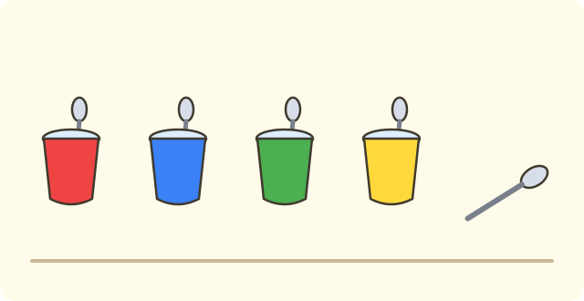
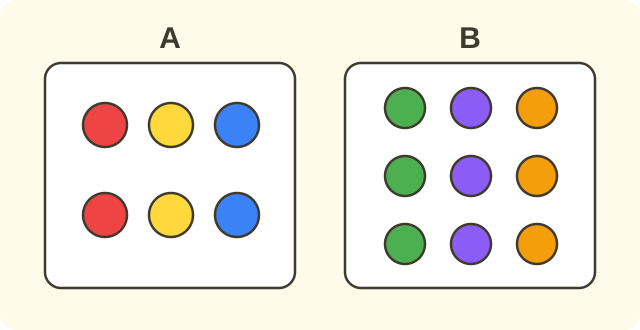

:::goals
- Match the things in two groups one pair at a time.
- Say which group has more, which has fewer, or that the two groups are the same.
- Say how many the bigger group has left over.
:::

On the table there are $4$ cups and $5$ spoons. Mum wants each cup to have one spoon. Are there more cups or more spoons?

You could count each group. But there is another way that needs no counting at all: match the things in pairs and see which side has some left.

## Let's explore

Let us put one spoon in each cup. One spoon for each cup, and never two spoons in the same cup.

- The first cup has one spoon. The second cup has one spoon.
- The third cup and the fourth cup also have one spoon each.
- All four cups have a spoon, but one spoon is left over.

One spoon is left over. The group with something left over is the group with more, so there are more spoons than cups. The cups ran out first, so there are fewer cups than spoons.

:::theorem Matching one to one
Match each thing in one group with one thing in the other group.
1. The group with things left over has **more**.
2. The group that runs out first has **fewer**.
3. If both groups run out together, they are **the same**.
:::

Why does matching tell us which group has more? Each pair uses up one thing from each group. So the group that still has things left is the one with more.

## Examples

We go back to the question at the start, about the cups and spoons on the table.

:::example Cups and spoons
There are $4$ cups and $5$ spoons. Which group has more? Which has fewer?

**Solution.** Match each cup with one spoon. When the $4$ cups are used up, $1$ spoon is left over.

So there are more spoons than cups, and fewer cups than spoons.
:::

Sometimes the matching ends with nothing left on either side. Here is an example.

:::example Children and hats
There are $3$ children and $3$ hats. Each child wears one hat. Which group has more?

**Solution.** Match each child with one hat. No child is without a hat and no hat is left over.

So the number of children and the number of hats are the same.
:::

Once you know which group has more, you can also say how many more it has. That is just the number left over.

:::example Red flowers and yellow flowers
In a pot there are $6$ red flowers and $8$ yellow flowers. Which group has more? How many are left over?

**Solution.** Match each red flower with one yellow flower. When the $6$ red flowers are used up, $2$ yellow flowers are left over.

So there are more yellow flowers than red flowers, by $2$ flowers.
:::

Matching also answers everyday questions, like whether every bird has a nest.

:::example Birds and nests
There are $5$ birds and $4$ nests. Each bird goes into one nest. Is any bird without a nest?

**Solution.** Match each nest with one bird. When the $4$ nests are used up, $1$ bird is left over.

So $1$ bird has no nest.
:::

:::warning Mistakes to watch out for
- **Thinking big means many.** Many children mix these up. Wrong: the big box has more marbles. Why it is wrong: a big box may not have many marbles. Right: match or count the marbles.
- **Matching one thing twice.** Wrong: one cup gets two spoons. Why it is wrong: the result is thrown off. Right: one spoon for each cup.
- **Mixing up "more" and "fewer".** Wrong: the group with things left over has fewer. Why it is wrong: it has more things. Right: the group with things left over has more.
:::

## Key terms

:::terms
- more | nhiều hơn
- fewer | ít hơn
- the same | bằng nhau
- match one to one | ghép một với một
- group | nhóm
- left over | thừa
:::

## Summary

- Match one to one: each thing in one group goes with one thing in the other group.
- The group with things left over has more; the group that runs out first has fewer.
- If both groups run out together, they are the same.
- A bigger thing does not always mean more things.

Back to the opening question: a spoon is left over, so there are more spoons than cups. Remember to use each thing only once, look at which side has some left, and then try some exercises.

## Practice

Each exercise has the key idea and a hint to get you started. Try it yourself first, look at the hint if you are stuck, and open the solution last. Going slowly is fine.

:::exercise
There are $3$ cups and $4$ spoons. Which group has more?

::hint
**What you need:** match in pairs; the group with things left over has more.

**Steps:**
1. Match each cup with one spoon.
2. See which group has things left over.

::solution
We match each cup with one spoon. There are $3$ cups, so $3$ spoons are matched.

The number of spoons left over is:
$$4-3=1\ \text{(spoon)}$$

The cups are used up but $1$ spoon is still left over, so there are more spoons than cups.

So there are more spoons than cups.

**Answer.** There are more spoons than cups.
:::

:::exercise
There are $5$ children and $5$ hats. Each child wears one hat. What can you say about the two groups?

::hint
**What you need:** if both groups run out together, they are the same.

**Steps:**
1. Match each child with one hat.
2. Is anything left over?

::solution
Each child wears one hat, so we match each child with one hat.

There are $5$ children and $5$ hats, so after matching, no child is without a hat and no hat is left over.

So the number of children is the same as the number of hats.

**Answer.** The number of children is the same as the number of hats.
:::

:::exercise
Remember the last lesson. a) Fill in the box: $6, 7, \square, 9, 10$. b) There are $7$ fish and $9$ prawns. Which group has fewer?

::hint
**What you need:** a row goes in counting order; match in pairs to find the group that runs out first.

**Steps:**
1. Say: six, seven, ...
2. Match each fish with one prawn.

::solution
a) We count: $6, 7, 8, 9, 10$. After $7$ comes $8$, so the number for the box is $8$.

b) We match each fish with one prawn. There are $7$ fish, so $7$ prawns are matched.

The number of prawns left over is:
$$9-7=2\ \text{(prawns)}$$

The fish are used up but $2$ prawns are still left over, so the fish ran out first. That means there are fewer fish than prawns.

So a) the number for the box is $8$; b) there are fewer fish than prawns.

**Answer.** a) $8$. b) There are fewer fish than prawns.
:::

:::exercise
There are $6$ birds and $4$ nests. Each bird goes into one nest. Is any bird without a nest? How many?

::hint
**What you need:** match each nest with one bird; the left over ones have no nest.

**Steps:**
1. Match $4$ nests with $4$ birds.
2. Count the birds left.

::solution
Solution

We match each bird with one nest. There are $4$ nests, so $4$ birds are matched.

The number of birds without a nest is:
$$6-4=2\ \text{(birds)}$$

The nests are used up but some birds are still left over, so there are birds without a nest.

So $2$ birds have no nest.

**Answer.** $2$ birds have no nest.
:::

:::exercise
A big box has $3$ marbles and a small box has $5$ marbles. Binh says: "The big box has more marbles." Is Binh right? Why?

::hint
**What you need:** "more" is about how many, not how big the box is.

**Steps:**
1. Match the marbles of the two boxes.
2. See which group has some left over.

::solution
We match each marble of the big box with one marble of the small box. The big box has $3$ marbles, so $3$ marbles of the small box are matched.

The number of marbles left over in the small box is:
$$5-3=2\ \text{(marbles)}$$

The marbles of the big box are used up but $2$ marbles of the small box are still left over, so the small box has more marbles. Also $5>3$.

So Binh is wrong, because the small box has more marbles than the big box.

**Answer.** No. The small box has more marbles.
:::

:::exercise
Lan matches $4$ bowls with $4$ spoons and says: "There are more bowls than spoons." Where did Lan go wrong? What should she say?

::hint
**What you need:** if both groups run out, they are the same.

**Steps:**
1. After matching, is anything left over?
2. Choose: more, fewer or the same.

::solution
We match each bowl with one spoon. There are $4$ bowls and $4$ spoons, so after matching, no bowl is left over and no spoon is left over.

Since nothing is left over, the two groups are the same. Lan's sentence "There are more bowls than spoons" is wrong.

So Lan went wrong by saying there are more bowls than spoons; the right thing to say is that the number of bowls is the same as the number of spoons.

**Answer.** The number of bowls is the same as the number of spoons.
:::

:::exercise
The table shows how many sweets three children have:

| Child | Mai | Nam | Ha |
|---|---|---|---|
| Sweets | $5$ | $7$ | $5$ |

a) Who has more sweets than Mai?
b) Which two children have the same number of sweets?

::hint
**What you need:** match or count the sweets of each child.

**Steps:**
1. Compare Mai with each child.
2. Find two numbers that are the same.

::solution
By the table, Mai has $5$ sweets, Nam has $7$ sweets and Ha has $5$ sweets.

a) We compare each child's sweets with Mai's. Nam has $7$ sweets and $7>5$, so Nam has more sweets than Mai. Nam has $7-5=2$ more sweets than Mai. Ha has $5$ sweets, the same as Mai, so Ha does not have more than Mai. The child who has more sweets than Mai is Nam.

b) Mai and Ha both have $5$ sweets, while Nam has $7$ sweets. The two children with the same number of sweets are Mai and Ha.

So a) Nam has more sweets than Mai; b) Mai and Ha have the same number of sweets.

**Answer.** a) Nam. b) Mai and Ha.
:::

:::exercise Challenge
Group A has $6$ circles and group B has $9$ circles. How many circles must you draw in group A to make the two groups the same?

::hint
**What you need:** match group A with group B; the circles left over in B show how many to draw.

**Steps:**
1. Match $6$ circles of A with $6$ circles of B.
2. Count the circles left over in B.

::solution
Solution

We match each circle of group A with one circle of group B. Group A has $6$ circles, so $6$ circles of group B are matched.

The number of circles left over in group B is:
$$9-6=3\ \text{(circles)}$$

To make the two groups the same, we draw in group A as many circles as are left over in group B, that is $3$ circles.

Check: group A has $6$ circles, and after drawing $3$ more it has $6+3=9$ circles, the same as group B. Correct.

So we must draw $3$ more circles in group A.

**Answer.** $3$ circles.
:::

## Mini test

:::quiz
::mc TH
There are $5$ cups and $6$ spoons. Which group has more?
A. Cups.
B. The same.
C. Spoons.
D. Cannot tell.
::key C
Matching $5$ cups with $5$ spoons leaves $1$ spoon, so there are more spoons. Option A picks the group that ran out first.

::mc NB
There are $4$ hats and $4$ children, one hat each. What can you say about the two groups?
A. More hats.
B. More children.
C. Cannot tell.
D. The same.
::key D
Nothing is left over after matching, so the two groups are the same.

::mc TH
Matching $7$ flowers with $5$ vases leaves $2$ flowers. Which group has fewer?
A. Vases.
B. Flowers.
C. The same.
D. Cannot tell.
::key A
The vases ran out first, so there are fewer vases. Option B picks the group left over.

::mc TH
The small box has $7$ marbles and the big box has $4$ marbles. Which box has more marbles?
A. The big box.
B. The small box.
C. The same.
D. Cannot tell.
::key B
$7$ marbles are more than $4$ marbles. Option A confuses big with many.

::tf TH TH TH NB
There are $3$ hens and $5$ ducks. Each hen is matched with one duck.
a) There are more ducks than hens.
b) There are more hens than ducks.
c) $2$ ducks are left over.
d) The hens and ducks are the same.
::key T F T F
a) True. b) False: the hens ran out first. c) True: after matching $3$ hens, $2$ ducks are left. d) False.

::sa TH
There are $8$ oranges and $5$ plates, one orange on each plate. How many oranges are left over?
::key 3
Matching $5$ plates with $5$ oranges leaves $3$ oranges.

::sa TH
There are $7$ birds and $6$ nests, one bird in each nest. How many birds are left over?
::key 1
Matching $6$ nests with $6$ birds leaves $1$ bird.
:::
