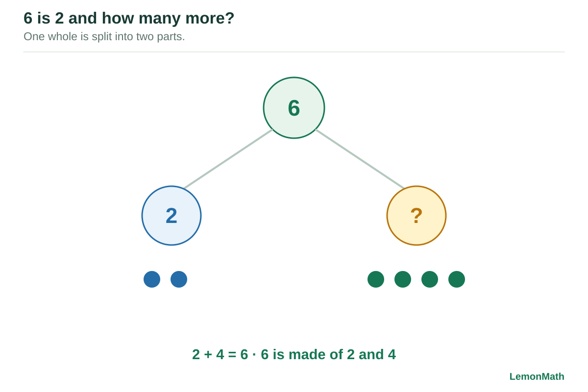
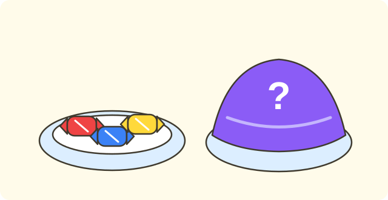

:::goals
- Know that a number is made of two smaller numbers, for example $5$ is made of $2$ and $3$.
- Find the missing part when you know the whole and one part.
- Know that swapping the two parts does not change the whole.
:::

Lan has $5$ marbles. She holds $2$ of them in her left hand and puts the rest in her right hand. Can you guess how many marbles are in her right hand?

You can already count and compare numbers up to $10$. But what if some of the marbles are hidden in a hand? Once you know how to split a number into two parts, you can work out the part you cannot see.

## Let's explore

Let us try it with $5$ marbles. You can share them between your two hands in more than one way. The table shows each way.

| Left hand | Right hand |
|---|---|
| $1$ | $4$ |
| $2$ | $3$ |
| $3$ | $2$ |
| $4$ | $1$ |

Look at each row. The two hands together always make all $5$ marbles, whichever row you choose. We have a way of saying this: $5$ is made of $1$ and $4$; $5$ is made of $2$ and $3$; $5$ is made of $3$ and $2$; $5$ is made of $4$ and $1$.

Back to Lan's question. The row that matches her left hand gives the answer: she has $3$ marbles in her right hand.

:::theorem Number bonds
1. A number can be made of two smaller numbers. For example, $5$ is made of $2$ and $3$.
2. Swap the two parts and the whole stays the same: $5$ is made of $3$ and $2$.
3. If you know the whole and one part, you find the other part by counting on or by matching.
:::

Why does this work? When you share the marbles between two hands, no marble is lost. The two hands together are still the whole group, however you share them.

## Examples

We begin with a small group: the number $4$.

:::example $4$ is made of $1$ and what
$4$ is made of $1$ and $\square$. Find the missing number.

**Solution.** You have $4$ marbles and take away $1$. You count the marbles left: "one, two, three".

So $4$ is made of $1$ and $3$.
:::

Does the method change for a bigger group? Have a go and see.

:::example $6$ is made of $2$ and what
$6$ is made of $2$ and $\square$. Find the missing number.

**Solution.** Count on from $2$ to $6$: "three, four, five, six". You counted $4$ numbers.

So $6$ is made of $2$ and $4$.

**Check.** $6$ is made of $4$ and $2$ (swapped). Correct.

:::

You may already know one way to split a number. Then just swap the two parts.

:::example Swapping the two parts
You know $7$ is made of $3$ and $4$. What is $7$ made of $4$ and?

**Solution.** Swapping the parts does not change the whole. So the other part of $4$ is $3$.

So $7$ is made of $4$ and $3$.
:::

What about sharing sweets between two plates? Splitting helps here too.

:::example Sharing sweets on two plates
$8$ sweets are shared between two plates. The first plate has $3$ sweets. How many sweets are on the second plate?

**Solution.** You need to know what $8$ is made of $3$ and. Count on from $3$ to $8$: "four, five, six, seven, eight". You counted $5$ numbers.

So the second plate has $5$ sweets.
:::

:::warning Mistakes to watch out for
- **Parts that do not make the whole.** Wrong: $6$ is made of $4$ and $3$. Why it is wrong: put $4$ and $3$ together and you get seven, not six. Right: $6$ is made of $4$ and $2$.
- **Forgetting that swapping still works.** Wrong: thinking $7$ is made of $3$ and $4$ but not of $4$ and $3$. Why it is wrong: swapping the parts does not change the whole. Right: both are correct.
- **Counting the number you already know.** Wrong: $6$ is made of $2$ and $5$ because you count "two, three, four, five, six". Why it is wrong: you counted the $2$ as well. Right: count on after $2$ to get $4$ numbers.
Many children slip up here, so do not worry if you do too. Go slowly and point to each marble as you count.
:::

## Key terms

:::terms
- is made of | gồm
- split a number | tách số
- two parts | hai phần
- number bonds | mấy và mấy
- whole | số lớn
- swap | đổi chỗ
:::

## Summary

- A number can be made of two smaller numbers: $5$ is made of $2$ and $3$.
- Swap the two parts and the whole stays the same.
- If you know the whole and one part, you count on from the known part to the whole to find the missing part.
- The two parts must make the whole group.
Do you remember Lan's question? One hand holds the part you know, the other holds the missing part, and together the two hands still make all the marbles. Do a few more exercises and splitting numbers will soon feel natural.

## Practice

Each exercise comes with what you need to remember and a hint to start you off. Try it yourself first, then open the solution. If the answer does not come at once, do not worry. Take it one step at a time.

:::exercise
$3$ is made of $1$ and $\square$. Find the missing number.

::hint
**What you need:** count on from the known part to the whole.

**Steps:**
1. Start from $1$.
2. Count up to $3$ and see how many numbers you say.

::solution
We count on from $1$ up to $3$: "two, three". We count $2$ more numbers.

Check: $1+2=3$. Correct.

So $3$ is made of $1$ and $2$.

**Answer.** $2$.
:::

:::exercise
$5$ is made of $4$ and $\square$. Find the missing number.

::hint
**What you need:** count on from $4$ to $5$.

**Steps:**
1. Start from $4$.
2. Count up to $5$.

::solution
We count on from $4$ up to $5$: "five". We count $1$ more number.

Check: $4+1=5$. Correct.

So $5$ is made of $4$ and $1$.

**Answer.** $1$.
:::

:::exercise
Remember the last lesson. a) Write $>$, $<$ or $=$: $6 \;\square\; 8$. b) $6$ is made of $2$ and $\square$.

::hint
**What you need:** the number on the right of the number line is greater; count on to find the missing part.

**Steps:**
1. Which is counted later, $6$ or $8$?
2. Count from $2$ to $6$.

::solution
a) When we count, the number $6$ is counted before $8$, so $6$ is less than $8$. We write the sign $<$:
$$6<8.$$

b) We count on from $2$ up to $6$: "three, four, five, six". We count $4$ more numbers.

Check: $2+4=6$. Correct.

So a) $6<8$; b) $6$ is made of $2$ and $4$.

**Answer.** a) $6<8$. b) $4$.
:::

:::exercise
a) $7$ is made of $5$ and $\square$.
b) $7$ is made of $3$ and $\square$.

::hint
**What you need:** count on from the known part to $7$.

**Steps:**
1. Part a) starts from $5$.
2. Part b) starts from $3$.

::solution
a) We count on from $5$ up to $7$: "six, seven". We count $2$ more numbers. Check: $5+2=7$. Correct.

b) We count on from $3$ up to $7$: "four, five, six, seven". We count $4$ more numbers. Check: $3+4=7$. Correct.

So a) $7$ is made of $5$ and $2$; b) $7$ is made of $3$ and $4$.

**Answer.** a) $2$. b) $4$.
:::

:::exercise
Ha says: "$6$ is made of $4$ and $3$." Is Ha right? Why?

::hint
**What you need:** the two parts must make the whole.

**Steps:**
1. From $4$ count on $3$ numbers: five, six, seven.
2. Which number do you reach?

::solution
Ha says $6$ is made of $4$ and $3$. We check by counting on $3$ numbers from $4$: "five, six, seven". We reach $7$, not $6$.

To count from $4$ up to $6$: "five, six", we only need to count $2$ more numbers. Check: $4+2=6$. Correct.

So Ha is wrong; $6$ is made of $4$ and $2$.

**Answer.** No. $6$ is made of $4$ and $2$.
:::

:::exercise
Nam splits the number $8$ into $5$ and $2$. Where did Nam go wrong? What is the right split?

::hint
**What you need:** the two parts must make all of $8$.

**Steps:**
1. Count from $5$ to $8$ to see how many more are needed.
2. Compare with Nam's $2$.

::solution
Nam splits $8$ into $5$ and $2$. We check: counting on $2$ numbers from $5$ gives "six, seven", which reaches $7$, not $8$.

To count from $5$ up to $8$: "six, seven, eight", we need to count $3$ more numbers. Check: $5+3=8$. Correct.

So Nam went wrong by choosing the number $2$; the right split is that $8$ is made of $5$ and $3$.

**Answer.** $8$ is made of $5$ and $3$.
:::

:::exercise
$9$ balloons are shared between two bags. The red bag has $6$ balloons. How many balloons are in the blue bag?

::hint
**What you need:** $9$ is made of $6$ and the missing part; count on from $6$ to $9$.

**Steps:**
1. What do we know? There are $9$ balloons and the red bag has $6$.
2. Count from $6$ to $9$.

::solution
Solution

The number of balloons in the blue bag is the number we must count on from $6$ to reach $9$. We count on from $6$ up to $9$: "seven, eight, nine". We count $3$ more numbers.

Check: $6+3=9$. Correct.

So the blue bag has $3$ balloons.

**Answer.** The blue bag has $3$ balloons.
:::

:::exercise Challenge
Write all the ways to split the number $4$ into two numbers, both greater than $0$ (swapped parts count as a different way).

::hint
**What you need:** try $1$, $2$, $3$ as the first part and find the other part.

**Steps:**
1. First part $1$: what is the other part?
2. Carry on with first parts $2$ and $3$.

::solution
Solution

We split the number $4$ into two numbers that are both greater than $0$, taking the first part to be $1$, $2$, $3$ in turn.

First part $1$: counting on from $1$ up to $4$: "two, three, four", gives $3$. So $4$ is made of $1$ and $3$.

First part $2$: counting on from $2$ up to $4$: "three, four", gives $2$. So $4$ is made of $2$ and $2$.

First part $3$: counting on from $3$ up to $4$: "four", gives $1$. So $4$ is made of $3$ and $1$.

Check: $1+3=4$, $2+2=4$, $3+1=4$. Each pair makes $4$.

So there are $3$ ways to split: $4$ is made of $1$ and $3$; $2$ and $2$; $3$ and $1$.

**Answer.** $4$ is made of $1$ and $3$; $2$ and $2$; $3$ and $1$.
:::

## Mini test

:::quiz
::mc NB
$5$ is made of $2$ and
A. $2$.
B. $7$.
C. $4$.
D. $3$.
::key D
Count from $2$ to $5$: "three, four, five", which is $3$ numbers. Option B joins the two numbers instead of finding the missing part.

::mc NB
$6$ is made of $4$ and
A. $2$.
B. $1$.
C. $3$.
D. $10$.
::key A
From $4$ to $6$ is $2$ numbers. Option B misses one number.

::mc TH
Which split is right for the number $7$?
A. $5$ and $3$.
B. $3$ and $4$.
C. $6$ and $2$.
D. $4$ and $4$.
::key B
Only $3$ and $4$ make $7$. Options A, C and D all make $8$.

::mc NB
$8$ is made of $5$ and
A. $2$.
B. $4$.
C. $3$.
D. $13$.
::key C
From $5$ to $8$ is $3$ numbers. Option A misses one number.

::tf NB NB TH TH
Look at the number $6$.
a) $6$ is made of $1$ and $5$.
b) $6$ is made of $2$ and $4$.
c) $6$ is made of $3$ and $4$.
d) $6$ is made of $5$ and $1$.
::key T T F T
a) True. b) True. c) False: $3$ and $4$ make seven. d) True: it is $1$ and $5$ swapped.

::sa TH
$9$ is made of $4$ and what?
::key 5
From $4$ to $9$: "five, six, seven, eight, nine", which is $5$ numbers.

::sa TH
$10$ is made of $7$ and what?
::key 3
From $7$ to $10$: "eight, nine, ten", which is $3$ numbers.
:::
