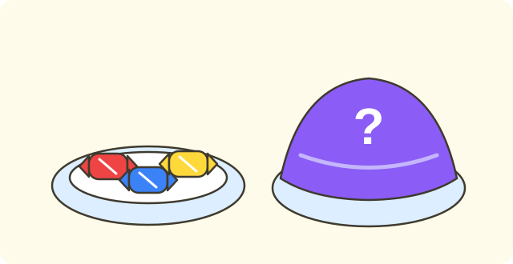

:::goals
- Know that a number is made of two smaller numbers, for example $5$ is made of $2$ and $3$.
- Find the missing part when you know the whole and one part.
- Know that swapping the two parts does not change the whole.
:::

Lan has $5$ marbles. She holds $2$ marbles in her left hand and the rest in her right hand. How many marbles are in her right hand?

You can already count and compare numbers up to $10$. In this lesson you learn to split a number into two parts.

## Let's explore

You have $5$ marbles and share them between two hands.

| Left hand | Right hand |
|---|---|
| $1$ | $4$ |
| $2$ | $3$ |
| $3$ | $2$ |
| $4$ | $1$ |

In every row, the two parts together make all $5$ marbles. We say: $5$ is made of $1$ and $4$; $5$ is made of $2$ and $3$; $5$ is made of $3$ and $2$; $5$ is made of $4$ and $1$.

So Lan has $3$ marbles in her right hand.

:::theorem Number bonds
1. A number can be made of two smaller numbers. For example, $5$ is made of $2$ and $3$.
2. Swap the two parts and the whole stays the same: $5$ is made of $3$ and $2$.
3. If you know the whole and one part, you find the other part by counting on or by matching.
:::

This works because when you share the marbles between two hands, no marble is lost. The two hands together are still the whole group.

## Examples

We start with the number $4$.

:::example $4$ is made of $1$ and what
$4$ is made of $1$ and $\square$. Find the missing number.

**Solution.** You have $4$ marbles and take away $1$. You count the marbles left: "one, two, three".

So $4$ is made of $1$ and $3$.
:::

Now try a bigger number.

:::example $6$ is made of $2$ and what
$6$ is made of $2$ and $\square$. Find the missing number.

**Solution.** Count on from $2$ to $6$: "three, four, five, six". You counted $4$ numbers.

So $6$ is made of $2$ and $4$.

**Check.** $6$ is made of $4$ and $2$ (swapped). Correct.
:::

Next, use swapping the two parts.

:::example Swapping the two parts
You know $7$ is made of $3$ and $4$. What is $7$ made of $4$ and?

**Solution.** Swapping the parts does not change the whole. So the other part of $4$ is $3$.

So $7$ is made of $4$ and $3$.
:::

Last, solve an everyday problem.

:::example Sharing sweets on two plates
$8$ sweets are shared between two plates. The first plate has $3$ sweets. How many sweets are on the second plate?

**Solution.** You need to know what $8$ is made of $3$ and. Count on from $3$ to $8$: "four, five, six, seven, eight". You counted $5$ numbers.

So the second plate has $5$ sweets.
:::

:::warning Mistakes to watch out for
- **Parts that do not make the whole.** Wrong: $6$ is made of $4$ and $3$. Why it is wrong: $4$ and $3$ together make seven, not six. Right: $6$ is made of $4$ and $2$.
- **Forgetting that swapping still works.** Wrong: $7$ is made of $3$ and $4$ but not of $4$ and $3$. Why it is wrong: swapping the parts does not change the whole. Right: both are correct.
- **Counting the number you already know.** Wrong: $6$ is made of $2$ and $5$ because you count "two, three, four, five, six". Why it is wrong: you counted the $2$ as well. Right: count on after $2$ to get $4$ numbers.
:::

## Key terms

:::terms
- is made of | gồm
- split a number | tách số
- two parts | hai phần
- number bonds | mấy và mấy
- whole | số lớn
- swap | đổi chỗ
:::

## Summary

- A number can be made of two smaller numbers: $5$ is made of $2$ and $3$.
- Swap the two parts and the whole stays the same.
- If you know the whole and one part, count on from the known part to the whole to find the missing part.
- The two parts must make the whole group.

## Practice

Each exercise comes with what you need and how to start. Try it yourself first, then open the solution.

:::exercise
$3$ is made of $1$ and $\square$. Find the missing number.

::hint
**What you need:** count on from the known part to the whole.

**Steps:**
1. Start from $1$.
2. Count up to $3$ and see how many numbers you say.

::solution
Count from $1$ to $3$: "two, three". That is $2$ numbers.

**Answer.** $2$.
:::

:::exercise
$5$ is made of $4$ and $\square$. Find the missing number.

::hint
**What you need:** count on from $4$ to $5$.

**Steps:**
1. Start from $4$.
2. Count up to $5$.

::solution
Count from $4$ to $5$: "five". That is $1$ number.

**Answer.** $1$.
:::

:::exercise
Remember the last lesson. a) Write $>$, $<$ or $=$: $6 \;\square\; 8$. b) $6$ is made of $2$ and $\square$.

::hint
**What you need:** the number on the right of the number line is greater; count on to find the missing part.

**Steps:**
1. Which is counted later, $6$ or $8$?
2. Count from $2$ to $6$.

::solution
a) $6$ is counted before $8$, so $6<8$. b) Count from $2$ to $6$: "three, four, five, six", which is $4$ numbers.

**Answer.** a) $6<8$. b) $4$.
:::

:::exercise
a) $7$ is made of $5$ and $\square$.
b) $7$ is made of $3$ and $\square$.

::hint
**What you need:** count on from the known part to $7$.

**Steps:**
1. Part a) starts from $5$.
2. Part b) starts from $3$.

::solution
a) Count from $5$ to $7$: "six, seven", which is $2$ numbers. b) Count from $3$ to $7$: "four, five, six, seven", which is $4$ numbers.

**Answer.** a) $2$. b) $4$.
:::

:::exercise
Ha says: "$6$ is made of $4$ and $3$." Is Ha right? Why?

::hint
**What you need:** the two parts must make the whole.

**Steps:**
1. From $4$ count on $3$ numbers: five, six, seven.
2. Which number do you reach?

::solution
From $4$, counting on $3$ numbers reaches seven, not six. Ha is wrong. From $4$ to $6$ you count only $2$ numbers.

**Answer.** No. $6$ is made of $4$ and $2$.
:::

:::exercise
Nam splits the number $8$ into $5$ and $2$. Where did Nam go wrong? What is the right split?

::hint
**What you need:** the two parts must make all of $8$.

**Steps:**
1. Count from $5$ to $8$ to see how many more are needed.
2. Compare with Nam's $2$.

::solution
From $5$ to $8$: "six, seven, eight", so $3$ numbers are needed. Nam's $2$ is wrong.

**Answer.** $8$ is made of $5$ and $3$.
:::

:::exercise
$9$ balloons are shared between two bags. The red bag has $6$ balloons. How many balloons are in the blue bag?

::hint
**What you need:** $9$ is made of $6$ and the missing part; count on from $6$ to $9$.

**Steps:**
1. What do we know? There are $9$ balloons and the red bag has $6$.
2. Count from $6$ to $9$.

::solution
Count from $6$ to $9$: "seven, eight, nine", which is $3$ numbers.

**Answer.** The blue bag has $3$ balloons.
:::

:::exercise Challenge
Write all the ways to split the number $4$ into two numbers, both greater than $0$ (swapped parts count as a different way).

::hint
**What you need:** try $1$, $2$, $3$ as the first part and find the other part.

**Steps:**
1. First part $1$: what is the other part?
2. Carry on with first parts $2$ and $3$.

::solution
First part $1$: counting from $1$ to $4$ gives $3$. First part $2$: gives $2$. First part $3$: gives $1$.

**Check.** Each pair makes $4$.

**Answer.** $4$ is made of $1$ and $3$; $2$ and $2$; $3$ and $1$.
:::

## Mini test

:::quiz
::mc
$5$ is made of $2$ and
A. $2$.
B. $7$.
C. $4$.
D. $3$.
::key D
Count from $2$ to $5$: "three, four, five", which is $3$ numbers. Option B joins the two numbers instead of finding the missing part.

::mc
$6$ is made of $4$ and
A. $2$.
B. $1$.
C. $3$.
D. $10$.
::key A
From $4$ to $6$ is $2$ numbers. Option B misses one number.

::mc
Which split is right for the number $7$?
A. $5$ and $3$.
B. $3$ and $4$.
C. $6$ and $2$.
D. $4$ and $4$.
::key B
Only $3$ and $4$ make $7$. Options A, C and D all make $8$.

::mc
$8$ is made of $5$ and
A. $2$.
B. $4$.
C. $3$.
D. $13$.
::key C
From $5$ to $8$ is $3$ numbers. Option A misses one number.

::tf
Look at the number $6$.
a) $6$ is made of $1$ and $5$.
b) $6$ is made of $2$ and $4$.
c) $6$ is made of $3$ and $4$.
d) $6$ is made of $5$ and $1$.
::key T T F T
a) True. b) True. c) False: $3$ and $4$ make seven. d) True: it is $1$ and $5$ swapped.

::sa
$9$ is made of $4$ and what?
::key 5
From $4$ to $9$: "five, six, seven, eight, nine", which is $5$ numbers.

::sa
$10$ is made of $7$ and what?
::key 3
From $7$ to $10$: "eight, nine, ten", which is $3$ numbers.
:::
