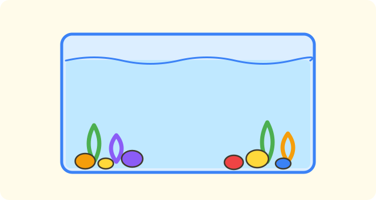

:::goals
- Count from $0$ to $5$ and say how many things there are.
- Read and write the numbers $0, 1, 2, 3, 4, 5$.
- Know that $0$ means there is nothing.
- Fill in the missing number in a row from $0$ to $5$.
:::

There is a plate of sweets on the table. Lan counts and says: "There are $4$ sweets." Then Lan eats every one of them. How many sweets are left on the plate now? And which number do you write for it?

You have been counting since nursery. Now let us write those numbers down neatly. We will also find out which number to write when the plate is empty.

## Let's explore

Let us count. Touch each thing once.

- There is one bird on a branch. You count: "one". We write the number $1$.
- There are two flowers in a vase. You count: "one, two". We write the number $2$.
- There are three oranges in a basket. You count: "one, two, three". We write the number $3$.
- There are four sweets on a plate. We write the number $4$.
- There are five balloons. We write the number $5$.
- There is no fish in the tank. We write the number $0$ and say "zero".
Do not worry if zero looks odd at first. When there is nothing to count, we simply write zero.

Now you can answer Lan's question. The plate is empty, just like the tank with no fish, so there are $0$ sweets on the plate.

:::graph The numbers from 0 to 5 in a row on a number line
alt: A number line with the points 0, 1, 2, 3, 4, 5 from left to right
x: -1..6
y: -1..1
segment: (0, 0) (5, 0)
point: (0, 0) "0" below
point: (1, 0) "1" below
point: (2, 0) "2" below
point: (3, 0) "3" below
point: (4, 0) "4" below
point: (5, 0) "5" below
:::

:::theorem How to use the numbers 0, 1, 2, 3, 4, 5
1. Each number tells you how many things there are.
2. When you count, say the numbers in order: zero, one, two, three, four, five.
3. If there is nothing, write $0$.
4. Count on one more and you get the number just after.
:::

Why does counting like this work? Each time you touch one thing, you say one number. Every thing gets its own number, so none is missed and none is counted twice. That is why the last number you say is how many things there are.

## Examples

We begin with something you know well: counting birds on a branch.

:::example Counting birds
There are three birds in a tree. Write the number of birds.

**Solution.** You count: "one, two, three". The last number you say is three.

So there are $3$ birds.
:::

A bigger group needs a little more care. Count slowly so that you do not miss any.

:::example Counting balloons
Nam holds five balloons. Write the number of balloons.

**Solution.** Count each balloon: "one, two, three, four, five". The last number is five.

So there are $5$ balloons.
:::

Here is a different case: sometimes there is nothing to count. What number do you write then?

:::example An empty fish tank
There is no fish in the tank. Write the number of fish.

**Solution.** There is no fish to count, so you write zero.

So there are $0$ fish.
:::

You know the counting order now, so you can find a number hidden in a row. Have a go.

:::example Fill in the row
Fill in the box: $0, 1, \square, 3, 4, 5$.

**Solution.** Count in order: zero, one, ..., three. After $1$ comes two, and then $3$.

So the missing number is $2$.

**Check.** Count the whole row again: zero, one, two, three, four, five. The order is right.
:::

:::warning Mistakes to watch out for
- **Missing one when counting.** Wrong: there are $4$ balloons but you count "one, two, three, five". Why it is wrong: you forgot four. Right: count "one, two, three, four" and get $4$ balloons.
- **Forgetting $0$.** Wrong: the vase has no flowers, but you write $1$. Why it is wrong: $1$ means one flower. Right: write $0$.
- **Counting one thing twice.** Wrong: touching the same orange two times. Why it is wrong: the answer is too big. Right: count each thing once and mark it when counted.
Many children slip up here. If you mark each thing as you count it, you can be sure of your answer.
:::

## Key terms

:::terms
- number | số
- count | đếm
- zero ($0$) | không
- one ($1$) | một
- two ($2$) | hai
- three ($3$) | ba
- four ($4$) | bốn
- five ($5$) | năm
- number line | tia số
:::

## Summary

- A number tells you how many things there are: $1, 2, 3, 4, 5$.
- If there is nothing, write $0$.
- Counting order: $0, 1, 2, 3, 4, 5$.
- Count each thing once; the last number you say is the answer.
Do you remember Lan's plate of sweets? When the sweets are gone there is nothing left to count, so we write zero. Practise a little more and counting and writing numbers will feel easy.

## Practice

Each exercise comes with what you need to remember and a hint to start you off. Try it yourself first, then open the solution. If the answer does not come at once, do not worry. Count it one step at a time.

:::exercise
There are three oranges in a basket. Write the number of oranges.

::hint
**What you need:** count each one; the last number is the answer.

**Steps:**
1. What do we know? Three oranges.
2. Write three as a digit.

::solution
There are three oranges in the basket. We count: one, two, three. The number "three" is written with the digit $3$.

So there are $3$ oranges in the basket.

**Answer.** $3$ oranges.
:::

:::exercise
Fill in the box: $0, 1, 2, \square, 4, 5$.

::hint
**What you need:** the numbers go in the order $0, 1, 2, 3, 4, 5$.

**Steps:**
1. Say the row: zero, one, two, ...
2. Which number is between $2$ and $4$?

::solution
We read the numbers in order from smallest to largest: $0, 1, 2$, then the box, then $4, 5$.

After $2$ comes $3$, and after $3$ comes $4$. So the number for the box is $3$.

Check: we read the whole row $0, 1, 2, 3, 4, 5$. Correct.

So the number to fill in is $3$.

**Answer.** $3$.
:::

:::exercise
You learned to count in nursery. Count the fingers on one hand and write the number.

::hint
**What you need:** count each finger once.

**Steps:**
1. Hold up one hand.
2. Count: one, two, three, four, five.

::solution
We count the fingers on one hand one by one: one, two, three, four, five. We count five fingers.

The number "five" is written with the digit $5$.

So one hand has $5$ fingers.

**Answer.** $5$ fingers.
:::

:::exercise
Mai's pencil case has no pens. Write the number of pens in it.

::hint
**What you need:** if there is nothing, write $0$.

**Steps:**
1. Is there any pen to count?
2. Choose the number for "nothing".

::solution
Mai's pencil case has no pens. When there is nothing, we write the number $0$.

So the number of pens in Mai's pencil case is $0$.

**Answer.** $0$ pens.
:::

:::exercise
A vase has no flowers. Lan writes that the number of flowers is $5$. Is Lan right? Why?

::hint
**What you need:** $0$ means nothing; $5$ means there are five.

**Steps:**
1. What do we know? The vase has no flowers.
2. Which number says "nothing"?

::solution
The vase has no flowers. When there is nothing, we write the number $0$, so the number of flowers in the vase is $0$.

Lan writes $5$, but $5$ is the number for five flowers. So what Lan wrote is not right.

So Lan is wrong; she should write $0$ for the number of flowers.

**Answer.** No. It should be $0$.
:::

:::exercise
Nam counts four balloons and says: "one, two, three, five". Where did Nam go wrong? What is the right count?

::hint
**What you need:** count every number in order: one, two, three, four.

**Steps:**
1. Read Nam's count again.
2. Find the number that is missing.

::solution
There are four balloons, so the right way to count is: one, two, three, four.

Nam counts: "one, two, three, five". After three, Nam jumps to five, which means he leaves out four.

So Nam went wrong by missing the number $4$; the right count is $1, 2, 3, 4$.

**Answer.** Nam missed $4$; the right count is $1, 2, 3, 4$.
:::

:::exercise
A school box holds: $4$ pencils, $2$ rubbers, $0$ rulers, $5$ felt pens. Which thing is not in the box?

::hint
**What you need:** the number $0$ means there is none of that thing.

**Steps:**
1. Find the number $0$ in the list.
2. Read the name next to it.

::solution
The box holds: $4$ pencils, $2$ rubbers, $0$ rulers, $5$ felt pens.

The number $0$ means there is none. The number $0$ is next to rulers, so the box has no ruler. The numbers $4$, $2$, $5$ are all different from $0$, so pencils, rubbers and felt pens are all in the box.

So the thing that is not in the box is the ruler.

**Answer.** The ruler.
:::

:::exercise Challenge
Fill in the boxes (count backwards): $5, \square, 3, \square, 1, \square$.

::hint
**What you need:** counting backwards means saying the numbers from big to small.

**Steps:**
1. Say: five, ..., three.
2. What comes after $3$? What comes after $1$?

::solution
We count backwards, going down by one each time: $5, 4, 3, 2, 1, 0$.

The number between $5$ and $3$ is $4$. The number between $3$ and $1$ is $2$. The number after $1$ is $0$.

Check: we read forwards from $0$ to $5$: $0, 1, 2, 3, 4, 5$. Correct.

So the numbers for the boxes are $4$, $2$, $0$ in order.

**Answer.** $4$, $2$, $0$.
:::

## Mini test

:::quiz
::mc NB
There are four balloons. Which number do you write?
A. $3$.
B. $4$.
C. $5$.
D. $0$.
::key B
Four is written $4$. Option A is the mistake of missing one balloon.

::mc NB
There are no flowers in the vase. The number of flowers is
A. $0$.
B. $1$.
C. $5$.
D. $4$.
::key A
Nothing is written $0$. Option B mixes it up with one flower.

::mc NB
Fill in the row $0, 1, 2, \square, 4, 5$.
A. $1$.
B. $2$.
C. $3$.
D. $5$.
::key C
After $2$ comes $3$, then $4$. Option B repeats the number $2$.

::mc NB
When you count, which number comes just after $4$?
A. $3$.
B. $4$.
C. $5$.
D. $0$.
::key C
Count on one after four and you get five, written $5$. Option A is the number before.

::tf NB NB TH TH
Look at the numbers $0, 1, 2, 3, 4, 5$.
a) The number $3$ is read "three".
b) If there is no bird on the branch, the number of birds is $0$.
c) When you count, $5$ comes before $4$.
d) The row $0, 1, 2, 3, 4, 5$ has six numbers.
::key T T F T
a) True. b) True: nothing is written $0$. c) False: when you count, $4$ comes before $5$. d) True: zero, one, two, three, four, five make six numbers.

::sa TH
Count backwards: $5, 4, 3, \square, 1$. Which number goes in the box?
::key 2
After $3$ comes $2$, then $1$.

::sa NB
Which number comes just after $3$?
::key 4
Count: three, four. The number just after $3$ is $4$.
:::
