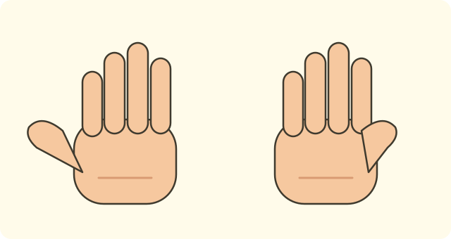
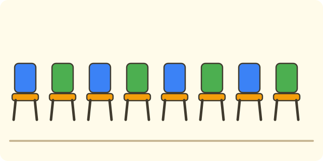

:::goals
- Count up to $10$ and say how many things there are.
- Read and write the numbers $6, 7, 8, 9, 10$.
- Know the number after a given number.
- Fill in the missing number in a row from $0$ to $10$.
:::

There are some marbles in a box. Mai counts each one and says: "There are $8$ marbles." How does Mai know she counted right, and how do you write the number $8$?

In the last lesson you learned the numbers from $0$ to $5$. Now you learn five new numbers: $6, 7, 8, 9, 10$.

## Let's explore

Count the things, one at a time.

- There are six pencils. You count: "one, two, three, four, five, six". We write the number $6$.
- There are seven leaves. We write the number $7$.
- There are eight marbles. We write the number $8$.
- There are nine eggs. We write the number $9$.
- Two hands have ten fingers. We write the number $10$.

The number $10$ is written with two digits: the digit $1$ first, then the digit $0$.

Count on one more after $5$ and you get $6$. We say $6$ is the number after $5$.

:::graph The numbers from 0 to 10 in a row on a number line
alt: A number line with the points from 0 to 10; the numbers 6, 7, 8, 9, 10 are to the right of 5
x: -1..11
y: -1..1
segment: (0, 0) (10, 0)
point: (5, 0) "5" below
point: (6, 0) "6" below
point: (7, 0) "7" below
point: (8, 0) "8" below
point: (9, 0) "9" below
point: (10, 0) "10" below
:::

:::theorem The numbers from 0 to 10
1. The counting order is $0, 1, 2, 3, 4, 5, 6, 7, 8, 9, 10$.
2. Count on one more and you get the number after.
3. The number $10$ is written with the digit $1$, then the digit $0$.
:::

This works because each number is exactly one more thing than the number before. You stop at the number where you finish counting.

## Examples

We start with counting pencils.

:::example Counting pencils
There are six pencils in a box. Write the number of pencils.

**Solution.** You count: "one, two, three, four, five, six". The last number is six.

So there are $6$ pencils.
:::

Now count fingers.

:::example Counting fingers
How many fingers are on your two hands?

**Solution.** Each hand has $5$ fingers. Count the first hand up to $5$, then carry on: "six, seven, eight, nine, ten".

So two hands have $10$ fingers.
:::

Next, find the number after.

:::example The number after
Find the number just after $8$.

**Solution.** You count: "... seven, eight, nine". After eight comes nine.

So the number after $8$ is $9$.
:::

Last, fill in the missing number in a row.

:::example Fill in the row
Fill in the box: $6, 7, \square, 9, 10$.

**Solution.** Say: "six, seven, ..., nine". After seven comes eight, and then nine.

So the missing number is $8$.

**Check.** Say the whole row: six, seven, eight, nine, ten. The order is right.
:::

:::warning Mistakes to watch out for
- **Missing one when counting.** Wrong: there are $8$ chairs but you count "one, ..., six, eight". Why it is wrong: you forgot seven. Right: count "..., six, seven, eight" and get $8$ chairs.
- **Writing $10$ backwards.** Wrong: writing $01$. Why it is wrong: the digit $1$ must come first. Right: write $10$.
- **Mixing up the number after and the number before.** Wrong: the number after $8$ is $7$. Why it is wrong: $7$ comes before $8$. Right: the number after $8$ is $9$.
:::

## Key terms

:::terms
- six ($6$) | sáu
- seven ($7$) | bảy
- eight ($8$) | tám
- nine ($9$) | chín
- ten ($10$) | mười
- digit | chữ số
- the number after | số liền sau
- number line | tia số
:::

## Summary

- The new numbers are $6, 7, 8, 9, 10$.
- Counting order: $0, 1, 2, 3, 4, 5, 6, 7, 8, 9, 10$.
- Count on one more to get the number after.
- The number $10$ is written with the digit $1$, then the digit $0$.

## Practice

Each exercise comes with what you need and how to start. Try it yourself first, then open the solution.

:::exercise
There are seven apples on a plate. Write the number of apples.

::hint
**What you need:** count each one; the last number is the answer.

**Steps:**
1. What do we know? Seven apples.
2. Write seven as a digit.

::solution
Seven is written $7$.

**Answer.** $7$ apples.
:::

:::exercise
Fill in the box: $6, 7, 8, \square, 10$.

::hint
**What you need:** the numbers go in counting order.

**Steps:**
1. Say: six, seven, eight, ...
2. Which number is between $8$ and $10$?

::solution
After $8$ comes $9$, then $10$.

**Answer.** $9$.
:::

:::exercise
Remember the last lesson: what is the number after $5$? Then fill in the box: $0, 1, \square, 3, 4, 5$.

::hint
**What you need:** the number after is one more.

**Steps:**
1. Count: ... four, five, ...
2. Say the row $0, 1, ...$ to find the missing number.

::solution
After five comes six, so the number after $5$ is $6$. In the row, after $1$ comes $2$.

**Answer.** $6$ and $2$.
:::

:::exercise
How many fingers does Lan have on her two hands? Write the number.

::hint
**What you need:** each hand has $5$ fingers; carry on counting from $5$.

**Steps:**
1. Count the first hand up to $5$.
2. Carry on with the second hand: six, seven, ...

::solution
You count up to ten fingers, written $10$.

**Answer.** $10$ fingers.
:::

:::exercise
Binh writes the number ten as $01$. Is Binh right? Why?

::hint
**What you need:** $10$ is written with the digit $1$ first, then the digit $0$.

**Steps:**
1. What do we know? Binh wrote $01$.
2. Which digit must come first?

::solution
Ten is written $10$, not $01$. Binh is wrong.

**Answer.** No. It should be $10$.
:::

:::exercise
An counts eight chairs and says: "one, two, three, four, five, six, eight". Where did An go wrong? What is the right count?

::hint
**What you need:** say every number in order.

**Steps:**
1. Read An's count again.
2. Find the number that is missing.

::solution
An left out seven. The right count is: one, two, three, four, five, six, seven, eight.

**Answer.** An missed $7$.
:::

:::exercise
The table shows how many things are in a school box:

| Thing | Pens | Exercise books | Rubbers | Rulers |
|---|---|---|---|---|
| Number | $6$ | $9$ | $0$ | $10$ |

a) Which thing has $10$?
b) Which thing has none?

::hint
**What you need:** read the number under each name.

**Steps:**
1. Find $10$ in the row "Number".
2. Find $0$.

::solution
a) The number $10$ is under rulers. b) The number $0$ is under rubbers.

**Answer.** a) Rulers. b) Rubbers.
:::

:::exercise Challenge
Fill in the boxes (count backwards): $10, \square, 8, \square, 6, \square$.

::hint
**What you need:** counting backwards means saying numbers from big to small.

**Steps:**
1. Say: ten, ..., eight.
2. What comes after $8$? What comes after $6$?

::solution
Counting backwards: $10, 9, 8, 7, 6, 5$.

**Check.** Read forwards from $5$ to $10$: $5, 6, 7, 8, 9, 10$. Correct.

**Answer.** $9$, $7$, $5$.
:::

## Mini test

:::quiz
::mc
There are eight marbles. Which number do you write?
A. $7$.
B. $8$.
C. $9$.
D. $6$.
::key B
Eight is written $8$. Option A is the mistake of missing one marble.

::mc
The number after $9$ is
A. $8$.
B. $9$.
C. $10$.
D. $0$.
::key C
Count on one after nine and you get ten. Option A is the number before.

::mc
Fill in the row $6, 7, \square, 9, 10$.
A. $7$.
B. $8$.
C. $9$.
D. $10$.
::key B
After $7$ comes $8$, then $9$. Option A repeats the number $7$.

::mc
Which digits (in order) write the number ten?
A. $1$ and $0$.
B. $0$ and $1$.
C. $1$ and $1$.
D. $0$ and $0$.
::key A
The number $10$ has the digit $1$ first, then the digit $0$. Option B is the backwards mistake.

::tf
Look at the numbers $6, 7, 8, 9, 10$.
a) The number $6$ is read "six".
b) The number after $7$ is $8$.
c) When you count, $9$ comes after $10$.
d) The row $6, 7, 8, 9, 10$ has five numbers.
::key T T F T
a) True. b) True. c) False: when you count, $9$ comes before $10$. d) True: six, seven, eight, nine, ten make five numbers.

::sa
Count backwards: $10, 9, 8, \square, 6$. Which number goes in the box?
::key 7
After $8$ comes $7$, then $6$.

::sa
What is the number after $8$?
::key 9
Count: eight, nine. The number after $8$ is $9$.
:::
