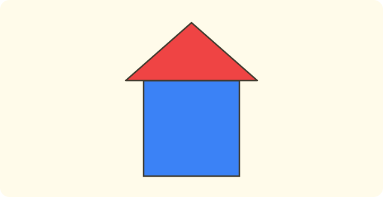
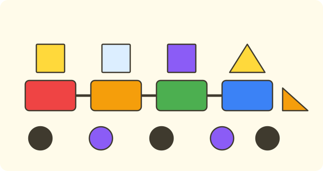
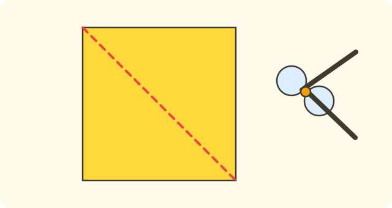

:::goals
- Spot and name squares, circles, triangles and rectangles.
- Say how many sides each shape has.
- Find these shapes in things around you.
:::

Look around your classroom. There is a clock face, a sheet of paper, a handkerchief and a road sign. Each one has its own shape. How do you know what to call each shape?

In the last lesson you split numbers. Now we look at shapes. When you know the name of a shape, you can describe an object with a single word: circle, square, rectangle. Four familiar shapes come first, and for each one we will count the sides.

## Let's explore

Look closely at the four shapes below. Which of them have you seen at home or at school?

:::diagram Four shapes: a square, a rectangle, a triangle and a circle
alt: Four shapes: a square, a rectangle, a triangle and a circle
point A 0,0 ""
point B 2,0 ""
point C 2,2 ""
point D 0,2 ""
point E 4,0 ""
point F 7,0 ""
point G 7,2 ""
point H 4,2 ""
point I 9,0 ""
point J 11,0 ""
point K 10,2 ""
point O 13,1 ""
polygon A B C D
polygon E F G H
polygon I J K
circle O 1
label 1,-0.7 "square"
label 5.5,-0.7 "rectangle"
label 10,-0.7 "triangle"
label 13,-0.7 "circle"
:::

Run your finger slowly along the edge of each shape. Is the edge straight or curved? Count how many straight pieces you find.

- A square has $4$ sides, and all $4$ sides are the same length.
- A rectangle also has $4$ sides, but only in pairs: two long sides the same length and two short sides the same length.
- A triangle has $3$ sides and $3$ corners.
- A circle has no sides at all. Its edge is round and curved.
Many children mix up a square and a rectangle. Just remember: in a square, every side is the same length.

:::theorem Four familiar shapes
1. Square: $4$ sides of the same length.
2. Rectangle: $4$ sides, two long sides the same and two short sides the same.
3. Triangle: $3$ sides and $3$ corners.
4. Circle: no sides and no corners.
:::

Why does this work? Every shape has its own number of sides and its own side lengths. Count the sides, then see whether they are all the same length, and you can name the shape.

## Examples

We try it on something you see often: a bicycle wheel.

:::example A bicycle wheel
What shape is a bicycle wheel?

**Solution.** The edge of the wheel is round and curved, with no sides and no corners.

So the wheel is a circle.
:::

A wheel has no sides. Now we try a shape that does have sides: a handkerchief.

:::example A handkerchief
A handkerchief has $4$ sides, and all $4$ sides are the same length. What shape is it?

**Solution.** A shape with $4$ sides of the same length is a square.

So the handkerchief is a square.
:::

A window has sides too, but it is not like the handkerchief. Where is the difference?

:::example A window
A window has $4$ sides. Two sides are long and the same, and two sides are short and the same. What shape is it?

**Solution.** A shape with $4$ sides that are not all the same, but equal in pairs, is a rectangle.

So the window is a rectangle.
:::

Sometimes an object is put together from several shapes. Here we count the shapes in a house.

:::example A house made of shapes
You make a house from one square (the walls) and one triangle (the roof). How many shapes did you use?

**Solution.** Count: one square, one triangle. You count: "one, two".

So you used $2$ shapes.
:::

:::warning Mistakes to watch out for
- **Mixing up a rectangle and a square.** Wrong: a shape with two long sides and two short sides is a square. Why it is wrong: a square has all $4$ sides the same. Right: that shape is a rectangle.
- **Saying a triangle has $4$ sides.** Wrong: a triangle has $4$ sides. Why it is wrong: a triangle has only $3$ sides. Right: a triangle has $3$ sides.
- **Saying a circle has a side.** Wrong: a circle has $1$ side. Why it is wrong: its edge is curved, with no straight side at all. Right: a circle has no sides.
Do not worry if you get these wrong at first. Count the sides slowly and you will get them right.
:::

## Key terms

:::terms
- square | hình vuông
- circle | hình tròn
- triangle | hình tam giác
- rectangle | hình chữ nhật
- side | cạnh
- corner | góc
- shape | hình
:::

## Summary

- A square has $4$ sides of the same length.
- A rectangle has $4$ sides: two long and two short.
- A triangle has $3$ sides and $3$ corners.
- A circle has no sides and no corners.
Look back at the clock face, the sheet of paper, the handkerchief and the road sign: you can now name each shape. Remember to count the sides first, then see whether they are the same length, and practise a few exercises to train your eye.

## Practice

Each exercise has a reminder of what you need and a hint to get started. Try it yourself first, and take your time. When you finish, or if you get stuck, open the solution.

:::exercise
What shape is a wall clock face?

::hint
**What you need:** a shape with a round edge and no sides is a circle.

**Steps:**
1. Is the edge of the clock round or straight?
2. Does it have sides and corners?

::solution
We look at the face of a wall clock.

The edge of the clock face is round, with no sides.

A shape with a round edge and no sides is a circle.

So a wall clock face is a circle.

**Answer.** A circle.
:::

:::exercise
What shape has $3$ sides?

::hint
**What you need:** count the sides to name the shape.

**Steps:**
1. How many sides do a square and a rectangle have?
2. Which shape has $3$ sides?

::solution
We compare the number of sides of the shapes we know: a circle has no sides; a square and a rectangle have $4$ sides; a triangle has $3$ sides.

The shape with $3$ sides is the triangle.

So the shape that has $3$ sides is a triangle.

**Answer.** A triangle.
:::

:::exercise
Remember the last lesson. a) $8$ cakes are shared between two plates. The first plate has $5$ cakes, so $8$ is made of $5$ and $\square$. b) What shape has $4$ sides of the same length?

::hint
**What you need:** count on from $5$ to $8$; a square has $4$ sides of the same length.

**Steps:**
1. Count: six, seven, eight.
2. Remember what a square looks like.

::solution
a) The first plate has $5$ cakes, so the number of cakes on the second plate is what is left after taking $5$ away from $8$:
$$8-5=3\ \text{(cakes)}.$$
Check: counting on from $5$, "six, seven, eight", gives $3$ numbers, and $5+3=8$. Hence $8$ is made of $5$ and $3$.

b) A rectangle also has $4$ sides, but it has two long sides and two short sides. The shape with all $4$ sides of the same length is a square.

So $8$ is made of $5$ and $3$; the shape with $4$ sides of the same length is a square.

**Answer.** a) $3$. b) A square.
:::

:::exercise
a) Of a square, a circle and a triangle, which has no sides?
b) How many sides does a rectangle have?

::hint
**What you need:** a circle has no sides; a rectangle has $4$ sides.

**Steps:**
1. Which shape has a curved edge?
2. Count the sides of a rectangle.

::solution
a) A square has $4$ sides, a triangle has $3$ sides, and a circle has a curved edge, so it has no sides. Hence the circle is the shape with no sides.

b) A rectangle has two long sides and two short sides, so in all it has
$$2+2=4\ \text{(sides)}.$$

So a) the circle has no sides; b) a rectangle has $4$ sides.

**Answer.** a) A circle. b) $4$ sides.
:::

:::exercise
An says: "A sheet of paper has $4$ sides, two long and two short, so it is a square." Is An right? Why?

::hint
**What you need:** a square has all $4$ sides the same length.

**Steps:**
1. Are all the sides of the paper the same?
2. Choose the right name.

::solution
To find out whether the paper is a square, we recall that a square has $4$ sides of the same length.

An's sheet of paper has two long sides and two short sides, so the sides are not all the same length.

A shape with $4$ sides, two long and two short, is a rectangle.

So An is wrong; the paper is a rectangle.

**Answer.** No. The paper is a rectangle.
:::

:::exercise
Mai says: "A triangle has $4$ sides." Where did Mai go wrong? Say it correctly.

::hint
**What you need:** a triangle has $3$ sides.

**Steps:**
1. Count the sides of a triangle.
2. Compare with Mai's number.

::solution
We count the sides of a triangle: a triangle has $3$ sides.

Mai says a triangle has $4$ sides, which is not right, because a triangle has only $3$ sides. A shape with $4$ sides is a square or a rectangle.

Mai should say it again: a triangle has $3$ sides.

So Mai went wrong by saying the number of sides is $4$; the correct sentence is: a triangle has $3$ sides.

**Answer.** A triangle has $3$ sides.
:::

:::exercise
The table shows how many shapes are in a picture:

| Shape | Squares | Circles | Triangles | Rectangles |
|---|---|---|---|---|
| Number | $3$ | $5$ | $2$ | $4$ |

a) Which shape is there most of?
b) Which shape is there least of?

::hint
**What you need:** compare the numbers in the row "Number".

**Steps:**
1. Read the numbers: $3, 5, 2, 4$.
2. Find the greatest and the least.

::solution
From the table, the number of each shape is: squares $3$, circles $5$, triangles $2$, rectangles $4$.

a) Comparing the numbers $3$, $5$, $2$, $4$, we have $5>4>3>2$, so the greatest number is $5$. The number $5$ is for circles, so there are most circles.

b) Among these numbers, the least is $2$. The number $2$ is for triangles, so there are fewest triangles.

So there are most circles and fewest triangles.

**Answer.** a) Circles. b) Triangles.
:::

:::exercise Challenge
You cut a square sheet of paper along a straight line joining two opposite corners. How many pieces do you get? What shape is each piece?

::hint
**What you need:** a triangle has $3$ sides and $3$ corners.

**Steps:**
1. Into how many parts does the cut split the square?
2. How many sides does each part have?

::solution
You cut the square sheet of paper along a straight line joining two opposite corners.

The cut splits the square into $2$ parts, so you get $2$ pieces.

Each piece has $3$ sides: two of them are sides of the square and one is the cutting line. A shape with $3$ sides is a triangle.

Check: the two pieces fit back together to make the square.

So you get $2$ pieces, each a triangle.

**Answer.** $2$ pieces, each a triangle.
:::

## Mini test

:::quiz
::mc NB
A bicycle wheel is the shape of a
A. square.
B. circle.
C. triangle.
D. rectangle.
::key B
The edge of the wheel is round, with no sides. Option A is a shape with sides.

::mc NB
A shape with $3$ sides is a
A. square.
B. circle.
C. triangle.
D. rectangle.
::key C
Only a triangle has $3$ sides.

::mc TH
A shape has $4$ sides, two long and the same, two short and the same (the sides are not all the same). It is a
A. square.
B. circle.
C. triangle.
D. rectangle.
::key D
That is a rectangle. Option A is wrong because a square has all $4$ sides the same.

::mc NB
Which shape has no sides?
A. Square.
B. Circle.
C. Triangle.
D. Rectangle.
::key B
The edge of a circle is curved, with no sides.

::tf NB NB TH NB
Look at the shapes.
a) A square has $4$ sides of the same length.
b) A triangle has $4$ sides.
c) A circle has no sides.
d) A rectangle has $3$ sides.
::key T F T F
a) True. b) False: a triangle has $3$ sides. c) True. d) False: a rectangle has $4$ sides.

::sa NB
How many sides does a rectangle have?
::key 4
A rectangle has two long sides and two short sides, $4$ in all.

::sa NB
How many corners does a triangle have?
::key 3
A triangle has $3$ sides and $3$ corners.
:::
