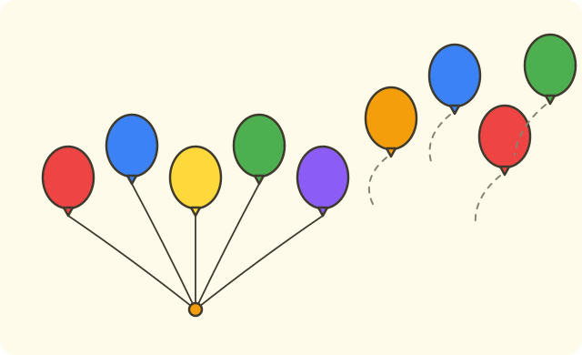

:::goals
- Understand that subtraction means taking some things away.
- Read and write subtractions within $10$, for example $7-2=5$.
- Work them out by counting back and check them with addition.
- Solve a word problem with one subtraction.
:::

Lan has $7$ sweets. She eats $2$ of them. How many sweets does Lan have left?

In the last lesson you put two groups together with addition. In this lesson you do the opposite: take away.

## Let's explore

Lan has $7$ sweets and eats $2$. You count back $2$ numbers starting from $7$.

- Say the number $7$ first: "seven".
- Count back two: "six, five".
- The last number is five.

So Lan has $5$ sweets left. We write $7-2=5$ and read it "seven minus two equals five".

:::graph On the number line: from 7 count back 2 steps to 5
alt: A number line with the points 7, 6, 5; the stretch from 7 back to 5 shows counting back two steps
x: -1..11
y: -1..1
segment: (5, 0) (7, 0)
point: (7, 0) "7" below
point: (6, 0) "6" below
point: (5, 0) "5" below
:::

:::theorem Subtraction
1. Taking away some things is subtraction. The minus sign is $-$.
2. To work out $7-2$, count back $2$ numbers from $7$: you get $5$.
3. Taking away $0$ does not change the number: $9-0=9$.
4. A number minus itself is $0$: $6-6=0$.
5. Check with addition: $5+2=7$.
:::

This works because when you take away $2$ sweets, there are $2$ fewer sweets, and you just count the ones left.

## Examples

We start with a very small subtraction.

:::example Work out $5-1$
**Solution.** Say the first number "five", then count back one: "four".

So $5-1=4$.
:::

Now count back more numbers.

:::example Work out $8-3$
**Solution.** Say the first number "eight", then count back three: "seven, six, five".

So $8-3=5$.

**Check.** $5+3=8$. Correct.
:::

Sometimes you take away the whole group.

:::example Work out $6-6$
**Solution.** Take away all $6$ things and nothing is left.

So $6-6=0$.
:::

What about taking away $0$?

:::example Work out $9-0$
**Solution.** Taking away $0$ means taking away nothing, so the number stays the same.

So $9-0=9$.
:::

Last, solve a word problem.

:::example Balloons
Binh has $9$ balloons. The wind blows $4$ of them away. How many balloons does Binh have left?

**Solution.** "Blows away" means taking away, so we subtract. Count back $4$ numbers from $9$: "eight, seven, six, five":
$$9-4=5\ \text{(balloons)}.$$
So Binh has $5$ balloons left.
:::

:::warning Mistakes to watch out for
- **Counting the first number when going back.** Wrong: $8-3=6$ because you count "eight, seven, six". Why it is wrong: you only counted back $2$ numbers. Right: count back all $3$ numbers: seven, six, five. So $8-3=5$.
- **Swapping the two numbers.** Wrong: $2-5=3$. Why it is wrong: you cannot take $5$ away from $2$. Right: subtraction cannot be swapped.
- **No unit in a word problem.** Wrong: "Answer: $5$". Right: "Answer: $5$ balloons".
:::

## Key terms

:::terms
- subtraction | phép trừ
- minus ($-$) | trừ
- take away | bớt
- left | còn lại
- count back | đếm lùi
- equals ($=$) | bằng
:::

## Summary

- Taking away is subtraction: $7-2=5$.
- Count back from the first number as many times as the second number says.
- $9-0=9$ and $6-6=0$.
- Check a subtraction with addition: $5+2=7$.
- Words like "take away", "blown away" and "left" usually mean subtraction; remember the unit.

## Practice

Each exercise comes with what you need and how to start. Try it yourself first, then open the solution.

:::exercise
Work out $5-2$.

::hint
**What you need:** count back from the first number as many times as the second number.

**Steps:**
1. Say the first number: five.
2. Count back two.

::solution
To work out $5-2$, we count back two numbers, starting from $5$.

From $5$ count back: "four, three".

The last number we say is $3$, so $5-2=3$.

Check: $3+2=5$. Correct.

So $5-2=3$.

**Answer.** $5-2=3$.
:::

:::exercise
Work out $9-4$.

::hint
**What you need:** count back four numbers from $9$.

**Steps:**
1. Say the first number: nine.
2. Count back four.

::solution
To work out $9-4$, we count back four numbers, starting from $9$.

From $9$ count back: "eight, seven, six, five".

The last number we say is $5$, so $9-4=5$.

Check: $5+4=9$. Correct.

So $9-4=5$.

**Answer.** $9-4=5$.
:::

:::exercise
Remember the last lesson: $3+4=7$. Use it to work out $7-4$ and $7-3$.

::hint
**What you need:** if $3+4=7$, taking $4$ away from $7$ leaves $3$.

**Steps:**
1. Count back four from $7$.
2. Count back three from $7$.

::solution
We have $3+4=7$, which means $7$ is made of $3$ and $4$.

$7-4$: from $7$ count back four numbers: "six, five, four, three", which gives $3$. Hence $7-4=3$.

$7-3$: from $7$ count back three numbers: "six, five, four", which gives $4$. Hence $7-3=4$.

Both results agree with $3+4=7$: $7$ is made of $3$ and $4$, and taking away one part leaves the other.

So $7-4=3$ and $7-3=4$.

**Answer.** $7-4=3$; $7-3=4$.
:::

:::exercise
Find the missing number:
a) $7-\square=5$.
b) $4-\square=4$.

::hint
**What you need:** count back from the first number to the answer and see how many numbers you went back.

**Steps:**
1. From $7$ back to $5$.
2. From $4$ you still have $4$: how much was taken away?

::solution
a) We look for the number to take away so that $5$ is left from $7$. From $7$ back to $5$: "six, five", so we go back $2$ numbers. Hence the missing number is $2$. Check: $7-2=5$. Correct.

b) We take a number away from $4$ and still have all $4$ left, which means nothing was taken away. Hence the missing number is $0$. Check: $4-0=4$. Correct.

So a) the missing number is $2$; b) the missing number is $0$.

**Answer.** a) $2$. b) $0$.
:::

:::exercise
Nam says: "$8-3=6$ because I counted back eight, seven, six." Is Nam right? Why?

::hint
**What you need:** count back exactly three numbers and do not count the first number.

**Steps:**
1. How many numbers must you count back from $8$?
2. Count again correctly.

::solution
To work out $8-3$, we count back $3$ numbers, starting from $8$ but not saying the number $8$.

From $8$ count back $3$ numbers: "seven, six, five". The last number is $5$, so $8-3=5$.

Nam said "eight, seven, six", so Nam said the number $8$ itself and only went back $2$ numbers, stopping at $6$.

Check: $5+3=8$. Correct. But $6+3=9$, which is not $8$, so $6$ is wrong.

So Nam is wrong; $8-3=5$.

**Answer.** No. $8-3=5$.
:::

:::exercise
Mai writes $2-5=3$. Where did Mai go wrong? Write it correctly.

::hint
**What you need:** you cannot take away more than you have; subtraction cannot be swapped.

**Steps:**
1. You have $2$. Can you take away $5$?
2. Try writing $5-2$.

::solution
The sum $2-5$ cannot be done, because you cannot take $5$ away from $2$ ($2<5$).

Mai swapped the two numbers. The right sum is $5-2$.

From $5$ count back two numbers: "four, three", which gives $3$. Hence $5-2=3$.

Check: $3+2=5$. Correct.

So Mai went wrong by writing $2-5$; it should be $5-2=3$.

**Answer.** $5-2=3$.
:::

:::exercise
Ha has $10$ cakes. She gives $6$ cakes to a friend. How many cakes does Ha have left?

::hint
**What you need:** "gives to a friend" means taking away: use subtraction.

**Steps:**
1. What do we know? Ha has $10$ cakes and gives away $6$. What is asked? How many are left.
2. Work out $10-6$ and write the answer with its unit.

::solution
Solution

The number of cakes Ha has left is:
$$10-6=4\ \text{(cakes)}.$$

Check: $4+6=10$. Correct.

So Ha has $4$ cakes left.

**Answer.** $4$ cakes.
:::

:::exercise Challenge
Write $+$ or $-$ in the box:
a) $6 \;\square\; 2 = 4$.
b) $6 \;\square\; 2 = 8$.

::hint
**What you need:** if the answer is less than the first number, you take away; if it is more, you add.

**Steps:**
1. Compare $4$ with $6$.
2. Compare $8$ with $6$.

::solution
a) The result $4$ is less than $6$, so we take away: write the sign $-$, and $6-2=4$.

b) The result $8$ is more than $6$, so we add: write the sign $+$, and $6+2=8$.

Check: from $6$ back two, "five, four", gives $4$; from $6$ on two, "seven, eight", gives $8$. Correct.

So a) write the sign $-$; b) write the sign $+$.

**Answer.** a) the sign $-$. b) the sign $+$.
:::

## Mini test

:::quiz
::mc NB
$8-3$ equals
A. $4$.
B. $6$.
C. $5$.
D. $11$.
::key C
Count back $3$ numbers from $8$: seven, six, five. Option D is $8+3$, an addition by mistake.

::mc NB
$9-0$ equals
A. $0$.
B. $10$.
C. $8$.
D. $9$.
::key D
Taking away $0$ does not change the number.

::mc TH
Which subtraction equals $4$?
A. $6-2$.
B. $7-2$.
C. $5-2$.
D. $8-3$.
::key A
$6-2=4$. The others equal $5$, $3$ and $5$.

::mc TH
There are $10$ birds and $3$ fly away. How many are left?
A. $13$ birds.
B. $7$ birds.
C. $6$ birds.
D. $3$ birds.
::key B
"Fly away" means take away: $10-3=7$. Option A is $10+3$.

::tf NB TH TH TH
Look at the subtraction $6-4$.
a) $6-4=2$.
b) $4-6=2$.
c) $6-4=10$.
d) $2+4=6$.
::key T F F T
a) True. b) False: you cannot take $6$ away from $4$. c) False: $10$ is $6+4$. d) True: it checks that $6-4=2$.

::sa TH
Work out $7-4$.
::key 3
Count back $4$ numbers from $7$: six, five, four, three.

::sa TH
Work out $10-10$.
::key 0
Take away the whole group and nothing is left.
:::
