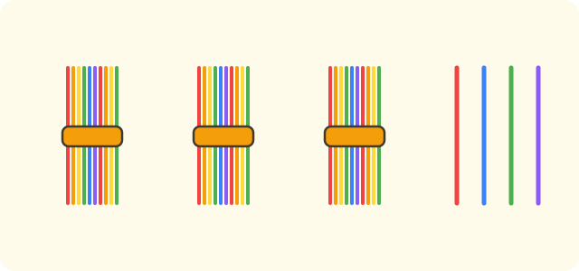
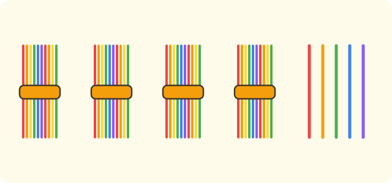

:::goals
- Count, read and write two-digit numbers.
- Know how many tens and ones each number has.
- Spot the digit in the tens place and the digit in the ones place.
:::

Lan has lots of marbles. She makes bundles of $10$ marbles and gets $2$ bundles, with $3$ marbles left over. How many marbles does Lan have altogether?

You already know how to count up to $10$. But if Lan had more marbles than that, counting them one by one would be easy to muddle. Putting them into bundles and counting the bundles is much tidier. This lesson shows you how to read and write numbers that way.

## Let's explore

When you put $10$ things together, you make one ten. So one ten has $10$ ones.

- $10$ marbles make $1$ ten and $0$ ones. We write the number $10$.
- $2$ bundles of marbles and $3$ loose marbles are $2$ tens and $3$ ones. We write the number $23$ (read "twenty-three").
- $4$ bundles of marbles and $7$ loose marbles are $4$ tens and $7$ ones. We write the number $47$ (read "forty-seven").
Notice that the tens come first and the ones come second.

So Lan has $23$ marbles. Look at the table:

| Number | Tens | Ones |
|---|---|---|
| $10$ | $1$ | $0$ |
| $23$ | $2$ | $3$ |
| $47$ | $4$ | $7$ |

:::theorem Two-digit numbers
1. A two-digit number has a digit in the tens place and a digit in the ones place.
2. The digit on the left is the tens digit and the digit on the right is the ones digit.
3. The number $23$ is $2$ tens and $3$ ones.
4. $1$ ten is $10$ ones; $5$ tens make $50$.
:::

Why does this work? Each bundle has $10$ marbles. Counting the bundles gives the tens, and counting the loose marbles gives the ones.

## Examples

We start with a number and ask: how many tens and ones?

:::example The number 23
How many tens and ones are in the number $23$?

**Solution.** The digit on the left is $2$, in the tens place. The digit on the right is $3$, in the ones place.

So $23$ is $2$ tens and $3$ ones.
:::

Now we go the other way: you know the tens and the ones, and you write the number.

:::example Writing a number
Write the number made of $4$ tens and $7$ ones.

**Solution.** The tens digit is $4$ and the ones digit is $7$. Write $4$ first, then $7$.

So the number is $47$.
:::

Some numbers are whole tens, with no loose ones at all. Here is one.

:::example The number 50
How many tens and ones are in the number $50$?

**Solution.** The tens digit is $5$ and the ones digit is $0$.

So $50$ is $5$ tens and $0$ ones.
:::

Last, we use bundles to count something real: sticks.

:::example Bundles of sticks
There are $3$ bundles of sticks with $10$ sticks in each, and $4$ loose sticks. How many sticks are there altogether?

**Solution.** $3$ bundles are $3$ tens and $4$ loose sticks are $4$ ones. Write $3$ in the tens place and $4$ in the ones place.

So there are $34$ sticks.
:::

:::warning Mistakes to watch out for
- **Swapping the digits.** Wrong: $2$ tens $3$ ones is written $32$. Why it is wrong: $32$ has $3$ tens. Right: $23$.
- **Forgetting the $0$.** Wrong: $5$ tens is written $5$. Why it is wrong: $5$ is only $5$ ones. Right: $5$ tens is written $50$.
- **Mixing up tens and ones.** Wrong: the digit $6$ in $68$ is in the ones place. Why it is wrong: $6$ is on the left, so it is in the tens place. Right: $6$ is in the tens place and $8$ in the ones place.
Many pupils mix these up, so remember: the digit on the left is in the tens place.
:::

## Key terms

:::terms
- two-digit number | số có hai chữ số
- digit | chữ số
- ten | chục
- one | đơn vị
- tens place | hàng chục
- ones place | hàng đơn vị
- bundle | bó
:::

## Summary

- One ten is $10$ ones.
- A two-digit number has tens and ones: $23$ is $2$ tens and $3$ ones.
- The digit on the left is the tens digit; the digit on the right is the ones digit.
- $5$ tens is written $50$.
Lan's question at the start is answered the same way: counting bundles gives the tens, and counting loose marbles gives the ones. Practise reading and writing a few more numbers until it feels natural.

## Practice

Each exercise comes with a reminder of what you need and a hint to start you off. Try it yourself first. If you get stuck, or when you have finished, open the solution.

:::exercise
The number $34$ is $\square$ tens and $\square$ ones.

::hint
**What you need:** the digit on the left is the tens digit, the digit on the right is the ones digit.

**Steps:**
1. Find the digit on the left.
2. Find the digit on the right.

::solution
The number $34$ has $3$ in the tens place and $4$ in the ones place.

The digit $3$ in the tens place means $3$ tens; the digit $4$ in the ones place means $4$ ones.

Check: $3$ tens is $30$ and $30+4=34$, which is correct.

So the number $34$ is $3$ tens and $4$ ones.

**Answer.** $3$ tens and $4$ ones.
:::

:::exercise
Write the number made of $6$ tens and $2$ ones.

::hint
**What you need:** write the tens digit first, then the ones digit.

**Steps:**
1. What is the tens digit?
2. What is the ones digit?

::solution
The number made of $6$ tens and $2$ ones has $6$ in the tens place and $2$ in the ones place.

We write the tens digit first and then the ones digit: write $6$ and then $2$.

Check: $60+2=62$, which is correct.

So the number made of $6$ tens and $2$ ones is $62$.

**Answer.** $62$.
:::

:::exercise
Remember the last lesson: $6$ children are in a line and Nam is fourth from the start. How many children are behind Nam?

::hint
**What you need:** the children behind Nam are the fifth and the sixth.

**Steps:**
1. Write the order from first to sixth.
2. Count the children after Nam.

::solution
There are $6$ children in the line and Nam is fourth from the start.

After the fourth child come the fifth and the sixth, which is $2$ children.

Check: $6-4=2$ (children), which is correct.

So there are $2$ children behind Nam.

**Answer.** $2$ children.
:::

:::exercise
a) How many tens and ones are in the number $70$?
b) Write the number made of $9$ tens and $1$ one.

::hint
**What you need:** write the tens digit first; a whole-ten number has $0$ ones.

**Steps:**
1. Read the two digits of $70$.
2. Write $9$ then $1$.

::solution
a) The number $70$ has $7$ in the tens place and $0$ in the ones place.
So the number $70$ is $7$ tens and $0$ ones.

b) The number made of $9$ tens and $1$ one has $9$ in the tens place and $1$ in the ones place, so we write $9$ and then $1$.
So the number is $91$.

**Answer.** a) $7$ tens and $0$ ones. b) $91$.
:::

:::exercise
Nam says: "$32$ and $23$ are the same number because they both have the digits $2$ and $3$." Is Nam right? Why?

::hint
**What you need:** the place of a digit decides its value.

**Steps:**
1. How many tens and ones are in $32$?
2. How many tens and ones are in $23$?

::solution
We look at how many tens and ones each number has.

The number $32$ has $3$ in the tens place and $2$ in the ones place, so $32$ is $3$ tens and $2$ ones.

The number $23$ has $2$ in the tens place and $3$ in the ones place, so $23$ is $2$ tens and $3$ ones.

The two numbers use the same digits $2$ and $3$, but each digit is in a different place, so the values are different: $32=30+2$ and $23=20+3$.

So Nam is wrong: $32$ and $23$ are different numbers.

**Answer.** No. $32$ and $23$ are different numbers.
:::

:::exercise
Mai says: "$5$ tens is written $5$." Where did Mai go wrong? Write it correctly.

::hint
**What you need:** $5$ tens is $5$ bundles of ten, with $0$ loose ones.

**Steps:**
1. What is the tens digit? What is the ones digit?
2. Write both digits.

::solution
$5$ tens means the digit in the tens place is $5$ and there are $0$ ones.

A two-digit number must show both the tens digit and the ones digit: the digit $5$ in the tens place and the digit $0$ in the ones place.

Mai wrote only $5$, so Mai forgot the digit $0$ in the ones place. The number $5$ is only $5$ ones, not $5$ tens.

Written correctly: $5$ tens is $50$. Check: the number $50$ has $5$ in the tens place and $0$ in the ones place, which is correct.

So Mai went wrong by forgetting the digit $0$; $5$ tens is written $50$.

**Answer.** $5$ tens is written $50$.
:::

:::exercise
There are $4$ bundles of sticks with $10$ sticks in each, and $5$ loose sticks. How many sticks are there altogether?

::hint
**What you need:** the bundles are the tens and the loose sticks are the ones.

**Steps:**
1. What do we know? $4$ bundles and $5$ loose sticks. What is asked? How many sticks altogether.
2. Write the tens, then the ones.

::solution
Each bundle has $10$ sticks, which is $1$ ten. There are $4$ bundles, so there are $4$ tens, that is $40$ sticks.

There are also $5$ loose sticks, which is $5$ ones.

The number of sticks altogether is:
$$40+5=45\ \text{(sticks)}.$$

So there are $45$ sticks altogether.

**Answer.** $45$ sticks.
:::

:::exercise Challenge
A two-digit number has $4$ in the tens place and a digit less than $2$ in the ones place. Which numbers could it be?

::hint
**What you need:** the digits less than $2$ are $0$ and $1$.

**Steps:**
1. Write $4$ in the tens place.
2. Try $0$ and $1$ in the ones place.

::solution
The number has two digits and the tens digit is $4$, so it has the form $4\square$, where $\square$ is the ones digit.

The ones digit is less than $2$, so it is $0$ or $1$.

With ones digit $0$ we get the number $40$; with ones digit $1$ we get the number $41$.

Check: both $40$ and $41$ have $4$ tens and fewer than $2$ ones, which is correct.

So the numbers are $40$ and $41$.

**Answer.** $40$ and $41$.
:::

## Mini test

:::quiz
::mc NB
The number $25$ is
A. $5$ tens and $2$ ones.
B. $2$ tens and $5$ ones.
C. $25$ tens.
D. $7$ tens.
::key B
The digit on the left, $2$, is in the tens place and the digit on the right, $5$, is in the ones place. Option A swaps the digits.

::mc NB
The number made of $4$ tens and $7$ ones is
A. $74$.
B. $47$.
C. $11$.
D. $4$.
::key B
Write $4$ first, then $7$. Option A is written backwards.

::mc NB
The number $50$ is
A. $5$ tens and $0$ ones.
B. $0$ tens and $5$ ones.
C. $5$ tens and $5$ ones.
D. $10$ tens.
::key A
The tens digit is $5$ and the ones digit is $0$. Option B swaps the digits.

::mc NB
The tens digit of the number $68$ is
A. $6$.
B. $8$.
C. $68$.
D. $14$.
::key A
The digit on the left, $6$, is the tens digit. Option B is the ones digit.

::tf NB NB TH TH
Look at the number $36$.
a) The tens digit is $3$.
b) The ones digit is $6$.
c) $36$ is $6$ tens and $3$ ones.
d) $36$ and $63$ are the same number.
::key T T F F
a) True. b) True. c) False: $36$ is $3$ tens and $6$ ones. d) False: they are different numbers.

::sa TH
There are $2$ bundles of sticks with $10$ sticks in each, and $6$ loose sticks. How many sticks are there altogether?
::key 26
$2$ tens and $6$ ones make $26$.

::sa NB
Which number is $9$ tens and $0$ ones?
::key 90
Write $9$ then $0$.
:::
