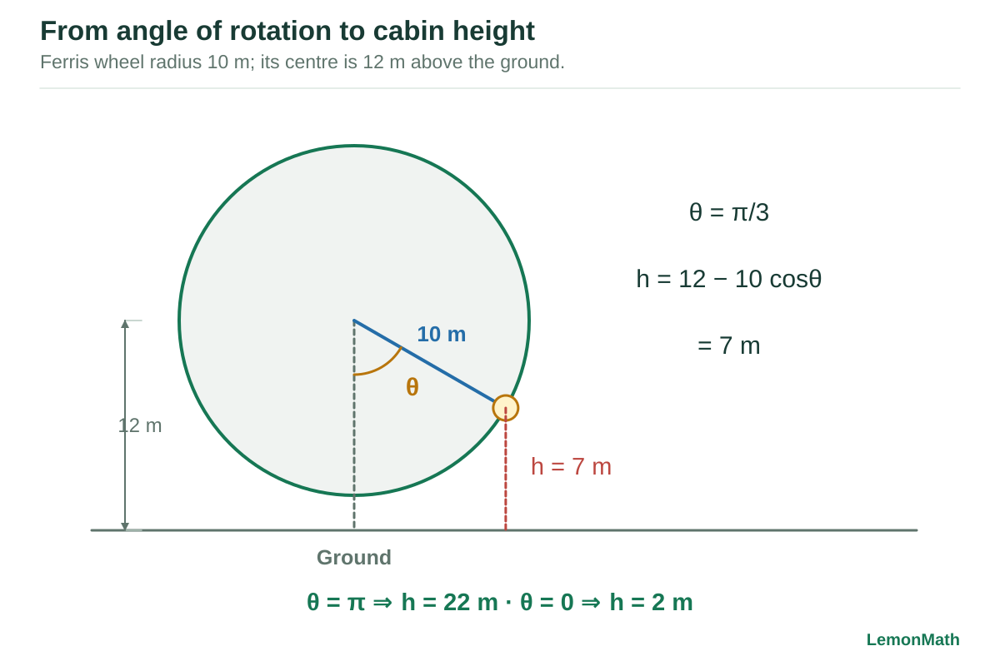

:::goals
- Convert between degrees and radians, find arc lengths and recognise the measures of a directed angle.
- Represent a directed angle on the unit circle and define $\sin\alpha$, $\cos\alpha$, $\tan\alpha$, $\cot\alpha$.
- Decide the signs of the trigonometric values by quadrant.
- Use the basic identities, the table of special values and related angles to find trigonometric values.
:::

A wall clock has a minute hand $10$ cm long. We place the origin $O$ at the pivot of the hands, with the $x$-axis horizontal pointing right and the $y$-axis pointing up. At exactly $12$ o'clock the tip of the hand is at $(0, 10)$.

After $20$ minutes, where is the tip? Through what angle has the hand turned, and in which direction? The angles $90^\circ$, $180^\circ$ or $360^\circ$ are not enough to answer, because the hand can turn through several revolutions and can also turn the other way. This lesson builds the tools for such situations: **directed angles**, then **trigonometric values**, which give us the coordinates of a point on a circle.

## Directed angles and their measures

### Explore: the minute hand turning

The minute hand turns steadily through one revolution ($360^\circ$) in $60$ minutes, that is $6^\circ$ per minute, in the clockwise direction. We agree that anticlockwise is the positive direction, so a clockwise turn has a negative measure.

| Time | $15$ minutes | $30$ minutes | $60$ minutes | $90$ minutes |
|---|---|---|---|---|
| Measure of the turn | $-90^\circ$ | $-180^\circ$ | $-360^\circ$ | $-540^\circ$ |

After $90$ minutes the hand has turned $1.5$ revolutions; the tip is in the same place as after $30$ minutes, but the measures differ by $360^\circ$. So one position of the tip corresponds to infinitely many measures.

:::definition Directed angle
Given two rays $Ou$ and $Ov$, a ray $Om$ turns about $O$ from the position $Ou$ to the position $Ov$ in a definite direction. This produces a **directed angle** with initial ray $Ou$ and terminal ray $Ov$, written $(Ou, Ov)$. Anticlockwise is the positive direction and clockwise is the negative direction.

If one measure of $(Ou, Ov)$ is $\alpha^\circ$, then all its measures have the form $\alpha^\circ+k\cdot360^\circ$ with $k\in\mathbb Z$.
:::

Degrees are familiar, but when we calculate with angles another unit is more convenient.

:::definition Radian
The angle at the centre of a circle that stands on an arc whose length equals the radius has a measure of **one radian** (written $1$ rad).
:::

The circumference of a circle of radius $R$ is $2\pi R$, so the whole circle corresponds to an angle of $2\pi$ rad. Hence $360^\circ=2\pi$ rad, that is

$$180^\circ=\pi\text{ rad},\qquad 1^\circ=\frac\pi{180}\text{ rad},\qquad 1\text{ rad}=\left(\frac{180}\pi\right)^\circ\approx57.3^\circ.$$

The radian measures of a directed angle also have the form $\alpha+k2\pi$ with $k\in\mathbb Z$. When we write a measure in radians we usually leave out the word "rad".

**A deeper look.** Why use radians? An arc of a circle of radius $R$ that stands on a central angle $\alpha$ (in radians) has length

$$l=R\alpha.$$

This formula has no factor $\dfrac\pi{180}$, so later formulae are much tidier. But it is true only when $\alpha$ is in radians.

It is worth remembering the common measures:

| Degrees | $0^\circ$ | $30^\circ$ | $45^\circ$ | $60^\circ$ | $90^\circ$ | $120^\circ$ | $135^\circ$ | $150^\circ$ | $180^\circ$ |
|---|---|---|---|---|---|---|---|---|---|
| Radians | $0$ | $\dfrac\pi6$ | $\dfrac\pi4$ | $\dfrac\pi3$ | $\dfrac\pi2$ | $\dfrac{2\pi}3$ | $\dfrac{3\pi}4$ | $\dfrac{5\pi}6$ | $\pi$ |

:::example Converting units and finding an arc length
a) Convert $72^\circ$ and $-225^\circ$ to radians, and convert $\dfrac{5\pi}{12}$ to degrees.
b) A wheel of radius $0.3$ m rolls without slipping and makes $2.5$ revolutions. Find the distance the wheel travels (to the nearest $0.01$ m). (The figures are made up.)

**Solution.** a) Multiply by $\dfrac\pi{180}$ to convert from degrees to radians:

$$72^\circ=72\cdot\frac\pi{180}=\frac{2\pi}5,\qquad -225^\circ=-225\cdot\frac\pi{180}=-\frac{5\pi}4.$$

Multiply by $\dfrac{180}\pi$ to convert from radians to degrees: $\dfrac{5\pi}{12}=\dfrac{5\pi}{12}\cdot\dfrac{180}\pi=75^\circ$.

b) One revolution is an angle of $2\pi$ rad, so $2.5$ revolutions is $\alpha=2.5\cdot2\pi=5\pi$ (rad). The distance travelled equals the arc length of the rim:

$$l=R\alpha=0.3\cdot5\pi=1.5\pi\approx4.71\text{ (m)}.$$

So $72^\circ=\dfrac{2\pi}5$, $-225^\circ=-\dfrac{5\pi}4$, $\dfrac{5\pi}{12}=75^\circ$, and the wheel travels about $4.71$ m.
:::

:::example Measures of a directed angle
a) Which of the numbers $\dfrac{7\pi}3$, $-\dfrac{5\pi}3$, $\dfrac{4\pi}3$, $\dfrac{13\pi}3$ are measures of the same directed angle (same initial and terminal rays) as the angle with measure $\dfrac\pi3$?
b) Find the measure $\alpha\in[0, 2\pi)$ of the directed angle that has a measure $\dfrac{25\pi}6$.

**Solution.** a) Two measures represent the same directed angle when their difference is an integer multiple of $2\pi$. We have $\dfrac{7\pi}3-\dfrac\pi3=2\pi$, $-\dfrac{5\pi}3-\dfrac\pi3=-2\pi$ and $\dfrac{13\pi}3-\dfrac\pi3=4\pi$, all multiples of $2\pi$. But $\dfrac{4\pi}3-\dfrac\pi3=\pi$ is not a multiple of $2\pi$.

b) We have $\dfrac{25\pi}6=\dfrac\pi6+4\pi=\dfrac\pi6+2\cdot2\pi$. So $\alpha=\dfrac\pi6$.

So $\dfrac{7\pi}3$, $-\dfrac{5\pi}3$ and $\dfrac{13\pi}3$ represent the same angle as $\dfrac\pi3$, and $\alpha=\dfrac\pi6$.
:::

## The unit circle and trigonometric values

In the plane $Oxy$, the **unit circle** is the circle with centre $O$ and radius $1$, oriented (the positive direction is anticlockwise) and with starting point $A(1, 0)$. For each number $\alpha$, the point $M$ on the circle such that $(OA, OM)$ has measure $\alpha$ is called the representing point of the directed angle $\alpha$.

:::diagram Point $M$ representing the angle $\alpha$ on the unit circle
alt: The unit circle with centre O and starting point A on the x-axis, a point M on the circle and the segment MH perpendicular to Ox; the length OH is cos alpha and the length MH is sin alpha
point O 0,0 below-left
point A 4,0 below-right
point M 2,3.46 above-right
point H 2,0 below
circle O 4
axes
segment O M
segment M H
right M H O
angle A O M "α"
label 2.9,1.7 "sin α"
label 0.9,-0.4 "cos α"
:::

:::definition Trigonometric values
Let $M(x_M, y_M)$ be the representing point of the directed angle $\alpha$ on the unit circle. We define

$$\cos\alpha=x_M,\qquad\sin\alpha=y_M,$$

$$\tan\alpha=\frac{\sin\alpha}{\cos\alpha}\ (\cos\alpha\neq0),\qquad\cot\alpha=\frac{\cos\alpha}{\sin\alpha}\ (\sin\alpha\neq0).$$
:::

For $0<\alpha<\dfrac\pi2$ this definition agrees with the trigonometric ratios in the right-angled triangle $OHM$ with hypotenuse $OM=1$: $\cos\alpha=OH$ and $\sin\alpha=MH$. What is new is that the angle $\alpha$ can now be as large as we like, or negative, and the ratios become coordinates.

From the definition we get the following remarks at once:

- Every number $\alpha$ has a $\sin\alpha$ and a $\cos\alpha$, and $-1\le\sin\alpha\le1$, $-1\le\cos\alpha\le1$ (the coordinates of a point on a circle of radius $1$).
- $\tan\alpha$ is defined when $\alpha\neq\dfrac\pi2+k\pi$; $\cot\alpha$ is defined when $\alpha\neq k\pi$ ($k\in\mathbb Z$).
- Two measures that differ by $2\pi$ give the same point $M$, so $\sin(\alpha+k2\pi)=\sin\alpha$ and $\cos(\alpha+k2\pi)=\cos\alpha$. Also $\tan(\alpha+k\pi)=\tan\alpha$.

### Signs of the trigonometric values

The sign of $\cos\alpha$ is the sign of the $x$-coordinate $x_M$, and the sign of $\sin\alpha$ is the sign of the $y$-coordinate $y_M$. We look at the quadrant of the point $M$:

| Quadrant | I | II | III | IV |
|---|---|---|---|---|
| $\sin\alpha$ | $+$ | $+$ | $-$ | $-$ |
| $\cos\alpha$ | $+$ | $-$ | $-$ | $+$ |
| $\tan\alpha$, $\cot\alpha$ | $+$ | $-$ | $+$ | $-$ |

### The basic identities

:::theorem The fundamental trigonometric identities
For all $\alpha$ for which the expressions are defined:

$$\sin^2\alpha+\cos^2\alpha=1,\qquad\tan\alpha\cdot\cot\alpha=1,$$

$$1+\tan^2\alpha=\frac1{\cos^2\alpha},\qquad1+\cot^2\alpha=\frac1{\sin^2\alpha}.$$
:::

Why are they true? The point $M(\cos\alpha, \sin\alpha)$ lies on the circle $x^2+y^2=1$, so $\cos^2\alpha+\sin^2\alpha=1$. Dividing both sides by $\cos^2\alpha$ gives $1+\tan^2\alpha=\dfrac1{\cos^2\alpha}$; dividing by $\sin^2\alpha$ gives $1+\cot^2\alpha=\dfrac1{\sin^2\alpha}$. Finally $\tan\alpha\cdot\cot\alpha=\dfrac{\sin\alpha}{\cos\alpha}\cdot\dfrac{\cos\alpha}{\sin\alpha}=1$.

### Special values

| $\alpha$ | $0$ | $\dfrac\pi6$ | $\dfrac\pi4$ | $\dfrac\pi3$ | $\dfrac\pi2$ |
|---|---|---|---|---|---|
| $\sin\alpha$ | $0$ | $\dfrac12$ | $\dfrac{\sqrt2}2$ | $\dfrac{\sqrt3}2$ | $1$ |
| $\cos\alpha$ | $1$ | $\dfrac{\sqrt3}2$ | $\dfrac{\sqrt2}2$ | $\dfrac12$ | $0$ |
| $\tan\alpha$ | $0$ | $\dfrac{\sqrt3}3$ | $1$ | $\sqrt3$ | undefined |
| $\cot\alpha$ | undefined | $\sqrt3$ | $1$ | $\dfrac{\sqrt3}3$ | $0$ |

### Related angles

The representing points of $\alpha$ and $-\alpha$ are symmetric in $Ox$; those of $\alpha$ and $\pi-\alpha$ are symmetric in $Oy$; those of $\alpha$ and $\pi+\alpha$ are symmetric in $O$. Changing the sign of the $x$-coordinate or $y$-coordinate accordingly, we get:

:::theorem Trigonometric values of related angles
- $\sin(-\alpha)=-\sin\alpha$, $\cos(-\alpha)=\cos\alpha$, $\tan(-\alpha)=-\tan\alpha$.
- $\sin(\pi-\alpha)=\sin\alpha$, $\cos(\pi-\alpha)=-\cos\alpha$, $\tan(\pi-\alpha)=-\tan\alpha$.
- $\sin(\pi+\alpha)=-\sin\alpha$, $\cos(\pi+\alpha)=-\cos\alpha$, $\tan(\pi+\alpha)=\tan\alpha$.
- $\sin\left(\dfrac\pi2-\alpha\right)=\cos\alpha$, $\cos\left(\dfrac\pi2-\alpha\right)=\sin\alpha$.
:::

The angles $\alpha$ and $\dfrac\pi2-\alpha$ are the two complementary acute angles of a right-angled triangle, so the sine of one equals the cosine of the other. This formula also gives $\sin\left(\alpha-\dfrac\pi2\right)=-\sin\left(\dfrac\pi2-\alpha\right)=-\cos\alpha$.

:::example Finding trigonometric values with related angles
Find a) $\sin\dfrac{5\pi}6$; b) $\cos\left(-\dfrac\pi4\right)$; c) $\tan\dfrac{2\pi}3$; d) $\sin\dfrac{7\pi}6$.

**Solution.** We reduce each angle to a special angle in $\left[0, \dfrac\pi2\right]$.

a) $\dfrac{5\pi}6=\pi-\dfrac\pi6$, so $\sin\dfrac{5\pi}6=\sin\dfrac\pi6=\dfrac12$.

b) $\cos\left(-\dfrac\pi4\right)=\cos\dfrac\pi4=\dfrac{\sqrt2}2$.

c) $\dfrac{2\pi}3=\pi-\dfrac\pi3$, so $\tan\dfrac{2\pi}3=-\tan\dfrac\pi3=-\sqrt3$.

d) $\dfrac{7\pi}6=\pi+\dfrac\pi6$, so $\sin\dfrac{7\pi}6=-\sin\dfrac\pi6=-\dfrac12$.

So a) $\dfrac12$; b) $\dfrac{\sqrt2}2$; c) $-\sqrt3$; d) $-\dfrac12$.
:::

:::example Finding the other trigonometric values
Given $\cos\alpha=-\dfrac35$ and $\dfrac\pi2<\alpha<\pi$, find $\sin\alpha$, $\tan\alpha$ and $\cot\alpha$.

**Solution.** From $\sin^2\alpha+\cos^2\alpha=1$ we have $\sin^2\alpha=1-\dfrac9{25}=\dfrac{16}{25}$. Since $\dfrac\pi2<\alpha<\pi$ (second quadrant), $\sin\alpha>0$, so $\sin\alpha=\dfrac45$.

Hence $\tan\alpha=\dfrac{\sin\alpha}{\cos\alpha}=\dfrac45\cdot\left(-\dfrac53\right)=-\dfrac43$ and $\cot\alpha=\dfrac1{\tan\alpha}=-\dfrac34$.

So $\sin\alpha=\dfrac45$, $\tan\alpha=-\dfrac43$, $\cot\alpha=-\dfrac34$.

**Remark.** If we forget the condition on the quadrant, we get two answers $\pm\dfrac45$. The condition $\dfrac\pi2<\alpha<\pi$ picks exactly one.
:::

Now we return to the clock at the start of the lesson. We use four steps to solve a real-life problem with several pieces of data.

:::example Position of the tip of the minute hand
The minute hand of a clock is $10$ cm long and is placed in a coordinate system as at the start of the lesson (at $12$ o'clock the tip is at $(0, 10)$). Find the coordinates of the tip after $20$ minutes. (The figures are made up.)

**Solution.**

*Understand.* The minute hand turns steadily clockwise at $6^\circ$ per minute. We need the coordinates of the tip after $t=20$ minutes.

*Plan.* Find the angle the hand has turned, deduce the angle $(Ox,\text{hand})$, then use the coordinates $(R\cos\theta, R\sin\theta)$ of a point on a circle of radius $R$.

*Solve.* After $20$ minutes the hand has turned $-6^\circ\cdot20=-120^\circ=-\dfrac{2\pi}3$. At the start the hand made an angle $\dfrac\pi2$ with $Ox$, so now that angle is $\theta=\dfrac\pi2-\dfrac{2\pi}3=-\dfrac\pi6$. The coordinates of the tip are

$$x=10\cos\left(-\frac\pi6\right)=10\cdot\frac{\sqrt3}2=5\sqrt3,\qquad y=10\sin\left(-\frac\pi6\right)=-5.$$

So the tip is at $(5\sqrt3, -5)\approx(8.66, -5)$.

*Look back.* Is this position reasonable? After $20$ minutes the hand points at the $4$ on the clock face, to the right of and below the centre, which agrees with $x>0$, $y<0$. The distance to the centre is $\sqrt{75+25}=10$, exactly the length of the hand. What if $t=50$ minutes? The hand has turned $-300^\circ\equiv60^\circ$, and by the same method the tip is at $(-5\sqrt3, 5)$, upper left, which agrees with the $10$ on the clock face.
:::

:::example Height of a Ferris wheel cabin
A Ferris wheel has radius $10$ m and its centre is $12$ m above the ground. A cabin starts at the lowest point and then turns anticlockwise through an angle $\theta$ (in radians). The height of the cabin above the ground is $h=12-10\cos\theta$ (m). Find the height of the cabin when $\theta=\dfrac\pi3$ and when $\theta=\pi$. (The figures are made up.)

**Solution.** The lowest point is in the direction $-\dfrac\pi2$ from $Ox$. After turning through $\theta$ the cabin is in the direction $\theta-\dfrac\pi2$, and its height above the centre is $10\sin\left(\theta-\dfrac\pi2\right)=-10\cos\theta$. Adding $12$ m gives the given formula.

For $\theta=\dfrac\pi3$: $h=12-10\cdot\dfrac12=7$ (m). For $\theta=\pi$: $h=12-10\cdot(-1)=22$ (m).

So the cabin is at height $7$ m when $\theta=\dfrac\pi3$ and at height $22$ m (the highest point) when $\theta=\pi$.

:::

:::warning Common mistakes
- **Mixing degrees and radians.** Wrong: finding an arc length with $l=R\alpha$ using $\alpha=72^\circ$ and $R=5$ to get $l=360$. Why it is wrong: the formula holds only when $\alpha$ is in radians. Right: convert $72^\circ=\dfrac{2\pi}5$ and then $l=5\cdot\dfrac{2\pi}5=2\pi$.
- **Forgetting the quadrant when taking a root.** Wrong: $\sin^2\alpha=\dfrac{16}{25}$, so $\sin\alpha=\dfrac45$ for every $\alpha$. Why it is wrong: there are two values $\pm\dfrac45$. Right: use the quadrant to choose the sign.
- **Getting $\cos(\pi-\alpha)$ wrong.** Wrong: $\cos(\pi-\alpha)=\cos\alpha$. Why it is wrong: the representing points are symmetric in $Oy$, so the $x$-coordinate changes sign. Right: $\cos(\pi-\alpha)=-\cos\alpha$.
- **Treating $\tan$ as defined for every angle.** Wrong: $\tan\dfrac\pi2=\dfrac{1}{0}$ or equal to $1$. Why it is wrong: $\cos\dfrac\pi2=0$. Right: $\tan\dfrac\pi2$ is undefined.
:::

**Connections.** This lesson builds on the trigonometric ratios of acute angles from grade 10 and extends them to every angle. It prepares for the trigonometric formulae (addition, double angle), trigonometric functions and trigonometric equations in later lessons, and for problems about periodic motion such as the Ferris wheel or the pendulum.

## Key terms

:::terms
- directed angle | góc lượng giác
- measure of a directed angle | số đo của góc lượng giác
- radian | radian
- arc length | độ dài cung
- unit circle | đường tròn lượng giác
- representing point | điểm biểu diễn
- trigonometric value | giá trị lượng giác
- sine, cosine, tangent, cotangent | sin, côsin, tang, côtang
- quadrant | góc phần tư
- fundamental trigonometric identities | hệ thức lượng giác cơ bản
- related angles | góc liên quan
- periodic | tuần hoàn
:::

## Summary

- A directed angle $(Ou, Ov)$ has a direction of turning: positive is anticlockwise. Its measures are $\alpha+k2\pi$ ($k\in\mathbb Z$).
- $180^\circ=\pi$ rad; arc length $l=R\alpha$ ($\alpha$ in radians).
- On the unit circle: $M(\cos\alpha, \sin\alpha)$, $\tan\alpha=\dfrac{\sin\alpha}{\cos\alpha}$, $\cot\alpha=\dfrac{\cos\alpha}{\sin\alpha}$.
- Identities: $\sin^2\alpha+\cos^2\alpha=1$, $1+\tan^2\alpha=\dfrac1{\cos^2\alpha}$, $1+\cot^2\alpha=\dfrac1{\sin^2\alpha}$, $\tan\alpha\cot\alpha=1$.
- Related angles: $-\alpha$, $\pi-\alpha$, $\pi+\alpha$, $\dfrac\pi2-\alpha$; signs by quadrant.

## Practice

Each exercise comes with what you need and hints; open the solution after trying.

:::exercise
Convert the following angles to radians: $150^\circ$, $-60^\circ$. Convert to degrees: $\dfrac{5\pi}4$, $\dfrac{7\pi}{18}$.

::hint
**What you need:** $180^\circ=\pi$ rad.

**Steps:**
1. Degrees to radians: multiply by $\dfrac\pi{180}$.
2. Radians to degrees: multiply by $\dfrac{180}\pi$.

::solution
Conversion formulas: $1^\circ=\dfrac\pi{180}$ rad and $1$ rad $=\left(\dfrac{180}\pi\right)^\circ$.

Converting to radians:
$$150^\circ=150\cdot\frac\pi{180}=\frac{5\pi}6,\qquad -60^\circ=-60\cdot\frac\pi{180}=-\frac\pi3.$$

Converting to degrees:
$$\frac{5\pi}4=\frac{5\pi}4\cdot\frac{180^\circ}\pi=225^\circ,\qquad \frac{7\pi}{18}=\frac{7\pi}{18}\cdot\frac{180^\circ}\pi=70^\circ.$$

So $150^\circ=\dfrac{5\pi}6$, $-60^\circ=-\dfrac\pi3$, $\dfrac{5\pi}4=225^\circ$ and $\dfrac{7\pi}{18}=70^\circ$.

**Answer.** $\dfrac{5\pi}6$; $-\dfrac\pi3$; $225^\circ$; $70^\circ$.
:::

:::exercise
Find the measure $\alpha\in[0, 2\pi)$ of the directed angle that has a measure $\dfrac{31\pi}6$, and of the directed angle that has a measure $-\dfrac{17\pi}4$.

::hint
**What you need:** the measures of the same directed angle differ by an integer multiple of $2\pi$.

**Steps:**
1. Add or subtract multiples of $2\pi$ so that the result is in $[0, 2\pi)$.
2. Check the difference from the original number.

::solution
Two directed angles whose measures differ by $k2\pi$ $(k\in\mathbb{Z})$ have the same initial side and terminal side. So we add or subtract multiples of $2\pi$ to bring the measure into $[0, 2\pi)$.

For $\dfrac{31\pi}6$: we have $\dfrac{31\pi}6=\dfrac{7\pi}6+\dfrac{24\pi}6=\dfrac{7\pi}6+4\pi$. Since $\dfrac{7\pi}6\in[0, 2\pi)$, we get $\alpha=\dfrac{7\pi}6$.

For $-\dfrac{17\pi}4$: adding $3\cdot2\pi=6\pi$, we obtain
$$-\frac{17\pi}4+6\pi=-\frac{17\pi}4+\frac{24\pi}4=\frac{7\pi}4.$$
Since $\dfrac{7\pi}4\in[0, 2\pi)$, we get $\alpha=\dfrac{7\pi}4$.

So $\alpha=\dfrac{7\pi}6$ for the angle with measure $\dfrac{31\pi}6$, and $\alpha=\dfrac{7\pi}4$ for the angle with measure $-\dfrac{17\pi}4$.

**Answer.** $\dfrac{7\pi}6$; $\dfrac{7\pi}4$.
:::

:::exercise
Find $\sin\dfrac{5\pi}3$, $\cos\left(-\dfrac\pi3\right)$, $\tan\dfrac{3\pi}4$, $\cot\dfrac{7\pi}6$.

::hint
**What you need:** the related angles and the table of special values.

**Steps:**
1. Write each angle in the form $\pm\alpha$, $\pi\pm\alpha$ or $2\pi-\alpha$ with $\alpha$ a special angle.
2. Decide the sign from the quadrant.

::solution
We reduce each angle to an acute angle using the related-angle formulas.

Since $\dfrac{5\pi}3=2\pi-\dfrac\pi3$,
$$\sin\frac{5\pi}3=\sin\left(-\frac\pi3\right)=-\sin\frac\pi3=-\frac{\sqrt3}2.$$

Since $\cos$ is an even function,
$$\cos\left(-\frac\pi3\right)=\cos\frac\pi3=\frac12.$$

Since $\dfrac{3\pi}4=\pi-\dfrac\pi4$ and $\tan(\pi-x)=-\tan x$,
$$\tan\frac{3\pi}4=-\tan\frac\pi4=-1.$$

Since $\dfrac{7\pi}6=\dfrac\pi6+\pi$ and $\cot$ has period $\pi$,
$$\cot\frac{7\pi}6=\cot\frac\pi6=\sqrt3.$$

So $\sin\dfrac{5\pi}3=-\dfrac{\sqrt3}2$, $\cos\left(-\dfrac\pi3\right)=\dfrac12$, $\tan\dfrac{3\pi}4=-1$ and $\cot\dfrac{7\pi}6=\sqrt3$.

**Answer.** $-\dfrac{\sqrt3}2$; $\dfrac12$; $-1$; $\sqrt3$.
:::

:::exercise
Decide the signs of $\sin\alpha$, $\cos\alpha$, $\tan\alpha$ when $\pi<\alpha<\dfrac{3\pi}2$.

::hint
**What you need:** the signs of the trigonometric values by quadrant.

**Steps:**
1. Find the quadrant that contains the representing point.
2. Read the signs from the table.

::solution
Let $M$ be the point representing the directed angle $\alpha$ on the unit circle. When $\pi<\alpha<\dfrac{3\pi}2$, the point $M$ lies in the third quadrant.

In the third quadrant both the $x$-coordinate and the $y$-coordinate of $M$ are negative. Since $\cos\alpha$ is the $x$-coordinate and $\sin\alpha$ is the $y$-coordinate of $M$, we get $\cos\alpha<0$ and $\sin\alpha<0$.

Hence $\tan\alpha=\dfrac{\sin\alpha}{\cos\alpha}>0$ (a quotient of two negative numbers).

So when $\pi<\alpha<\dfrac{3\pi}2$ we have $\sin\alpha<0$, $\cos\alpha<0$ and $\tan\alpha>0$.

**Answer.** $\sin\alpha<0$; $\cos\alpha<0$; $\tan\alpha>0$.
:::

:::exercise
The minute hand of a clock is $12$ cm long and is placed in a coordinate system as at the start of the lesson (at $12$ o'clock the tip is at $(0, 12)$). After $25$ minutes:
a) Through how many radians (as a directed angle) has the hand turned?
b) How far has the tip travelled, in centimetres (to 1 decimal place)?
c) What are the coordinates of the tip?

::hint
**What you need:** the hand turns $6^\circ$ per minute in the negative direction; $l=R\alpha$; coordinates $(R\cos\theta, R\sin\theta)$.

**Steps:**
1. Find the angle turned and convert it to radians.
2. Use $l=R|\alpha|$.
3. Find the angle $\theta=\dfrac\pi2+\alpha$.

::solution
The minute hand turns clockwise (the negative direction) and makes one full turn of $-360^\circ$ in $60$ minutes, so it turns through $-6^\circ$ each minute.

a) After $25$ minutes the hand has turned through the directed angle
$$-6^\circ\cdot25=-150^\circ=-150\cdot\frac\pi{180}=-\frac{5\pi}6\ (\text{rad}).$$

b) The tip moves on a circle of radius $R=12$ cm and traces an arc of measure $\dfrac{5\pi}6$ rad. The distance travelled is
$$l=R\cdot\frac{5\pi}6=12\cdot\frac{5\pi}6=10\pi\approx31.4\ (\text{cm}).$$

c) At $12$ o'clock the tip is at $(0, 12)$, so the directed angle from the ray $Ox$ to the ray $OM$ is $\dfrac\pi2$. After turning through a further $-\dfrac{5\pi}6$, the directed angle of the ray $OM$ is
$$\theta=\frac\pi2-\frac{5\pi}6=-\frac\pi3.$$
Therefore
$$x=12\cos\left(-\frac\pi3\right)=12\cdot\frac12=6,\qquad y=12\sin\left(-\frac\pi3\right)=-12\cdot\frac{\sqrt3}2=-6\sqrt3\approx-10.39.$$

So after $25$ minutes the minute hand has turned through $-\dfrac{5\pi}6$ rad; the tip has travelled about $31.4$ cm; and the coordinates of the tip are $(6, -6\sqrt3)$.

**Answer.** a) $-\dfrac{5\pi}6$; b) $\approx31.4$ cm; c) $(6, -6\sqrt3)$.
:::

:::exercise
A Ferris wheel has radius $15$ m and its centre is $18$ m above the ground. A cabin starts at the lowest point and turns anticlockwise through an angle $\theta$, and its height above the ground is $h=18-15\cos\theta$ (m). Find the height of the cabin when $\theta=\dfrac\pi3$, and state the greatest and least heights of the cabin. (The figures are made up.)

::hint
**What you need:** $-1\le\cos\theta\le1$; $\cos\dfrac\pi3=\dfrac12$.

**Steps:**
1. Substitute $\theta=\dfrac\pi3$ into the formula.
2. Find the range of $h$ from $-1\le\cos\theta\le1$.

::solution
The height of the cabin is $h=18-15\cos\theta$ (m).

For $\theta=\dfrac\pi3$ we have $\cos\dfrac\pi3=\dfrac12$, so
$$h=18-15\cdot\frac12=18-7.5=10.5\ (\text{m}).$$

For every $\theta$ we have $-1\le\cos\theta\le1$. Multiplying by $-15<0$ (which reverses the inequalities) gives $-15\le-15\cos\theta\le15$. Adding $18$ throughout, we get
$$3\le h\le33.$$

Equality on the left occurs when $\cos\theta=1$, and equality on the right occurs when $\cos\theta=-1$. Since $\cos\theta$ takes both of these values, the least height is $3$ m and the greatest height is $33$ m.

So when $\theta=\dfrac\pi3$ the cabin is $10.5$ m high; the least height of the cabin is $3$ m (when $\cos\theta=1$) and the greatest height is $33$ m (when $\cos\theta=-1$).

**Answer.** $10.5$ m; least $3$ m; greatest $33$ m.
:::

:::exercise
Given an angle $\alpha$ with $0<\alpha<\dfrac\pi2$ and $\tan\alpha=\dfrac34$. Decide whether each statement is true or false.

a) $\sin\alpha=\dfrac45$.

b) $\cos\alpha=\dfrac45$.

c) $\sin(\pi-\alpha)=\dfrac35$.

d) $\cos\left(\dfrac\pi2-\alpha\right)=\dfrac35$.

::hint
**What you need:** $1+\tan^2\alpha=\dfrac1{\cos^2\alpha}$; related angles.

**Steps:**
1. Find $\cos\alpha$ from $\tan\alpha$, then $\sin\alpha=\tan\alpha\cdot\cos\alpha$.
2. Use $\sin(\pi-\alpha)=\sin\alpha$ and $\cos\left(\dfrac\pi2-\alpha\right)=\sin\alpha$.

::solution
Since $0<\alpha<\dfrac\pi2$, we have $\sin\alpha>0$ and $\cos\alpha>0$.

From the identity $1+\tan^2\alpha=\dfrac1{\cos^2\alpha}$ and $\tan\alpha=\dfrac34$, we have
$$\frac1{\cos^2\alpha}=1+\frac9{16}=\frac{25}{16},\ \text{so}\ \cos^2\alpha=\frac{16}{25}.$$
Since $\cos\alpha>0$, we get $\cos\alpha=\dfrac45$. Then $\sin\alpha=\tan\alpha\cdot\cos\alpha=\dfrac34\cdot\dfrac45=\dfrac35$.

a) **False.** We have $\sin\alpha=\dfrac35\ne\dfrac45$.

b) **True.** By the above, $\cos\alpha=\dfrac45$.

c) **True.** Supplementary angles have the same sine, so $\sin(\pi-\alpha)=\sin\alpha=\dfrac35$.

d) **True.** For complementary angles, $\cos\left(\dfrac\pi2-\alpha\right)=\sin\alpha=\dfrac35$.

So statements b), c), d) are true; statement a) is false.

**Answer.** a) False; b) True; c) True; d) True.
:::

:::exercise
Given $\tan\alpha=3$, find $A=\dfrac{2\sin\alpha+\cos\alpha}{\sin\alpha-\cos\alpha}$ (to 1 decimal place if necessary).

::hint
**What you need:** divide the numerator and the denominator by $\cos\alpha\neq0$ to reduce to $\tan\alpha$.

**Steps:**
1. Since $\tan\alpha=3$, $\cos\alpha\neq0$.
2. Divide the numerator and the denominator by $\cos\alpha$.

::solution
Since $\tan\alpha=3$ is defined, $\cos\alpha\ne0$. The denominator equals $\sin\alpha-\cos\alpha=\cos\alpha\,(\tan\alpha-1)=2\cos\alpha\ne0$, so the expression $A$ is defined.

Dividing the numerator and the denominator of $A$ by $\cos\alpha\ne0$, we get
$$A=\frac{2\sin\alpha+\cos\alpha}{\sin\alpha-\cos\alpha}=\frac{2\tan\alpha+1}{\tan\alpha-1}.$$

Substituting $\tan\alpha=3$, we have
$$A=\frac{2\cdot3+1}{3-1}=\frac72=3.5.$$

So $A=3.5$.

**Answer.** $3.5$.
:::

:::exercise
Triangle $ABC$ is right-angled at $A$ with $AB=6$ and $AC=8$. Find $\sin B$, $\cos B$, $\tan B$ and check the identity $\sin^2B+\cos^2B=1$. (A revision of the trigonometric ratios of an acute angle.)

::hint
**What you need:** $\sin B=\dfrac{\text{opposite}}{\text{hypotenuse}}$, $\cos B=\dfrac{\text{adjacent}}{\text{hypotenuse}}$, $\tan B=\dfrac{\text{opposite}}{\text{adjacent}}$; Pythagoras' theorem.

**Steps:**
1. Find $BC$.
2. Write the ratios and check the identity.

::solution
Consider triangle $ABC$ right-angled at $A$. By Pythagoras' theorem,
$$BC=\sqrt{AB^2+AC^2}=\sqrt{6^2+8^2}=\sqrt{100}=10.$$

Using the definitions of the trigonometric ratios of the acute angle $B$ (opposite side $AC$, adjacent side $AB$, hypotenuse $BC$), we have
$$\sin B=\frac{AC}{BC}=\frac8{10}=\frac45,\qquad \cos B=\frac{AB}{BC}=\frac6{10}=\frac35,\qquad \tan B=\frac{AC}{AB}=\frac86=\frac43.$$

Check: $\sin^2B+\cos^2B=\dfrac{16}{25}+\dfrac9{25}=\dfrac{25}{25}=1$.

So $\sin B=\dfrac45$, $\cos B=\dfrac35$, $\tan B=\dfrac43$, and the identity $\sin^2B+\cos^2B=1$ holds.

**Answer.** $\sin B=\dfrac45$, $\cos B=\dfrac35$, $\tan B=\dfrac43$.
:::

:::exercise Challenge
Prove that $\sin^6\alpha+\cos^6\alpha+3\sin^2\alpha\cos^2\alpha=1$ for all $\alpha$.

::hint
**What you need:** $a^3+b^3=(a+b)^3-3ab(a+b)$ and $\sin^2\alpha+\cos^2\alpha=1$.

**Steps:**
1. Let $a=\sin^2\alpha$, $b=\cos^2\alpha$.
2. Write $a^3+b^3$ in terms of $a+b$ and $ab$.

::solution
We transform the left-hand side. Let $a=\sin^2\alpha$ and $b=\cos^2\alpha$. By the basic identity $\sin^2\alpha+\cos^2\alpha=1$, we have $a+b=1$.

Applying the identity $a^3+b^3=(a+b)^3-3ab(a+b)$ and substituting $a+b=1$, we get
$$\begin{aligned}\sin^6\alpha+\cos^6\alpha&=a^3+b^3\\&=(a+b)^3-3ab(a+b)\\&=1-3ab.\end{aligned}$$

Also $3\sin^2\alpha\cos^2\alpha=3ab$. Hence
$$\sin^6\alpha+\cos^6\alpha+3\sin^2\alpha\cos^2\alpha=1-3ab+3ab=1.$$

So $\sin^6\alpha+\cos^6\alpha+3\sin^2\alpha\cos^2\alpha=1$ for all $\alpha$.

**Answer.** The identity is proved.
:::

## Mini test

:::quiz
::mc NB
The angle $135^\circ$ in radians is
A. $\dfrac{3\pi}4$.
B. $\dfrac{5\pi}6$.
C. $\dfrac{3\pi}2$.
D. $\dfrac{2\pi}3$.
::key A
$135\cdot\dfrac\pi{180}=\dfrac{3\pi}4$. Option D is $120^\circ$, B is $150^\circ$, and C is $270^\circ$.

::mc TH
The value of $\cos\dfrac{2\pi}3$ is
A. $\dfrac12$.
B. $-\dfrac12$.
C. $\dfrac{\sqrt3}2$.
D. $-\dfrac{\sqrt3}2$.
::key B
$\cos\dfrac{2\pi}3=\cos\left(\pi-\dfrac\pi3\right)=-\cos\dfrac\pi3=-\dfrac12$. Option A forgets the sign change; C and D confuse it with $\cos\dfrac\pi6$.

::mc VD
Given $\tan\alpha=2$, the value of $\dfrac{\sin\alpha+\cos\alpha}{\sin\alpha-\cos\alpha}$ is
A. $-3$.
B. $\dfrac13$.
C. $3$.
D. $1$.
::key C
Dividing the numerator and the denominator by $\cos\alpha$: $\dfrac{\tan\alpha+1}{\tan\alpha-1}=\dfrac{3}{1}=3$. Option B inverts the fraction.

::mc TH
On a circle of radius $5$ cm, the arc that stands on a central angle $\dfrac{2\pi}5$ (radians) has length
A. $\dfrac{2\pi}{25}$ cm.
B. $360$ cm.
C. $\pi$ cm.
D. $2\pi$ cm.
::key D
$l=R\alpha=5\cdot\dfrac{2\pi}5=2\pi$. Option A divides $\alpha$ by $R$, and B uses degrees instead of radians.

::tf TH TH NB TH
Given an angle $\alpha$ with $\dfrac\pi2<\alpha<\pi$ and $\sin\alpha=\dfrac35$. Decide whether each statement is true or false.
a) $\cos\alpha=\dfrac45$.
b) $\tan\alpha=\dfrac34$.
c) $\sin(\pi-\alpha)=-\dfrac35$.
d) $\cos(-\alpha)=\dfrac45$.
::key F F F F
Since $\alpha$ is in the second quadrant, $\cos\alpha=-\dfrac45$. a) False: $\cos\alpha=-\dfrac45$. b) False: $\tan\alpha=-\dfrac34$. c) False: $\sin(\pi-\alpha)=\sin\alpha=\dfrac35$. d) False: $\cos(-\alpha)=\cos\alpha=-\dfrac45$.

::sa TH
A Ferris wheel has radius $10$ m and its centre is $12$ m above the ground. The height of a cabin above the ground is $h=12-10\cos\theta$ (m), where $\theta$ is the angle turned from the lowest point. Find the height of the cabin when $\theta=\dfrac{4\pi}3$ (in metres).
::key 17
$\cos\dfrac{4\pi}3=-\dfrac12$, so $h=12+5=17$.

::sa VD
Given $\tan\alpha=2$, find $\dfrac{3\sin\alpha-\cos\alpha}{\sin\alpha+2\cos\alpha}$ (to 2 decimal places if necessary).
::key 1.25
Dividing the numerator and the denominator by $\cos\alpha$: $\dfrac{3\tan\alpha-1}{\tan\alpha+2}=\dfrac54=1.25$.
:::
