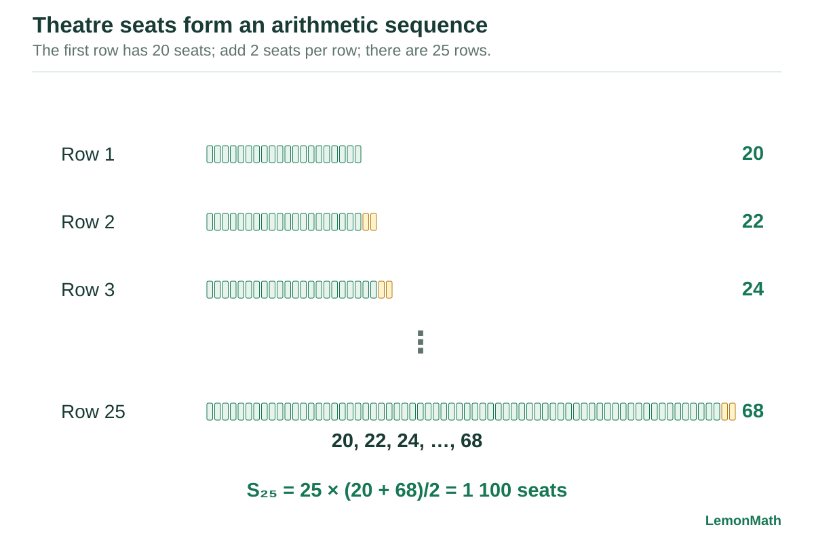

:::goals
- Recognise an arithmetic progression and find its common difference.
- Write the formula for the general term of an arithmetic progression and use it to find any term.
- Use the property of three consecutive terms to recognise an arithmetic progression and to find its terms.
- Find the sum of the first $n$ terms of an arithmetic progression and apply it to real problems.
:::

A cinema has $25$ rows of seats. The first row has $20$ seats, and each row after that has $2$ more seats than the row just before it. In the previous lesson we wrote the number of seats in row $n$ as $a_n=18+2n$.

How many seats does the whole cinema have? Adding $25$ numbers one by one is long and easy to get wrong. We will see that sequences in which each term is a fixed amount more than the one before have both a neat formula for the $n$th term and a neat formula for the sum.

## Arithmetic progressions and the general term

### Explore: a constant difference

What is different about these two sequences?
$$2, 5, 8, 11, 14, \dots\qquad\text{and}\qquad1, 4, 9, 16, 25, \dots$$
In the first, the difference between consecutive terms is always $3$. In the second, the differences are $3, 5, 7, 9, \dots$, which keep changing. The first sequence, like the number of seats in the cinema ($20, 22, 24, \dots$) and the money put in the piggy bank ($20, 25, 30, \dots$), grows steadily step by step.

:::definition Arithmetic progression
An arithmetic progression (arithmetic sequence) is a sequence (finite or infinite) in which, from the second term on, each term equals the term just before it plus a fixed number $d$:
$$u_{n+1}=u_n+d\quad\text{for all }n\ge1.$$
The number $d$ is called the **common difference**.
:::

If $d>0$ the progression is increasing; if $d<0$ it is decreasing; if $d=0$ all terms are equal. For example, $5, 2, -1, -4, \dots$ is an arithmetic progression with $u_1=5$ and $d=-3$.

:::theorem The general term of an arithmetic progression
An arithmetic progression $(u_n)$ with first term $u_1$ and common difference $d$ satisfies
$$u_n=u_1+(n-1)d\quad\text{for all }n\ge1.$$
:::

Why is this true? From $u_1$ to $u_n$ we take $n-1$ steps, each adding $d$. Explicitly, $u_2=u_1+d$, $u_3=u_2+d=u_1+2d$, $u_4=u_1+3d$, and so on. The number of times we add $d$ is always one less than the index $n$. So for the seats in the cinema, $a_n=20+(n-1)\cdot2=18+2n$, just as we wrote.

:::theorem The property of three consecutive terms
Three consecutive terms $u_{k-1}$, $u_k$, $u_{k+1}$ of an arithmetic progression satisfy $u_k=\dfrac{u_{k-1}+u_{k+1}}{2}$. Conversely, three numbers $a$, $b$, $c$ (in that order) form an arithmetic progression if and only if $a+c=2b$.
:::

Why is this true? An arithmetic progression means $u_k-u_{k-1}=u_{k+1}-u_k=d$. Rearranging gives $2u_k=u_{k-1}+u_{k+1}$. In other words, every term (except the first and last) is the mean of the two terms next to it. That is where the name "arithmetic" comes from.

:::example Recognising an arithmetic progression
Which of these sequences are arithmetic progressions? If so, give $u_1$ and the common difference. a) $3, 7, 11, 15, \dots$; b) $1, 2, 4, 8, \dots$; c) the sequence $(u_n)$ with $u_n=5-2n$.

**Solution.** a) The differences $7-3=4$, $11-7=4$ and $15-11=4$ are equal, so this is an arithmetic progression with $u_1=3$ and $d=4$.

b) The differences are $1, 2, 4$, which are not equal, so this is not an arithmetic progression.

c) We have $u_{n+1}-u_n=\left(5-2(n+1)\right)-(5-2n)=-2$, which is constant, so $(u_n)$ is an arithmetic progression with $u_1=3$ and $d=-2$.
:::

If we know any two terms, we can find the common difference and then the first term.

:::example Finding the first term and the common difference
An arithmetic progression $(u_n)$ has $u_3=7$ and $u_8=22$. Find $u_1$, $d$ and a formula for $u_n$.

**Solution.** From $u_3$ to $u_8$ there are $5$ steps, so $u_8-u_3=5d$. Hence $5d=22-7=15$, so $d=3$. From $u_3=u_1+2d$ we get $u_1=7-6=1$. The general term is $u_n=1+3(n-1)=3n-2$.

So $u_1=1$, $d=3$ and $u_n=3n-2$.

**Check.** $u_3=3\cdot3-2=7$ and $u_8=3\cdot8-2=22$. Correct.
:::

## The sum of the first $n$ terms

### Explore: adding from both ends

We find $1+2+3+\dots+10$. Pair the first number with the last:
$$(1+10)+(2+9)+(3+8)+(4+7)+(5+6)=5\cdot11=55.$$
Each pair adds up to $11$ and there are $5$ pairs, so the total is $55$. This is exactly the number $T_{10}$ of cans in $10$ rows from the previous lesson. According to a famous anecdote, the schoolboy Gauss used this idea to add $1+2+\dots+100$ very quickly. Pairing works for every arithmetic progression.

:::theorem The sum of the first $n$ terms of an arithmetic progression
Let $(u_n)$ be an arithmetic progression with first term $u_1$ and common difference $d$. The sum $S_n=u_1+u_2+\dots+u_n$ of the first $n$ terms is
$$S_n=\dfrac{n(u_1+u_n)}{2}=\dfrac{n\left[2u_1+(n-1)d\right]}{2}.$$
:::

Why is this true? Write the sum twice, once in the usual order and once in reverse:
$$\begin{aligned}S_n&=u_1+u_2+\dots+u_{n-1}+u_n,\\ S_n&=u_n+u_{n-1}+\dots+u_2+u_1.\end{aligned}$$
Add column by column: $u_k+u_{n+1-k}=\left[u_1+(k-1)d\right]+\left[u_1+(n-k)d\right]=2u_1+(n-1)d=u_1+u_n$ for every $k$. There are $n$ columns, so $2S_n=n(u_1+u_n)$. Substituting $u_n=u_1+(n-1)d$ gives the second form.

For $u_1=1$ and $d=1$, the formula gives $S_n=\dfrac{n(1+n)}{2}$. This is the formula $T_n=\dfrac{n(n+1)}{2}$ for the cans that we guessed in the previous lesson.

Now we count the seats in the cinema.

:::example The seats in a cinema
A cinema has $25$ rows: $20$ seats in the first row and each later row has $2$ more seats than the row before. How many seats does the whole cinema have?

**Understand.** The numbers of seats form an arithmetic progression with $u_1=20$, $d=2$ and $25$ terms. We need the sum $S_{25}$.

**Plan.** Find the number of seats $u_{25}$ in the last row with the formula for the general term, then use $S_n=\dfrac{n(u_1+u_n)}{2}$.

**Solve.** The last row has $u_{25}=20+24\cdot2=68$ seats. Hence
$$S_{25}=\dfrac{25\cdot(20+68)}{2}=\dfrac{25\cdot88}{2}=1100.$$
So the cinema has $1100$ seats.

**Look back.** Using the second form: $S_{25}=\dfrac{25\left[2\cdot20+24\cdot2\right]}{2}=\dfrac{25\cdot88}{2}=1100$, the same result. The average number of seats per row is $\dfrac{1100}{25}=44$, which is exactly the number of seats in the middle row (row $13$: $20+12\cdot2=44$) and also the mean of the first and last rows: $\dfrac{20+68}{2}=44$. This is true for every arithmetic progression with an odd number of terms.

:::

Next, an example using the property of three consecutive terms.

:::example Finding $x$ so that three numbers form an arithmetic progression
Find $x$ so that the numbers $2$, $x+1$, $3x-5$, in that order, form an arithmetic progression.

**Solution.** Three numbers form an arithmetic progression when the middle one is the mean of the other two, that is $2(x+1)=2+(3x-5)$. We have
$$2x+2=3x-3\Leftrightarrow x=5.$$
So $x=5$.

**Check.** For $x=5$ the three numbers are $2$, $6$, $10$, with common difference $4$. Correct.
:::

When we add a list of equally spaced numbers, we need to know how many terms there are.

:::example The sum of the multiples of $3$
Find the sum of the natural numbers from $1$ to $100$ that are divisible by $3$.

**Solution.** These numbers are $3, 6, 9, \dots, 99$, an arithmetic progression with $u_1=3$ and $d=3$. Suppose the last term $99$ is the $n$th term: $3+(n-1)\cdot3=99$, so $n=\dfrac{99-3}{3}+1=33$. Hence
$$S_{33}=\dfrac{33\cdot(3+99)}{2}=33\cdot51=1683.$$
So the required sum is $1683$.

**Remark.** The number of terms of an arithmetic progression from $u_1$ to $u_n$ is $\dfrac{u_n-u_1}{d}+1$; the "$+1$" counts the first term.
:::

Finally, we return to the piggy bank problem from the previous lesson.

:::example Total savings
You put $20\,000$ dong in the piggy bank in the first month and each later month $5\,000$ dong more than the month before, so the amount put in during month $n$ is $u_n=15\,000+5\,000n$ (dong). How much do you have in total after $12$ months? After at least how many months does the total in the piggy bank exceed $1$ million dong?

**Solution.** We have $u_1=20\,000$ and $u_{12}=75\,000$. Hence
$$S_{12}=\dfrac{12\cdot(20\,000+75\,000)}{2}=570\,000\ \text{(dong)}.$$
For any $n$, $S_n=\dfrac{n\left[2\cdot20\,000+(n-1)\cdot5\,000\right]}{2}=2\,500\,n(n+7)$. We need $2\,500\,n(n+7)>1\,000\,000$, that is $n(n+7)>400$. Trying values: $n=16$ gives $16\cdot23=368<400$; $n=17$ gives $17\cdot24=408>400$.

So after $12$ months you have $570\,000$ dong, and after at least $17$ months the total exceeds $1$ million dong (it is then $1\,020\,000$ dong).
:::

**Connections.** An arithmetic progression is a sequence given by the recurrence relation $u_{n+1}=u_n+d$ from the previous lesson, and it has both a formula for the general term and a formula for the sum. It is the discrete version of a linear function: $u_n=dn+(u_1-d)$ has a graph of points lying on a straight line with gradient $d$. In the next lesson we replace adding a fixed number by multiplying by a fixed number to get geometric progressions.

:::warning Common mistakes
- **Using $n$ instead of $n-1$ in the formula for the general term.** Wrong: $u_n=u_1+nd$. Why it is wrong: for $n=1$ the formula gives $u_1+d$, not $u_1$. Right: $u_n=u_1+(n-1)d$.
- **Checking only the first two terms and concluding that it is an arithmetic progression.** Wrong: $1, 3, 5, 8$ is an arithmetic progression because $3-1=5-3=2$. Why it is wrong: the next difference is $8-5=3\ne2$. Right: check that $u_{k+1}-u_k$ is the same for every $k$.
- **Forgetting to add $1$ when counting terms.** Wrong: the numbers $3, 6, \dots, 99$ number $\dfrac{99-3}{3}=32$. Why it is wrong: this count misses one term. Right: $\dfrac{99-3}{3}+1=33$ numbers.
- **Forgetting to divide by $2$ in the sum formula.** Wrong: $S_n=n(u_1+u_n)$. Why it is wrong: for $1+2+3+4$ the formula gives $4\cdot5=20$ but the sum is $10$. Right: $S_n=\dfrac{n(u_1+u_n)}{2}$.
:::

## Key terms

:::terms
- arithmetic progression (arithmetic sequence) | cấp số cộng
- common difference | công sai
- first term | số hạng đầu
- general term ($n$th term) | số hạng tổng quát
- sum of the first $n$ terms | tổng $n$ số hạng đầu
- arithmetic mean | trung bình cộng
- increasing sequence | dãy số tăng
- decreasing sequence | dãy số giảm
- recurrence relation | hệ thức truy hồi
:::

## Summary

- Arithmetic progression: $u_{n+1}=u_n+d$; $d$ is the common difference. It is increasing if $d>0$ and decreasing if $d<0$.
- General term: $u_n=u_1+(n-1)d$. Any two terms give $u_m-u_k=(m-k)d$.
- Three numbers $a, b, c$ form an arithmetic progression if and only if $a+c=2b$.
- The sum of the first $n$ terms: $S_n=\dfrac{n(u_1+u_n)}{2}=\dfrac{n\left[2u_1+(n-1)d\right]}{2}$.
- The number of terms from $u_1$ to $u_n$ is $\dfrac{u_n-u_1}{d}+1$.
- Special case: $1+2+\dots+n=\dfrac{n(n+1)}{2}$.

## Practice

Each exercise comes with what you need and hints. Try it yourself first, then open the solution.

:::exercise
Prove that the sequence $(u_n)$ with $u_n=3n-5$ is an arithmetic progression. Find $u_1$ and the common difference.

::hint
**What you need:** a sequence is an arithmetic progression if $u_{n+1}-u_n$ is constant.

**Steps:**
1. Find $u_{n+1}-u_n$.
2. Find $u_1$.

::solution
Consider the difference of two consecutive terms: for every $n\in\mathbb{N}^*$ we have
$$u_{n+1}-u_n=\left(3(n+1)-5\right)-(3n-5)=3n+3-5-3n+5=3.$$

This difference does not depend on $n$, so $(u_n)$ is an arithmetic progression with common difference $d=3$.

The first term is $u_1=3\cdot1-5=-2$.

So $(u_n)$ is an arithmetic progression with $u_1=-2$ and common difference $d=3$.

**Answer.** An arithmetic progression with $u_1=-2$, $d=3$.
:::

:::exercise
An arithmetic progression has $u_1=5$ and $d=-3$. Find $u_{10}$. Which term is $-49$?

::hint
**What you need:** $u_n=u_1+(n-1)d$.

**Steps:**
1. Substitute $n=10$.
2. Solve $5-3(n-1)=-49$.

::solution
The general term of an arithmetic progression is $u_n=u_1+(n-1)d$.

With $u_1=5$, $d=-3$ and $n=10$, we have
$$u_{10}=5+9\cdot(-3)=5-27=-22.$$

Suppose $-49$ is the $n$th term $(n\in\mathbb{N}^*)$. Then
$$\begin{aligned}5-3(n-1)&=-49\\-3(n-1)&=-54\\n-1&=18\\n&=19.\end{aligned}$$
The value $n=19$ is a positive integer (it satisfies the condition).

So $u_{10}=-22$ and $-49$ is the $19$th term.

**Answer.** $u_{10}=-22$; $-49$ is the $19$th term.
:::

:::exercise
An arithmetic progression has $u_4=10$ and $u_9=-5$. Find $u_1$, the common difference $d$ and $u_{20}$.

::hint
**What you need:** $u_9-u_4=5d$.

**Steps:**
1. Find $d$ from the difference of the two given terms.
2. Find $u_1=u_4-3d$, then $u_{20}$.

::solution
Let $d$ be the common difference. We have $u_4=u_1+3d=10$ and $u_9=u_1+8d=-5$.

Subtracting $u_4$ from $u_9$ (side by side), we get
$$5d=-5-10=-15,\ \text{so}\ d=-3.$$

From $u_4=u_1+3d=10$ we have $u_1=10-3\cdot(-3)=10+9=19$.

Hence
$$u_{20}=u_1+19d=19+19\cdot(-3)=19-57=-38.$$

So $u_1=19$, the common difference is $d=-3$ and $u_{20}=-38$.

**Answer.** $u_1=19$, $d=-3$, $u_{20}=-38$.
:::

:::exercise
Find the sum $2+5+8+\dots+98$.

::hint
**What you need:** this is an arithmetic progression with $u_1=2$, $d=3$; find the number of terms before finding the sum.

**Steps:**
1. Solve $2+3(n-1)=98$ to find $n$.
2. Use $S_n=\dfrac{n(u_1+u_n)}{2}$.

::solution
The numbers $2, 5, 8, \dots, 98$ form an arithmetic progression with $u_1=2$ and common difference $d=5-2=3$.

Suppose $98$ is the $n$th term $(n\in\mathbb{N}^*)$. Then
$$2+3(n-1)=98\iff3(n-1)=96\iff n=33.$$
So the sum has $33$ terms, with $u_{33}=98$.

Using the formula for the sum of the first $n$ terms, $S_n=\dfrac{n(u_1+u_n)}2$, we have
$$S_{33}=\frac{33\cdot(2+98)}2=\frac{33\cdot100}2=1650.$$

So $2+5+8+\dots+98=1650$.

**Answer.** $1650$.
:::

:::exercise
Find $x$ so that the numbers $x-2$, $2x+1$, $5x-4$, in that order, form an arithmetic progression.

::hint
**What you need:** $a, b, c$ form an arithmetic progression when $a+c=2b$.

**Steps:**
1. Write $(x-2)+(5x-4)=2(2x+1)$.
2. Solve the equation, then check.

::solution
Three numbers $a$, $b$, $c$, in that order, form an arithmetic progression if and only if $a+c=2b$.

Applying this with $a=x-2$, $b=2x+1$, $c=5x-4$, we have
$$\begin{aligned}(x-2)+(5x-4)&=2(2x+1)\\6x-6&=4x+2\\2x&=8\\x&=4.\end{aligned}$$

Check: for $x=4$ the three numbers are $2$, $9$, $16$; we have $9-2=7$ and $16-9=7$, so they form an arithmetic progression with common difference $7$.

So $x=4$.

**Answer.** $x=4$.
:::

:::exercise
Suppose a company pays a salary of $120$ million dong in the first year and each later year pays $6$ million dong more than the year before. Find the total salary received in the first $10$ years.

::hint
**What you need:** the yearly salaries form an arithmetic progression with $u_1=120$, $d=6$.

**Steps:**
1. Find the salary in year $10$.
2. Use the sum formula.

::solution
Let $u_n$ (million dong) be the salary in year $n$, where $n=1, 2, \dots, 10$. Each later year the salary is $6$ million dong more than the year before, so $(u_n)$ is an arithmetic progression with $u_1=120$ and common difference $d=6$.

The salary in year $10$ is
$$u_{10}=u_1+9d=120+9\cdot6=174\ (\text{million dong}).$$

The total salary received in the first $10$ years is
$$S_{10}=\frac{10\cdot(u_1+u_{10})}2=\frac{10\cdot(120+174)}2=5\cdot294=1470\ (\text{million dong}).$$

So the total salary received in the first $10$ years is $1470$ million dong.

**Answer.** $1470$ million dong.
:::

:::exercise
Consider the sequence $7, 3, -1, -5, \dots$ (an arithmetic progression). Decide whether each statement is true or false.

a) The common difference of the progression is $d=-4$.

b) The general term is $u_n=11-4n$.

c) The number $-45$ is a term of the progression.

d) The sum of the first $10$ terms is $-130$.

::hint
**What you need:** $u_n=u_1+(n-1)d$; $S_n=\dfrac{n\left[2u_1+(n-1)d\right]}{2}$.

**Steps:**
1. Find $d$ and $u_n$.
2. c) Solve $u_n=-45$.
3. d) Find $S_{10}$.

::solution
The sequence $7, 3, -1, -5, \dots$ is an arithmetic progression with $u_1=7$ and common difference $d=3-7=-4$ (check: $-1-3=-4$ and $-5-(-1)=-4$).

a) **True.** The common difference is $d=3-7=-4$.

b) **True.** The general term is $u_n=u_1+(n-1)d=7+(n-1)\cdot(-4)=11-4n$.

c) **True.** Suppose $-45$ is the $n$th term $(n\in\mathbb{N}^*)$. Then $11-4n=-45$, so $4n=56$ and $n=14$. This is a positive integer, so $-45$ is the $14$th term of the progression.

d) **False.** Using the formula $S_n=\dfrac{n\left[2u_1+(n-1)d\right]}2$, we have
$$S_{10}=\frac{10\left[14+9\cdot(-4)\right]}2=5\cdot(-22)=-110\ne-130.$$

So statements a), b), c) are true; statement d) is false.

**Answer.** a) True; b) True; c) True; d) False.
:::

:::exercise
Find the sum of all odd numbers with two digits.

::hint
**What you need:** the numbers $11, 13, \dots, 99$ form an arithmetic progression with $d=2$.

**Steps:**
1. Find the number of terms $\dfrac{99-11}{2}+1$.
2. Use $S_n=\dfrac{n(u_1+u_n)}{2}$.

::solution
The odd numbers with two digits are $11, 13, 15, \dots, 99$. They form an arithmetic progression with $u_1=11$ and common difference $d=2$.

Suppose $99$ is the $n$th term $(n\in\mathbb{N}^*)$. Then $11+2(n-1)=99$, so $n-1=44$ and $n=45$. The number of terms is $\dfrac{99-11}2+1=45$.

Using the formula $S_n=\dfrac{n(u_1+u_n)}2$, the required sum is
$$S_{45}=\frac{45\cdot(11+99)}2=45\cdot55=2475.$$

So the sum of all odd numbers with two digits is $2475$.

**Answer.** $2475$.
:::

:::exercise Revision
Prove that every arithmetic progression with common difference $d>0$ is increasing and bounded below but not bounded above.

::hint
**What you need:** from the previous lesson, a sequence is increasing when $u_{n+1}-u_n>0$; it is bounded above when some $M$ has $u_n\le M$ for all $n$.

**Steps:**
1. Find $u_{n+1}-u_n$.
2. Use $u_n=u_1+(n-1)d$ to compare with $u_1$ and with any number $M$.

::solution
Let $(u_n)$ be an arithmetic progression with common difference $d>0$.

Increasing: for every $n\in\mathbb{N}^*$ we have $u_{n+1}-u_n=d>0$, that is $u_{n+1}>u_n$. So $(u_n)$ is an increasing sequence.

Bounded below: since the sequence is increasing, $u_n\ge u_1$ for all $n\in\mathbb{N}^*$. So the sequence is bounded below by $u_1$.

Not bounded above: take any number $M$. Choose a positive integer $n$ with $n>1+\dfrac{M-u_1}d$. Since $d>0$, multiplying both sides by $d$ keeps the inequality: $(n-1)d>M-u_1$. Therefore
$$u_n=u_1+(n-1)d>M.$$
So for every number $M$ some term of the sequence exceeds $M$, and hence no number $M$ bounds the sequence above.

So every arithmetic progression with common difference $d>0$ is increasing and bounded below (by $u_1$) but not bounded above.

**Answer.** The sequence is increasing, bounded below by $u_1$, and not bounded above.
:::

:::exercise Challenge
Let $a$, $b$, $c$ be numbers such that $a^2$, $b^2$, $c^2$ form an arithmetic progression and $a+b$, $b+c$, $c+a$ are all non-zero. Prove that $\dfrac{1}{b+c}$, $\dfrac{1}{c+a}$, $\dfrac{1}{a+b}$ also form an arithmetic progression.

::hint
**What you need:** three numbers form an arithmetic progression when two consecutive differences are equal; $b^2-a^2=c^2-b^2$.

**Steps:**
1. Find $\dfrac{1}{c+a}-\dfrac{1}{b+c}$ and $\dfrac{1}{a+b}-\dfrac{1}{c+a}$ over common denominators.
2. Compare the two differences, using $(b-a)(a+b)=(c-b)(b+c)$.

::solution
Since $a+b$, $b+c$, $c+a$ are all non-zero, the fractions $\dfrac{1}{b+c}$, $\dfrac{1}{c+a}$, $\dfrac{1}{a+b}$ are all defined.

The three numbers $\dfrac{1}{b+c}$, $\dfrac{1}{c+a}$, $\dfrac{1}{a+b}$ form an arithmetic progression if and only if the two consecutive differences are equal. We compute
$$\frac{1}{c+a}-\frac{1}{b+c}=\frac{(b+c)-(c+a)}{(c+a)(b+c)}=\frac{b-a}{(c+a)(b+c)},$$
$$\frac{1}{a+b}-\frac{1}{c+a}=\frac{(c+a)-(a+b)}{(a+b)(c+a)}=\frac{c-b}{(a+b)(c+a)}.$$

These two differences have the common factor $\dfrac1{c+a}\ne0$, so they are equal if and only if
$$\frac{b-a}{b+c}=\frac{c-b}{a+b}.$$
Cross-multiplying (since $b+c\ne0$ and $a+b\ne0$), this is equivalent to
$$(b-a)(a+b)=(c-b)(b+c)\iff b^2-a^2=c^2-b^2.$$

The last equality is true because $a^2$, $b^2$, $c^2$ form an arithmetic progression (the hypothesis). Every step above is an equivalence, so the two differences are equal.

So $\dfrac{1}{b+c}$, $\dfrac{1}{c+a}$, $\dfrac{1}{a+b}$ also form an arithmetic progression.

**Answer.** The numbers $\dfrac{1}{b+c}$, $\dfrac{1}{c+a}$, $\dfrac{1}{a+b}$ form an arithmetic progression.
:::

## Mini test

:::quiz
::mc NB
An arithmetic progression has $u_1=-3$ and $d=4$. The term $u_6$ is
A. $21$.
B. $13$.
C. $24$.
D. $17$.
::key D
$u_6=-3+5\cdot4=17$. Option A uses $6d$ instead of $5d$, and option B is $u_5$.

::mc TH
The numbers $3$, $x$, $15$, in that order, form an arithmetic progression when $x$ equals
A. $9$.
B. $7$.
C. $45$.
D. $6$.
::key A
$x=\dfrac{3+15}{2}=9$. Option C takes the product $3\cdot15$.

::mc TH
An arithmetic progression has $u_1=2$ and $d=3$. The sum of the first $20$ terms is
A. $1220$.
B. $610$.
C. $59$.
D. $590$.
::key B
$u_{20}=2+19\cdot3=59$ and $S_{20}=\dfrac{20\cdot(2+59)}{2}=610$. Option A forgets to divide by $2$, and option C is just $u_{20}$.

::mc TH
How many terms does the arithmetic progression $5, 8, 11, \dots, 98$ have?
A. $31$.
B. $33$.
C. $32$.
D. $93$.
::key C
$\dfrac{98-5}{3}+1=32$. Option A forgets to add $1$ and miscounts by one term, and option D is $98-5$.

::tf TH TH VD TH
A grandstand has $12$ rows of seats: $30$ seats in the first row and each later row has $3$ more seats than the row before. Decide whether each statement is true or false.
a) The numbers of seats in the rows form an arithmetic progression with common difference $3$.
b) Row $12$ has $66$ seats.
c) The grandstand has $576$ seats in total.
d) Row $8$ has $51$ seats.
::key T F F T
a) True. b) False: $u_{12}=30+11\cdot3=63$. c) False: $S_{12}=\dfrac{12\cdot(30+63)}{2}=558$. d) True: $u_8=30+7\cdot3=51$.

::sa VD
Find the sum of the multiples of $5$ from $1$ to $100$.
::key 1050
The numbers $5, 10, \dots, 100$ have $20$ terms, so the sum is $\dfrac{20\cdot(5+100)}{2}=1050$.

::sa VD
An arithmetic progression has $u_3=2$ and $u_7=14$. Find $u_{10}$.
::key 23
$4d=14-2=12$, so $d=3$, and $u_{10}=u_7+3d=14+9=23$.
:::
