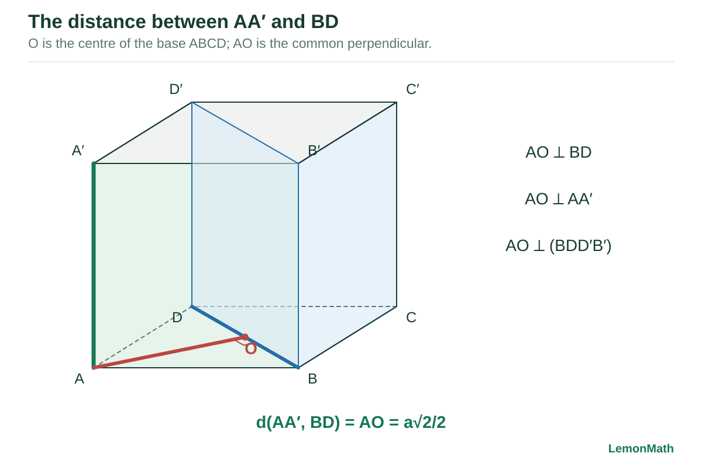

:::goals
- Understand the distance from a point to a line and to a plane.
- Know the distance between a line and a parallel plane, and between two parallel planes.
- Find the distance between two skew lines by reducing it to a distance to a plane.
- Apply this to pyramids, cubes, cuboids and real-life problems.
:::

Suppose that in a cuboid-shaped room a pipe runs vertically along one corner, while a cable is stretched along a diagonal of the floor (assumed figures). The two never meet and are not parallel. What is the shortest distance between them? To answer, we need the idea of distance in space.

## Exploration: which point of a line is nearest?

In a plane, let $\Delta$ be the horizontal axis and $M(0, 3)$ a point. For a point $X(t, 0)$ on $\Delta$, the length is $MX=\sqrt{9+t^2}$.

| $t$ | $0$ | $1$ | $2$ | $4$ |
|---|---|---|---|---|
| $MX$ | $3$ | $\sqrt{10}\approx3.16$ | $\sqrt{13}\approx3.61$ | $5$ |

The length $MX$ is smallest, equal to $3$, when $X$ is the foot $H$ of the perpendicular from $M$ to $\Delta$. The same is true in space: the shortest distance is measured in the perpendicular direction.

## Distance from a point

:::definition Distance from a point to a line and to a plane
- The **distance from a point $M$ to a line $\Delta$** is the length of segment $MH$, where $H$ is the orthogonal projection of $M$ onto $\Delta$. We write $d(M,\Delta)$.
- The **distance from a point $M$ to a plane $(P)$** is the length of segment $MH$, where $H$ is the orthogonal projection of $M$ onto $(P)$. We write $d(M,(P))$.
:::

**Why is $MH$ the shortest?** For any point $X$ of $(P)$ other than $H$, triangle $MHX$ is right-angled at $H$, so $MX^2=MH^2+HX^2>MH^2$, hence $MX>MH$. The argument for a line is the same.

If $M$ lies on the line or plane, the distance is $0$.

## Distances between figures

:::theorem Distance between a line and a parallel plane, and between two parallel planes
- If $\Delta\parallel(P)$, every point of $\Delta$ is at the same distance from $(P)$. This is the **distance between $\Delta$ and $(P)$**: $d(\Delta,(P))=d(M,(P))$ for any point $M$ of $\Delta$.
- If $(P)\parallel(Q)$, every point of $(P)$ is at the same distance from $(Q)$, called the **distance between the two planes**: $d((P),(Q))=d(M,(Q))$ for $M\in(P)$.
:::

:::definition Distance between two skew lines
Let $a$ and $b$ be skew lines. Let $(Q)$ be the plane containing $b$ and parallel to $a$. The **distance between $a$ and $b$** equals the distance between $a$ and $(Q)$, written $d(a,b)$.
:::

The distance between two skew lines also equals the length of their common perpendicular segment, and it is the smallest distance between a point of $a$ and a point of $b$.

:::diagram The distance from $A$ to the plane $(SBC)$
alt: Pyramid S.ABCD with SA perpendicular to the base; point H lies on SB with AH perpendicular to SB, and segment AH is the distance from A to the plane SBC
point A 0,0 below-left
point B 4,0 below-right
point C 5.2,1.5 right
point D 1.2,1.5 above
point S 0,4.2 above-left
point H 2.1,2.0 above
segment S A
segment S B
segment S C
segment S D dashed
segment A B
segment B C
segment A D dashed
segment D C dashed
segment A H dashed
right S A B
right A H S
:::

## Examples

First, the distance from a point to a line.

:::example Distance from a point to a line
The pyramid $S.ABCD$ has a square base $ABCD$ of side $a$, $SA\perp(ABCD)$ and $SA=a$. Find the distance from $A$ to the line $SC$.

**Solution.** Since $SA\perp(ABCD)$, $SA\perp AC$. We have $AC=a\sqrt2$ and $SC=\sqrt{SA^2+AC^2}=a\sqrt3$.

Let $K$ be the foot of the perpendicular from $A$ to $SC$. In triangle $SAC$, right-angled at $A$, compute the area in two ways: $\dfrac12 AK\cdot SC=\dfrac12SA\cdot AC$. Hence
$$AK=\frac{SA\cdot AC}{SC}=\frac{a\cdot a\sqrt2}{a\sqrt3}=\frac{a\sqrt6}{3}.$$

So $d(A,SC)=\dfrac{a\sqrt6}{3}$.
:::

Next, the distance from a point to a plane.

:::example Distance from the vertex of a right tetrahedron
The tetrahedron $OABC$ has $OA$, $OB$, $OC$ mutually perpendicular and $OA=OB=OC=a$. Find $d(O,(ABC))$.

**Solution.** Let $M$ be the midpoint of $BC$. Since $OA\perp(OBC)$, $OA\perp BC$; triangle $OBC$ is right isosceles at $O$, so $OM\perp BC$. The lines $OA$, $OM$ intersect at $O$ in $(OAM)$, so $BC\perp(OAM)$.

In the plane $(OAM)$ draw $OH\perp AM$. Since $BC\perp(OAM)$, $BC\perp OH$. The lines $AM$, $BC$ intersect at $M$ in $(ABC)$, so $OH\perp(ABC)$, that is $OH=d(O,(ABC))$.

Triangle $OAM$ is right-angled at $O$ with $OA=a$ and $OM=\dfrac{a\sqrt2}{2}$, so
$$\frac1{OH^2}=\frac1{OA^2}+\frac1{OM^2}=\frac1{a^2}+\frac2{a^2}=\frac3{a^2}\Rightarrow OH=\frac{a}{\sqrt3}=\frac{a\sqrt3}{3}.$$

So $d(O,(ABC))=\dfrac{a\sqrt3}{3}$.
:::

Now the distance to a lateral face of a pyramid.

:::example Distance from the foot of the height to a lateral face
The pyramid $S.ABCD$ has a square base $ABCD$ of side $a$, $SA\perp(ABCD)$ and $SA=a$. Find $d(A,(SBC))$.

**Solution.** We have $BC\perp AB$ and $BC\perp SA$, so $BC\perp(SAB)$. In $(SAB)$ draw $AH\perp SB$ at $H$. Since $BC\perp(SAB)$, $BC\perp AH$. The lines $SB$, $BC$ intersect at $B$ in $(SBC)$, so $AH\perp(SBC)$, hence $AH=d(A,(SBC))$.

Triangle $SAB$ is right-angled at $A$ with $SA=AB=a$, so $SB=a\sqrt2$ and
$$AH=\frac{SA\cdot AB}{SB}=\frac{a\cdot a}{a\sqrt2}=\frac{a\sqrt2}{2}.$$

So $d(A,(SBC))=\dfrac{a\sqrt2}{2}$.
:::

Finally, the distance between two skew lines.

:::example Distance between two skew lines in a cube
In the cube $ABCD.A'B'C'D'$ of edge $a$, find the distance between the lines $AA'$ and $BD$.

**Solution.** The lines $AA'$ and $BD$ are skew. The plane $(BDD'B')$ contains $BD$ and is parallel to $AA'$ (since $AA'\parallel BB'$ and $BB'\subset(BDD'B')$). Therefore
$$d(AA',BD)=d(AA',(BDD'B'))=d(A,(BDD'B')).$$

Let $O$ be the centre of the base $ABCD$. We have $AO\perp BD$ and $AO\perp BB'$ (since $BB'\perp(ABCD)$). The lines $BD$, $BB'$ intersect in $(BDD'B')$, so $AO\perp(BDD'B')$. Thus $d(A,(BDD'B'))=AO=\dfrac{a\sqrt2}{2}$.

So $d(AA',BD)=\dfrac{a\sqrt2}{2}$.

:::

Now we return to the pipe and cable from the start, in four steps.

:::example Application: the distance between a pipe and a cable
Suppose a room is a cuboid $ABCD.A'B'C'D'$ whose floor $ABCD$ has $AB=6$ m and $AD=4$ m, and whose height is $AA'=3$ m (assumed figures). A pipe runs along the vertical edge $AA'$ and a cable is stretched along the floor diagonal $BD$. Find the shortest distance between the pipe and the cable, to the nearest tenth of a metre.

**Solution.**

*Understand.* We need $d(AA',BD)$ for two skew lines.

*Plan.* As in the cube, the plane $(BDD'B')$ contains $BD$ and is parallel to $AA'$, so $d(AA',BD)=d(A,(BDD'B'))$. The foot of the perpendicular from $A$ lies on $BD$ in the floor, so this distance equals $d(A,BD)$.

*Solve.* In triangle $ABD$, right-angled at $A$, with $AB=6$ and $AD=4$, we get $BD=\sqrt{36+16}=\sqrt{52}$. Draw $AK\perp BD$; then
$$AK=\frac{AB\cdot AD}{BD}=\frac{24}{\sqrt{52}}\approx3.3.$$

So the shortest distance between the pipe and the cable is about $3.3$ m.

*Look back.* Is the result reasonable? The distance must be less than both $AB=6$ and $AD=4$, because $AK$ is the altitude to the hypotenuse and is shorter than both legs; $3.3<4$ is reasonable. The height of the room, $AA'=3$ m, does not affect the result, because the pipe is vertical and the cable horizontal, so the distance is measured in the floor.
:::

:::warning Common mistakes
- **Taking the distance to any point of the line.** Wrong: $d(M,\Delta)=MX$ for an arbitrary point $X$ of $\Delta$. Why it is wrong: only the foot of the perpendicular gives the shortest length. Right: $d(M,\Delta)=MH$ with $MH\perp\Delta$.
- **Forgetting to prove the segment is perpendicular to the plane.** Wrong: draw $AH\perp SB$ and conclude at once that $AH=d(A,(SBC))$. Why it is wrong: $AH$ must be perpendicular to the whole plane $(SBC)$, that is, to two intersecting lines of it. Right: also show $AH\perp BC$.
- **Measuring the distance between skew lines by a segment joining arbitrary points.** Wrong: take $AB'$, or any segment joining two points, as the distance. Why it is wrong: such a segment is usually longer than the shortest distance. Right: reduce to the distance from a point to the plane containing one line and parallel to the other.
- **Thinking a line parallel to a plane is at distance $0$.** Wrong: $\Delta\parallel(P)$, so $d(\Delta,(P))=0$. Why it is wrong: a parallel line has no point in common with the plane. Right: the distance equals the distance from any point of $\Delta$ to $(P)$, and is greater than $0$.
:::

**Connections.** This lesson uses [a line perpendicular to a plane](lesson:line-perpendicular-plane) to construct feet of perpendiculars, and [orthogonal projection](lesson:orthogonal-projection-angle) to reduce problems to right triangles. The lesson on [volumes](lesson:volumes) uses the height, which is the distance from the apex to the base. In practice, builders and engineers use the shortest distance between pipes and cables to lay out services so they do not collide.

## Terms

:::terms
- khoảng cách từ điểm đến đường thẳng | distance from a point to a line
- khoảng cách từ điểm đến mặt phẳng | distance from a point to a plane
- khoảng cách giữa hai mặt phẳng song song | distance between two parallel planes
- khoảng cách giữa hai đường thẳng chéo nhau | distance between two skew lines
- đoạn vuông góc chung | common perpendicular
- chân đường vuông góc | foot of the perpendicular
- đường cao | height
- hình hộp chữ nhật | cuboid
- hình chóp | pyramid
- song song | parallel
:::

## Summary

- $d(M,\Delta)=MH$ and $d(M,(P))=MH$, where $H$ is the orthogonal projection of $M$ onto $\Delta$ or $(P)$; this is the shortest distance.
- $d(\Delta,(P))=d(M,(P))$ for $M\in\Delta$ when $\Delta\parallel(P)$; $d((P),(Q))=d(M,(Q))$ for $M\in(P)$ when $(P)\parallel(Q)$.
- For skew lines $a$, $b$: $d(a,b)=d(a,(Q))$ where $(Q)\supset b$ and $(Q)\parallel a$.
- To find $d(A,(P))$, construct $AH\perp(P)$ by showing $AH$ is perpendicular to two intersecting lines of $(P)$, then compute in a right triangle.
- A useful formula in a right triangle: the altitude to the hypotenuse is $h=\dfrac{xy}{\sqrt{x^2+y^2}}$ for legs $x$, $y$.

## Practice

Each exercise has the knowledge needed and hints on the steps. Try it yourself first, then open the solution.

:::exercise
The pyramid $S.ABC$ has $SA\perp(ABC)$, triangle $ABC$ right-angled at $A$, $AB=15$, $AC=20$ and $SA=16$ (any unit). Find $d(A,BC)$ and $d(A,(SBC))$.

::hint
**Knowledge:** the altitude in a right triangle; draw $AH\perp SK$ where $K$ is the foot of the altitude from $A$ in triangle $ABC$.

**Hints on the steps:**
1. Find $BC$, then $AK$.
2. Show $BC\perp(SAK)$, draw $AH\perp SK$ and find $AH$.

::solution
$BC=\sqrt{225+400}=25$ and $AK=\dfrac{15\cdot20}{25}=12$. So $d(A,BC)=12$.

$BC\perp AK$ and $BC\perp SA$, so $BC\perp(SAK)$. Draw $AH\perp SK$; then $AH\perp BC$, so $AH\perp(SBC)$. Triangle $SAK$ is right-angled at $A$ with $SK=\sqrt{256+144}=20$, so $AH=\dfrac{16\cdot12}{20}=9.6$.

**Answer.** $d(A,BC)=12$; $d(A,(SBC))=9.6$.
:::

:::exercise
In the cube $ABCD.A'B'C'D'$ of edge $a$, find the distance from $B$ to the plane $(ACC'A')$.

::hint
**Knowledge:** $BD\perp(ACC'A')$.

**Hints on the steps:**
1. Let $O$ be the centre of $ABCD$.
2. Show $BO\perp(ACC'A')$.

::solution
Let $O=AC\cap BD$. Since $ABCD$ is a square, $BD\perp AC$.

Since $ABCD.A'B'C'D'$ is a cube, $AA'\perp(ABCD)$, so $AA'\perp BD$.

The line $BD$ is perpendicular to the two intersecting lines $AC$ and $AA'$ lying in $(ACC'A')$, so $BD\perp(ACC'A')$. As $O\in BD$, we get $BO\perp(ACC'A')$, and $O\in AC\subset(ACC'A')$.

Hence $d\left(B,(ACC'A')\right)=BO$.

The square $ABCD$ of side $a$ has diagonal $BD=a\sqrt2$, and $O$ is the midpoint of $BD$, so $BO=\dfrac{BD}{2}=\dfrac{a\sqrt2}{2}$.

So the distance from $B$ to the plane $(ACC'A')$ is $\dfrac{a\sqrt2}{2}$.

**Answer.** $\dfrac{a\sqrt2}{2}$.
:::

:::exercise
In the cube $ABCD.A'B'C'D'$ of edge $a$, find the distance between the line $BB'$ and the plane $(ACC'A')$.

::hint
**Knowledge:** $BB'\parallel CC'$, so $BB'\parallel(ACC'A')$.

**Hints on the steps:**
1. Choose the point $B$ on $BB'$.
2. Use the result of the previous exercise.

::solution
We have $BB'\parallel CC'$ (lateral edges of the cube) and $CC'\subset(ACC'A')$. Also $BB'\not\subset(ACC'A')$ (because $B\notin(ACC'A')$). Hence $BB'\parallel(ACC'A')$.

The distance between a line and a plane parallel to it equals the distance from any point of the line to the plane. Choosing the point $B$:
$$d\left(BB',(ACC'A')\right)=d\left(B,(ACC'A')\right)=\frac{a\sqrt2}{2}$$
(the result of Exercise 2).

So the distance between $BB'$ and $(ACC'A')$ is $\dfrac{a\sqrt2}{2}$.

**Answer.** $\dfrac{a\sqrt2}{2}$.
:::

:::exercise
Decide whether each statement is true or false.

a) The distance from a point $M$ to a plane $(P)$ is the length of the perpendicular segment from $M$ to $(P)$.

b) If $\Delta\parallel(P)$ then $d(\Delta,(P))=0$.

c) The distance between two parallel planes equals the distance from any point of one plane to the other.

d) The distance between two skew lines $a$, $b$ equals the distance between $a$ and any plane containing $b$.

::hint
**Knowledge:** the definitions of distance.

**Hints on the steps:**
1. Compare each statement with the definition.
2. For part d, note the plane must be parallel to $a$.

::solution
a) **True.** By definition, the distance from a point $M$ to a plane $(P)$ is the distance $MH$ from $M$ to its orthogonal projection $H$ on $(P)$, that is, the length of the perpendicular segment from $M$ to $(P)$.

b) **False.** If $\Delta\parallel(P)$, then $\Delta$ and $(P)$ have no common point, so the distance $d(\Delta,(P))$ (the distance from any point of $\Delta$ to $(P)$) is greater than $0$.

c) **True.** By the theorem, if two planes are parallel, then every point of one plane has the same distance to the other plane; this common value is the distance between the two planes.

d) **False.** The distance between two skew lines $a$, $b$ equals the distance between $a$ and the plane that contains $b$ and is parallel to $a$. If we take an arbitrary plane containing $b$ that is not parallel to $a$, that plane meets $a$ and the distance is $0$, which is not the distance between $a$ and $b$.

So statements a), c) are true; statements b), d) are false.

**Answer.** a) True; b) False; c) True; d) False.
:::

:::exercise
Suppose a room is a cuboid $ABCD.A'B'C'D'$ whose floor $ABCD$ has $AB=8$ m and $AD=6$ m, and whose height is $AA'=3$ m (assumed figures). A pipe runs along the vertical edge $AA'$ and a cable is stretched along the floor diagonal $BD$. Find the shortest distance between the pipe and the cable.

::hint
**Knowledge:** $d(AA',BD)=d(A,BD)$.

**Hints on the steps:**
1. Find $BD$.
2. Find the altitude to the hypotenuse in triangle $ABD$.

::solution
Since $ABCD$ is a rectangle, triangle $ABD$ is right-angled at $A$, with $AB=8$ m and $AD=6$ m.

By Pythagoras' theorem:
$$BD=\sqrt{AB^2+AD^2}=\sqrt{64+36}=10\ \text{(m)}.$$

Draw $AH\perp BD$ at $H$. Since $AA'\perp(ABCD)$ and $AH\subset(ABCD)$, we have $AA'\perp AH$. So $AH$ is perpendicular to both $AA'$ and $BD$, hence $AH$ is the common perpendicular of the skew lines $AA'$ and $BD$. Therefore
$$d(AA',BD)=AH=d(A,BD).$$

In triangle $ABD$, right-angled at $A$, we have $AH\cdot BD=AB\cdot AD$ (both equal twice the area of the triangle), so
$$AH=\frac{AB\cdot AD}{BD}=\frac{8\cdot6}{10}=4.8\ \text{(m)}.$$

So the shortest distance between the pipe and the cable is $4.8$ m.

**Answer.** $4.8$ m.
:::

:::exercise
Suppose a roof is shaped like a pyramid $S.ABCD$ whose base $ABCD$ is a square of side $6$ m and whose lateral edges are all $5$ m (assumed figures). Let $O$ be the centre of the base. Find the distance from $S$ to the plane $(ABCD)$ and the distance from $S$ to the line $BC$.

::hint
**Knowledge:** $SO\perp(ABCD)$; if $M$ is the midpoint of $BC$ then $SM\perp BC$.

**Hints on the steps:**
1. Find $SO$ in triangle $SOA$.
2. Find $SM$ in triangle $SOM$, right-angled at $O$, with $OM=3$.

::solution
The base $ABCD$ is a square of side $6$ m and $O$ is its centre, so $OA=OB=OC=OD$. The lateral edges satisfy $SA=SB=SC=SD=5$ m, hence $SO\perp(ABCD)$ and $d\left(S,(ABCD)\right)=SO$.

The diagonal of the base is $AC=6\sqrt2$, so $OA=\dfrac{AC}{2}=3\sqrt2$.

In triangle $SOA$, right-angled at $O$:
$$SO=\sqrt{SA^2-OA^2}=\sqrt{25-18}=\sqrt7\approx2.6\ \text{(m)}.$$

Let $M$ be the midpoint of $BC$. Triangle $SBC$ is isosceles at $S$, so the median $SM$ is also an altitude: $SM\perp BC$, that is $d(S,BC)=SM$.

We have $OM\perp BC$ and $OM=\dfrac{AB}{2}=3$ m. Since $SO\perp(ABCD)$, $SO\perp OM$, and in triangle $SOM$, right-angled at $O$:
$$SM=\sqrt{SO^2+OM^2}=\sqrt{7+9}=4\ \text{(m)}.$$

So the distance from $S$ to the plane $(ABCD)$ is about $2.6$ m and the distance from $S$ to the line $BC$ is $4$ m.

**Answer.** $d(S,(ABCD))\approx2.6$ m; $d(S,BC)=4$ m.
:::

:::exercise
In the cube $ABCD.A'B'C'D'$ of edge $a$, find the distance from $A'$ to the plane $(AB'D')$.

::hint
**Knowledge:** the tetrahedron $A'.AB'D'$ has three edges from $A'$ that are mutually perpendicular and equal to $a$.

**Hints on the steps:**
1. Recognise the right tetrahedron from the examples.
2. Apply the result.

::solution
The tetrahedron $A'.AB'D'$ has three edges $A'A$, $A'B'$, $A'D'$ that are mutually perpendicular and all equal to $a$ (the edges of the cube issuing from $A'$).

Its volume is $V=\dfrac13\cdot S_{A'B'D'}\cdot A'A=\dfrac13\cdot\dfrac{a^2}{2}\cdot a=\dfrac{a^3}{6}$.

Triangle $AB'D'$ has three sides $AB'=B'D'=D'A=a\sqrt2$ (diagonals of square faces), so it is equilateral with side $a\sqrt2$ and area
$$S_{AB'D'}=\frac{\sqrt3}{4}\left(a\sqrt2\right)^2=\frac{a^2\sqrt3}{2}.$$

The distance from $A'$ to $(AB'D')$ is the height of the tetrahedron relative to the base $AB'D'$, so
$$d\left(A',(AB'D')\right)=\frac{3V}{S_{AB'D'}}=\frac{a^3/2}{a^2\sqrt3/2}=\frac{a}{\sqrt3}=\frac{a\sqrt3}{3}.$$

So the distance from $A'$ to the plane $(AB'D')$ is $\dfrac{a\sqrt3}{3}$.

**Answer.** $\dfrac{a\sqrt3}{3}$.
:::

:::exercise
Revisit Pythagoras' theorem. In the cube $ABCD.A'B'C'D'$ of edge $a$, find the distance from $A$ to the line $CC'$ and to the line $BC'$.

::hint
**Knowledge:** $AC\perp CC'$ and $AB\perp BC'$.

**Hints on the steps:**
1. Find the foot of the perpendicular from $A$ to each line.
2. Find the lengths by Pythagoras' theorem.

::solution
We use Pythagoras' theorem and perpendicularity relations in the cube of edge $a$.

Distance from $A$ to $CC'$: since $CC'\perp(ABCD)$ and $AC\subset(ABCD)$, we have $CC'\perp AC$. So $AC$ is the perpendicular segment from $A$ to $CC'$ and
$$d(A,CC')=AC=\sqrt{AB^2+BC^2}=\sqrt{a^2+a^2}=a\sqrt2.$$

Distance from $A$ to $BC'$: since $AB\perp BC$ and $AB\perp BB'$, we have $AB\perp(BCC'B')$. As $BC'\subset(BCC'B')$, we get $AB\perp BC'$. So $AB$ is the perpendicular segment from $A$ to $BC'$ and
$$d(A,BC')=AB=a.$$

So $d(A,CC')=a\sqrt2$ and $d(A,BC')=a$.

**Answer.** $a\sqrt2$ and $a$.
:::

:::exercise Challenge
In the cube $ABCD.A'B'C'D'$ of edge $a$, find the distance between the skew lines $AB'$ and $BC'$.

::hint
**Knowledge:** $AB'\parallel DC'$, so $AB'\parallel(BDC')$. The tetrahedron $C.BDC'$ has three edges from $C$ that are mutually perpendicular.

**Hints on the steps:**
1. Reduce to $d(A,(BDC'))$.
2. Use the midpoint $O$ of $AC$ to pass to $d(C,(BDC'))$.

::solution
We have $AB'\parallel DC'$ (because $AB'C'D$ is a rectangle) and $DC'\subset(BDC')$, while $AB'\not\subset(BDC')$. Hence $AB'\parallel(BDC')$, and $BC'\subset(BDC')$.

The distance between the skew lines $AB'$ and $BC'$ equals the distance between $AB'$ and the plane $(BDC')$, which contains $BC'$ and is parallel to $AB'$. Therefore
$$d(AB',BC')=d\left(AB',(BDC')\right)=d\left(A,(BDC')\right).$$

Let $O$ be the midpoint of $AC$. Since $O$ is also the midpoint of $BD$, $O\in BD\subset(BDC')$. As $O$ is the midpoint of $AC$ and lies in the plane $(BDC')$, the points $A$ and $C$ have the same distance to $(BDC')$:
$$d\left(A,(BDC')\right)=d\left(C,(BDC')\right).$$

The tetrahedron $C.BDC'$ has three edges $CB$, $CD$, $CC'$ that are mutually perpendicular and all equal to $a$. Its volume is $V=\dfrac13\cdot\dfrac{a^2}{2}\cdot a=\dfrac{a^3}{6}$. Triangle $BDC'$ has sides $BD=DC'=C'B=a\sqrt2$, so it is equilateral with area $\dfrac{\sqrt3}{4}\left(a\sqrt2\right)^2=\dfrac{a^2\sqrt3}{2}$. Hence
$$d\left(C,(BDC')\right)=\frac{3V}{S_{BDC'}}=\frac{a^3/2}{a^2\sqrt3/2}=\frac{a\sqrt3}{3}.$$

So the distance between the skew lines $AB'$ and $BC'$ is $\dfrac{a\sqrt3}{3}$.

**Answer.** $\dfrac{a\sqrt3}{3}$.
:::

## Mini test

:::quiz
::mc NB
The distance from a point $M$ to a plane $(P)$ equals
A. the length $MN$ for any point $N$ of $(P)$.
B. the greatest length of a segment joining $M$ to a point of $(P)$.
C. the length $MH$, where $H$ is the orthogonal projection of $M$ onto $(P)$.
D. the length of a segment joining $M$ to a point of $(P)$ in the same plane.
::key C
This is the definition, and $MH$ is the shortest length. Options A and D depend on the point chosen, and B is wrong because there is no greatest length.

::mc VD
The pyramid $S.ABCD$ has a square base of side $a$, $SA\perp(ABCD)$ and $SA=a$. The distance from $A$ to $(SBC)$ is
A. $a$.
B. $\dfrac{a\sqrt3}{3}$.
C. $a\sqrt2$.
D. $\dfrac{a\sqrt2}{2}$.
::key D
$AH=\dfrac{SA\cdot AB}{SB}=\dfrac{a^2}{a\sqrt2}=\dfrac{a\sqrt2}{2}$. Option A is $SA$, B is the distance for a different right tetrahedron, and C is the diagonal of the base.

::mc VD
In the cube $ABCD.A'B'C'D'$ of edge $a$, the distance between $AA'$ and the plane $(BDD'B')$ is
A. $\dfrac{a\sqrt2}{2}$.
B. $a$.
C. $\dfrac{a}{2}$.
D. $a\sqrt2$.
::key A
$d(AA',(BDD'B'))=d(A,(BDD'B'))=AO=\dfrac{a\sqrt2}{2}$. Option B is the edge, C is half the edge, and D is the diagonal of a face.

::mc VD
The tetrahedron $OABC$ has $OA$, $OB$, $OC$ mutually perpendicular and equal to $a$. The distance from $O$ to $(ABC)$ is
A. $\dfrac{a\sqrt2}{2}$.
B. $\dfrac{a\sqrt3}{3}$.
C. $\dfrac{a}{2}$.
D. $a$.
::key B
$\dfrac1{OH^2}=\dfrac3{a^2}$, so $OH=\dfrac{a}{\sqrt3}=\dfrac{a\sqrt3}{3}$. Option A is $OM$, and C and D do not satisfy the relation.

::tf NB TH TH NB
Decide whether each statement is true or false:
a) The distance from a point $M$ to a line $\Delta$ is the length of the perpendicular segment from $M$ to $\Delta$.
b) If $(P)\parallel(Q)$, every point of $(P)$ is at the same distance from $(Q)$.
c) If $\Delta\parallel(P)$ then $d(\Delta,(P))=0$.
d) The distance between skew lines $a$, $b$ is the distance between $a$ and the plane containing $b$ and parallel to $a$.
::key T T F T
a) True by definition. b) True by the theorem. c) False: $\Delta$ has no common point with $(P)$, so the distance is greater than $0$. d) True by definition.

::sa VDC
Suppose a room is a cuboid with a floor $8$ m $\times6$ m and a height of $3$ m. A pipe runs vertically along one corner and a cable is stretched along the floor diagonal that does not pass through that corner. Find the shortest distance between the pipe and the cable, in metres.
::key 4.8
The distance is the altitude to the hypotenuse of the right triangle with legs $8$ and $6$: $\dfrac{8\cdot6}{10}=4.8$.

::sa VD
The tetrahedron $OABC$ has $OA$, $OB$, $OC$ mutually perpendicular and all equal to $6$. Find the distance from $O$ to $(ABC)$, to the nearest tenth.
::key 3.5
$d=\dfrac{6}{\sqrt3}=2\sqrt3\approx3.5$.
:::
