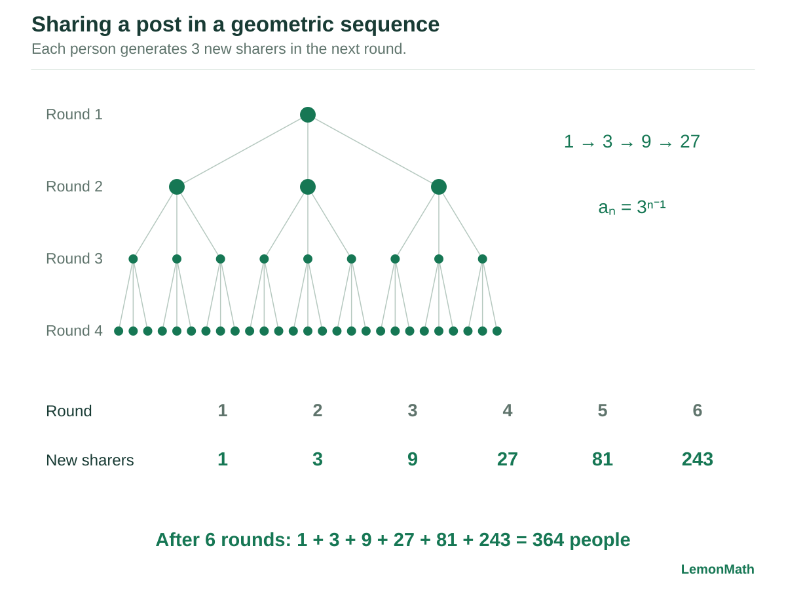

:::goals
- Recognise a geometric progression and find its common ratio.
- Write the formula for the general term of a geometric progression and use it to find any term.
- Use the property of three consecutive terms to recognise a geometric progression and to find its terms.
- Find the sum of the first $n$ terms of a geometric progression and apply it to compound interest and spreading problems.
:::

A bank accepts a deposit of $100$ million dong at an interest rate of $6\%$ a year, and each year's interest is added to the capital so that interest is earned on it the next year (this is called compound interest). This is an imagined situation for practice.

After $10$ years, how much is in the account? After how many years has the amount doubled? In the previous lesson the amount grew by a fixed quantity at each step. This time the amount is multiplied by a fixed number each year, and we will see that this makes things grow much faster.

## Geometric progressions and the general term

### Explore: a constant ratio

Let $u_n$ be the amount (in millions of dong) after $n$ years. We have the table:

| Year $n$ | $0$ | $1$ | $2$ | $3$ |
|---|---|---|---|---|
| Amount | $100$ | $106$ | $112.36$ | $119.1016$ |

The differences between consecutive amounts are $6$, $6.36$, $6.7416$: they are not equal, so this is not an arithmetic progression. But the quotients are equal: $\dfrac{106}{100}=1.06$, $\dfrac{112.36}{106}=1.06$, $\dfrac{119.1016}{112.36}=1.06$. After one year the amount is $1.06$ times the previous amount, because $100\%$ of the capital plus $6\%$ interest is $106\%$.

:::definition Geometric progression
A geometric progression (geometric sequence) is a sequence (finite or infinite) in which, from the second term on, each term equals the term just before it multiplied by a fixed number $q$:
$$u_{n+1}=u_n\cdot q\quad\text{for all }n\ge1.$$
The number $q$ is called the **common ratio**.
:::

In this lesson we consider geometric progressions with $u_1\ne0$ and $q\ne0$. When $q>1$ and $u_1>0$ the sequence is increasing; when $0<q<1$ and $u_1>0$ it is decreasing; when $q=1$ all terms are equal; when $q<0$ the terms alternate in sign. For example, $5, -10, 20, -40, \dots$ is a geometric progression with $u_1=5$ and $q=-2$.

:::theorem The general term of a geometric progression
A geometric progression $(u_n)$ with first term $u_1$ and common ratio $q$ satisfies
$$u_n=u_1\cdot q^{n-1}\quad\text{for all }n\ge1.$$
:::

Why is this true? From $u_1$ to $u_n$ we take $n-1$ steps, each multiplying by $q$. Explicitly, $u_2=u_1q$, $u_3=u_2q=u_1q^2$, $u_4=u_1q^3$, and so on. The number of times we multiply by $q$, that is the exponent of $q$, is always one less than the index $n$. This is like arithmetic progressions, but adding $d$ is replaced by multiplying by $q$, so $(n-1)d$ becomes $q^{n-1}$.

:::theorem The property of three consecutive terms
Three consecutive terms $u_{k-1}$, $u_k$, $u_{k+1}$ of a geometric progression satisfy $u_k^2=u_{k-1}\cdot u_{k+1}$. Conversely, three non-zero numbers $a$, $b$, $c$ (in that order) form a geometric progression if and only if $b^2=ac$.
:::

Why is this true? A geometric progression means $\dfrac{u_k}{u_{k-1}}=\dfrac{u_{k+1}}{u_k}=q$. Cross-multiplying gives $u_k^2=u_{k-1}u_{k+1}$. When the terms are positive, $u_k=\sqrt{u_{k-1}u_{k+1}}$ is the geometric mean of the two terms next to it, which is where the name comes from.

**Going deeper: how fast powers grow.** According to a famous legend about the chessboard, the inventor of chess asked the king to reward him with $1$ grain of rice on the first square, $2$ grains on the second, $4$ on the third, doubling each time up to the $64$th square. The last square holds $2^{63}$ grains, and the total is $2^{64}-1\approx1.8\cdot10^{19}$ grains, more than any king's granaries could hold. A geometric progression with $q>1$ always overtakes an arithmetic progression after enough steps.

:::example Recognising a geometric progression
Which of these sequences are geometric progressions? If so, give $u_1$ and the common ratio. a) $2, 6, 18, 54, \dots$; b) $5, -10, 20, -40, \dots$; c) $1, 3, 5, 7, \dots$; d) the sequence $(u_n)$ with $u_n=5\cdot\left(\dfrac12\right)^n$.

**Solution.** a) The quotients $\dfrac62=\dfrac{18}{6}=\dfrac{54}{18}=3$ are equal, so this is a geometric progression with $u_1=2$ and $q=3$.

b) The quotients $\dfrac{-10}{5}=\dfrac{20}{-10}=\dfrac{-40}{20}=-2$ are equal, so this is a geometric progression with $u_1=5$ and $q=-2$.

c) The quotients are $3$ and $\dfrac53$, which are not equal, so this is not a geometric progression (it is an arithmetic progression).

d) We have $\dfrac{u_{n+1}}{u_n}=\dfrac{5\cdot(1/2)^{n+1}}{5\cdot(1/2)^n}=\dfrac12$, which is constant, so $(u_n)$ is a geometric progression with $u_1=\dfrac52$ and $q=\dfrac12$.
:::

If we know any two terms, we can find the common ratio and then the first term.

:::example Finding the first term and the common ratio
A geometric progression $(u_n)$ has $u_2=6$ and $u_5=48$. Find $u_1$, $q$ and a formula for $u_n$.

**Solution.** From $u_2$ to $u_5$ there are $3$ steps, so $u_5=u_2\cdot q^3$. Hence $q^3=\dfrac{48}{6}=8$, so $q=2$. From $u_2=u_1q$ we get $u_1=\dfrac62=3$. The general term is $u_n=3\cdot2^{n-1}$.

So $u_1=3$, $q=2$ and $u_n=3\cdot2^{n-1}$.

**Check.** $u_2=3\cdot2=6$ and $u_5=3\cdot2^4=48$. Correct.
:::

Now we answer the question at the start of the lesson.

:::example Compound interest on a deposit
A deposit of $100$ million dong earns interest at $6\%$ a year, compounded annually. How much is there after $10$ years (to 2 decimal places, in millions of dong)? After at least how many years has the amount at least doubled?

**Understand.** Let $u_n$ be the amount after $n$ years. Each year the amount is multiplied by $1.06$. We need $u_{10}$ and the smallest positive integer $n$ with $u_n\ge200$.

**Plan.** The amounts after $n$ years form a geometric progression with $u_1=106$ and $q=1.06$. Use the formula for the general term.

**Solve.** We have $u_n=106\cdot1.06^{n-1}=100\cdot1.06^n$. Hence $u_{10}=100\cdot1.06^{10}\approx179.08$ (million dong). For the amount to double we need $1.06^n\ge2$. Computing: $1.06^{11}\approx1.898<2$ and $1.06^{12}\approx2.012\ge2$.

So after $10$ years there are about $179.08$ million dong, and after at least $12$ years the amount has doubled (to about $201.22$ million dong).

**Look back.** If the bank paid only simple interest, adding $6$ million dong each year, the amount would be the arithmetic progression $100+6n$ and it would take $\dfrac{100}{6}\approx16.7$, that is $17$ years, to double. Compound interest is faster because interest earns interest. A familiar mental rule, called the rule of $72$, says that at an interest rate of $r\%$ a year the number of years to double is about $\dfrac{72}{r}$; for $r=6$ we get $12$ years, which matches the result above.
:::

Next, an example using the property of three consecutive terms.

:::example Finding $x$ so that three numbers form a geometric progression
Find $x$ so that the numbers $2$, $x$, $18$, in that order, form a geometric progression.

**Solution.** Three numbers form a geometric progression when $x^2=2\cdot18=36$, so $x=6$ or $x=-6$.

For $x=6$ the numbers are $2, 6, 18$ with common ratio $3$. For $x=-6$ the numbers are $2, -6, 18$ with common ratio $-3$. So $x=6$ or $x=-6$.
:::

## The sum of the first $n$ terms

### Explore: sums of powers of $2$

We add $1+2+4+8$. The sum is $15=2^4-1$. Similarly $1+2+4+8+16=31=2^5-1$. We guess that the sum of the first $n$ terms of $1, 2, 4, \dots$ is $2^n-1$. One way to see why: $1+1=2$, $(1+2)+1=4$, $(1+2+4)+1=8$, and so on, so the sum of the first terms is always exactly $1$ less than the next term.

:::theorem The sum of the first $n$ terms of a geometric progression
Let $(u_n)$ be a geometric progression with first term $u_1$ and common ratio $q$. The sum $S_n=u_1+u_2+\dots+u_n$ of the first $n$ terms is
$$S_n=\dfrac{u_1\left(1-q^n\right)}{1-q}\quad(q\ne1),\qquad S_n=nu_1\quad(q=1).$$
:::

Why is this true? Multiplying both sides of $S_n=u_1+u_1q+u_1q^2+\dots+u_1q^{n-1}$ by $q$ gives $qS_n=u_1q+u_1q^2+\dots+u_1q^{n}$. Subtracting, almost all the terms cancel and only $S_n-qS_n=u_1-u_1q^n$ remains, that is $(1-q)S_n=u_1(1-q^n)$. Dividing by $1-q\ne0$ gives the formula. When $q=1$ every term equals $u_1$, so $S_n=nu_1$.

:::example Finding the sum of the first $n$ terms
Find a) the sum of the first $10$ terms of the geometric progression $3, 6, 12, \dots$; b) the sum of the first $6$ terms of the geometric progression $8, 4, 2, 1, \dots$.

**Solution.** a) We have $u_1=3$ and $q=2$, so
$$S_{10}=\dfrac{3\left(1-2^{10}\right)}{1-2}=3\left(2^{10}-1\right)=3\cdot1023=3069.$$

b) We have $u_1=8$ and $q=\dfrac12$, so
$$S_6=\dfrac{8\left(1-\left(\frac12\right)^6\right)}{1-\frac12}=16\cdot\dfrac{63}{64}=\dfrac{63}{4}=15.75.$$

So $S_{10}=3069$ and $S_6=15.75$.

**Check for part b.** $8+4+2+1+0.5+0.25=15.75$. Correct.
:::

Finally, a problem about how something spreads.

:::example Sharing a post
Suppose a post on social media is shared by $1$ person in round $1$, and each person who shares in one round causes $3$ new people to share in the next round. Let $a_n$ be the number of people who share in round $n$. Find the total number of people who have shared after $6$ rounds, and say after how many rounds this total first exceeds $1000$.

**Solution.** The numbers in the rounds are $1, 3, 9, 27, \dots$, a geometric progression $a_n=3^{n-1}$ with $a_1=1$ and $q=3$. The total after $n$ rounds is
$$S_n=\dfrac{1\cdot\left(3^n-1\right)}{3-1}=\dfrac{3^n-1}{2}.$$
For $n=6$: $S_6=\dfrac{729-1}{2}=364$. Solving $\dfrac{3^n-1}{2}>1000$ requires $3^n>2001$. Since $3^6=729<2001<2187=3^7$, we get $n=7$ and $S_7=\dfrac{2187-1}{2}=1093$.

So after $6$ rounds $364$ people have shared, and after $7$ rounds the total first exceeds $1000$.

:::

**Connections.** A geometric progression is a sequence given by the recurrence relation $u_{n+1}=u_nq$ from the lesson on sequences, and it has both a formula for the general term and a formula for the sum, as arithmetic progressions do. It is the discrete version of an exponential function: $u_n=\dfrac{u_1}{q}\cdot q^n$ is an exponential function of $n$. When $|q|<1$ the terms shrink towards $0$ and the sum $S_n$ approaches a definite value; this idea leads to the limit of a sequence in later lessons.

:::warning Common mistakes
- **Using the exponent $n$ instead of $n-1$.** Wrong: $u_n=u_1q^n$. Why it is wrong: for $n=1$ the formula gives $u_1q$, not $u_1$. Right: $u_n=u_1q^{n-1}$.
- **Checking only the first two terms and concluding that it is a geometric progression.** Wrong: $1, 2, 4, 9$ is a geometric progression because $\dfrac21=\dfrac42=2$. Why it is wrong: the next quotient is $\dfrac94\ne2$. Right: check that $\dfrac{u_{k+1}}{u_k}$ is the same for every $k$.
- **Using the sum formula when $q=1$.** Wrong: $5+5+5+5=\dfrac{5\left(1-1^4\right)}{1-1}$. Why it is wrong: the denominator is $0$, so it cannot be evaluated. Right: for $q=1$, $S_n=nu_1=4\cdot5=20$.
- **Multiplying by $0.06$ instead of $1.06$ for interest.** Wrong: after one year the amount is $100\cdot0.06=6$ million dong. Why it is wrong: $0.06$ is only the interest, without the capital. Right: the amount after one year is $100\cdot1.06=106$ million dong.
:::

## Key terms

:::terms
- geometric progression (geometric sequence) | cấp số nhân
- common ratio | công bội
- general term ($n$th term) | số hạng tổng quát
- sum of the first $n$ terms | tổng $n$ số hạng đầu
- geometric mean | trung bình nhân
- compound interest | lãi kép
- simple interest | lãi đơn
- arithmetic progression | cấp số cộng
- recurrence relation | hệ thức truy hồi
:::

## Summary

- Geometric progression: $u_{n+1}=u_nq$; $q$ is the common ratio ($u_1\ne0$, $q\ne0$).
- General term: $u_n=u_1q^{n-1}$. Any two terms give $u_m=u_kq^{m-k}$.
- Three non-zero numbers $a, b, c$ form a geometric progression if and only if $b^2=ac$.
- The sum of the first $n$ terms: $S_n=\dfrac{u_1\left(1-q^n\right)}{1-q}$ if $q\ne1$; $S_n=nu_1$ if $q=1$.
- Compound interest: the amount after $n$ periods at interest rate $r$ per period is $A(1+r)^n$, a geometric progression with common ratio $1+r$.
- An arithmetic progression adds a fixed amount at each step; a geometric progression multiplies by a fixed number at each step.

## Practice

Each exercise comes with what you need and hints. Try it yourself first, then open the solution.

:::exercise
Prove that the sequence $(u_n)$ with $u_n=5\cdot(-2)^n$ is a geometric progression. Find $u_1$ and the common ratio.

::hint
**What you need:** a sequence is a geometric progression if $\dfrac{u_{n+1}}{u_n}$ is constant.

**Steps:**
1. Find $\dfrac{u_{n+1}}{u_n}$.
2. Find $u_1$.

::solution
To prove that $(u_n)$ is a geometric progression, we show that the ratio $\dfrac{u_{n+1}}{u_n}$ is a constant for every $n\in\mathbb{N}^*$ (all terms are nonzero because $5\cdot(-2)^n\ne0$).

We have
$$\frac{u_{n+1}}{u_n}=\frac{5\cdot(-2)^{n+1}}{5\cdot(-2)^n}=-2,$$
which does not depend on $n$. Hence $(u_n)$ is a geometric progression with common ratio $q=-2$.

The first term is $u_1=5\cdot(-2)^1=-10$.

So $(u_n)$ is a geometric progression with $u_1=-10$ and common ratio $q=-2$.

**Answer.** A geometric progression with $u_1=-10$, $q=-2$.
:::

:::exercise
A geometric progression has $u_1=2$ and $q=3$. Find $u_6$. Which term is $1458$?

::hint
**What you need:** $u_n=u_1q^{n-1}$.

**Steps:**
1. Substitute $n=6$.
2. Solve $2\cdot3^{n-1}=1458$.

::solution
Using the general term $u_n=u_1q^{n-1}$ with $u_1=2$, $q=3$, we have
$$u_6=2\cdot3^{6-1}=2\cdot3^5=2\cdot243=486.$$

Suppose $1458$ is the $n$th term, that is $u_n=1458$. Then
$$2\cdot3^{n-1}=1458\iff3^{n-1}=729=3^6.$$

Hence $n-1=6$, that is $n=7$ (which satisfies $n\in\mathbb{N}^*$).

So $u_6=486$ and $1458$ is the $7$th term.

**Answer.** $u_6=486$; $1458$ is the $7$th term.
:::

:::exercise
A geometric progression has $u_2=-6$ and $u_5=48$. Find $u_1$, the common ratio $q$ and $u_8$.

::hint
**What you need:** $u_5=u_2\cdot q^3$.

**Steps:**
1. Find $q$ from $q^3=\dfrac{u_5}{u_2}$.
2. Find $u_1=\dfrac{u_2}{q}$, then $u_8$.

::solution
Let $q$ be the common ratio. By the formula $u_n=u_1q^{n-1}$ we have $u_2=u_1q$ and $u_5=u_1q^4$.

Dividing the two equalities (since $u_2=-6\ne0$, we have $u_1\ne0$ and $q\ne0$):
$$\frac{u_5}{u_2}=q^3=\frac{48}{-6}=-8.$$

Hence $q=-2$.

From $u_2=u_1q$ we get $u_1=\dfrac{u_2}{q}=\dfrac{-6}{-2}=3$.

Then
$$u_8=u_1q^7=3\cdot(-2)^7=3\cdot(-128)=-384.$$

So $u_1=3$, the common ratio is $q=-2$ and $u_8=-384$.

**Answer.** $u_1=3$, $q=-2$, $u_8=-384$.
:::

:::exercise
Find a) $5+10+20+\dots$ ($8$ terms); b) the sum of the first $5$ terms of the geometric progression with $u_1=9$ and $q=\dfrac13$.

::hint
**What you need:** $S_n=\dfrac{u_1\left(1-q^n\right)}{1-q}$.

**Steps:**
1. Identify $u_1$, $q$ and $n$ in each part.
2. Substitute into the formula.

::solution
The sum of the first $n$ terms of a geometric progression with common ratio $q\ne1$ is $S_n=\dfrac{u_1\left(1-q^n\right)}{1-q}$.

a) The sequence $5, 10, 20,\dots$ is a geometric progression with $u_1=5$ and $q=\dfrac{10}{5}=2$. With $n=8$:
$$S_8=\frac{5\left(1-2^8\right)}{1-2}=\frac{5\cdot(-255)}{-1}=5\cdot255=1275.$$
So the sum of the first $8$ terms is $1275$.

b) With $u_1=9$, $q=\dfrac13$ and $n=5$:
$$S_5=\frac{9\left(1-\left(\frac13\right)^5\right)}{1-\frac13}=\frac{9\cdot\frac{242}{243}}{\frac23}=\frac{27}{2}\cdot\frac{242}{243}=\frac{121}{9}.$$
So the sum of the first $5$ terms is $\dfrac{121}{9}$.

**Answer.** a) $1275$; b) $\dfrac{121}{9}$.
:::

:::exercise
Find $x$ so that the numbers $1$, $x+2$, $3x+4$, in that order, form a geometric progression.

::hint
**What you need:** three numbers $a, b, c$ form a geometric progression when $b^2=ac$.

**Steps:**
1. Write $(x+2)^2=1\cdot(3x+4)$.
2. Solve the quadratic equation, then check.

::solution
Three numbers $a$, $b$, $c$, in that order, form a geometric progression when $b^2=ac$. For the numbers $1$, $x+2$, $3x+4$, the condition is
$$(x+2)^2=1\cdot(3x+4).$$

Expanding and simplifying:
$$x^2+4x+4=3x+4\iff x^2+x=0\iff x(x+1)=0.$$

Hence $x=0$ or $x=-1$.

Check: for $x=0$ the numbers are $1, 2, 4$, a geometric progression with common ratio $2$; for $x=-1$ the numbers are $1, 1, 1$, a geometric progression with common ratio $1$. Both values work.

So $x=0$ or $x=-1$.

**Answer.** $x=0$ or $x=-1$.
:::

:::exercise
Suppose $200$ million dong is deposited at $7\%$ a year, compounded annually. Find the amount after $5$ years, to 2 decimal places in millions of dong. How much more is this than with simple interest?

::hint
**What you need:** the amount after $n$ years is $200\cdot1.07^n$; simple interest per year is $200\cdot0.07$.

**Steps:**
1. Find $200\cdot1.07^5$.
2. Find the amount with simple interest, then subtract.

::solution
Let $A$ (million dong) be the amount after $5$ years with compound interest. Since the interest is compounded, each year's amount is $1.07$ times the previous year's; the yearly amounts form a geometric progression with common ratio $1.07$. Hence
$$A=200\cdot1.07^5\approx280.51\ \text{(million dong)}.$$

With simple interest, each year earns interest only on the original deposit: $200\cdot7\%=14$ (million dong). The amount after $5$ years is
$$200+5\cdot14=270\ \text{(million dong)}.$$

The difference between the two is
$$280.51-270=10.51\ \text{(million dong)}.$$

So after $5$ years the amount is about $280.51$ million dong, which is about $10.51$ million dong more than with simple interest.

**Answer.** About $280.51$ million dong; about $10.51$ million dong more than with simple interest.
:::

:::exercise
Consider the sequence $81, -27, 9, -3, \dots$ (a geometric progression). Decide whether each statement is true or false.

a) The common ratio of the progression is $q=-\dfrac13$.

b) The general term is $u_n=81\cdot\left(-\dfrac13\right)^{n-1}$.

c) The sequence is decreasing.

d) $u_7=-\dfrac19$.

::hint
**What you need:** $q=\dfrac{u_2}{u_1}$; $u_n=u_1q^{n-1}$; a sequence is decreasing when $u_{n+1}<u_n$ for all $n$.

**Steps:**
1. Find $q$ and $u_n$.
2. c) Compare $u_1$ and $u_2$, then $u_2$ and $u_3$.
3. d) Find $u_7$.

::solution
The sequence $81, -27, 9, -3,\dots$ is a geometric progression with $u_1=81$.

a) **True.** The common ratio is $q=\dfrac{u_2}{u_1}=\dfrac{-27}{81}=-\dfrac13$.

b) **True.** The general term is $u_n=u_1q^{n-1}$ with $u_1=81$ and $q=-\dfrac13$, that is $u_n=81\cdot\left(-\dfrac13\right)^{n-1}$.

c) **False.** We have $u_1=81>u_2=-27$ but $u_2=-27<u_3=9$. The sequence goes down and up, so it is not decreasing.

d) **False.** We have
$$u_7=81\cdot\left(-\frac13\right)^6=\frac{81}{729}=\frac19,$$
not $-\dfrac19$.

So statements a), b) are true; statements c), d) are false.

**Answer.** a) True; b) True; c) False; d) False.
:::

:::exercise
Suppose a sheet of paper $0.1$ mm thick could be folded in half $8$ times in a row (ignoring real-world limits). Find the thickness of the folded paper after $8$ folds (in mm).

::hint
**What you need:** each fold in half multiplies the thickness by $2$.

**Steps:**
1. The thickness after $n$ folds is $0.1\cdot2^n$.
2. Substitute $n=8$.

::solution
Each fold doubles the thickness of the paper. Let $u_k$ (mm) be the thickness after $k$ folds, with $u_0=0.1$. Then $(u_k)$ is a geometric progression with common ratio $q=2$, so $u_k=0.1\cdot2^k$.

With $k=8$:
$$u_8=0.1\cdot2^8=0.1\cdot256=25.6\ \text{(mm)}.$$

So the thickness of the folded paper after $8$ folds is $25.6$ mm.

**Answer.** $25.6$ mm.
:::

:::exercise Revision
Prove that if $(u_n)$ is an arithmetic progression with common difference $d$, then the sequence $v_n=2^{u_n}$ is a geometric progression with common ratio $2^d$.

::hint
**What you need:** from the previous lesson, $u_{n+1}-u_n=d$; for powers, $\dfrac{2^a}{2^b}=2^{a-b}$.

**Steps:**
1. Find $\dfrac{v_{n+1}}{v_n}$.
2. Use $u_{n+1}-u_n=d$.

::solution
Since $(u_n)$ is an arithmetic progression with common difference $d$, we have $u_{n+1}-u_n=d$ for every $n\in\mathbb{N}^*$.

All terms of $v_n=2^{u_n}$ are positive (hence nonzero). Consider the ratio of two consecutive terms:
$$\frac{v_{n+1}}{v_n}=\frac{2^{u_{n+1}}}{2^{u_n}}=2^{u_{n+1}-u_n}=2^d.$$

This ratio equals $2^d$, which is constant for every $n$.

So $(v_n)$ is a geometric progression with common ratio $2^d$.

**Answer.** $(v_n)$ is a geometric progression with common ratio $2^d$.
:::

:::exercise Challenge
Find three numbers that form a geometric progression with sum $14$ and product $64$.

::hint
**What you need:** write the three numbers as $\dfrac{a}{q}$, $a$, $aq$; their product is $a^3$.

**Steps:**
1. Use the product $64$ to find $a$.
2. Use the sum $14$ to find $q$.

::solution
Let the three numbers be $\dfrac aq$, $a$, $aq$ (with $a\ne0$, $q\ne0$), forming a geometric progression with common ratio $q$.

Their product is $64$, so
$$\frac aq\cdot a\cdot aq=a^3=64\iff a=4.$$

Their sum is $14$, so
$$\frac4q+4+4q=14\iff\frac4q+4q=10.$$

Multiplying both sides by $q\ne0$ gives $4+4q^2=10q$, that is
$$4q^2-10q+4=0\iff2q^2-5q+2=0.$$

The equation has $\Delta=25-16=9$, so $q=\dfrac{5+3}{4}=2$ or $q=\dfrac{5-3}{4}=\dfrac12$ (both nonzero).

For $q=2$ the numbers are $2, 4, 8$. For $q=\dfrac12$ the numbers are $8, 4, 2$. Check: $2+4+8=14$ and $2\cdot4\cdot8=64$.

So the three numbers are $2$, $4$, $8$ (or $8$, $4$, $2$ in the reverse order).

**Answer.** The three numbers are $2$, $4$, $8$ (or $8$, $4$, $2$).
:::

## Mini test

:::quiz
::mc NB
A geometric progression has $u_1=3$ and $q=-2$. The term $u_5$ is
A. $-96$.
B. $96$.
C. $-48$.
D. $48$.
::key D
$u_5=3\cdot(-2)^4=48$. Option A uses $q^5$ instead of $q^4$, and option C has the wrong sign.

::mc TH
The numbers $4$, $x$, $9$ with $x>0$, in that order, form a geometric progression when $x$ equals
A. $6$.
B. $36$.
C. $13$.
D. $6.5$.
::key A
$x^2=4\cdot9=36$ and $x>0$, so $x=6$. Option D is the arithmetic mean, and option B is the product.

::mc TH
A geometric progression has $u_1=1$ and $q=3$. The sum of the first $6$ terms is
A. $1093$.
B. $364$.
C. $729$.
D. $728$.
::key B
$S_6=\dfrac{3^6-1}{3-1}=\dfrac{728}{2}=364$. Option A is $S_7$, option C is $u_7$, and option D forgets to divide by $2$.

::mc VD
A deposit of $50$ million dong earns $8\%$ a year, compounded annually. After $3$ years the amount is about
A. $62.00$ million dong.
B. $54.00$ million dong.
C. $62.99$ million dong.
D. $58.32$ million dong.
::key C
$50\cdot1.08^3\approx62.99$. Option A is simple interest ($50+3\cdot4$), option B is the amount after one year, and option D is the amount after two years ($50\cdot1.08^2$).

::tf TH TH TH VD
A colony of bacteria starts with $500$ cells and doubles in number every hour. Decide whether each statement is true or false.
a) After $3$ hours there are $1500$ cells.
b) After $5$ hours there are $16\,000$ cells.
c) After $10$ hours there are $5\,000$ cells.
d) After at least $8$ hours the number of bacteria exceeds $100\,000$.
::key F T F T
The number after $n$ hours is $500\cdot2^n$. a) False: $500\cdot8=4000$. b) True: $500\cdot32=16\,000$. c) False: $500\cdot1024=512\,000$. d) True: after $7$ hours there are $64\,000$ cells and after $8$ hours there are $128\,000$.

::sa TH
A geometric progression has $u_1=2$ and $q=3$. Find the sum of the first $5$ terms.
::key 242
$S_5=\dfrac{2\left(3^5-1\right)}{3-1}=3^5-1=242$.

::sa VD
In the geometric progression $1, 2, 4, 8, \dots$, which term is the first to be greater than $1000$?
::key 11
$u_n=2^{n-1}$; $2^9=512<1000<1024=2^{10}$, so $n-1=10$ and $n=11$.
:::
