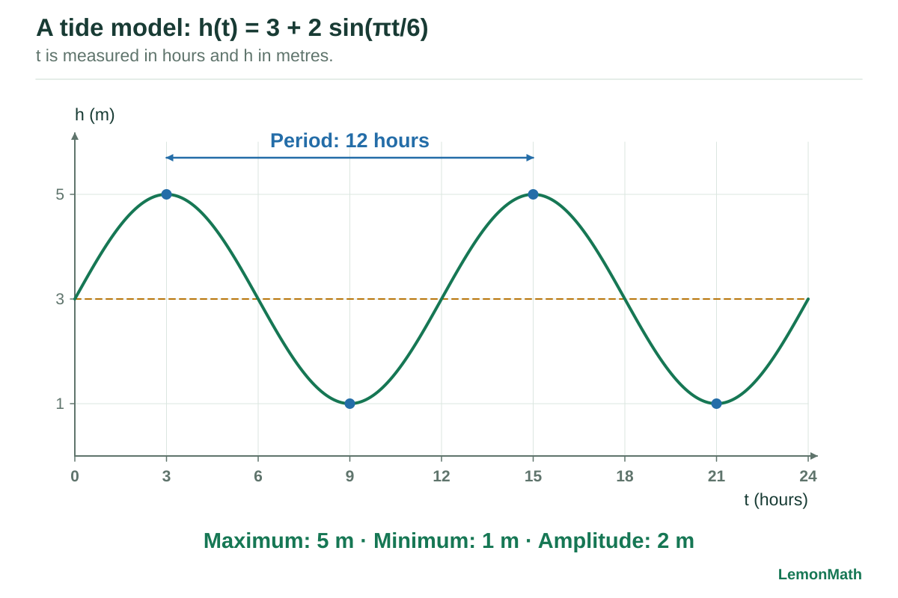

:::goals
- State the domain, range, parity and period of the functions $y=\sin x$, $y=\cos x$, $y=\tan x$ and $y=\cot x$.
- Recognise the graphs of these four functions and read from a graph where the function is increasing or decreasing.
- Find the domain, greatest value, least value and period of simple trigonometric functions.
- Use trigonometric functions to model repeating phenomena such as tides and alternating current.
:::

Suppose the water level at a port (in metres) $t$ hours after midnight is given by $h(t)=3+2\sin\dfrac{\pi t}{6}$. The water rises, falls, rises again, and keeps repeating.

What are the highest and lowest water levels? After how long does the pattern repeat exactly? To answer, we need to understand how $\sin$ behaves as $x$ increases: where it reaches its greatest and least values, and how soon it repeats.

## The functions $y=\sin x$ and $y=\cos x$

### Explore: how does $\sin x$ repeat?

For an angle $x$ (in radians), the point $M$ on the unit circle that corresponds to $x$ has coordinates $(\cos x, \sin x)$. We compute $\sin x$ for some familiar angles:

| $x$ | $0$ | $\dfrac{\pi}{6}$ | $\dfrac{\pi}{2}$ | $\dfrac{5\pi}{6}$ | $\pi$ | $\dfrac{7\pi}{6}$ | $\dfrac{3\pi}{2}$ | $\dfrac{11\pi}{6}$ | $2\pi$ |
|---|---|---|---|---|---|---|---|---|---|
| $\sin x$ | $0$ | $\dfrac12$ | $1$ | $\dfrac12$ | $0$ | $-\dfrac12$ | $-1$ | $-\dfrac12$ | $0$ |

We notice two things. The values of $\sin x$ always lie between $-1$ and $1$, reaching $1$ at $\dfrac{\pi}{2}$ and $-1$ at $\dfrac{3\pi}{2}$. And after every turn of $2\pi$ (one trip round the circle) the point $M$ is back where it started, so the values repeat: $\sin(x+2\pi)=\sin x$.

:::definition Periodic function
A function $y=f(x)$ with domain $D$ is **periodic** if there is a number $T>0$ such that for every $x\in D$ we have $x+T\in D$, $x-T\in D$ and $f(x+T)=f(x)$. The smallest such number $T$ (if it exists) is called the **period** of the function.
:::

Is $2\pi$ really the smallest period of $\sin$? Suppose $0<T<2\pi$ also satisfies $\sin(x+T)=\sin x$ for all $x$. Putting $x=\dfrac{\pi}{2}$ gives $\sin\left(\dfrac{\pi}{2}+T\right)=1$. But $\sin$ equals $1$ only at the angles $\dfrac{\pi}{2}+k2\pi$, so $T=k2\pi$, which contradicts $0<T<2\pi$. So the smallest period of $\sin$ is $2\pi$; the argument for $\cos$ is similar.

:::theorem Properties of $y=\sin x$ and $y=\cos x$
**The function $y=\sin x$:**
- Domain $\mathbb{R}$, range $[-1, 1]$.
- It is an odd function (because $\sin(-x)=-\sin x$), so its graph is symmetric about the origin.
- It is periodic with period $2\pi$.
- It is increasing on each interval $\left(-\dfrac{\pi}{2}+k2\pi, \dfrac{\pi}{2}+k2\pi\right)$ and decreasing on each interval $\left(\dfrac{\pi}{2}+k2\pi, \dfrac{3\pi}{2}+k2\pi\right)$, $k\in\mathbb{Z}$.

**The function $y=\cos x$:**
- Domain $\mathbb{R}$, range $[-1, 1]$.
- It is an even function (because $\cos(-x)=\cos x$), so its graph is symmetric about the $y$-axis.
- It is periodic with period $2\pi$.
- It is increasing on each interval $(-\pi+k2\pi, k2\pi)$ and decreasing on each interval $(k2\pi, \pi+k2\pi)$, $k\in\mathbb{Z}$.
:::

:::graph Graph of $y=\sin x$
alt: A wave through the origin with greatest value 1 at π/2 and least value −1 at 3π/2, repeating every 2π
x: -7..7
y: -1.6..1.6
plot: sin(x)
point: (1.5708, 1) "π/2" above
point: (3.1416, 0) "π" above-right
point: (4.7124, -1) "3π/2" below
point: (-1.5708, -1) "-π/2" below
:::

:::graph Graph of $y=\cos x$
alt: A wave crossing the y-axis at 1, with least value −1 at π and −π and greatest value 1 at 2π, symmetric about the y-axis
x: -7..7
y: -1.6..1.6
plot: cos(x)
point: (0, 1) "1" above-right
point: (3.1416, -1) "π" below
point: (-3.1416, -1) "-π" below
point: (6.2832, 1) "2π" above
:::

The graph of $\cos$ is the graph of $\sin$ translated $\dfrac{\pi}{2}$ units to the left, because $\cos x=\sin\left(x+\dfrac{\pi}{2}\right)$. We only need to draw one period of length $2\pi$ carefully and repeat it in both directions.

## The functions $y=\tan x$ and $y=\cot x$

These two functions are defined as quotients of $\sin$ and $\cos$:
$$\tan x=\dfrac{\sin x}{\cos x}\ (\cos x\ne0),\qquad \cot x=\dfrac{\cos x}{\sin x}\ (\sin x\ne0).$$
Since $\cos x=0$ when $x=\dfrac{\pi}{2}+k\pi$ and $\sin x=0$ when $x=k\pi$, these functions are not defined at those points.

:::theorem Properties of $y=\tan x$ and $y=\cot x$
**The function $y=\tan x$:**
- Domain $\mathbb{R}\setminus\left\{\dfrac{\pi}{2}+k\pi \mid k\in\mathbb{Z}\right\}$, range $\mathbb{R}$.
- It is odd and periodic with period $\pi$.
- It is increasing on each interval $\left(-\dfrac{\pi}{2}+k\pi, \dfrac{\pi}{2}+k\pi\right)$.
- Its graph has the vertical asymptotes $x=\dfrac{\pi}{2}+k\pi$.

**The function $y=\cot x$:**
- Domain $\mathbb{R}\setminus\{k\pi \mid k\in\mathbb{Z}\}$, range $\mathbb{R}$.
- It is odd and periodic with period $\pi$.
- It is decreasing on each interval $(k\pi, \pi+k\pi)$.
- Its graph has the vertical asymptotes $x=k\pi$.
:::

The period of $\tan$ is $\pi$, not $2\pi$, because $\tan(x+\pi)=\dfrac{\sin(x+\pi)}{\cos(x+\pi)}=\dfrac{-\sin x}{-\cos x}=\tan x$: the numerator and the denominator both change sign.

:::graph Graph of $y=\tan x$
alt: Three branches of the tangent graph rising from left to right, each between two vertical asymptotes; the middle branch passes through the origin and the point (π/4, 1)
x: -4.5..4.5
y: -4..4
plot: tan(x) ; -1.45..1.45
plot: tan(x) ; 1.7..4.4
plot: tan(x) ; -4.4..-1.7
vline: 1.5708 ; dashed
vline: -1.5708 ; dashed
point: (0.7854, 1) "π/4" below-right
:::

The graph of $\cot$ has a similar shape but falls from left to right, because $\cot x=\tan\left(\dfrac{\pi}{2}-x\right)$: reflect the graph of $\tan$ in the $y$-axis, then translate it $\dfrac{\pi}{2}$ units to the right.

## Examples

We start by finding where a function makes sense.

:::example Finding the domain
Find the domain of a) $y=\tan\left(2x-\dfrac{\pi}{3}\right)$; b) $y=\dfrac{1}{1-\cos x}$.

**Solution.** a) The function is defined when $\cos\left(2x-\dfrac{\pi}{3}\right)\ne0$, that is
$$2x-\dfrac{\pi}{3}\ne\dfrac{\pi}{2}+k\pi\Leftrightarrow 2x\ne\dfrac{5\pi}{6}+k\pi\Leftrightarrow x\ne\dfrac{5\pi}{12}+\dfrac{k\pi}{2}\quad(k\in\mathbb{Z}).$$
So the domain is $\mathbb{R}\setminus\left\{\dfrac{5\pi}{12}+\dfrac{k\pi}{2}\mid k\in\mathbb{Z}\right\}$.

b) The function is defined when $1-\cos x\ne0$, that is $\cos x\ne1$, or $x\ne k2\pi$. So the domain is $\mathbb{R}\setminus\{k2\pi\mid k\in\mathbb{Z}\}$.
:::

From the range $[-1, 1]$ of $\sin$ and $\cos$ we can find the greatest and least values of many other functions. The next example answers the question at the start of the lesson.

:::example Tides
For $h(t)=3+2\sin\dfrac{\pi t}{6}$ (metres, $t$ hours after midnight), find the highest and lowest water levels, the times when they occur in the interval $0\le t<24$, and the period after which the water level repeats.

**Understand.** We need the greatest and least values of $h$, the times at which they occur, and the smallest number of hours $T$ with $h(t+T)=h(t)$.

**Plan.** Use $-1\le\sin x\le1$ for the greatest and least values, and the period $2\pi$ of $\sin$ to find $T$.

**Solve.** Since $-1\le\sin\dfrac{\pi t}{6}\le1$, we have $1\le h(t)\le5$. The level is $5$ m when $\dfrac{\pi t}{6}=\dfrac{\pi}{2}+k2\pi$, that is $t=3+12k$; in $[0, 24)$ these are $t=3$ and $t=15$. The level is $1$ m when $\dfrac{\pi t}{6}=-\dfrac{\pi}{2}+k2\pi$, that is $t=-3+12k$; in $[0, 24)$ these are $t=9$ and $t=21$.

We have $h(t+12)=3+2\sin\left(\dfrac{\pi t}{6}+2\pi\right)=h(t)$, and $12$ is the smallest such number because the smallest period of $\sin$ is $2\pi$.

So the highest level is $5$ m (at $3$ o'clock and $15$ o'clock), the lowest is $1$ m (at $9$ o'clock and $21$ o'clock), and the pattern repeats every $12$ hours.

**Look back.** A ship needs a water level of at least $4$ m to enter the port. We need $h(t)\ge4$, that is $\sin\dfrac{\pi t}{6}\ge\dfrac12$. On the graph of $\sin$, this happens when $\dfrac{\pi t}{6}$ lies in $\left[\dfrac{\pi}{6}, \dfrac{5\pi}{6}\right]$ within one period, that is $t\in[1, 5]$. So in each $12$-hour period the ship can enter for only $4$ hours (from $1$ to $5$ o'clock, then from $13$ to $17$ o'clock). This is reasonable: $4$ m lies between the lowest level $1$ m and the highest level $5$ m, so the window does not fill the whole period.

:::

Next we look at parity and period.

:::example Parity and period
a) Decide whether $y=x\sin x$ and $y=\sin x+1$ are even, odd or neither. b) Find the period of $y=\sin2x$.

**Solution.** a) For $f(x)=x\sin x$ we have $f(-x)=(-x)\sin(-x)=(-x)(-\sin x)=x\sin x=f(x)$. The domain $\mathbb{R}$ is symmetric, so $f$ is an even function.

For $g(x)=\sin x+1$ we have $g\left(\dfrac{\pi}{2}\right)=2$ and $g\left(-\dfrac{\pi}{2}\right)=0$. Since $0\ne2$ and $0\ne-2$, $g(-x)$ is neither equal to $g(x)$ nor to $-g(x)$. So $g$ is neither even nor odd.

b) We have $\sin2(x+\pi)=\sin(2x+2\pi)=\sin2x$, so $\pi$ is a period. As $x$ runs from $0$ to $\pi$, $2x$ runs through one full period $2\pi$ of $\sin$, so no smaller positive number works. So the period of $y=\sin2x$ is $\pi$.
:::

**Remark.** In general, $y=\sin(\omega x+\varphi)$ and $y=\cos(\omega x+\varphi)$ with $\omega\ne0$ have period $\dfrac{2\pi}{|\omega|}$, and $y=\tan(\omega x+\varphi)$ has period $\dfrac{\pi}{|\omega|}$.

Monotonicity lets us compare values without a calculator.

:::example Comparing trigonometric values
Compare a) $\cos\dfrac{\pi}{5}$ and $\cos\dfrac{2\pi}{5}$; b) $\tan\left(-\dfrac{\pi}{5}\right)$ and $\tan\dfrac{\pi}{7}$.

**Solution.** a) The angles $\dfrac{\pi}{5}$ and $\dfrac{2\pi}{5}$ both lie in $(0, \pi)$, where $\cos$ is decreasing. Since $\dfrac{\pi}{5}<\dfrac{2\pi}{5}$, we have $\cos\dfrac{\pi}{5}>\cos\dfrac{2\pi}{5}$.

b) The angles $-\dfrac{\pi}{5}$ and $\dfrac{\pi}{7}$ both lie in $\left(-\dfrac{\pi}{2}, \dfrac{\pi}{2}\right)$, where $\tan$ is increasing. Since $-\dfrac{\pi}{5}<\dfrac{\pi}{7}$, we have $\tan\left(-\dfrac{\pi}{5}\right)<\tan\dfrac{\pi}{7}$.
:::

A graph also shows how many solutions an equation has, which prepares us for the next lesson.

:::example Number of solutions of a trigonometric equation
Using the graph of $y=\cos x$, say how many solutions the equation $\cos x=\dfrac12$ has in the interval $[-\pi, 2\pi]$.

**Solution.** The solutions are the $x$-coordinates of the intersections of the graph of $y=\cos x$ with the line $y=\dfrac12$. We have $\cos\dfrac{\pi}{3}=\dfrac12$. In $[-\pi, \pi]$, $\cos$ is even, so there are two intersections, $x=\pm\dfrac{\pi}{3}$. In $\left(\pi, 2\pi\right]$ the graph rises from $-1$ to $1$ and meets the line $y=\dfrac12$ exactly once, at $x=2\pi-\dfrac{\pi}{3}=\dfrac{5\pi}{3}$.

So the equation has $3$ solutions in $[-\pi, 2\pi]$: $-\dfrac{\pi}{3}$, $\dfrac{\pi}{3}$ and $\dfrac{5\pi}{3}$.
:::

Finally, an example from alternating current.

:::example Alternating current
Household mains electricity in Vietnam has an effective voltage of $220$ V and a frequency of $50$ Hz. The instantaneous voltage is modelled by $u(t)=220\sqrt2\sin(100\pi t)$ (V), with $t$ in seconds. Find the period and the peak voltage (to the nearest whole number).

**Solution.** The function $\sin(100\pi t)$ has period $\dfrac{2\pi}{100\pi}=0.02$ seconds, so it repeats $\dfrac{1}{0.02}=50$ times per second, matching the frequency $50$ Hz.

Since $-1\le\sin(100\pi t)\le1$, we have $-220\sqrt2\le u\le220\sqrt2$. The greatest value $220\sqrt2\approx311$ (V) occurs when $\sin(100\pi t)=1$, for example at $t=0.005$ seconds.

So the period is $0.02$ seconds and the peak voltage is about $311$ V.
:::

**Connections.** This lesson builds on trigonometric values of angles and on the formulas of the previous lesson, for example when we write $\sin x+\cos x$ as a single $\sin$ function. It prepares the next lesson: the solutions of a trigonometric equation are the intersections of a graph with a horizontal line, and the period tells us that solutions repeat after $2\pi$ or $\pi$. Later, trigonometric functions will reappear in derivatives and in the description of oscillations.

:::warning Common mistakes
- **Saying the period of $\tan x$ is $2\pi$.** Wrong: $\tan x$ has period $2\pi$, like $\sin x$. Why it is wrong: $\tan(x+\pi)=\tan x$, for example $\tan\dfrac{\pi}{4}=\tan\dfrac{5\pi}{4}=1$, so $\pi$ is already a period. Right: the period of $\tan x$ and $\cot x$ is $\pi$.
- **Saying the period of $\sin2x$ is $2\pi$.** Wrong: replacing $x$ by $2x$ does not change the period. Why it is wrong: $\sin2(x+\pi)=\sin2x$. Right: the period is $\dfrac{2\pi}{2}=\pi$.
- **Forgetting to exclude points where the function is undefined.** Wrong: the domain of $y=\tan x$ is $\mathbb{R}$. Why it is wrong: at $x=\dfrac{\pi}{2}$ we have $\cos x=0$, so $\tan x$ has no meaning. Right: $x\ne\dfrac{\pi}{2}+k\pi$.
- **Saying $\tan x$ is increasing on its whole domain.** Wrong: $\tan x$ is increasing on $(0, \pi)$. Why it is wrong: $\tan\dfrac{\pi}{4}=1$ but $\tan\dfrac{3\pi}{4}=-1$, although $\dfrac{\pi}{4}<\dfrac{3\pi}{4}$. Right: $\tan x$ is increasing on each interval $\left(-\dfrac{\pi}{2}+k\pi, \dfrac{\pi}{2}+k\pi\right)$.
:::

## Key terms

:::terms
- trigonometric function | hàm số lượng giác
- periodic function | hàm số tuần hoàn
- period | chu kì
- even function | hàm số chẵn
- odd function | hàm số lẻ
- domain | tập xác định
- range | tập giá trị
- increasing | đồng biến
- decreasing | nghịch biến
- vertical asymptote | tiệm cận đứng
- unit circle | đường tròn lượng giác
:::

## Summary

- $y=\sin x$ and $y=\cos x$: defined on $\mathbb{R}$, range $[-1, 1]$, period $2\pi$; $\sin$ is odd and $\cos$ is even.
- $y=\tan x$: $x\ne\dfrac{\pi}{2}+k\pi$; $y=\cot x$: $x\ne k\pi$. Both have range $\mathbb{R}$, are odd, and have period $\pi$.
- $\sin$ is increasing on $\left(-\dfrac{\pi}{2}, \dfrac{\pi}{2}\right)$; $\cos$ is decreasing on $(0, \pi)$; $\tan$ is increasing on $\left(-\dfrac{\pi}{2}, \dfrac{\pi}{2}\right)$; $\cot$ is decreasing on $(0, \pi)$ (and the pattern repeats with the period).
- The period of $\sin(\omega x+\varphi)$ and $\cos(\omega x+\varphi)$ is $\dfrac{2\pi}{|\omega|}$; the period of $\tan(\omega x+\varphi)$ is $\dfrac{\pi}{|\omega|}$.
- The greatest and least values of a function of the form $a\sin(\cdot)+b$ follow from $-1\le\sin\le1$: they are $b+|a|$ and $b-|a|$.
- The solutions of $\sin x=m$ or $\cos x=m$ are the $x$-coordinates of the intersections of the graph with the line $y=m$.

## Practice

Each exercise comes with what you need and hints. Try it yourself first, then open the solution.

:::exercise
Find the domain of a) $y=\tan\left(x+\dfrac{\pi}{6}\right)$; b) $y=\dfrac{1}{1+\sin x}$.

::hint
**What you need:** $\tan u$ is defined when $\cos u\ne0$; a fraction is defined when its denominator is not $0$.

**Steps:**
1. Part a: require $x+\dfrac{\pi}{6}\ne\dfrac{\pi}{2}+k\pi$.
2. Part b: when is $\sin x=-1$?

::solution
a) The function $y=\tan u$ is defined when $\cos u\ne0$, that is $u\ne\dfrac{\pi}{2}+k\pi$ $(k\in\mathbb{Z})$. With $u=x+\dfrac{\pi}{6}$, the function is defined when
$$x+\frac{\pi}{6}\ne\frac{\pi}{2}+k\pi\iff x\ne\frac{\pi}{3}+k\pi.$$

So the domain of the function is $\mathbb{R}\setminus\left\{\dfrac{\pi}{3}+k\pi\ \middle|\ k\in\mathbb{Z}\right\}$.

b) The function $y=\dfrac{1}{1+\sin x}$ is defined when the denominator is non-zero, that is $1+\sin x\ne0$, or $\sin x\ne-1$. The equation $\sin x=-1$ has solutions $x=-\dfrac{\pi}{2}+k2\pi$ $(k\in\mathbb{Z})$, so the function is defined when $x\ne-\dfrac{\pi}{2}+k2\pi$.

So the domain of the function is $\mathbb{R}\setminus\left\{-\dfrac{\pi}{2}+k2\pi\ \middle|\ k\in\mathbb{Z}\right\}$.

**Answer.** a) $\mathbb{R}\setminus\left\{\dfrac{\pi}{3}+k\pi\right\}$; b) $\mathbb{R}\setminus\left\{-\dfrac{\pi}{2}+k2\pi\right\}$ ($k\in\mathbb{Z}$).
:::

:::exercise
Find the greatest and least values of $y=5-3\cos x$ and the values of $x$ at which they occur.

::hint
**What you need:** $-1\le\cos x\le1$; $\cos x=1$ when $x=k2\pi$ and $\cos x=-1$ when $x=\pi+k2\pi$.

**Steps:**
1. Multiply the inequality by $-3$ (reversing it), then add $5$.
2. Find the $x$ for each value.

::solution
The function $y=5-3\cos x$ is defined for all $x\in\mathbb{R}$.

For every $x$, we have $-1\le\cos x\le1$. Multiplying by $-3<0$ (which reverses the inequalities), we get $-3\le-3\cos x\le3$. Adding $5$, we obtain
$$2\le5-3\cos x\le8,\ \text{that is}\ 2\le y\le8.$$

The least value $y=2$ occurs when $\cos x=1$, that is $x=k2\pi$ $(k\in\mathbb{Z})$.

The greatest value $y=8$ occurs when $\cos x=-1$, that is $x=\pi+k2\pi$ $(k\in\mathbb{Z})$.

So the least value of the function is $2$, attained at $x=k2\pi$; the greatest value is $8$, attained at $x=\pi+k2\pi$ $(k\in\mathbb{Z})$.

**Answer.** $\min y=2$ at $x=k2\pi$; $\max y=8$ at $x=\pi+k2\pi$.
:::

:::exercise
Decide whether each function is even, odd or neither: a) $y=x\cos x$; b) $y=\sin^2x+\cos x$; c) $y=\tan x+x$.

::hint
**What you need:** even: $f(-x)=f(x)$; odd: $f(-x)=-f(x)$.

**Steps:**
1. Find $f(-x)$ using $\sin(-x)=-\sin x$, $\cos(-x)=\cos x$ and $\tan(-x)=-\tan x$.
2. Compare with $f(x)$ and $-f(x)$.

::solution
To decide parity, we check that the domain is symmetric about $0$ and then compare $f(-x)$ with $f(x)$. Recall that $\cos(-x)=\cos x$, $\sin(-x)=-\sin x$, $\tan(-x)=-\tan x$.

a) The function $f(x)=x\cos x$ has domain $\mathbb{R}$, which is symmetric about $0$. We have
$$f(-x)=(-x)\cos(-x)=-x\cos x=-f(x).$$
So $y=x\cos x$ is an odd function.

b) The function $f(x)=\sin^2x+\cos x$ has domain $\mathbb{R}$, which is symmetric about $0$. We have
$$f(-x)=\sin^2(-x)+\cos(-x)=(-\sin x)^2+\cos x=\sin^2x+\cos x=f(x).$$
So $y=\sin^2x+\cos x$ is an even function.

c) The function $f(x)=\tan x+x$ has domain $\mathbb{R}\setminus\left\{\dfrac{\pi}{2}+k\pi\right\}$; if $x$ is in this set then so is $-x$, so the domain is symmetric about $0$. We have
$$f(-x)=\tan(-x)+(-x)=-(\tan x+x)=-f(x).$$
So $y=\tan x+x$ is an odd function.

**Answer.** a) odd; b) even; c) odd.
:::

:::exercise
Find the period of a) $y=\sin3x$; b) $y=\cos\dfrac{x}{2}$; c) $y=\tan2x$.

::hint
**What you need:** $\sin(\omega x)$ and $\cos(\omega x)$ have period $\dfrac{2\pi}{|\omega|}$; $\tan(\omega x)$ has period $\dfrac{\pi}{|\omega|}$.

**Steps:**
1. Identify the coefficient $\omega$ of $x$ in each function.
2. Apply the period formula.

::solution
The functions $y=\sin\omega x$ and $y=\cos\omega x$ are periodic with period $\dfrac{2\pi}{|\omega|}$; the function $y=\tan\omega x$ is periodic with period $\dfrac{\pi}{|\omega|}$.

a) For $y=\sin3x$, we have $\omega=3$, so the period is $\dfrac{2\pi}{3}$.

b) For $y=\cos\dfrac{x}{2}$, we have $\omega=\dfrac12$, so the period is $\dfrac{2\pi}{1/2}=4\pi$.

c) For $y=\tan2x$, we have $\omega=2$, so the period is $\dfrac{\pi}{2}$.

So the periods of the three functions are $\dfrac{2\pi}{3}$, $4\pi$ and $\dfrac{\pi}{2}$ respectively.

**Answer.** a) $\dfrac{2\pi}{3}$; b) $4\pi$; c) $\dfrac{\pi}{2}$.
:::

:::exercise
Compare a) $\sin\dfrac{\pi}{9}$ and $\sin\dfrac{2\pi}{9}$; b) $\cos\dfrac{4\pi}{5}$ and $\cos\dfrac{3\pi}{5}$.

::hint
**What you need:** $\sin$ is increasing on $\left(0, \dfrac{\pi}{2}\right)$; $\cos$ is decreasing on $(0, \pi)$.

**Steps:**
1. Check which interval of monotonicity contains both angles.
2. Compare the angles, then deduce the order of the values.

::solution
a) We have $0<\dfrac{\pi}{9}<\dfrac{2\pi}{9}<\dfrac{\pi}{2}$, so both angles lie in $\left(0, \dfrac{\pi}{2}\right)$. On this interval the function $y=\sin x$ is increasing, hence
$$\sin\frac{\pi}{9}<\sin\frac{2\pi}{9}.$$

b) We have $0<\dfrac{3\pi}{5}<\dfrac{4\pi}{5}<\pi$, so both angles lie in $(0, \pi)$. On this interval the function $y=\cos x$ is decreasing and $\dfrac{4\pi}{5}>\dfrac{3\pi}{5}$, hence
$$\cos\frac{4\pi}{5}<\cos\frac{3\pi}{5}.$$

So $\sin\dfrac{\pi}{9}<\sin\dfrac{2\pi}{9}$ and $\cos\dfrac{4\pi}{5}<\cos\dfrac{3\pi}{5}$.

**Answer.** a) $\sin\dfrac{\pi}{9}<\sin\dfrac{2\pi}{9}$; b) $\cos\dfrac{4\pi}{5}<\cos\dfrac{3\pi}{5}$.
:::

:::exercise
Suppose the outdoor temperature (in degrees Celsius) in a city on a hot day is modelled by $T(t)=28+5\sin\dfrac{\pi(t-9)}{12}$, where $t$ is the number of hours after midnight ($0\le t<24$). Find the highest and lowest temperatures and when they occur. After how many hours does the temperature pattern repeat?

::hint
**What you need:** $-1\le\sin u\le1$; $\sin u=1$ when $u=\dfrac{\pi}{2}+k2\pi$ and $\sin u=-1$ when $u=-\dfrac{\pi}{2}+k2\pi$.

**Steps:**
1. Find the range of $T$.
2. Solve $\dfrac{\pi(t-9)}{12}=\pm\dfrac{\pi}{2}$ with $0\le t<24$.
3. Find the period of $\sin\dfrac{\pi t}{12}$.

::solution
The temperature is given by $T(t)=28+5\sin\dfrac{\pi(t-9)}{12}$ with $0\le t<24$ ($t$ in hours, $T$ in degrees Celsius).

For every $t$, we have $-1\le\sin\dfrac{\pi(t-9)}{12}\le1$, so $-5\le5\sin\dfrac{\pi(t-9)}{12}\le5$, hence $23\le T\le33$.

The highest temperature $33^\circ$C occurs when $\sin\dfrac{\pi(t-9)}{12}=1$, that is $\dfrac{\pi(t-9)}{12}=\dfrac{\pi}{2}$, so $t-9=6$, that is $t=15$ (which satisfies $0\le t<24$).

The lowest temperature $23^\circ$C occurs when $\sin\dfrac{\pi(t-9)}{12}=-1$, that is $\dfrac{\pi(t-9)}{12}=-\dfrac{\pi}{2}$, so $t-9=-6$, that is $t=3$ (which satisfies $0\le t<24$).

The period of the function is $\dfrac{2\pi}{\pi/12}=24$ hours, so the temperature repeats every $24$ hours; therefore these are the only two such times in $0\le t<24$.

So the highest temperature is $33^\circ$C at $15$ o'clock, the lowest is $23^\circ$C at $3$ o'clock, and the pattern repeats every $24$ hours.

**Answer.** Highest $33^\circ$C at $15$ o'clock; lowest $23^\circ$C at $3$ o'clock; the pattern repeats every $24$ hours.
:::

:::exercise
Consider the function $y=\tan x$. Decide whether each statement is true or false.

a) The function is defined on $\mathbb{R}$.

b) The function is periodic with period $\pi$.

c) The function is increasing on the interval $(0, \pi)$.

d) The graph is symmetric about the origin.

::hint
**What you need:** the domain, period, intervals of increase and oddness of $\tan$.

**Steps:**
1. a) Where is $\tan x$ undefined?
2. c) Does the point $x=\dfrac{\pi}{2}$ belong to $(0, \pi)$?
3. d) The graph of an odd function is symmetric about $O$.

::solution
Consider the function $y=\tan x$, whose domain is $\mathbb{R}\setminus\left\{\dfrac{\pi}{2}+k\pi\ \middle|\ k\in\mathbb{Z}\right\}$.

a) **False.** The function $\tan x$ is not defined at $x=\dfrac{\pi}{2}+k\pi$ (because $\cos x=0$ there), so it is not defined on all of $\mathbb{R}$.

b) **True.** We have $\tan(x+\pi)=\tan x$ for every $x$ in the domain, and $\pi$ is the smallest positive number with this property. Hence the function is periodic with period $\pi$.

c) **False.** We have $\dfrac{\pi}{2}\in(0, \pi)$ but $\tan x$ is not defined there, so the function is not continuous on $(0, \pi)$. The function is increasing on $\left(0, \dfrac{\pi}{2}\right)$ and on $\left(\dfrac{\pi}{2}, \pi\right)$ separately.

d) **True.** The domain is symmetric about $0$ and $\tan(-x)=-\tan x$, so $\tan$ is an odd function. Hence the graph is symmetric about the origin.

So statements b), d) are true; statements a), c) are false.

**Answer.** a) False; b) True; c) False; d) True.
:::

:::exercise
The instantaneous voltage of an alternating current source is $u(t)=220\sqrt2\sin(100\pi t)$ (V). Find the peak voltage, to the nearest whole number (in V).

::hint
**What you need:** the greatest value of $\sin$ is $1$.

**Steps:**
1. Find the greatest value of $u$.
2. Approximate $220\sqrt2$.

::solution
The instantaneous voltage is $u(t)=220\sqrt2\sin(100\pi t)$ (V).

For every $t$, we have $\sin(100\pi t)\le1$, so $u\le220\sqrt2$. Equality holds when $\sin(100\pi t)=1$, for instance when $100\pi t=\dfrac{\pi}{2}$, that is $t=\dfrac1{200}$ second. Hence the peak voltage is
$$U_{\max}=220\sqrt2\approx311.1\ \text{V}.$$

Rounding to the nearest whole number, we get $311$ V.

So the peak voltage of the source is approximately $311$ V.

**Answer.** $311$ V.
:::

:::exercise Revision
Use the addition formula to write $y=\sin x+\cos x$ in the form $y=\sqrt2\sin\left(x+\dfrac{\pi}{4}\right)$. Hence find the range and the period of the function.

::hint
**What you need:** $\sin(a+b)=\sin a\cos b+\cos a\sin b$; $\sin\dfrac{\pi}{4}=\cos\dfrac{\pi}{4}=\dfrac{\sqrt2}{2}$.

**Steps:**
1. Expand $\sqrt2\sin\left(x+\dfrac{\pi}{4}\right)$.
2. Use $-1\le\sin\le1$ and the period of $\sin(x+\varphi)$.

::solution
Using the addition formula $\sin(a+b)=\sin a\cos b+\cos a\sin b$ with $a=x$, $b=\dfrac{\pi}{4}$, we have
$$\sqrt2\sin\left(x+\frac{\pi}{4}\right)=\sqrt2\left(\sin x\cdot\frac{\sqrt2}{2}+\cos x\cdot\frac{\sqrt2}{2}\right)=\sin x+\cos x.$$

So $y=\sin x+\cos x=\sqrt2\sin\left(x+\dfrac{\pi}{4}\right)$.

For every $x$, we have $-1\le\sin\left(x+\dfrac{\pi}{4}\right)\le1$, so $-\sqrt2\le y\le\sqrt2$. Since $x+\dfrac{\pi}{4}$ takes every real value, $\sin\left(x+\dfrac{\pi}{4}\right)$ takes every value in $[-1, 1]$, so $y$ takes every value in $\left[-\sqrt2, \sqrt2\right]$.

The function $\sin\left(x+\dfrac{\pi}{4}\right)$ is periodic with period $2\pi$, so $y$ has period $2\pi$.

So the range of the function is $\left[-\sqrt2, \sqrt2\right]$ and its period is $2\pi$.

**Answer.** Range $\left[-\sqrt2, \sqrt2\right]$; period $2\pi$.
:::

:::exercise Challenge
Prove that $y=\sin^2x$ is periodic with period $\pi$ (that is, $\pi$ is the smallest positive number that works).

::hint
**What you need:** the power-reducing formula $\sin^2x=\dfrac{1-\cos2x}{2}$; when is $\sin^2T=0$?

**Steps:**
1. Show that $\pi$ is a period.
2. Suppose $0<T<\pi$ is also a period; put $x=0$ to find a contradiction.

::solution
We have $\sin^2(x+\pi)=(-\sin x)^2=\sin^2x$, so $\pi$ is a period. Suppose $0<T<\pi$ also satisfies $\sin^2(x+T)=\sin^2x$ for all $x$. Putting $x=0$ gives $\sin^2T=0$, so $T=k\pi$, which contradicts $0<T<\pi$. So the smallest period is $\pi$.

**Answer.** The period of $y=\sin^2x$ is $\pi$.
:::

## Mini test

:::quiz
::mc TH
The domain of the function $y=\cot2x$ is
A. $\mathbb{R}\setminus\{k\pi\mid k\in\mathbb{Z}\}$.
B. $\mathbb{R}\setminus\left\{\dfrac{\pi}{2}+k\pi\mid k\in\mathbb{Z}\right\}$.
C. $\mathbb{R}\setminus\left\{\dfrac{k\pi}{2}\mid k\in\mathbb{Z}\right\}$.
D. $\mathbb{R}\setminus\left\{\dfrac{k\pi}{4}\mid k\in\mathbb{Z}\right\}$.
::key C
The function is defined when $\sin2x\ne0$, that is $2x\ne k\pi$, or $x\ne\dfrac{k\pi}{2}$. Option A forgets the factor $2$, and option B is the domain of $\tan$.

::mc TH
The greatest value of $y=4-3\sin2x$ is
A. $1$.
B. $4$.
C. $10$.
D. $7$.
::key D
Since $-1\le\sin2x\le1$, we have $y\le4+3=7$, reached when $\sin2x=-1$. Option A is the least value, and option C assumes $\sin2x$ can equal $-2$.

::mc NB
The period of $y=\sin\dfrac{\pi x}{3}$ is
A. $6$.
B. $3$.
C. $2\pi$.
D. $\dfrac{\pi}{3}$.
::key A
The period is $\dfrac{2\pi}{\pi/3}=6$. Option C ignores the coefficient of $x$, and option B uses $\dfrac{\pi}{\pi/3}$ (the period of $\tan$).

::mc TH
Which of the following statements is true?
A. $\cos\dfrac{\pi}{5}<\cos\dfrac{2\pi}{5}$.
B. $\tan\dfrac{\pi}{5}<\tan\dfrac{2\pi}{5}$.
C. $\sin\dfrac{3\pi}{5}>\sin\dfrac{\pi}{2}$.
D. $\tan\dfrac{3\pi}{5}>\tan\dfrac{2\pi}{5}$.
::key B
$\tan$ is increasing on $\left(0, \dfrac{\pi}{2}\right)$, so A is true. B is false because $\cos$ is decreasing on $(0, \pi)$; C is false because $\sin\dfrac{\pi}{2}=1$ is the greatest value; D is false because $\tan\dfrac{3\pi}{5}<0<\tan\dfrac{2\pi}{5}$.

::tf TH TH TH NB
Consider the function $y=3-2\cos x$. Decide whether each statement is true or false.
a) The range of the function is $[1, 5]$.
b) The function is odd.
c) The function is increasing on the interval $(0, \pi)$.
d) The function is periodic with period $2\pi$.
::key T F T T
a) True: $-1\le\cos x\le1$ gives $1\le y\le5$. b) False: $y(-x)=3-2\cos(-x)=y(x)$, so the function is even. c) True: $\cos x$ is decreasing on $(0, \pi)$, so $-2\cos x$ is increasing. d) True: $\cos x$ has period $2\pi$.

::sa VD
How many values of $x\in[0, 3\pi]$ satisfy $\sin x=\dfrac12$?
::key 4
The solutions are $\dfrac{\pi}{6}$, $\dfrac{5\pi}{6}$, $\dfrac{13\pi}{6}$ and $\dfrac{17\pi}{6}$, all in $[0, 3\pi]$; the next solution $\dfrac{25\pi}{6}$ is greater than $3\pi$.

::sa TH
The height (in m) of a Ferris wheel cabin above the ground after $t$ minutes is $h(t)=22-20\cos\dfrac{\pi t}{4}$. Find the height of the cabin after $3$ minutes, to 1 decimal place.
::key 36.1
$h(3)=22-20\cos\dfrac{3\pi}{4}=22+20\cdot\dfrac{\sqrt2}{2}=22+10\sqrt2\approx36.1$ (m).
:::
