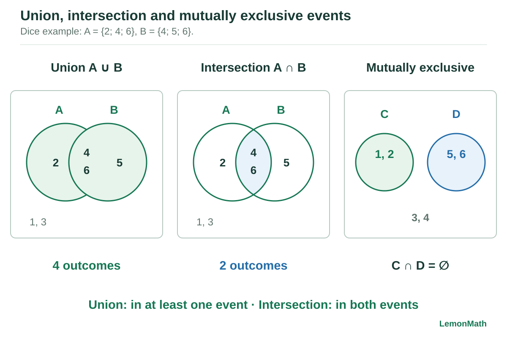

:::goals
- Understand and describe the union $A\cup B$, the intersection $A\cap B$ and the complement $\overline A$ of events.
- Recognise mutually exclusive events.
- Understand independent events and use the condition $P(AB)=P(A)\,P(B)$ to test them.
- Apply this to dice, cards, surveys and real-life situations.
:::

Suppose that in a class of $40$ students, $25$ like football, $18$ like basketball and $8$ like both (assumed figures). A student is chosen at random. What is the probability that the student likes at least one of the two sports? Are the two preferences independent? To answer, we need the language of union, intersection and independent events.

## Exploration: two events on the same die

Roll a fair die, which has $6$ equally likely outcomes. Let $A$ be "the number is even" and $B$ be "the number is at least $4$".

| Number | $1$ | $2$ | $3$ | $4$ | $5$ | $6$ |
|---|---|---|---|---|---|---|
| In $A$ | no | yes | no | yes | no | yes |
| In $B$ | no | no | no | yes | yes | yes |

The outcomes favourable to $A$ are $\{2,4,6\}$ and to $B$ are $\{4,5,6\}$. The outcomes in at least one of the events are $\{2,4,5,6\}$; those in both are $\{4,6\}$. These two sets give two new events.

## Union and intersection

:::definition Union, intersection and complement of events
Let $A$ and $B$ be two events of the same experiment.
- The **union** $A\cup B$ occurs when **at least one** of $A$, $B$ occurs.
- The **intersection** $A\cap B$ (also written $AB$) occurs when **both** $A$ and $B$ occur.
- The **complement** of $A$, written $\overline A$, occurs when $A$ does not occur.
:::

The set of outcomes favourable to $A\cup B$ is the union of the sets favourable to $A$ and to $B$; the set for $A\cap B$ is their intersection. In the die example, $A\cup B=\{2,4,5,6\}$ and $A\cap B=\{4,6\}$.

:::definition Mutually exclusive events
Two events $A$ and $B$ are **mutually exclusive** if they cannot occur together, that is $A\cap B=\varnothing$. Then $P(AB)=0$.
:::

An event $A$ and its complement $\overline A$ are always mutually exclusive, and $P(A)+P(\overline A)=1$.

:::definition Independent events
Two events $A$ and $B$ are **independent** if the occurrence or non-occurrence of one does not change the probability of the other. Then
$$P(AB)=P(A)\,P(B).$$
Conversely, if $P(AB)=P(A)\,P(B)$ then $A$ and $B$ are independent.
:::

If $A$ and $B$ are independent, then the pairs $A$ and $\overline B$, $\overline A$ and $B$, $\overline A$ and $\overline B$ are also independent.

## Examples

First, a union and an intersection on a die.

:::example Union and intersection of two events
Roll a fair die. Let $A$ be "the number is even" and $B$ be "the number is at least $4$". Describe $A\cup B$ and $A\cap B$ and find their probabilities.

**Solution.** We have $A=\{2,4,6\}$ and $B=\{4,5,6\}$. So $A\cup B=\{2,4,5,6\}$ has $4$ outcomes and $A\cap B=\{4,6\}$ has $2$ outcomes. Since the $6$ outcomes are equally likely,
$$P(A\cup B)=\frac46=\frac23,\qquad P(A\cap B)=\frac26=\frac13.$$

So $P(A\cup B)=\dfrac23$ and $P(A\cap B)=\dfrac13$.

:::

Next, a deck of cards.

:::example Drawing one card
A card is drawn at random from a standard deck of $52$ cards. Let $A$ be "a heart is drawn" and $B$ be "a king is drawn". Find $P(A\cup B)$ and $P(A\cap B)$.

**Solution.** There are $13$ hearts and $4$ kings. The intersection $A\cap B$ contains only the king of hearts, that is $1$ outcome. The union $A\cup B$ contains the $13$ hearts and the other $3$ kings (not hearts), a total of $16$ outcomes. So
$$P(A\cap B)=\frac1{52},\qquad P(A\cup B)=\frac{16}{52}=\frac4{13}.$$

So $P(A\cap B)=\dfrac1{52}$ and $P(A\cup B)=\dfrac4{13}$.
:::

Now mutually exclusive events.

:::example Mutually exclusive events
A card is drawn at random from a standard deck of $52$ cards. Let $A$ be "an ace is drawn" and $B$ be "a queen is drawn". Are these events mutually exclusive? Are they independent?

**Solution.** A card cannot be both an ace and a queen, so $A\cap B=\varnothing$; the events are mutually exclusive and $P(AB)=0$. On the other hand, $P(A)=P(B)=\dfrac4{52}=\dfrac1{13}$, so $P(A)\,P(B)=\dfrac1{169}\neq0$. Hence $P(AB)\neq P(A)\,P(B)$ and the events are **not** independent.

So $A$ and $B$ are mutually exclusive but not independent.
:::

Then testing independence.

:::example Testing independence
Roll a fair die twice. Let $A$ be "the first roll is $3$", $B$ be "the sum of the two rolls is $7$", and $C$ be "the sum of the two rolls is $8$". Decide whether $A$ is independent of $B$ and whether $A$ is independent of $C$.

**Solution.** There are $36$ equally likely outcomes. We have $P(A)=\dfrac6{36}=\dfrac16$, $P(B)=\dfrac6{36}=\dfrac16$ (the pairs $(1,6),(2,5),\dots,(6,1)$) and $P(C)=\dfrac5{36}$.

The intersection $A\cap B$ is only $(3,4)$, so $P(AB)=\dfrac1{36}=\dfrac16\cdot\dfrac16=P(A)\,P(B)$. So $A$ and $B$ are independent.

The intersection $A\cap C$ is only $(3,5)$, so $P(AC)=\dfrac1{36}$, while $P(A)\,P(C)=\dfrac16\cdot\dfrac5{36}=\dfrac5{216}$. The two values differ, so $A$ and $C$ are not independent.

So $A$ and $B$ are independent, but $A$ and $C$ are not.
:::

Finally, we return to the survey from the start, in four steps.

:::example Application: a survey of preferences in a class
Suppose that in a class of $40$ students, $25$ like football, $18$ like basketball and $8$ like both (assumed figures). A student is chosen at random. Let $A$ be "the student likes football" and $B$ be "the student likes basketball". Find $P(A\cup B)$ and decide whether the two events are independent.

**Solution.**

*Understand.* We need the probability that the student likes at least one sport, $P(A\cup B)$, and a comparison of $P(AB)$ with $P(A)\,P(B)$.

*Plan.* Count the students who like at least one sport by adding the two groups and subtracting the students counted twice (those who like both). Then compare the probabilities.

*Solve.* There are $25+18-8=35$ students who like at least one sport, so $P(A\cup B)=\dfrac{35}{40}=\dfrac78$. Also $P(A)=\dfrac{25}{40}=\dfrac58$, $P(B)=\dfrac{18}{40}=\dfrac9{20}$ and $P(AB)=\dfrac8{40}=\dfrac15$. The product is $P(A)\,P(B)=\dfrac58\cdot\dfrac9{20}=\dfrac9{32}\approx0.28$, while $P(AB)=0.2$. The values differ, so the events are not independent.

So $P(A\cup B)=\dfrac78$ and the events are not independent.

*Look back.* Is the result reasonable? The probability $\dfrac78$ must exceed each of $P(A)=\dfrac58$ and $P(B)=\dfrac9{20}$, and it does. The remaining $5$ students like neither sport, so $P(\overline{A\cup B})=\dfrac18$ and $\dfrac78+\dfrac18=1$. Non-independence is also reasonable: among the students who like football, the proportion who like basketball is $\dfrac8{25}=0.32$, lower than the overall proportion $\dfrac9{20}=0.45$, so knowing a student likes football makes basketball less likely.
:::

:::warning Common mistakes
- **Union means both.** Wrong: $A\cup B$ occurs when $A$ and $B$ both occur. Why it is wrong: that is the intersection. Right: $A\cup B$ occurs when at least one of them occurs.
- **Adding the numbers of outcomes directly for a union.** Wrong: $n(A\cup B)=n(A)+n(B)$ in the heart-or-king example. Why it is wrong: the king of hearts is counted twice. Right: $n(A\cup B)=n(A)+n(B)-n(A\cap B)=13+4-1=16$.
- **Mutually exclusive means independent.** Wrong: $A$, $B$ are mutually exclusive, so they are independent. Why it is wrong: mutually exclusive gives $P(AB)=0$, while independence needs $P(AB)=P(A)P(B)$; these agree only when a probability is $0$. Right: two events with positive probability that are mutually exclusive are not independent.
- **Independent means they cannot occur together.** Wrong: $A$, $B$ are independent, so $A\cap B=\varnothing$. Why it is wrong: independent events can still occur together. Right: $P(AB)=P(A)\,P(B)>0$ when both probabilities are positive.
:::

**Connections.** This lesson uses the classical definition of probability and counting outcomes from earlier lessons. The lesson on [the addition rule](lesson:addition-rule) will turn the count $n(A\cup B)=n(A)+n(B)-n(A\cap B)$ into the formula $P(A\cup B)=P(A)+P(B)-P(AB)$. In practice, surveys, quality control and risk forecasts all need us to tell unions, intersections and independence apart.

## Terms

:::terms
- biến cố hợp | union of events
- biến cố giao | intersection of events
- biến cố đối | complementary event
- biến cố xung khắc | mutually exclusive events
- biến cố độc lập | independent events
- phép thử | experiment
- không gian mẫu | sample space
- kết quả thuận lợi | favourable outcome
- xác suất | probability
- bộ bài tây | standard deck of cards
:::

## Summary

- $A\cup B$: at least one of the events occurs; $A\cap B$ (or $AB$): both occur; $\overline A$: $A$ does not occur.
- $A$, $B$ are mutually exclusive if $A\cap B=\varnothing$, and then $P(AB)=0$.
- $A$, $B$ are independent if and only if $P(AB)=P(A)\,P(B)$.
- If $A$, $B$ are independent, so are $A$ and $\overline B$; mutually exclusive and independent are different ideas.
- Counting a union: $n(A\cup B)=n(A)+n(B)-n(A\cap B)$.

## Practice

Each exercise has the knowledge needed and hints on the steps. Try it yourself first, then open the solution.

:::exercise
Roll a fair die. Let $A$ be "the number is divisible by $3$" and $B$ be "the number is odd". Describe $A\cup B$ and $A\cap B$ and find their probabilities.

::hint
**Knowledge:** list the favourable outcomes; union and intersection.

**Hints on the steps:**
1. List $A$ and $B$.
2. Find the union and the intersection, then divide by $6$.

::solution
The sample space is $\Omega=\{1,2,3,4,5,6\}$, which has $6$ equally likely outcomes.

The event $A$, "the number is divisible by $3$", gives $A=\{3,6\}$. The event $B$, "the number is odd", gives $B=\{1,3,5\}$.

The union $A\cup B$ is the event "the number is divisible by $3$ or is odd", consisting of the outcomes in at least one of the two sets: $A\cup B=\{1,3,5,6\}$.

The intersection $A\cap B$ is the event "the number is both divisible by $3$ and odd", consisting of the outcomes in both sets: $A\cap B=\{3\}$.

Hence $n(A\cup B)=4$ and $n(A\cap B)=1$, so
$$P(A\cup B)=\frac46=\frac23,\qquad P(A\cap B)=\frac16.$$

So $P(A\cup B)=\dfrac23$ and $P(A\cap B)=\dfrac16$.

**Answer.** $\dfrac23$ and $\dfrac16$.
:::

:::exercise
A card is drawn at random from a standard deck of $52$ cards. Let $A$ be "a spade" and $B$ be "a jack, queen or king". Find $P(A\cup B)$ and $P(A\cap B)$.

::hint
**Knowledge:** $n(A\cup B)=n(A)+n(B)-n(A\cap B)$.

**Hints on the steps:**
1. Count $n(A)=13$ and $n(B)=12$.
2. Count the intersection: the jack, queen and king of spades.

::solution
A standard deck has $52$ cards, each equally likely to be drawn, so $n(\Omega)=52$.

The event $A$, "a spade", has $n(A)=13$. The event $B$, "a jack, queen or king", has $n(B)=3\cdot4=12$ cards (each rank comes in $4$ suits).

The intersection $A\cap B$ is "a spade that is a jack, queen or king", consisting of the jack, queen and king of spades, so $n(A\cap B)=3$.

By the addition rule, we have
$$n(A\cup B)=n(A)+n(B)-n(A\cap B)=13+12-3=22.$$

Hence
$$P(A\cup B)=\frac{22}{52}=\frac{11}{26},\qquad P(A\cap B)=\frac{3}{52}.$$

So $P(A\cup B)=\dfrac{11}{26}$ and $P(A\cap B)=\dfrac3{52}$.

**Answer.** $\dfrac{11}{26}$ and $\dfrac3{52}$.
:::

:::exercise
A fair coin is tossed three times. Let $A$ be "at least two heads" and $B$ be "the first toss is a tail". Find $P(A\cup B)$ and $P(A\cap B)$.

::hint
**Knowledge:** there are $8$ equally likely outcomes.

**Hints on the steps:**
1. List the outcomes favourable to $A$ and to $B$ (H: head, T: tail).
2. Find the union and the intersection.

::solution
Let $H$ denote heads and $T$ denote tails. Tossing a fair coin three times gives $2^3=8$ equally likely outcomes.

The event $A$, "at least two heads", gives $A=\{HHH,HHT,HTH,THH\}$, which has $4$ outcomes.

The event $B$, "the first toss is a tail", gives $B=\{THH,THT,TTH,TTT\}$, which has $4$ outcomes.

The only outcome in both $A$ and $B$ is $THH$, so $A\cap B=\{THH\}$ and $n(A\cap B)=1$.

The union has $n(A\cup B)=4+4-1=7$ outcomes.

Hence
$$P(A\cup B)=\frac78,\qquad P(A\cap B)=\frac18.$$

So $P(A\cup B)=\dfrac78$ and $P(A\cap B)=\dfrac18$.

**Answer.** $\dfrac78$ and $\dfrac18$.
:::

:::exercise
Decide whether each statement is true or false.

a) The event $A\cup B$ occurs when at least one of $A$, $B$ occurs.

b) If $A\cap B=\varnothing$ then $A$ and $B$ are always independent.

c) If $P(AB)=P(A)\,P(B)$ then $A$ and $B$ are independent.

d) The event $A\cup B$ occurs only when both $A$ and $B$ occur.

::hint
**Knowledge:** the definitions.

**Hints on the steps:**
1. Compare each statement with the definition.
2. Distinguish mutually exclusive from independent.

::solution
a) **True.** By definition, the union $A\cup B$ occurs exactly when at least one of $A$, $B$ occurs.

b) **False.** If $A\cap B=\varnothing$ (the events are mutually exclusive) then $P(AB)=0$. Two events are independent when $P(AB)=P(A)P(B)$; if $P(A)>0$ and $P(B)>0$ then $P(A)P(B)>0$, which differs from $P(AB)=0$. For example, roll a fair die with $A=\{1\}$ and $B=\{2\}$: $A\cap B=\varnothing$ but $P(AB)=0\ne\dfrac1{36}=P(A)P(B)$.

c) **True.** By definition, the events $A$ and $B$ are independent when $P(AB)=P(A)\,P(B)$.

d) **False.** The event $A\cup B$ occurs when at least one of the two events occurs, not necessarily both. The event "both $A$ and $B$ occur" is the intersection $A\cap B$.

So statements a), c) are true; statements b), d) are false.

**Answer.** a) True; b) False; c) True; d) False.
:::

:::exercise
Suppose two marksmen shoot independently at the same target; the probability of a hit is $0.8$ for the first and $0.7$ for the second (assumed figures). Find the probability that both hit and the probability that both miss.

::hint
**Knowledge:** if $A$, $B$ are independent then $P(AB)=P(A)P(B)$; $\overline A$, $\overline B$ are also independent.

**Hints on the steps:**
1. Find $P(AB)$.
2. Find $P(\overline A)$, $P(\overline B)$ and multiply.

::solution
Let $A$ be the event "the first marksman hits" and $B$ the event "the second marksman hits". We are given $P(A)=0.8$, $P(B)=0.7$, and $A$, $B$ are independent.

Both hit is the event $AB$. Since $A$ and $B$ are independent,
$$P(AB)=P(A)\,P(B)=0.8\cdot0.7=0.56.$$

Both miss is the event $\overline A\,\overline B$. We have $P(\overline A)=1-0.8=0.2$ and $P(\overline B)=1-0.7=0.3$. Since $A$ and $B$ are independent, so are $\overline A$ and $\overline B$, hence
$$P(\overline A\,\overline B)=P(\overline A)\,P(\overline B)=0.2\cdot0.3=0.06.$$

So the probability that both hit is $0.56$ and the probability that both miss is $0.06$.

**Answer.** $0.56$ and $0.06$.
:::

:::exercise
Roll a fair die twice. Let $A$ be "the sum of the two rolls is $7$" and $B$ be "the second roll is $6$". Are the two events independent?

::hint
**Knowledge:** compare $P(AB)$ with $P(A)P(B)$.

**Hints on the steps:**
1. Find $P(A)$ and $P(B)$.
2. Find the intersection: only $(1,6)$.

::solution
Rolling a fair die twice gives $6\cdot6=36$ equally likely outcomes, each a pair $(i, j)$ where $i$ is the first roll and $j$ is the second roll.

The event $A$, "the sum of the two rolls is $7$", consists of the $6$ outcomes $(1, 6)$, $(2, 5)$, $(3, 4)$, $(4, 3)$, $(5, 2)$, $(6, 1)$, so $P(A)=\dfrac{6}{36}=\dfrac16$.

The event $B$, "the second roll is $6$", consists of the $6$ outcomes $(1, 6)$, $(2, 6)$, $\ldots$, $(6, 6)$, so $P(B)=\dfrac{6}{36}=\dfrac16$.

The only outcome in both $A$ and $B$ is $(1, 6)$, so $A\cap B=\{(1, 6)\}$ and $P(AB)=\dfrac1{36}$.

We have $P(A)\,P(B)=\dfrac16\cdot\dfrac16=\dfrac1{36}=P(AB)$.

So the events $A$ and $B$ are independent.

**Answer.** Yes, the events are independent.
:::

:::exercise
Suppose that in a class of $30$ students, $18$ learn chess, $12$ learn music and $5$ learn both (assumed figures). A student is chosen at random. Find the probability that the student learns at least one of the two, and the probability that the student learns neither.

::hint
**Knowledge:** $n(A\cup B)=n(A)+n(B)-n(A\cap B)$; complementary events.

**Hints on the steps:**
1. Count the students who learn at least one.
2. Use the complement.

::solution
Let $A$ be the event "the chosen student learns chess" and $B$ the event "the chosen student learns music". We are given $n(A)=18$, $n(B)=12$, $n(A\cap B)=5$ and $n(\Omega)=30$.

The event "learns at least one of the two" is $A\cup B$. By the addition rule, the number of students who learn at least one is
$$n(A\cup B)=n(A)+n(B)-n(A\cap B)=18+12-5=25.$$

Hence
$$P(A\cup B)=\frac{25}{30}=\frac56.$$

The event "learns neither" is the complement of $A\cup B$, so
$$P\left(\overline{A\cup B}\right)=1-P(A\cup B)=1-\frac56=\frac16.$$

So the probability that the student learns at least one of the two is $\dfrac56$, and the probability that the student learns neither is $\dfrac16$.

**Answer.** $\dfrac56$ and $\dfrac16$.
:::

:::exercise
Revisit fractions. Two cards are drawn one after the other from a standard deck of $52$ cards, each card being returned to the deck after it is drawn. Find the probability that both cards are hearts.

::hint
**Knowledge:** with replacement, the two draws are independent.

**Hints on the steps:**
1. Find the probability of a heart on one draw.
2. Multiply the two probabilities.

::solution
Let $A_1$ be the event "the first card is a heart" and $A_2$ the event "the second card is a heart".

The deck has $52$ cards, of which $13$ are hearts. Each card is returned to the deck after it is drawn, so the deck always has all $52$ cards and the second draw does not depend on the first. Hence $A_1$ and $A_2$ are independent and
$$P(A_1)=P(A_2)=\frac{13}{52}=\frac14.$$

Both cards being hearts is the event $A_1A_2$, so
$$P(A_1A_2)=P(A_1)\,P(A_2)=\frac14\cdot\frac14=\frac1{16}.$$

So the probability that both cards are hearts is $\dfrac1{16}$.

**Answer.** $\dfrac1{16}$.
:::

:::exercise Challenge
Prove that if $A$ and $B$ are independent, then $A$ and $\overline B$ are also independent.

::hint
**Knowledge:** $A=AB\cup A\overline B$ and these two events are mutually exclusive, so $P(A)=P(AB)+P(A\overline B)$.

**Hints on the steps:**
1. Express $P(A\overline B)$ using $P(A)$ and $P(AB)$.
2. Substitute $P(AB)=P(A)P(B)$.

::solution
Suppose $A$ and $B$ are independent, that is $P(AB)=P(A)\,P(B)$. We need to prove that $P(A\overline B)=P(A)\,P(\overline B)$.

The event $A$ is the union of the two mutually exclusive events $AB$ and $A\overline B$ (according to whether $B$ occurs or not), so
$$P(A)=P(AB)+P(A\overline B),\ \text{hence}\ P(A\overline B)=P(A)-P(AB).$$

Substituting $P(AB)=P(A)\,P(B)$, we obtain
$$\begin{aligned}P(A\overline B)&=P(A)-P(A)\,P(B)\\&=P(A)\,\bigl(1-P(B)\bigr)\\&=P(A)\,P(\overline B).\end{aligned}$$

So if $A$ and $B$ are independent, then $A$ and $\overline B$ are also independent.

**Answer.** Proved.
:::

## Mini test

:::quiz
::mc NB
The event $A\cup B$ occurs when
A. at least one of $A$, $B$ occurs.
B. $A$ occurs and $B$ does not.
C. both $A$ and $B$ occur.
D. neither event occurs.
::key A
This is the definition of the union. Option C is the intersection, and B and D are other events.

::mc TH
Roll a fair die. Let $A$ be "the number is even" and $B$ be "the number is at least $4$". The probability $P(A\cap B)$ is
A. $\dfrac12$.
B. $\dfrac13$.
C. $\dfrac16$.
D. $\dfrac23$.
::key B
$A\cap B=\{4,6\}$, so $P=\dfrac26=\dfrac13$. Option D is $P(A\cup B)$, A is $P(A)$, and C counts only one outcome.

::mc TH
A card is drawn from a standard deck of $52$ cards. Let $A$ be "a heart" and $B$ be "a king". The probability $P(A\cup B)$ is
A. $\dfrac1{52}$.
B. $\dfrac{17}{52}$.
C. $\dfrac4{13}$.
D. $\dfrac1{13}$.
::key C
$n(A\cup B)=13+4-1=16$, so $P=\dfrac{16}{52}=\dfrac4{13}$. Option B forgets to subtract the common card, A is $P(AB)$, and D is $P(B)$.

::mc NB
Two events $A$, $B$ are independent if and only if
A. $A\cap B=\varnothing$.
B. $P(AB)=0$.
C. $P(A\cup B)=P(A)+P(B)$.
D. $P(AB)=P(A)\,P(B)$.
::key D
This is the condition for independence. Options A and B describe mutually exclusive events, and C holds only for mutually exclusive events.

::tf NB TH TH TH
Decide whether each statement is true or false:
a) The intersection $A\cap B$ occurs when both $A$ and $B$ occur.
b) $A$ and its complement $\overline A$ are always mutually exclusive.
c) Two mutually exclusive events with positive probabilities are always independent.
d) If $A$ and $B$ are independent then $A$ and $\overline B$ are also independent.
::key T T F T
a) True by definition. b) True, since $A$ and $\overline A$ cannot occur together. c) False: then $P(AB)=0\neq P(A)P(B)$. d) True by the property.

::sa TH
Independent events $A$, $B$ have $P(A)=0.6$ and $P(B)=0.5$. Find $P(AB)$.
::key 0.3
$P(AB)=0.6\cdot0.5=0.3$.

::sa VD
Suppose that in a survey of $50$ people, $30$ use app X, $24$ use app Y and $14$ use both. One person is chosen at random. Find the probability that the person uses at least one app.
::key 0.8
$30+24-14=40$ people, so the probability is $\dfrac{40}{50}=0.8$.
:::
