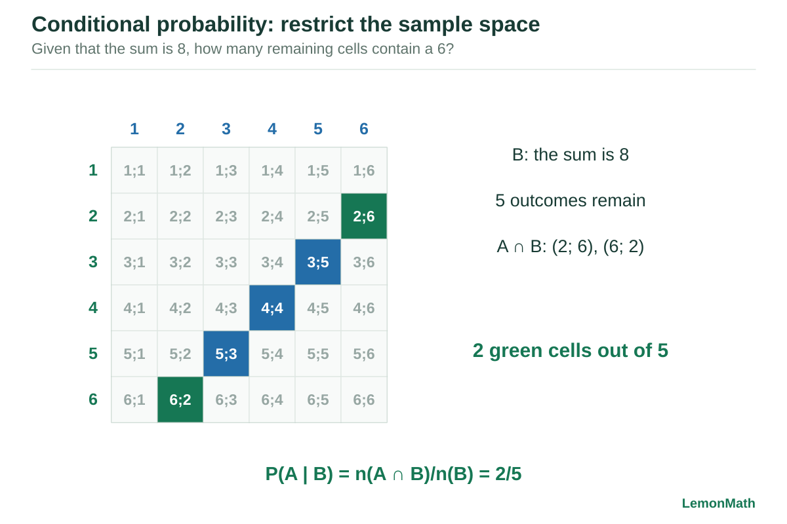

:::goals
- Understand and find the conditional probability $P(A\mid B)$, by the formula and by counting.
- Read conditional probabilities from two-way tables and tree diagrams.
- Use the multiplication rule $P(A\cap B)=P(B)\cdot P(A\mid B)$.
- Recognise independent events through the equation $P(A\mid B)=P(A)$.
:::

A school surveys $200$ grade-12 students about joining a sports club:

| | Joined | Not joined | Total |
|---|---|---|---|
| Boys | $60$ | $40$ | $100$ |
| Girls | $30$ | $70$ | $100$ |
| Total | $90$ | $110$ | $200$ |

One student is chosen at random. The probability that the student has joined the club is $\dfrac{90}{200}=0.45$. But if we **also know** that the student chosen is a girl, what is the probability that she has joined the club? Think about it: does the new information change the number?

## Conditional probability

### Explore: shrinking the sample space

Once we know that the student is a girl, we only look at the $100$ girls in the second row. Of these, $30$ have joined, so the probability we want is

$$\frac{30}{100}=0.3.$$

This is not $0.45$: one piece of information, "is a girl", has changed the probability. We can also write it with probabilities over all $200$ students, and writing it that way leads us to the general formula:

$$\frac{30}{100}=\frac{30/200}{100/200}=\frac{P(\text{girl and joined})}{P(\text{girl})}=\frac{0.15}{0.5}=0.3.$$

:::definition Conditional probability
Let $A$ and $B$ be events with $P(B)>0$. The probability of $A$ **given** that $B$ has happened, written $P(A\mid B)$, is
$$P(A\mid B)=\frac{P(A\cap B)}{P(B)}.$$
When the outcomes are equally likely, we can count: $P(A\mid B)=\dfrac{n(A\cap B)}{n(B)}$.
:::

**Why this formula?** Knowing that $B$ has happened means only the outcomes in $B$ are still possible, so $B$ acts as a new sample space. Inside it, the outcomes that make $A$ happen are exactly $A\cap B$. We divide by $P(B)$ so that the probabilities in the "new space" add up to $1$.

The definition gives $P(\overline{A}\mid B)=1-P(A\mid B)$, just as for ordinary probabilities. The reason is that in the new sample space, each outcome either makes the event happen or does not.

:::example Rolling two dice
Two fair dice are rolled. Given that the total is $8$, find the probability that at least one die shows a $6$.

**Solution.** Let $B$ be "the total is $8$" and $A$ be "at least one $6$". We list $B$, then count the outcomes of $B$ that contain a $6$:

$$B=\{(2, 6), (3, 5), (4, 4), (5, 3), (6, 2)\},\qquad A\cap B=\{(2, 6), (6, 2)\}.$$

So $P(A\mid B)=\dfrac{n(A\cap B)}{n(B)}=\dfrac25$.

:::

The order of the two events in $P(A\mid B)$ matters a great deal. Swapping them asks a completely different question, as the next example shows.

:::example Swapping the two events
Using the survey table at the start, one student is chosen at random. Let $T$ be "has joined the club" and $N$ be "is a girl". Find $P(T\mid N)$ and $P(N\mid T)$.

**Solution.** $P(T\mid N)$ only uses the "Girls" row; $P(N\mid T)$ only uses the "Joined" column:

$$P(T\mid N)=\frac{30}{100}=\frac{3}{10},\qquad P(N\mid T)=\frac{30}{90}=\frac13.$$

The two numbers are different: $P(T\mid N)$ answers "of the girls, what fraction joined?", while $P(N\mid T)$ answers "of those who joined, what fraction are girls?".
:::

## The multiplication rule and tree diagrams

Multiplying both sides of the definition by $P(B)$ gives a formula for the probability of an intersection. We use it as often as the definition itself.

:::theorem The multiplication rule
For events $A$ and $B$ with positive probabilities:
$$P(A\cap B)=P(B)\cdot P(A\mid B)=P(A)\cdot P(B\mid A).$$
:::

This rule is especially useful when an experiment happens **in stages**, such as drawing balls one after another. On a tree diagram, each branch carries the conditional probability of that stage, and the probability of a path is the product of the numbers along it.

:::example Drawing without replacement
A box holds $5$ red balls and $3$ blue balls. Two balls are drawn one after the other, without replacement. Find the probability that both are red, and the probability that the second is red given that the first is blue.

**Solution.** Let $D_1$, $D_2$ be "the first, second ball is red". At the first draw there are $5$ red out of $8$. If a red ball has already been drawn, $4$ red remain out of $7$:

$$P(D_1\cap D_2)=P(D_1)\cdot P(D_2\mid D_1)=\frac58\cdot\frac47=\frac{20}{56}=\frac{5}{14}.$$

If the first ball is blue, the box has $5$ red and $2$ blue left, so $P(D_2\mid \overline{D_1})=\dfrac57$.
:::

:::diagram Tree diagram for drawing two balls without replacement
alt: A two-stage tree; the first stage splits into red with probability 5/8 and blue with probability 3/8, and each branch splits again into red and blue with conditional probabilities; the four ends show the probabilities 20/56, 15/56, 15/56 and 6/56
point S 0,0 left "Start"
point R 3,2 above "Red"
point X 3,-2 below "Blue"
point RR 6,3 right "Red: 20/56"
point RX 6,1 right "Blue: 15/56"
point XR 6,-1 right "Red: 15/56"
point XX 6,-3 right "Blue: 6/56"
segment S R
segment S X
segment R RR
segment R RX
segment X XR
segment X XX
label 1.2,1.5 "5/8"
label 1.2,-1.5 "3/8"
label 4.4,3 "4/7"
label 4.4,1.1 "3/7"
label 4.4,-1.1 "5/7"
label 4.4,-3 "2/7"
:::

The four numbers at the ends add up to $\dfrac{20+15+15+6}{56}=1$. It is worth getting into the habit of adding them up like this: if the total is not one, something has gone wrong.

:::example A two-round contest
The probability that a student passes round 1 of a contest is $0.6$. Given that the student has passed round 1, the probability of passing round 2 is $0.5$. Find the probability that the student passes both rounds.

**Solution.** Let $V_1$, $V_2$ be the events of passing round 1 and round 2. To reach round 2 one must pass round 1, so we use the multiplication rule:

$$P(V_1\cap V_2)=P(V_1)\cdot P(V_2\mid V_1)=0.6\cdot0.5=0.3.$$

So the probability of passing both rounds is $0.3$.
:::

## Independent events

In grade 11, two events were called independent when whether one happens does not change the probability of the other. With conditional probability we can write this as a formula: when $P(B)>0$,

$$A \text{ and } B \text{ are independent}\iff P(A\mid B)=P(A)\iff P(A\cap B)=P(A)\cdot P(B).$$

The second equivalence follows from the multiplication rule. In the drawing example, $P(D_2\mid D_1)=\dfrac47$ but $P(D_2\mid\overline{D_1})=\dfrac57$, so $D_1$ and $D_2$ are **not** independent.

:::example Testing for independence
A die is rolled. Let $A$ be "an even number", $B$ be "at most $4$" and $C$ be "at least $4$". Are $A$ and $B$ independent? What about $A$ and $C$?

**Solution.** We have $P(A)=\dfrac36=\dfrac12$. In $B=\{1, 2, 3, 4\}$ there are two even numbers; in $C=\{4, 5, 6\}$ there are also two:

$$P(A\mid B)=\frac24=\frac12=P(A),\qquad P(A\mid C)=\frac23\neq P(A).$$

So $A$ and $B$ are independent, while $A$ and $C$ are not.
:::

The last example is a medical one. Here, mixing up $P(A\mid B)$ and $P(B\mid A)$ does not just spoil an answer; it can make people misunderstand their own health.

:::example Screening test results
A screening programme tests $1000$ people, with these results:

| | Has the disease | Does not | Total |
|---|---|---|---|
| Positive | $45$ | $95$ | $140$ |
| Negative | $5$ | $855$ | $860$ |
| Total | $50$ | $950$ | $1000$ |

One person is chosen at random. Find the probability of a positive test given that the person has the disease, and the probability of having the disease given a positive test.

**Solution.** The first question only uses the "Has the disease" column, the second only the "Positive" row:

$$P(\text{positive}\mid\text{disease})=\frac{45}{50}=0.9,\qquad P(\text{disease}\mid\text{positive})=\frac{45}{140}=\frac{9}{28}\approx0.32.$$

The test detects $90\%$ of the people who have the disease, but only about $32\%$ of those who test positive really have it, because the healthy people are so many that the $95$ false positives outnumber the $45$ true ones. The next lesson explains this with Bayes' theorem.
:::

:::warning Common mistakes
- **Mixing up $P(A\mid B)$ and $P(B\mid A)$.** Wrong: "the test is right for $90\%$ of sick people, so a person who tests positive is $90\%$ likely to be sick". Why it is wrong: that is $P(\text{positive}\mid\text{disease})$, not $P(\text{disease}\mid\text{positive})$. Right: $P(\text{disease}\mid\text{positive})=\dfrac{45}{140}\approx0.32$.
- **Dividing by the whole sample space.** Wrong: in the dice example, $P(A\mid B)=\dfrac{2}{36}$. Why it is wrong: once $B$ is known, only $5$ outcomes remain. Right: $\dfrac25$.
- **The wrong denominator.** Wrong: $P(A\mid B)=\dfrac{P(A\cap B)}{P(A)}$. Why it is wrong: the condition is $B$, so we divide by $P(B)$.
- **Multiplying as if independent when drawing without replacement.** Wrong: $P(\text{two red})=\dfrac58\cdot\dfrac58=\dfrac{25}{64}$. Why it is wrong: after the first draw the box has changed. Right: $\dfrac58\cdot\dfrac47=\dfrac5{14}$.

The first slip is not only made by students; adults make it too. Each time you read a conditional probability, ask yourself: what is already known, and what are we asking about?
:::

## Key terms

:::terms
- conditional probability | xác suất có điều kiện
- intersection of events | biến cố giao
- two-way table | bảng hai chiều
- tree diagram | sơ đồ cây
- multiplication rule | công thức nhân xác suất
- independent events | biến cố độc lập
- drawing without replacement | lấy không hoàn lại
- false positive | dương tính giả
:::

## Summary

- $P(A\mid B)=\dfrac{P(A\cap B)}{P(B)}$ (with $P(B)>0$); for equally likely outcomes, $\dfrac{n(A\cap B)}{n(B)}$.
- Knowing that $B$ happened shrinks the sample space to $B$; in a two-way table, read only the row or column of $B$.
- $P(A\mid B)$ and $P(B\mid A)$ are usually different.
- Multiplication rule: $P(A\cap B)=P(B)\cdot P(A\mid B)$; on a tree diagram, multiply along a path.
- $A$, $B$ independent $\iff P(A\mid B)=P(A)\iff P(A\cap B)=P(A)P(B)$.

Back to the survey: once we know the student is a girl, we count only among the girls, and the probability changes. If you remember one thing, remember this: a conditional probability is a probability in a sample space that has been narrowed down.

## Practice

Each exercise gives you what you need and a few steps to start. Try it yourself first. If you get stuck, read a hint, carry on, and only then open the solution to compare.

:::exercise
A fair die is rolled. Given that the result is odd, find the probability that it is at most $3$.

::hint
**What you need:** $P(A\mid B)=\dfrac{n(A\cap B)}{n(B)}$ when outcomes are equally likely.

**Steps:**
1. List $B=\{1, 3, 5\}$.
2. Count the elements of $B$ that are at most $3$.

::solution
Let $A$ be the event "the result is at most $3$" and $B$ be the event "the result is odd". We need $P(A\mid B)$.

The sample space is $\Omega=\{1, 2, 3, 4, 5, 6\}$, which has $6$ equally likely outcomes. We have $B=\{1, 3, 5\}$, so $n(B)=3$.

The outcomes favourable to both $A$ and $B$ are $A\cap B=\{1, 3\}$, so $n(A\cap B)=2$.

Using the formula $P(A\mid B)=\dfrac{n(A\cap B)}{n(B)}$, we get
$$P(A\mid B)=\frac23.$$

So the probability that the result is at most $3$, given that it is odd, is $\dfrac23$.

**Answer.** $\dfrac23$.
:::

:::exercise
A class has $40$ students: $20$ boys, $14$ of whom like maths, and $20$ girls, $10$ of whom like maths. One student is chosen at random. Find the probability that the student likes maths given that she is a girl, and the probability that the student is a boy given that the student likes maths.

::hint
**What you need:** make a two-way table; read only the row (or column) of the condition.

**Steps:**
1. The number who like maths is $14+10=24$.
2. Compute $\dfrac{10}{20}$ and $\dfrac{14}{24}$.

::solution
Let $A$ be the event "the chosen student likes maths", $G$ be the event "the chosen student is a girl" and $B$ be the event "the chosen student is a boy".

The number of students who like maths is $14+10=24$. We have
$$P(G)=\frac{20}{40},\qquad P(A)=\frac{24}{40},\qquad P(A\cap G)=\frac{10}{40},\qquad P(A\cap B)=\frac{14}{40}.$$

The probability that the student likes maths given that she is a girl:
$$P(A\mid G)=\frac{P(A\cap G)}{P(G)}=\frac{10/40}{20/40}=\frac{10}{20}=\frac12.$$

The probability that the student is a boy given that the student likes maths:
$$P(B\mid A)=\frac{P(A\cap B)}{P(A)}=\frac{14/40}{24/40}=\frac{14}{24}=\frac7{12}.$$

So the probability that the student likes maths given that she is a girl is $\dfrac12$, and the probability that the student is a boy given that the student likes maths is $\dfrac7{12}$.

**Answer.** $\dfrac12$ and $\dfrac7{12}$.
:::

:::exercise
Given $P(A)=0.5$, $P(B)=0.4$ and $P(A\cap B)=0.2$, find $P(A\mid B)$ and $P(B\mid A)$, and decide whether $A$ and $B$ are independent.

::hint
**What you need:** the definition of conditional probability; independence means $P(A\mid B)=P(A)$.

**Steps:**
1. Divide $P(A\cap B)$ by $P(B)$, then by $P(A)$.
2. Compare $P(A\mid B)$ with $P(A)$.

::solution
Using the conditional probability formulas $P(A\mid B)=\dfrac{P(A\cap B)}{P(B)}$ and $P(B\mid A)=\dfrac{P(A\cap B)}{P(A)}$, we have
$$P(A\mid B)=\frac{0.2}{0.4}=0.5,\qquad P(B\mid A)=\frac{0.2}{0.5}=0.4.$$

Testing independence. We have $P(A\mid B)=0.5=P(A)$. Also $P(A)\cdot P(B)=0.5\cdot0.4=0.2=P(A\cap B)$.

So $P(A\mid B)=0.5$, $P(B\mid A)=0.4$ and the events $A$ and $B$ are independent.

**Answer.** $0.5$; $0.4$; independent.
:::

:::exercise
A box holds $4$ white balls and $6$ black balls. Two balls are drawn one after the other without replacement. Find the probability that both are black, and the probability that the second is white given that the first is black.

::hint
**What you need:** the multiplication rule $P(A\cap B)=P(A)\cdot P(B\mid A)$; after the first draw, $9$ balls remain.

**Steps:**
1. $P(\text{black first})=\dfrac{6}{10}$ and $P(\text{black second}\mid\text{black first})=\dfrac59$.
2. If the first is black, $4$ white remain out of $9$.

::solution
Let $A_1$ be the event "the first ball is black", $A_2$ be the event "the second ball is black" and $W_2$ be the event "the second ball is white".

Probability that both are black. The box initially holds $10$ balls, of which $6$ are black, so $P(A_1)=\dfrac{6}{10}$. After a black ball is drawn (without replacement), $9$ balls remain, of which $5$ are black, so $P(A_2\mid A_1)=\dfrac59$. By the multiplication rule,
$$P(A_1\cap A_2)=P(A_1)\cdot P(A_2\mid A_1)=\frac{6}{10}\cdot\frac59=\frac{30}{90}=\frac13.$$

Probability that the second is white given that the first is black. After a black ball is drawn, $9$ balls remain, of which $4$ are white, so
$$P(W_2\mid A_1)=\frac49.$$

So the probability that both balls are black is $\dfrac13$, and the probability that the second is white given that the first is black is $\dfrac49$.

**Answer.** $\dfrac13$ and $\dfrac49$.
:::

:::exercise
A box holds $10$ cards numbered $1$ to $10$. One card is drawn at random. Let $A$ be "the number is even" and $B$ be "the number is at least $7$". Is each claim true or false?

a) $P(B)=0.4$.

b) $P(A\mid B)=\dfrac12$.

c) $P(B\mid A)=\dfrac25$.

d) $A$ and $B$ are not independent.

::hint
**What you need:** $P(A\mid B)=\dfrac{n(A\cap B)}{n(B)}$; independence means $P(A\mid B)=P(A)$.

**Steps:**
1. List $B=\{7, 8, 9, 10\}$ and $A\cap B=\{8, 10\}$.
2. Compare $P(A\mid B)$ with $P(A)=\dfrac12$.

::solution
The sample space $\Omega=\{1, 2, \dots, 10\}$ has $10$ equally likely outcomes. We have $A=\{2, 4, 6, 8, 10\}$, so $n(A)=5$ and $P(A)=\dfrac5{10}=\dfrac12$. We have $B=\{7, 8, 9, 10\}$, so $n(B)=4$. The intersection is $A\cap B=\{8, 10\}$, so $n(A\cap B)=2$.

a) **True.** We have $P(B)=\dfrac{n(B)}{n(\Omega)}=\dfrac4{10}=0.4$.

b) **True.** We have $P(A\mid B)=\dfrac{n(A\cap B)}{n(B)}=\dfrac24=\dfrac12$.

c) **True.** Of the $5$ elements of $A$, the $2$ elements $8$ and $10$ belong to $B$, so $P(B\mid A)=\dfrac{n(A\cap B)}{n(A)}=\dfrac25$.

d) **False.** We have $P(A\mid B)=\dfrac12=P(A)$. Also $P(A)\cdot P(B)=\dfrac12\cdot0.4=0.2=\dfrac2{10}=P(A\cap B)$. Hence $A$ and $B$ are independent, so the claim that $A$ and $B$ are not independent is false.

So claims a), b), c) are true; claim d) is false.

**Answer.** a) True; b) True; c) True; d) False.
:::

:::exercise
Two fair dice are rolled. Given that at least one die shows a $6$, find the probability that the total is at least $10$. Give your answer to 2 decimal places.

::hint
**What you need:** counting in the shrunken sample space.

**Steps:**
1. Count the outcomes with at least one $6$: $36-25=11$.
2. Among them, count those with total $\ge10$.

::solution
Let $A$ be the event "at least one die shows a $6$" and $B$ be the event "the total is at least $10$". We need $P(B\mid A)$.

Rolling two dice gives $6\cdot6=36$ equally likely outcomes. The complement of $A$ is "neither die shows a $6$", which has $5\cdot5=25$ outcomes. Hence $n(A)=36-25=11$.

The outcomes favourable to both $A$ and $B$ (a $6$ appears and the total is $\ge10$) are $(4, 6)$, $(6, 4)$, $(5, 6)$, $(6, 5)$, $(6, 6)$, so $n(A\cap B)=5$.

Using the formula $P(B\mid A)=\dfrac{n(A\cap B)}{n(A)}$, we get
$$P(B\mid A)=\frac5{11}\approx0.4545.$$

So the probability that the total is at least $10$, given that at least one die shows a $6$, is approximately $0.45$.

**Answer.** $0.45$.
:::

:::exercise
In a café, $70\%$ of customers order a coffee drink, and $40\%$ of those also order a cake. Also, $35\%$ of all customers order a cake. Find the probability that a customer orders both coffee and cake, and the probability that a customer ordered coffee given that the customer ordered cake.

::hint
**What you need:** "$40\%$ of those" is the conditional probability $P(\text{cake}\mid\text{coffee})=0.4$.

**Steps:**
1. Use the multiplication rule.
2. Divide by $P(\text{cake})=0.35$.

::solution
Let $A$ be the event "the customer orders a coffee drink" and $B$ be the event "the customer orders a cake". By the problem, $P(A)=0.7$, $P(B\mid A)=0.4$ and $P(B)=0.35$.

Probability that a customer orders both coffee and cake. By the multiplication rule,
$$P(A\cap B)=P(A)\cdot P(B\mid A)=0.7\cdot0.4=0.28.$$

Probability that the customer ordered coffee given that the customer ordered cake:
$$P(A\mid B)=\frac{P(A\cap B)}{P(B)}=\frac{0.28}{0.35}=0.8.$$

So the probability that a customer orders both coffee and cake is $0.28$, and the probability that the customer ordered coffee given that the customer ordered cake is $0.8$.

**Answer.** $0.28$ and $0.8$.
:::

:::exercise Review
Two marksmen fire independently at a target, one shot each, hitting with probabilities $0.8$ and $0.7$. Given that the target is hit at least once, find the probability that both hit it. Give your answer to 2 decimal places.

::hint
**What you need:** the multiplication rule for independent events (grade 11) and the complementary event: $P(\text{at least one})=1-P(\text{nobody hits})$.

**Steps:**
1. $P(\text{both hit})=0.8\cdot0.7$.
2. $P(\text{at least one hit})=1-0.2\cdot0.3$; "both hit" lies inside "at least one hit".

::solution
Let $A$ be the event "the first marksman hits" and $B$ be the event "the second marksman hits". By the problem, $P(A)=0.8$, $P(B)=0.7$ and $A$, $B$ are independent.

Let $C=A\cap B$ be the event "both hit" and $D$ be the event "the target is hit at least once". We need $P(C\mid D)$.

Since $A$ and $B$ are independent,
$$P(C)=P(A)\cdot P(B)=0.8\cdot0.7=0.56.$$

The complement of $D$ is "both miss", with probability $(1-0.8)(1-0.7)=0.2\cdot0.3=0.06$. Hence
$$P(D)=1-0.06=0.94.$$

Since "both hit" implies "at least one hit", we have $C\subset D$, so $C\cap D=C$. Using the conditional probability formula,
$$P(C\mid D)=\frac{P(C\cap D)}{P(D)}=\frac{0.56}{0.94}=\frac{28}{47}\approx0.596.$$

So the probability that both hit the target, given that the target is hit at least once, is approximately $0.60$.

**Answer.** $\approx0.60$.
:::

:::exercise Review
A group has $5$ boys and $4$ girls. Three of them are chosen at random. Given that at least one girl is chosen, find the probability that exactly one girl is chosen.

::hint
**What you need:** counting with combinations (see [permutations, arrangements and combinations](lesson:permutations-combinations)).

**Steps:**
1. The number of choices with at least one girl is $\binom{9}{3}-\binom{5}{3}$.
2. The number with exactly one girl is $\binom{4}{1}\cdot\binom{5}{2}$.

::solution
Let $A$ be the event "at least one girl is chosen" and $B$ be the event "exactly one girl is chosen". We need $P(B\mid A)$.

Choosing $3$ people from $9$ can be done in $\binom{9}{3}=84$ ways. The complement of $A$ is "all three chosen are boys", which can be done in $\binom{5}{3}=10$ ways. Hence $n(A)=84-10=74$.

For the event $B$, we choose $1$ girl from $4$ girls and $2$ boys from $5$ boys, so $n(B)=\binom{4}{1}\cdot\binom{5}{2}=4\cdot10=40$.

Exactly one girl implies at least one girl, so $B\subset A$ and $n(A\cap B)=n(B)=40$.

Using the formula $P(B\mid A)=\dfrac{n(A\cap B)}{n(A)}$, we get
$$P(B\mid A)=\frac{40}{74}=\frac{20}{37}.$$

So the probability that exactly one girl is chosen, given that at least one girl is chosen, is $\dfrac{20}{37}$.

**Answer.** $\dfrac{20}{37}$.
:::

:::exercise Challenge
A fair coin is tossed three times. Let $A$ be "the first toss is heads" and $B$ be "at least two tosses are heads". Find $P(A\mid B)$ and $P(B\mid A)$, and decide whether $A$ and $B$ are independent.

::hint
**What you need:** list the $8$ equally likely outcomes; independence means $P(A\mid B)=P(A)$.

**Steps:**
1. Write $B$ (H for heads, T for tails): HHT, HTH, THH, HHH.
2. Count $A\cap B$, then divide by $n(B)$ and by $n(A)=4$.

::solution
Write H for heads and T for tails. The sample space has $2^3=8$ equally likely outcomes.

The event $A$ "the first toss is heads" is $A=\{\text{HHH}, \text{HHT}, \text{HTH}, \text{HTT}\}$, so $P(A)=\dfrac48=\dfrac12$.

The event $B$ "at least two tosses are heads" is $B=\{\text{HHH}, \text{HHT}, \text{HTH}, \text{THH}\}$, so $P(B)=\dfrac48=\dfrac12$.

The intersection is $A\cap B=\{\text{HHT}, \text{HTH}, \text{HHH}\}$, which has $3$ elements, so $P(A\cap B)=\dfrac38$.

Using the conditional probability formula,
$$P(A\mid B)=\frac{P(A\cap B)}{P(B)}=\frac{3/8}{4/8}=\frac34,\qquad P(B\mid A)=\frac{P(A\cap B)}{P(A)}=\frac{3/8}{4/8}=\frac34.$$

Testing independence. We have $P(A)=\dfrac12\neq\dfrac34=P(A\mid B)$ (equivalently, $P(A)\cdot P(B)=\dfrac14\neq\dfrac38=P(A\cap B)$), so $A$ and $B$ are not independent: knowing the first toss is heads makes at least two heads more likely.

So $P(A\mid B)=\dfrac34$, $P(B\mid A)=\dfrac34$ and the events $A$ and $B$ are not independent.

**Answer.** $\dfrac34$; $\dfrac34$; not independent.
:::

## Mini test

:::quiz
::mc NB
Given $P(A)=0.6$, $P(B)=0.5$ and $P(A\cap B)=0.2$, the value of $P(A\mid B)$ is
A. $0.3$.
B. $0.4$.
C. $\dfrac13$.
D. $0.1$.
::key B
$P(A\mid B)=\dfrac{0.2}{0.5}=0.4$. A is $P(A)P(B)$, C divides by $P(A)$ (that is $P(B\mid A)$), and D multiplies $P(A\cap B)$ by $P(B)$.

::mc TH
A fair die is rolled. Given that the result is even, the probability that it is a $6$ is
A. $\dfrac16$.
B. $\dfrac12$.
C. $\dfrac13$.
D. $\dfrac1{12}$.
::key C
The shrunken sample space is $\{2, 4, 6\}$, so the probability is $\dfrac13$. A ignores the condition, B is the probability of an even number, and D multiplies $\dfrac16\cdot\dfrac12$.

::mc TH
A box holds $3$ red and $2$ blue balls. Two balls are drawn one after the other without replacement. The probability that both are red is
A. $\dfrac{9}{25}$.
B. $\dfrac{3}{10}$.
C. $\dfrac35$.
D. $\dfrac12$.
::key B
$\dfrac35\cdot\dfrac24=\dfrac3{10}$. A treats the draws as with replacement, C is only the probability that the first is red, and D is only $P(\text{red second}\mid\text{red first})$.

::mc TH
Of $100$ people asked, $40$ use app X and $30$ of those are satisfied; $60$ do not use X and $30$ of those are satisfied. A satisfied person is chosen at random. The probability that this person uses app X is
A. $\dfrac34$.
B. $\dfrac{3}{10}$.
C. $\dfrac12$.
D. $\dfrac35$.
::key C
There are $60$ satisfied people, $30$ of whom use X: $\dfrac{30}{60}=\dfrac12$. A is $P(\text{satisfied}\mid\text{uses X})$, B divides by all $100$ people, and D is the probability of being satisfied.

::tf NB TH TH TH
$A$ and $B$ are independent events with $P(A)=0.4$ and $P(B)=0.5$.
a) $P(A\cap B)=0.2$.
b) $P(A\mid B)=0.4$.
c) $P(\overline{A}\mid B)=0.4$.
d) $P(A\cup B)=0.7$.
::key T T F T
a) True: $0.4\cdot0.5$. b) True: independence gives $P(A\mid B)=P(A)$. c) False: $P(\overline{A}\mid B)=1-0.4=0.6$. d) True: $0.4+0.5-0.2=0.7$.

::sa VD
Two fair dice are rolled. Given that the total is $7$, find the probability that one die shows a $1$. Give your answer to 2 decimal places.
::key 0.33
A total of $7$ has $6$ outcomes, of which $(1, 6)$ and $(6, 1)$ contain a $1$: $\dfrac26=\dfrac13\approx0.33$.

::sa VD
Of $500$ people tested, $20$ have a disease and $18$ of them test positive; $480$ do not have it and $24$ of them test positive. A person who tests positive is chosen at random. Find the probability that this person has the disease. Give your answer to 2 decimal places.
::key 0.43
There are $18+24=42$ positive results, $18$ of them from people with the disease: $\dfrac{18}{42}=\dfrac37\approx0.43$.
:::
