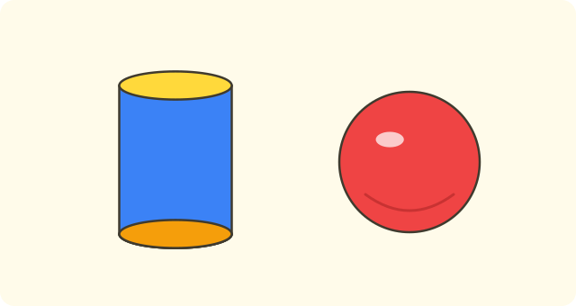
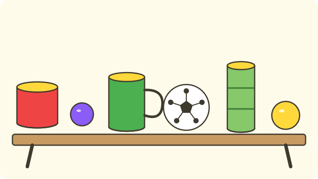

:::goals
- Recognise cylinders and spheres in the objects around you.
- Say that a cylinder has $2$ flat faces and $1$ curved surface, and a sphere has only a curved surface.
- Explain why tins can be stacked but balls cannot.
:::

Lan puts a ball and a tin of milk on a slightly sloping table. The ball rolls away fast. The tin rolls when it lies on its side, but when it stands up it stays still.

Why are the two objects different? Today you will find the answer with two new solid shapes.

## Let's explore

Pick up a tin of milk. Feel both ends: the top and the bottom are flat. Feel around the side of the tin: this part is curved.

Now pick up a ball. Feel all over it: it is curved everywhere, with no flat part at all.

We write down what we found in a table:

| | Tin of milk | Ball |
|---|---|---|
| Number of flat faces | $2$ | $0$ |
| Number of curved surfaces | $1$ | $1$ |
| Stands up and stacks | yes | not steadily |
| Rolling | rolls in one direction | rolls in every direction |

The tin has the shape of a **cylinder**. The ball has the shape of a **sphere**.

:::theorem Recognising cylinders and spheres
- A **cylinder** has $2$ flat circular faces (called the two bases) and $1$ curved surface around the side. Examples: a tin of milk, a drum, a round cake tin.
- A **sphere** has only a curved surface and no flat faces. Examples: a ball, a marble.
:::

A cylinder can be stacked because its bases are flat, so one sits on another without sliding. A sphere has no flat face, so it rolls away easily.

## Examples

We start by recognising a familiar object.

:::example The drum
Is the drum in your classroom a cylinder or a sphere?

**Solution.** The two ends of the drum are flat circles, and the side is one curved surface. An object with $2$ flat circles and $1$ curved surface is a cylinder.

So the drum is a cylinder.
:::

Next, you count the faces of a cylinder.

:::example Counting the faces of a tin
How many flat faces and how many curved surfaces does a tin of milk have?

**Solution.** A tin is a cylinder. A cylinder has two flat bases, the top and the bottom, and one curved surface, the side of the tin.

So the tin has $2$ flat faces and $1$ curved surface.
:::

Now we sort many objects at once.

:::example Sorting objects
On the table there are: a round cake tin, a marble, a cylinder-shaped cup, a football, a bamboo tube and a table-tennis ball. How many cylinders and how many spheres are there?

**Solution.** Put each object in its group:

- Cylinders (two flat bases): the cake tin, the cup, the bamboo tube. That is $3$ objects.
- Spheres (only a curved surface): the marble, the football, the table-tennis ball. That is $3$ objects.

So there are $3$ cylinders and $3$ spheres.
:::

Finally, you use what you know to choose objects for building a tower.

:::example Building a tower
Nam has $4$ tins of milk and $3$ balls. He wants to build a tall tower. Which should he use? Why?

**Solution.** To build a tower, the objects must sit on top of each other without rolling. A tin is a cylinder with flat bases, so it can be stacked. A ball is a sphere with no flat face, so it rolls away.

So Nam should use the $4$ tins of milk.
:::

:::warning Mistakes to watch out for
- **Thinking a ball has a flat face.** Wrong: "A ball has $1$ flat face." Why it is wrong: a ball is curved everywhere you touch it. Right: a sphere has $0$ flat faces.
- **Forgetting the curved surface of a cylinder.** Wrong: "A tin has only $2$ flat faces." Why it is wrong: the side of the tin is a curved surface. Right: a tin has $2$ flat faces and $1$ curved surface.
- **Mixing up a box with a cylinder.** Wrong: "A box with square corners is a cylinder." Why it is wrong: a cylinder has two round bases and no corners. Right: only an object with two round bases is a cylinder.
:::

## Key terms

:::terms
- cylinder | khối trụ
- sphere | khối cầu
- flat face | mặt phẳng
- curved surface | mặt cong
- base | đáy
- roll | lăn
- stack | xếp chồng
:::

## Summary

- A cylinder has $2$ flat circular faces (two bases) and $1$ curved surface. Examples: a tin of milk, a drum.
- A sphere has only $1$ curved surface and no flat faces. Examples: a ball, a marble.
- A cylinder can be stacked because it has flat bases; a sphere rolls, so it does not stack steadily.
- To tell which solid an object is, feel whether it has a flat face.

## Practice

Each exercise comes with what you need and how to start. Try it yourself first, then open the solution.

:::exercise
Is each object a cylinder or a sphere?

a) A tin of fizzy drink.

b) A table-tennis ball.

c) A drum.

d) A marble.

::hint
**What you need:** an object with two flat round bases is a cylinder; an object with no flat face is a sphere.

**Steps:**
1. Think: does the object have a flat part?
2. Two flat ends: choose cylinder. Otherwise: sphere.

::solution
The tin and the drum have two flat bases. The table-tennis ball and the marble have no flat face.

**Answer.** a) cylinder; b) sphere; c) cylinder; d) sphere.
:::

:::exercise
Write the right number in each box.

a) A cylinder has $\square$ flat faces.

b) A cylinder has $\square$ curved surfaces.

c) A sphere has $\square$ flat faces.

::hint
**What you need:** a cylinder has $2$ flat faces and $1$ curved surface; a sphere has no flat faces.

**Steps:**
1. Remember the table in "Let's explore".
2. Fill in each box.

::solution
A cylinder has two flat bases and one curved surface. A sphere has no flat faces.

**Answer.** a) $2$; b) $1$; c) $0$.
:::

:::exercise
Which sentences are true and which are false?

a) A sphere has a flat face.

b) Cylinders can be stacked.

c) A ball rolls in every direction.

::hint
**What you need:** a sphere has no flat faces; a cylinder has flat bases, so it can be stacked.

**Steps:**
1. Read each sentence.
2. Check it against the Summary.

::solution
a) False, because a sphere has no flat face. b) True, because a cylinder has flat bases. c) True, because a sphere rolls in every direction.

**Answer.** a) False; b) True; c) True.
:::

:::exercise
Which object does not belong with the others: a tin of milk, a drum, a ball, a cylinder-shaped cup?

::hint
**What you need:** an object with two flat bases is a cylinder.

**Steps:**
1. Put each object in the group cylinder or sphere.
2. Find the object in the other group.

::solution
The tin, the drum and the cup are cylinders. The ball is a sphere.

**Answer.** The ball.
:::

:::exercise
You want to build a tall tower from objects. Do you choose a tin of milk or a ball? Why?

::hint
**What you need:** an object with a flat base can sit on top of another one.

**Steps:**
1. Which object has a flat face?
2. Will an object with a flat face roll away when stacked?

::solution
A tin is a cylinder with flat bases, so it can be stacked. A ball is a sphere with no flat face, so it will roll away.

**Answer.** Choose the tin of milk.
:::

:::exercise
Mai says: "A round orange has two flat faces, so it is a cylinder." What is wrong with what Mai says? Correct it.

::hint
**What you need:** a sphere has no flat faces.

**Steps:**
1. Does a round orange have any flat part?
2. Which solid has no flat faces?

::solution
A round orange has no flat face at all, so Mai is wrong. A solid with no flat face is a sphere.

**Answer.** A round orange has the shape of a sphere.
:::

:::exercise
A shopkeeper has $20$ tins of milk and stacks them into $5$ equal stacks. How many tins are in each stack? (Remember your division facts for $5$.)

::hint
**What you need:** sharing equally means dividing: $20\div5$.

**Steps:**
1. What do we know? $20$ tins, $5$ equal stacks. What is asked? The number of tins in each stack.
2. Work out $20\div5$ and write the answer with its unit.

::solution
The number of tins in each stack is:
$$20\div5=4\ \text{(tins)}.$$

**Check.** $4\times5=20$. Correct.

**Answer.** $4$ tins of milk.
:::

:::exercise Challenge
A baby has $3$ cylinders and $2$ spheres. How many flat faces do all these solids have altogether?

::hint
**What you need:** each cylinder has $2$ flat faces, and each sphere has $0$ flat faces.

**Steps:**
1. Work out the flat faces of $3$ cylinders: $3\times2$.
2. Work out the flat faces of $2$ spheres, then add.

::solution
Three cylinders have $3\times2=6$ flat faces. Two spheres have $2\times0=0$ flat faces. Altogether $6+0=6$.

**Answer.** $6$ flat faces.
:::

## Mini test

:::quiz
::mc
Which object has the shape of a sphere?
A. A tin of milk.
B. A drum.
C. A football.
D. A round cake tin.
::key C
A football has no flat face, so it is a sphere. The other objects have two flat bases, so they are cylinders.

::mc
How many flat faces does a cylinder have?
A. $0$.
B. $1$.
C. $2$.
D. $3$.
::key C
A cylinder has two flat bases. Option B is the number of curved surfaces, so do not mix them up.

::mc
Why can tins of milk be stacked?
A. Because a tin has flat bases.
B. Because a tin has no curved surface.
C. Because a tin is a sphere.
D. Because a tin is very light.
::key A
The flat bases of a tin sit on each other without sliding. A tin is a cylinder, not a sphere, and it still has a curved surface.

::mc
Which solid has no flat faces?
A. A cylinder.
B. A sphere.
C. Both solids.
D. Neither solid.
::key B
A sphere has only a curved surface. A cylinder has $2$ flat faces.

::tf
Look at cylinders and spheres.
a) A cylinder has $2$ flat faces.
b) A cylinder has $3$ curved surfaces.
c) Cylinders can be stacked.
d) A ball is a cylinder.
::key T F T F
a) True: it has two flat bases. b) False: a cylinder has only $1$ curved surface. c) True: thanks to its flat bases. d) False: a ball is a sphere.

::sa
There are $4$ tins of milk. How many flat faces do all the tins have?
::key 8
Each tin is a cylinder with $2$ flat faces. So $4\times2=8$ (flat faces).

::sa
There are $15$ tins of milk, stacked with $5$ tins in each stack. How many stacks are there?
::key 3
$15\div5=3$ (stacks), because $3\times5=15$.
:::
