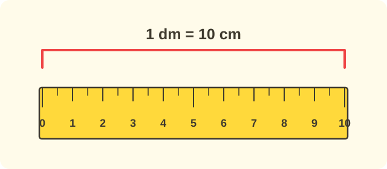

:::goals
- Know the units of length decimetre (dm), metre (m) and kilometre (km).
- Remember $1$ dm $=10$ cm, $1$ m $=10$ dm, $1$ km $=1000$ m and change between units.
- Choose a sensible unit to measure with and do sums with lengths.
:::

Nam measures his desk with his hand span and gets $6$ spans. Mai measures the same desk with her hand span and gets $7$ spans. Why do the two friends get different numbers?

Because everyone's hand span is a different length. To make everyone measure the same, we need standard units. You already know the centimetre (cm). Today you learn three more units.

## Let's explore

Take a ruler that is $10$ cm long. A length of $10$ cm is called $1$ **decimetre**, written dm.

- $1$ dm $=10$ cm.

Now pick up your teacher's metre rule. It is as long as $10$ of those $1$ dm rulers placed end to end. This length is called $1$ **metre**, written m.

- $1$ m $=10$ dm.

For very long distances, like from school to another town, we use the **kilometre**, written km.

- $1$ km $=1000$ m.

We put this in a table:

| Unit | Short form | Exchange |
|---|---|---|
| decimetre | dm | $1$ dm $=10$ cm |
| metre | m | $1$ m $=10$ dm |
| kilometre | km | $1$ km $=1000$ m |

:::theorem Units of length
- $1$ dm $=10$ cm.
- $1$ m $=10$ dm.
- $1$ km $=1000$ m.
:::

The bigger the unit, the longer the things we measure with it: dm for desks and chairs; m for classrooms and playgrounds; km for the way between faraway places.

## Examples

We start with changing metres to decimetres.

:::example Changing m to dm
Change $3$ m to dm.

**Solution.** Each metre is $10$ dm, so $3$ m is three groups of $10$ dm:
$$3\text{ m}=10+10+10=30\text{ dm}.$$
So $3$ m $=30$ dm.
:::

Now you change the other way.

:::example Changing dm to m
Change $40$ dm to m.

**Solution.** $10$ dm is $1$ m. In $40$ dm there are $4$ groups of $10$ dm:
$$40\text{ dm}=4\text{ m}.$$
So $40$ dm $=4$ m.
:::

Next you choose a sensible unit.

:::example Choosing a unit
Choose dm, m or km to measure: a) the length of the school playground; b) the distance from Hanoi to Hai Phong.

**Solution.** a) A playground is longer than a classroom but not very far, so we use metres. b) The distance between two cities is very long, so we use kilometres.

So a) use m; b) use km.
:::

Finally you do a sum with lengths.

:::example A walk
This morning Nam walks $3$ km and this afternoon he walks $2$ km. How many kilometres does he walk altogether?

**Solution.** "Altogether" means putting together, so we add and keep the unit:
$$3+2=5\ \text{(km)}.$$
So Nam walks $5$ km altogether.
:::

:::warning Mistakes to watch out for
- **Mixing up metres and decimetres.** Wrong: "$1$ m $=100$ dm". Why it is wrong: one metre is ten $1$ dm rulers. Right: $1$ m $=10$ dm.
- **Leaving out the unit in the answer.** Wrong: "Answer: $5$". Right: "Answer: $5$ km".
- **Using the wrong unit.** Wrong: "The pen is $15$ km long". Why it is wrong: km is for very long distances. Right: the pen is $15$ cm long.
:::

## Key terms

:::terms
- decimetre | đề-xi-mét
- metre | mét
- kilometre | ki-lô-mét
- centimetre | xăng-ti-mét
- length | độ dài
- unit of measurement | đơn vị đo
- short form | viết tắt
:::

## Summary

- $1$ dm $=10$ cm; $1$ m $=10$ dm; $1$ km $=1000$ m.
- Use dm for short objects, m for playgrounds and classrooms, km for long roads.
- In sums with lengths, keep the unit and write it in the answer.

## Practice

Each exercise comes with what you need and how to start. Try it yourself first, then open the solution.

:::exercise
Write the right number in each box.

a) $1$ dm $=\square$ cm.

b) $1$ m $=\square$ dm.

c) $1$ km $=\square$ m.

::hint
**What you need:** remember the table of units.

**Steps:**
1. See which smaller unit the bigger one changes to.
2. Fill in each box.

::solution
One decimetre is ten centimetres, one metre is ten decimetres, and one kilometre is one thousand metres.

**Answer.** a) $10$; b) $10$; c) $1000$.
:::

:::exercise
Change the units.

a) $3$ m $=\square$ dm.

b) $50$ dm $=\square$ m.

c) $7$ dm $=\square$ cm.

::hint
**What you need:** $1$ m $=10$ dm; $1$ dm $=10$ cm.

**Steps:**
1. Changing to a smaller unit gives a bigger number.
2. Count on in tens or split into groups of $10$.

::solution
a) $3\times10=30$. b) $50$ dm has $5$ groups of $10$ dm, so it is $5$ m. c) $7\times10=70$.

**Answer.** a) $30$; b) $5$; c) $70$.
:::

:::exercise
Remember the last lesson. Road A is $450$ m long and road B is $405$ m long. Write $>$, $<$ or $=$, then say which road is longer.

::hint
**What you need:** compare the hundreds, then the tens.

**Steps:**
1. Compare the hundreds of $450$ and $405$.
2. If equal, compare the tens.

::solution
The hundreds are equal, both $4$. The tens $5>0$, so $450>405$.

**Answer.** $450>405$; road A is longer.
:::

:::exercise
Work out.

a) $6$ dm $+3$ dm.

b) $15$ m $-8$ m.

c) $20$ km $-5$ km.

::hint
**What you need:** calculate as with normal numbers and keep the unit.

**Steps:**
1. Do the sum with the numbers.
2. Write the unit in the result.

::solution
a) $6+3=9$. b) $15-8=7$. c) $20-5=15$.

**Answer.** a) $9$ dm; b) $7$ m; c) $15$ km.
:::

:::exercise
Choose a sensible unit (dm, m or km). Why?

a) The height of a school desk.

b) The length of the school playground.

c) The road from your home to a faraway city.

::hint
**What you need:** dm for short things, m for playgrounds and classrooms, km for long roads.

**Steps:**
1. Is the thing short or long?
2. Choose the unit that fits.

::solution
a) A desk is not very long, choose dm. b) A playground is much longer than a desk, choose m. c) The road to a city is very long, choose km.

**Answer.** a) dm; b) m; c) km.
:::

:::exercise
Mai says: "$1$ m $=100$ dm." What is wrong with what Mai says? Correct it.

::hint
**What you need:** one metre is ten decimetres.

**Steps:**
1. How many $1$ dm rulers placed end to end make a metre rule?
2. Correct the number.

::solution
A metre rule is as long as $10$ rulers of $1$ dm, not $100$.

**Answer.** $1$ m $=10$ dm.
:::

:::exercise
This morning Nam walks $3$ km and this afternoon he walks $2$ km. How many kilometres does he walk altogether?

::hint
**What you need:** "altogether" means putting together: use addition.

**Steps:**
1. What do we know? $3$ km and $2$ km. What is asked? The total distance.
2. Work out $3+2$ and give the answer with its unit.

::solution
The distance for both parts of the day is:
$$3+2=5\ \text{(km)}.$$

**Answer.** $5$ km.
:::

:::exercise Challenge
A piece of string is $3$ m long. It is cut into pieces that are $5$ dm long. How many pieces can be cut?

::hint
**What you need:** $3$ m $=30$ dm; share equally: $30\div5$.

**Steps:**
1. Change $3$ m to dm.
2. Divide by the length of one piece.

::solution
$3$ m $=30$ dm. The number of pieces is $30\div5=6$ (pieces).

**Check.** $6\times5=30$. Correct.

**Answer.** $6$ pieces.
:::

## Mini test

:::quiz
::mc
$1$ m equals
A. $1$ dm.
B. $10$ dm.
C. $100$ dm.
D. $1000$ dm.
::key B
$1$ m $=10$ dm. Option C mixes it up with $100$ cm.

::mc
Which unit is best for the distance between two cities?
A. cm.
B. dm.
C. m.
D. km.
::key D
Two cities are very far apart, so we use km.

::mc
$4$ m equals
A. $4$ dm.
B. $14$ dm.
C. $40$ dm.
D. $400$ dm.
::key C
$4\times10=40$ dm. Option A forgets to change the unit.

::mc
$20$ dm equals
A. $2$ m.
B. $20$ m.
C. $200$ m.
D. $2$ km.
::key A
$20$ dm has $2$ groups of $10$ dm, so it is $2$ m.

::tf
Look at units of length.
a) $1$ km $=1000$ m.
b) $1$ dm $=10$ cm.
c) $1$ m $=100$ dm.
d) We measure the length of a pen in km.
::key T T F F
a) True. b) True. c) False: $1$ m $=10$ dm. d) False: a pen is short, so we use cm.

::sa
How many decimetres are in $5$ m?
::key 50
$5\times10=50$ (dm).

::sa
How many metres are $60$ dm?
::key 6
$60$ dm has $6$ groups of $10$ dm, which is $6$ m.
:::
