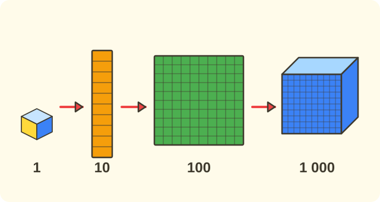

:::goals
- Know that $10$ ones make $1$ ten, $10$ tens make $1$ hundred and $10$ hundreds make $1$ thousand.
- Exchange between ones, tens, hundreds and thousands.
- Use groups of $10$ to count a large amount.
:::

Mai has $10$ loose marbles. She puts all $10$ into one bag. How many bags of ten marbles can $10$ loose marbles make?

Counting one by one takes a long time. This lesson shows you how to count faster by making groups.

## Let's explore

You already know how to count to $10$. When we have $10$ loose objects, we put them in one group called **one ten**.

- $10$ loose objects (each is $1$ **one**) make $1$ **ten**.
- $10$ of these bags (each is $1$ ten) make $1$ **hundred**.
- $10$ of these boxes (each is $1$ hundred) make $1$ **thousand**.

We write this in a table:

| Exchange | Make |
|---|---|
| $10$ ones | $1$ ten |
| $10$ tens | $1$ hundred |
| $10$ hundreds | $1$ thousand |

So $10$ loose marbles make $1$ bag of ten marbles.

:::theorem The exchange rule
- $10$ ones $=1$ ten.
- $10$ tens $=1$ hundred.
- $10$ hundreds $=1$ thousand.
:::

The rule works because each time we have $10$ equal groups, we put them into one bigger group, and nothing is lost.

## Examples

We start with the simplest exchange.

:::example From ones to tens
Lan has $10$ loose sweets. How many tens of sweets can she make?

**Solution.** $10$ ones make $1$ ten, so $10$ loose sweets make $1$ ten of sweets.

So Lan has $1$ ten of sweets.
:::

Now we exchange the other way, from tens back to ones.

:::example From tens to ones
Nam has $2$ tens of marbles. How many marbles does he have?

**Solution.** Each ten has $10$ marbles, so $2$ tens are two groups of $10$:
$$10+10=20.$$
So Nam has $20$ marbles.
:::

Next we go up one step: from tens to hundreds.

:::example From tens to hundreds
There are $10$ tens of exercise books. How many hundreds is that? How many tens are in one hundred?

**Solution.** $10$ tens make $1$ hundred, so $10$ tens of books make $1$ hundred books. The other way round, $1$ hundred has $10$ tens.

So it is $1$ hundred books, and $1$ hundred has $10$ tens.
:::

Finally we use the rule for an everyday problem.

:::example Boxes of books
One box holds $100$ exercise books. A shop has $10$ such boxes. How many books are there altogether?

**Solution.** Each box is $1$ hundred books. $10$ boxes make $10$ hundreds of books. And $10$ hundreds make $1$ thousand.

So the shop has $1$ thousand books.
:::

:::warning Mistakes to watch out for
- **Mixing up hundreds and tens.** Wrong: "$1$ hundred has $10$ ones". Why it is wrong: $10$ ones make only $1$ ten. Right: $1$ hundred has $10$ tens.
- **Mixing up tens and ones.** Wrong: "$1$ ten is $1$ one". Why it is wrong: $1$ ten is one group of $10$ ones. Right: $1$ ten has $10$ ones.
- **Mixing up thousands and hundreds.** Wrong: "$10$ hundreds make $1$ hundred". Why it is wrong: $10$ hundreds are ten big groups. Right: $10$ hundreds make $1$ thousand.
:::

## Key terms

:::terms
- ones | đơn vị
- tens | chục
- hundreds | trăm
- thousand | nghìn
- exchange | đổi
- group | gói thành nhóm
- group of ten | nhóm mười
:::

## Summary

- $10$ ones $=1$ ten.
- $10$ tens $=1$ hundred.
- $10$ hundreds $=1$ thousand.
- Making groups of $10$ helps you count faster.

## Practice

Each exercise comes with what you need and how to start. Try it yourself first, then open the solution.

:::exercise
Write the right number in each box.

a) $10$ ones $=\square$ ten.

b) $10$ tens $=\square$ hundred.

c) $10$ hundreds $=\square$ thousand.

::hint
**What you need:** ten small groups make one bigger group.

**Steps:**
1. Remember the exchange table.
2. Fill in each box.

::solution
Ten ones make a ten, ten tens make a hundred, and ten hundreds make a thousand.

**Answer.** a) $1$; b) $1$; c) $1$.
:::

:::exercise
Write the right number in each box.

a) $1$ ten $=\square$ ones.

b) $1$ hundred $=\square$ tens.

c) $1$ thousand $=\square$ hundreds.

::hint
**What you need:** exchanging back: one big group has $10$ groups of the next size down.

**Steps:**
1. How many smaller groups make up one bigger group?
2. Fill in each box.

::solution
One ten has ten ones, one hundred has ten tens, and one thousand has ten hundreds.

**Answer.** a) $10$; b) $10$; c) $10$.
:::

:::exercise
Remember the last lesson. A tin of milk is a cylinder with $2$ flat faces. How many flat faces do $10$ tins have? How many tens is that?

::hint
**What you need:** each tin has $2$ flat faces; $10$ ones make $1$ ten.

**Steps:**
1. Work out $10\times2$.
2. Change the number you found into tens.

::solution
The flat faces of $10$ tins: $10\times2=20$. And $20=10+10$, which is $2$ tens.

**Answer.** $20$ flat faces, which is $2$ tens.
:::

:::exercise
Change to ones.

a) $2$ tens $=\square$ ones.

b) $3$ tens $=\square$ ones.

c) $5$ tens $=\square$ ones.

::hint
**What you need:** each ten has $10$ ones.

**Steps:**
1. Add the groups of $10$.
2. Or count on in tens: $10, 20, 30, \dots$

::solution
$2$ tens: $10+10=20$. $3$ tens: $10+10+10=30$. $5$ tens: counting on in tens five times gives $50$.

**Answer.** a) $20$; b) $30$; c) $50$.
:::

:::exercise
You want to count $100$ marbles quickly. You put $10$ marbles in each bag. How many bags do you need? Why?

::hint
**What you need:** $1$ hundred has $10$ tens, and a bag of $10$ marbles is $1$ ten.

**Steps:**
1. How many tens is one bag?
2. How many tens is $100$?

::solution
Each bag is $1$ ten. $100$ is $1$ hundred, and $1$ hundred has $10$ tens. So you need $10$ bags.

**Answer.** $10$ bags.
:::

:::exercise
Nam says: "$1$ hundred is $10$ ones." What is wrong with what Nam says? Correct it.

::hint
**What you need:** $10$ ones make only $1$ ten; $1$ hundred is $10$ tens.

**Steps:**
1. How many tens are $10$ ones?
2. How many tens make $1$ hundred?

::solution
$10$ ones make only $1$ ten, not yet $1$ hundred. To make $1$ hundred you need $10$ tens.

**Answer.** $1$ hundred is $10$ tens.
:::

:::exercise
One box holds $100$ exercise books. A shop has $10$ such boxes. How many thousands of books are there altogether?

::hint
**What you need:** $10$ hundreds make $1$ thousand.

**Steps:**
1. What do we know? Each box has $1$ hundred books, and there are $10$ boxes. What is asked? How many thousands of books.
2. Change $10$ hundreds into thousands and write the answer with its unit.

::solution
$10$ boxes make $10$ hundreds of books. And $10$ hundreds make $1$ thousand.

**Answer.** $1$ thousand books.
:::

:::exercise Challenge
How many tens make one thousand?

::hint
**What you need:** $1$ thousand has $10$ hundreds, and $1$ hundred has $10$ tens.

**Steps:**
1. How many hundreds are in one thousand?
2. How many tens are in each hundred? Add ten times.

::solution
$1$ thousand has $10$ hundreds. Each hundred has $10$ tens. So $10$ hundreds have $10\times10=100$ tens.

**Check.** $100$ tens make $10$ hundreds, which is $1$ thousand. Correct.

**Answer.** $100$ tens.
:::

## Mini test

:::quiz
::mc
$10$ ones equal
A. $1$ ten.
B. $10$ tens.
C. $1$ hundred.
D. $100$ tens.
::key A
$10$ ones make $1$ ten. Option C mixes it up with $10$ tens.

::mc
How many tens are in $1$ hundred?
A. $1$ ten.
B. $10$ tens.
C. $100$ tens.
D. $1000$ tens.
::key B
$1$ hundred is made of $10$ tens. Option C mixes up $1$ hundred with $100$ tens.

::mc
$10$ hundreds equal
A. $1$ thousand.
B. $100$ hundreds.
C. $1$ ten.
D. $10$ tens.
::key A
Ten hundreds make $1$ thousand. Option D mixes up hundreds with tens.

::mc
Each box has $10$ pens. There are $10$ such boxes. How many pens are there altogether?
A. $10$ pens.
B. $20$ pens.
C. $100$ pens.
D. $1000$ pens.
::key C
$10$ boxes with $1$ ten of pens each make $10$ tens, which is $1$ hundred pens. Option B comes from adding $10+10$.

::tf
Look at these exchanges.
a) $1$ ten has $10$ ones.
b) $1$ hundred has $10$ tens.
c) $10$ hundreds make $100$.
d) $1$ thousand has $10$ hundreds.
::key T T F T
a) True. b) True. c) False: $10$ hundreds make $1$ thousand. d) True.

::sa
How many ones are $2$ tens?
::key 20
$10+10=20$ (ones).

::sa
How many hundreds make $1$ thousand?
::key 10
$1$ thousand is made of $10$ hundreds.
:::
