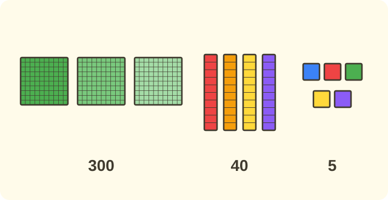

:::goals
- Write a three-digit number as a sum of hundreds, tens and ones, for example $345=300+40+5$.
- Go the other way: write a sum of hundreds, tens and ones as a number.
- Write correctly when a digit is $0$, for example $305=300+5$.
:::

A library has $345$ books. The librarian packs them into crates of $100$, bundles of $10$ and loose books. How many crates, bundles and loose books does she use?

You know that $345$ has $3$ hundreds, $4$ tens and $5$ ones. This lesson shows you how to write that as an addition.

## Let's explore

The number $345$ is made of $3$ hundreds, $4$ tens and $5$ ones. We work out the value of each part:

- $3$ hundreds is $300$.
- $4$ tens is $40$.
- $5$ ones is $5$.

Adding the three parts gives $300+40+5=345$. So we write:
$$345=300+40+5.$$

The librarian uses $3$ crates, $4$ bundles and $5$ loose books.

:::theorem Writing a number as a sum
A three-digit number can be written as the sum of its hundreds, tens and ones:
- the hundreds digit gives that many hundreds (for example $3$ gives $300$);
- the tens digit gives that many tens (for example $4$ gives $40$);
- the ones digit gives that many ones (for example $5$ gives $5$).
:::

This works because each digit sits in a place, and the place tells the value of the digit: the digit $4$ in the tens place is $40$, not $4$.

## Examples

We start with a number that has no $0$.

:::example Writing a number as a sum
Write $453$ as a sum of hundreds, tens and ones.

**Solution.** The number $453$ has the digit $4$ in the hundreds place, $5$ in the tens place and $3$ in the ones place. The values of the parts are $400$, $50$ and $3$:
$$453=400+50+3.$$
So $453=400+50+3$.
:::

Now you go the other way: from a sum to a number.

:::example From a sum to a number
Write the number $700+60+2$.

**Solution.** $700$ is $7$ hundreds, $60$ is $6$ tens and $2$ is $2$ ones. Write the three digits side by side: $7$, $6$, $2$:
$$700+60+2=762.$$
So $700+60+2=762$.
:::

Next comes a number with a $0$.

:::example A number with a 0
Write $805$ as a sum of hundreds, tens and ones.

**Solution.** The number $805$ has $8$ hundreds, $0$ tens and $5$ ones. The tens place is empty, so we do not need a tens part:
$$805=800+5.$$
So $805=800+5$.
:::

Finally you use this in a problem.

:::example Crates, bundles and loose pens
A shop has $5$ crates of $100$ pens, $1$ bundle of $10$ pens and $9$ loose pens. Write the number of pens as a sum and say how many pens there are.

**Solution.** $5$ crates is $500$, $1$ bundle is $10$ and $9$ loose pens is $9$:
$$500+10+9=519.$$
So the shop has $519$ pens, and $519=500+10+9$.
:::

:::warning Mistakes to watch out for
- **Adding the digits.** Wrong: "$453=4+5+3$". Why it is wrong: $4+5+3=12$, not $453$. Right: $453=400+50+3$.
- **Forgetting the value of the place.** Wrong: "$345=300+4+5$". Why it is wrong: the digit $4$ in the tens place is $40$. Right: $345=300+40+5$.
- **Going wrong with a $0$.** Wrong: "$305=300+50$". Why it is wrong: $305$ has $0$ tens, and the $5$ is $5$ ones. Right: $305=300+5$.
:::

## Key terms

:::terms
- sum | tổng
- hundreds place | hàng trăm
- tens place | hàng chục
- ones place | hàng đơn vị
- digit | chữ số
- value | giá trị
- addition | phép cộng
:::

## Summary

- To write a number as a sum: hundreds + tens + ones, for example $345=300+40+5$.
- A digit has the value of its place: the $4$ in the tens place is $40$.
- A place with $0$ can be left out of the sum: $305=300+5$.
- From the sum $300+40+5$ you can write the number back as $345$.

## Practice

Each exercise comes with what you need and how to start. Try it yourself first, then open the solution.

:::exercise
Write as a sum of hundreds, tens and ones.

a) $236$.

b) $910$.

::hint
**What you need:** each digit has the value of the place it is in.

**Steps:**
1. Write the value of the hundreds, tens and ones digits.
2. Leave out any place that is $0$.

::solution
a) $236$ has $2$ hundreds, $3$ tens, $6$ ones. b) $910$ has $9$ hundreds, $1$ ten, $0$ ones.

**Answer.** a) $236=200+30+6$; b) $910=900+10$.
:::

:::exercise
Write the number.

a) $400+50+7$.

b) $800+20$.

::hint
**What you need:** the hundreds, tens and ones are the digits of the number.

**Steps:**
1. See how many hundreds, tens and ones each part has.
2. Write a $0$ in any place that is missing.

::solution
a) $4$ hundreds, $5$ tens, $7$ ones. b) $8$ hundreds, $2$ tens, $0$ ones.

**Answer.** a) $457$; b) $820$.
:::

:::exercise
Remember the last lesson. A number has the hundreds digit $6$, the tens digit $0$ and the ones digit $4$. Write the number and then write it as a sum.

::hint
**What you need:** write the hundreds, tens and ones digits in turn.

**Steps:**
1. Write the three digits side by side.
2. Write it as a sum, leaving out the tens because they are $0$.

::solution
The number is $604$. We have $604=600+4$.

**Answer.** $604=600+4$.
:::

:::exercise
Write the right number in each box.

a) $500+\square+3=573$.

b) $\square+40+2=942$.

::hint
**What you need:** look at the digits of the number on the right.

**Steps:**
1. Find the digit in the place you need.
2. Write the value of that digit.

::solution
a) $573$ has $7$ in the tens place, value $70$. b) $942$ has $9$ in the hundreds place, value $900$.

**Answer.** a) $70$; b) $900$.
:::

:::exercise
Which is right for $372$: $3+7+2$, $30+70+2$ or $300+70+2$? Why?

::hint
**What you need:** the digit $3$ in the hundreds place has the value $300$.

**Steps:**
1. What are the values of $3$, $7$ and $2$ in their places?
2. Add the values.

::solution
$3$ in the hundreds place is $300$, $7$ in the tens place is $70$ and $2$ in the ones place is $2$. Adding gives $372$.

**Answer.** $372=300+70+2$.
:::

:::exercise
Lan writes "$305=300+50$". What is wrong with what Lan writes? Correct it.

::hint
**What you need:** $305$ has $0$ tens.

**Steps:**
1. What is $300+50$?
2. How many tens and ones does $305$ have?

::solution
$300+50=350$, not $305$. The number $305$ has $3$ hundreds, $0$ tens and $5$ ones.

**Answer.** $305=300+5$.
:::

:::exercise
A library has $4$ crates of $100$ books, $6$ bundles of $10$ books and $8$ loose books. How many books are there? Write it as a sum.

::hint
**What you need:** each crate is $100$ and each bundle is $10$.

**Steps:**
1. What do we know? $4$ hundreds, $6$ tens, $8$ ones. What is asked? The number of books.
2. Write the sum and give the answer with its unit.

::solution
The sum is $400+60+8=468$.

**Answer.** $468$ books; $468=400+60+8$.
:::

:::exercise Challenge
Find the three-digit number of the form $400+\square0+\square$, where the tens digit equals the ones digit and the ones digit is $8$.

::hint
**What you need:** the ones digit is $8$, and the tens digit is also $8$.

**Steps:**
1. Find the tens digit.
2. Write the number and then the sum.

::solution
The tens digit is $8$, so the tens part is $80$. We have $400+80+8=488$.

**Check.** $488$ has the tens digit and the ones digit both equal to $8$. Correct.

**Answer.** $488$.
:::

## Mini test

:::quiz
::mc
The number $345$ written as a sum is
A. $300+40+5$.
B. $3+4+5$.
C. $30+40+5$.
D. $3+40+500$.
::key A
$3$ hundreds is $300$, $4$ tens is $40$ and $5$ ones is $5$. Option B is the mistake of adding the digits.

::mc
$600+20+8$ equals
A. $682$.
B. $628$.
C. $6208$.
D. $862$.
::key B
$6$ hundreds, $2$ tens and $8$ ones make $628$. Option A swaps the tens and ones places.

::mc
The number $807$ written as a sum is
A. $80+7$.
B. $800+70$.
C. $800+7$.
D. $8+0+7$.
::key C
$807$ has $8$ hundreds, $0$ tens and $7$ ones. Option B is $870$.

::mc
The number $510$ written as a sum is
A. $5+1+0$.
B. $50+10$.
C. $500+1$.
D. $500+10$.
::key D
$5$ in the hundreds place is $500$ and $1$ in the tens place is $10$. Option C is $501$.

::tf
Look at the number $726$.
a) $726=700+20+6$.
b) $726=7+2+6$.
c) $726=700+26$.
d) $726=70+20+6$.
::key T F T F
a) True. b) False: $7+2+6=15$. c) True: $20+6=26$. d) False: $70+20+6=96$.

::sa
Work out $400+90+3$.
::key 493
$4$ hundreds, $9$ tens and $3$ ones make $493$.

::sa
Which number goes in the box: $200+\square+9=259$?
::key 50
$259$ has $5$ in the tens place, value $50$.
:::
