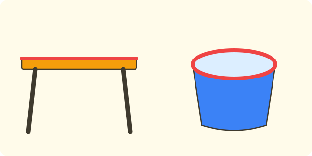

:::goals
- Recognise points, line segments, straight lines and curves.
- Use a ruler to draw a line segment and say its name, for example line segment $AB$.
- Recognise three points that are in a line.
:::

Mai stands at the school gate and sees the flagpole far away. She wants to walk straight from the gate to the flagpole. What kind of path should she follow, and how can we draw that path on paper?

The path Mai walks, a line on paper, the edge of a desk: you see shapes like these every day. Once you know their names, point, line segment, straight line and curve, you can draw them and talk about them clearly.

## Let's explore

Let us begin with the simplest shape. Put two small dots on a sheet of paper. Each small dot is a **point**. We name a point with a capital letter, for example point $A$ and point $B$.

Now place a ruler so that its edge passes through both $A$ and $B$. Draw a line along the edge from $A$ to $B$. The line you drew is a **line segment**, called $AB$. The points $A$ and $B$ are the two endpoints of the segment.

:::diagram Line segment AB
alt: A horizontal line segment AB with the two endpoints A and B
point A 0,0 below
point B 4,0 below
segment A B
:::

Now imagine we keep this straight line going for ever in both directions, with no place to stop. Then we get a **straight line**. A straight line has no endpoints.

What if the line is not straight, but bends and wiggles? We call it a **curve**.

:::graph A curve
alt: A curve that wiggles up and down and is not straight
x: 0..7
y: -2..2
plot: sin(x) ; 0..6
:::

:::theorem Recognising the shapes
- **Point**: a small dot, named with a capital letter.
- **Line segment** $AB$: a straight line from point $A$ to point $B$, with two endpoints, drawn with a ruler.
- **Straight line**: a straight line that goes on for ever in both directions, with no endpoints.
- **Curve**: a line that is not straight and bends.
:::

Why do we use a ruler? Its edge is straight, so a line drawn along the edge is straight too. Drawing by hand often makes the line bend.

## Examples

Let us practise drawing a line segment first.

:::example Draw line segment $MN$
**Solution.** Follow these steps:
1. Put two dots on the paper and write $M$ and $N$ next to them.
2. Place the ruler so that its edge passes through $M$ and $N$.
3. Draw a straight line from $M$ to $N$ along the edge.

The straight line you drew is the line segment $MN$.
:::

Now we look for these shapes around us, on a desk and on a cup.

:::example Line segment or curve?
The edge of a desk and the rim of a round cup: which one suggests a line segment, and which a curve?

**Solution.** The edge of a desk is straight and has two ends, so it suggests a line segment. The rim of a round cup goes round and is not straight, so it suggests a curve.
:::

What about three points? We check whether they lie on the same straight line.

:::diagram Points A, B, C and point D
alt: Three points A, B and C on the same straight line going up to the right, and point D above and to the left, off the line
point A 0,0 below
point B 2,1 below-right
point C 4,2 above
point D 1,2 above
segment A C
:::

:::example Three points in a line
Look at the picture. Which three points lie on the same straight line?

**Solution.** Place a ruler along the line from $A$ to $C$. Point $B$ lies exactly on the edge, but point $D$ is off to the side. So the three points $A$, $B$, $C$ lie on one straight line. We say $A$, $B$, $C$ are **in a line**.
:::

Finally, we count the line segments that join pairs of points.

:::example Counting line segments
Three points $A$, $B$, $C$ are in a line. We join every pair of points. How many line segments do we get?

**Solution.** The pairs are $A$ and $B$, $B$ and $C$, and $A$ and $C$. Each pair gives one line segment: $AB$, $BC$, $AC$.

So we get $3$ line segments.
:::

:::warning Mistakes to watch out for
- **Drawing without a ruler.** Wrong: drawing line segment $AB$ by hand so that it bends. Why it is wrong: once a line bends, it is not a line segment. Right: place a ruler and draw along its edge.
- **Mixing up a line segment and a straight line.** Wrong: saying that line segment $AB$ goes on for ever. Why it is wrong: a line segment has only two ends, $A$ and $B$, so it cannot go on for ever. Right: only a straight line goes on for ever in both directions.
- **Saying three points are in a line when one is off.** Wrong: "$A$, $B$, $D$ are in a line" in the picture above. Why it is wrong: $D$ is not on the straight line $AC$, it sits off to the side. Right: only $A$, $B$, $C$ are in a line.
:::

## Key terms

:::terms
- point | điểm
- line segment | đoạn thẳng
- straight line | đường thẳng
- curve | đường cong
- three points in a line | ba điểm thẳng hàng
- endpoints | hai đầu của đoạn thẳng
- ruler | thước kẻ
:::

## Summary

- A point is a small dot; we name it with a capital letter.
- Line segment $AB$ joins points $A$ and $B$, has two endpoints and is drawn with a ruler.
- A straight line goes on for ever in both directions; a curve is not straight.
- Three points on the same straight line are in a line.

Back to our opening question: to walk straight from the gate to the flagpole, Mai follows a line segment, and we draw that path with a ruler. Remember that a line segment has two ends, while a straight line goes on for ever. Try the practice exercises to get used to it.

## Practice

Each exercise has what you need to remember and a hint to start you off. Have a go on your own first, then open the solution to check.

:::exercise
A shape has two points $P$ and $Q$ and a straight line joining $P$ to $Q$ drawn with a ruler. What is the shape? Write its name.

::hint
**What you need:** a straight line joining two points, with two ends, is a line segment.

**Steps:**
1. Is the line straight? Does it have two ends?
2. Name it using its two endpoints.

::solution
The shape has two points $P$ and $Q$ and a straight line joining $P$ to $Q$ drawn with a ruler.

This straight line has two ends, $P$ and $Q$ (it does not go on for ever in either direction). A shape with two ends like this is called a line segment.

So the shape is the line segment $PQ$.

**Answer.** Line segment $PQ$.
:::

:::exercise
Describe how to draw a line segment $AB$ that is $5$ cm long.

::hint
**What you need:** use a ruler marked in centimetres.

**Steps:**
1. Mark point $A$ and put the $0$ mark of the ruler at $A$.
2. Mark point $B$ at the $5$ mark, then draw the line.

::solution
To draw a line segment $AB$ that is $5$ cm long, we do the following in order.

Step 1: Use a pencil to mark a point and name it $A$.

Step 2: Place the ruler so that its $0$ mark is at point $A$.

Step 3: Mark point $B$ exactly at the $5$ cm mark on the ruler.

Step 4: Draw a straight line from $A$ to $B$ along the edge of the ruler.

So we get the line segment $AB$, $5$ cm long.

**Answer.** Line segment $AB$, $5$ cm long.
:::

:::exercise
Does each object suggest a line segment or a curve?

a) The edge of a board.

b) A rope lying in loops on the floor.

c) The rim of a bicycle wheel.

::hint
**What you need:** a straight line with two ends is a line segment; a line that bends or is round is a curve.

**Steps:**
1. Look at the object: is it straight or curved?
2. Name the shape.

::solution
a) The edge of a board is straight and has two ends, so it suggests a line segment.

b) A rope lying in loops on the floor is not straight but bent, so it suggests a curve.

c) The rim of a bicycle wheel is round, not straight, so it suggests a curve.

So a) a line segment; b) a curve; c) a curve.

**Answer.** a) Line segment; b) Curve; c) Curve.
:::

:::exercise
Remember subtraction with regrouping. Line segment $AB$ is $52$ cm long and line segment $CD$ is $27$ cm long. How many centimetres longer is $AB$ than $CD$?

::hint
**What you need:** "how many longer" means finding the difference: use subtraction.

**Steps:**
1. What do we know? What is asked?
2. Work out $52-27$, borrowing $1$ ten, and write the unit cm.

::solution
Solution

To find how many centimetres longer $AB$ is than $CD$, we subtract the length of $CD$ from the length of $AB$.

Set out the subtraction and start from the ones: $2$ cannot take away $7$, so we regroup and work out $12-7=5$, write $5$ and carry $1$. Tens: $5-1-2=2$, write $2$.

The difference in length is:
$$52-27=25\ \text{(cm)}$$

Check: $25+27=52$. Correct.

So line segment $AB$ is $25$ cm longer than line segment $CD$.

**Answer.** $25$ cm.
:::

:::exercise
Points $A$, $B$, $C$ are in a line, with $B$ in the middle. Name the line segments whose endpoints are two of these three points.

::hint
**What you need:** every pair of points gives one line segment.

**Steps:**
1. List the pairs of points.
2. Write the name of each segment.

::solution
Each line segment has as its endpoints two of the three points $A$, $B$, $C$. We pair up the different points:

- the pair $A$ and $B$ gives the line segment $AB$;
- the pair $B$ and $C$ gives the line segment $BC$;
- the pair $A$ and $C$ gives the line segment $AC$.

The line segment $AC$ passes through point $B$, but it is still a line segment with endpoints $A$ and $C$. There are no other pairs of points.

So there are $3$ line segments: $AB$, $BC$, $AC$.

**Answer.** $AB$, $BC$, $AC$ ($3$ line segments).
:::

:::exercise
Nam draws a slightly bent line joining points $A$ and $B$ and says, "This is line segment $AB$." Is Nam right? Why? How would you fix it?

::hint
**What you need:** a line segment must be straight and drawn with a ruler.

**Steps:**
1. Is Nam's line straight?
2. What do you need to draw a straight line?

::solution
A line segment is a straight line with two ends. The line that Nam drew joining points $A$ and $B$ is slightly bent, not straight, so it is not a line segment.

How to fix it: place a ruler so that its edge passes through both points $A$ and $B$, then draw a straight line from $A$ to $B$ along the edge of the ruler. Then we get the line segment $AB$.

So Nam is wrong; the line joining $A$ and $B$ must be drawn again with a ruler.

**Answer.** Nam is wrong; draw it again with a ruler.
:::

:::exercise
Three marker poles $A$, $B$, $C$ are placed in a line on a field. The children stretch a string from pole $A$ to pole $C$. Is pole $B$ on the stretched string? What about a pole $D$ placed off to the side?

::hint
**What you need:** three points in a line lie on the same straight line.

**Steps:**
1. What does it mean that $A$, $B$, $C$ are in a line?
2. Is pole $D$ on the straight line $AC$?

::solution
The string stretched from pole $A$ to pole $C$ is straight, so it suggests the line segment $AC$.

Since the three poles $A$, $B$, $C$ are placed in a line, pole $B$ is on the string stretched from $A$ to $C$.

Pole $D$ is placed off to the side, not in a line with $A$ and $C$, so pole $D$ is not on the string.

So pole $B$ is on the stretched string, and pole $D$ is not on the string.

**Answer.** Pole $B$ is on the string; pole $D$ is not.
:::

:::exercise Challenge
There are four points $A$, $B$, $C$, $D$. The points $A$, $B$, $C$ are in a line and point $D$ is outside it. We join every pair of points. How many line segments are there altogether?

::hint
**What you need:** every pair of points gives one line segment.

**Steps:**
1. List the pairs with $A$: $AB$, $AC$, $AD$.
2. Then the pairs with $B$ (not counted yet), then the pairs with $C$.

::solution
Joining every pair of the four points $A$, $B$, $C$, $D$ gives one line segment for each pair. We list them in order so that we miss none and count none twice.

- The line segments with an end at $A$: $AB$, $AC$, $AD$ ($3$ segments).
- The line segments with an end at $B$ (not counting $AB$ again): $BC$, $BD$ ($2$ segments).
- The line segments with an end at $C$ (not counting $AC$, $BC$ again): $CD$ ($1$ segment).

The number of line segments is:
$$3+2+1=6\ \text{(line segments)}$$

So there are $6$ line segments altogether.

**Answer.** $6$ line segments.
:::

## Mini test

:::quiz
::mc NB
Which shape is a straight line with two ends and a length we can measure?
A. A line segment.
B. A straight line.
C. A curve.
D. A point.
::key A
A line segment has two ends, so we can measure its length. A straight line goes on for ever, a curve is not straight, and a point is only a dot.

::mc NB
Three points in a line are three points that
A. lie on the same straight line.
B. are joined by a curve.
C. are always the same distance apart.
D. do not lie on any straight line.
::key A
Three points on the same straight line are in a line; they do not have to be the same distance apart.

::mc TH
Three points $A$, $B$, $C$ are on one straight line. We join every pair of points. How many line segments are there?
A. $2$.
B. $3$.
C. $4$.
D. $6$.
::key B
There are $AB$, $BC$, $AC$, so $3$ line segments. Option A forgets $AC$, and D counts each segment twice ($AB$ and $BA$).

::mc TH
Which object suggests a curve?
A. The edge of a ruler.
B. The rim of a round cup.
C. The edge of a board.
D. A tightly stretched string.
::key B
The rim of a round cup goes round, so it is a curve. The other three objects are straight.

::tf TH NB NB TH
Three points $A$, $B$, $C$ are in a line.
a) We can draw one straight line through all three points.
b) Line segment $AB$ has two endpoints, $A$ and $B$.
c) Line segment $AB$ is a curve.
d) Joining every pair of points gives three line segments $AB$, $BC$, $AC$.
::key T T F T
a) True: three points in a line lie on one straight line. b) True. c) False: a line segment is straight. d) True: there are $3$ pairs of points.

::sa VD
Line segment $AB$ is $36$ cm long and line segment $CD$ is $7$ cm long. How many centimetres longer is $AB$ than $CD$?
::key 29
$16-7=9$ and $3-1=2$, so $36-7=29$ (cm).

::sa VD
A straight piece of string is $63$ cm long. You cut off $8$ cm. How many centimetres of string are left?
::key 55
$13-8=5$ and $6-1=5$, so $63-8=55$ (cm).
:::
