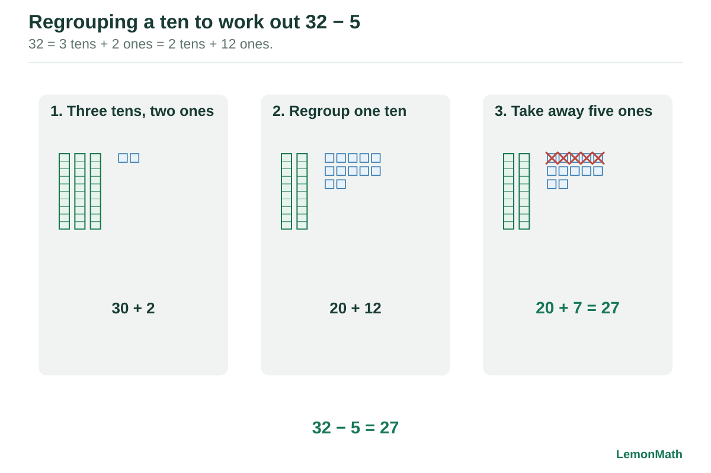

:::goals
- Understand why we exchange $1$ ten for $10$ ones when the ones are too small to subtract from.
- Set out a column subtraction and work it out correctly, for example $42-6$.
- Solve a word problem with one subtraction that needs regrouping.
:::

The teacher has $42$ pencils. She gives $6$ pencils to the children. How many pencils does she have left?

Look at the ones: there are not enough of them for the teacher to give away. So how can she take them away? You have already added with regrouping: when there are too many ones, we gather them into a ten. Subtraction with regrouping works the other way round: when there are too few ones, we exchange a ten for ones. By the end you will be able to answer the teacher's question.

## Let's explore

Let's split the $42$ pencils into $4$ tens and $2$ ones. The teacher gives away $6$, so we need to take away $6$ ones.

- The ones place has only $2$ ones, but we need to take away $6$. There are not enough.
- So we exchange $1$ ten for $10$ ones. That leaves $3$ tens, and the ones become $2+10=12$ ones.
- Now we can take away: $12-6=6$. The tens are still $3$.

Put together, that is $3$ tens and $6$ ones, which is $36$. That answers the teacher's question.

$$\begin{array}{r} 42\\ -\ \ 6\\ \hline 36 \end{array}$$

There is another way. On a number line, jump back $2$ from $42$ to reach $40$, then jump back $4$ more to reach $36$. Both ways give the same answer.

:::graph On the number line: from 42 jump back 2 to reach 40, then jump back 4 to reach 36
alt: A number line from 34 to 44 with the points 36, 40 and 42 marked and the stretch from 36 to 42 highlighted
x: 34..44
y: -1..1
segment: (36, 0) (42, 0)
point: (36, 0) "36" below
point: (40, 0) "40" above
point: (42, 0) "42" below
:::

:::theorem Subtracting a one-digit number from a two-digit number with regrouping
To work out $42-6$:
1. Set out the column: ones under ones.
2. Ones: $2$ is too small to take away $6$, so borrow $1$ ten. Work out $12-6=6$ and write $6$.
3. Tens: $4$ take away the $1$ ten you borrowed leaves $3$. Write $3$.
:::

Why are we allowed to do this? Because $1$ ten is the same as $10$ ones. We only change how we count the pencils; none is lost and none is added.

## Examples

Let's try one where the ones are only a little too small.

:::example Work out $32-5$
**Solution.** Ones: $2$ is too small to take away $5$, so borrow $1$ ten to make $12$. Work out $12-5=7$. Tens: $3-1=2$:
$$\begin{array}{r} 32\\ -\ \ 5\\ \hline 27 \end{array}$$
So $32-5=27$.

:::

This one is done in exactly the same way, with different numbers. Before you read on, ask yourself: are there enough ones to take away?

:::example Work out $54-8$
**Solution.** Ones: borrow $1$ ten, $14-8=6$. Tens: $5-1=4$:
$$\begin{array}{r} 54\\ -\ \ 8\\ \hline 46 \end{array}$$
So $54-8=46$.
:::

This time there is only $1$ one, so we are further short than before and the borrowed ten has to give us more ones.

:::example Work out $81-7$
**Solution.** Ones: $1$ is too small to take away $7$, so borrow $1$ ten to make $11$. Work out $11-7=4$. Tens: $8-1=7$:
$$\begin{array}{r} 81\\ -\ \ 7\\ \hline 74 \end{array}$$
So $81-7=74$.

**Check.** Check with addition: $74+7=81$. Correct.
:::

Subtraction with regrouping also turns up when we count things in a shop. Try this problem about exercise books.

:::example A shop selling exercise books
A shop has $63$ exercise books. It sells $8$ of them. How many exercise books does the shop have left?

**Solution.** "Sells" and "left" mean taking away, so we subtract. Ones: borrow $1$ ten, $13-8=5$. Tens: $6-1=5$:
$$63-8=55\ \text{(books)}.$$
So the shop has $55$ exercise books left.
:::

:::warning Mistakes to watch out for
- **Taking the smaller digit from the bigger one.** This is an easy slip to make. Wrong: $42-6=44$. Why it is wrong: you worked out $6-2=4$ instead of borrowing a ten to work out $12-6$. Right: $42-6=36$.
- **Borrowing a ten but not reducing the tens.** Wrong: $42-6=46$. Why it is wrong: you worked out $12-6=6$ but kept $4$ tens and forgot to take away the borrowed ten. If a ten has gone over to the ones, there is one ten fewer in the tens. Right: $42-6=36$.
- **No unit in a word problem.** Wrong: "Answer: $55$". A number always needs its unit. Right: "Answer: $55$ exercise books".
:::

## Key terms

:::terms
- subtraction with regrouping | phép trừ có nhớ
- minuend | số bị trừ
- subtrahend | số trừ
- difference | hiệu
- tens | hàng chục
- ones | hàng đơn vị
- exchange 1 ten for 10 ones | đổi 1 chục lấy 10 đơn vị
- set out the column | đặt tính
:::

## Summary

- If the ones are too small to subtract from, borrow $1$ ten and exchange it for $10$ ones, then subtract.
- In the tens: remember to take away the $1$ ten you borrowed.
- Example: $42-6$: $12-6=6$; $4-1=3$; the answer is $36$.
- Check with addition: $36+6=42$.

So the teacher has $36$ pencils left. When the ones are too few, exchange a ten for ones and then subtract. Try a few questions in the practice section to make the method your own.

## Practice

Each exercise gives you what you need to remember and a hint to get started. Try it yourself first, look at the hint if you are stuck, and open the solution only when you have finished. A wrong answer is not a problem; putting it right is how you learn.

:::exercise
Work out $53-7$.

::hint
**What you need:** if the ones are too small, borrow $1$ ten.

**Steps:**
1. Work out $13-7$.
2. Tens: $5$ take away $1$.

::solution
Set out the column and subtract from the ones to the tens.

$$\begin{array}{r} 53 \\ -\ 7 \\ \hline 46 \end{array}$$

Ones: $3$ is too small to take away $7$, so borrow $1$ ten. We have $13-7=6$; write $6$.

Tens: after borrowing $1$ ten, $5$ tens become $4$ tens, since $5-1=4$; write $4$.

Check: $46+7=53$.

So $53-7=46$.

**Answer.** $46$.
:::

:::exercise
Set out the column and work out $72-5$.

::hint
**What you need:** put ones under ones.

**Steps:**
1. Write $72$, then write $5$ in the same column as the $2$.
2. Subtract the ones (borrow a ten), then the tens.

::solution
Set out the column and subtract from the ones to the tens.

$$\begin{array}{r} 72 \\ -\ 5 \\ \hline 67 \end{array}$$

Ones: $2$ is too small to take away $5$, so borrow $1$ ten. We have $12-5=7$; write $7$.

Tens: after borrowing $1$ ten, $7$ tens become $6$ tens, since $7-1=6$; write $6$.

Check: $67+5=72$.

So $72-5=67$.

**Answer.** $67$.
:::

:::exercise
Remember addition with regrouping.

a) Work out $29+7$.

b) Use part a) to work out $36-7$.

::hint
**What you need:** subtraction is the opposite of addition: if $29+7=36$ then $36-7=29$.

**Steps:**
1. Work out $9+7$, then the tens.
2. Try $36-7$ by borrowing a ten.

::solution
a) Addition with regrouping: in the ones, $9+7=16$, write $6$ and carry $1$. In the tens, $2+1=3$, write $3$. So $29+7=36$.

b) We need $36-7$. Ones: $6$ is too small to take away $7$, so borrow $1$ ten, and $16-7=9$. Tens: $3-1=2$. Hence $36-7=29$.

Comparing with part a): since $29+7=36$, taking the number $7$ away from the sum $36$ leaves the other number, $29$. The two results agree.

So $29+7=36$ and $36-7=29$.

**Answer.** a) $36$; b) $29$.
:::

:::exercise
Find the missing number.

a) $45-\square=39$.

b) $71-\square=64$.

::hint
**What you need:** the missing number is the difference of the two given numbers, or check with addition.

**Steps:**
1. How much must you add to $39$ to reach $45$?
2. Check with subtraction.

::solution
a) The missing number is the number taken away, which equals the minuend minus the difference. We have $\square=45-39$. Ones: $5$ is too small to take away $9$, so borrow $1$ ten, $15-9=6$. Tens: $4-1-3=0$. So $\square=6$ (from $39$ up to $45$ is $6$).

Check: $45-6=39$.

b) In the same way, $\square=71-64$. Ones: $1$ is too small to take away $4$, so borrow $1$ ten, $11-4=7$. Tens: $7-1-6=0$. So $\square=7$ (from $64$ up to $71$ is $7$).

Check: $71-7=64$.

So the missing number in part a) is $6$ and in part b) is $7$.

**Answer.** a) $6$; b) $7$.
:::

:::exercise
Write $>$, $<$ or $=$ in the box. Say why.

a) $62-8 \;\square\; 55$.

b) $40-3 \;\square\; 37$.

::hint
**What you need:** work out the difference first, then compare the two numbers.

**Steps:**
1. Work out the difference on the left.
2. Compare the tens, then the ones.

::solution
a) We work out $62-8$. Ones: $2$ is too small to take away $8$, so borrow $1$ ten, $12-8=4$. Tens: $6-1=5$. Hence $62-8=54$. Since $54<55$, we have $62-8<55$.

b) We work out $40-3$. Ones: $0$ is too small to take away $3$, so borrow $1$ ten, $10-3=7$. Tens: $4-1=3$. Hence $40-3=37$. The two numbers are equal, so $40-3=37$.

So $62-8<55$ and $40-3=37$.

**Answer.** a) The sign $<$; b) the sign $=$.
:::

:::exercise
Binh wrote: $52-7=55$. Where did Binh go wrong? Correct the answer.

::hint
**What you need:** if the ones are too small, borrow $1$ ten; do not take the smaller digit from the bigger one.

**Steps:**
1. Can you work out $2-7$?
2. Try again with $12-7$.

::solution
In the ones, $2$ is too small to take away $7$. Binh worked out $7-2=5$, which is wrong because you must take $7$ away from $2$, and since $2<7$ you have to borrow. In the tens, Binh also forgot to reduce by the $1$ ten that was borrowed, and kept $5$.

The correct way: borrow $1$ ten, so $12-7=5$. Tens: $5-1=4$. Hence $52-7=45$.

Check: $45+7=52$.

So Binh went wrong by taking the smaller digit from the bigger one, and the correct result is $52-7=45$.

**Answer.** Binh took the smaller digit from the bigger one; the right answer is $45$.
:::

:::exercise
A basket has $64$ oranges. Mum sells $9$ oranges. How many oranges are left in the basket?

::hint
**What you need:** "sells" and "left" mean taking away: use subtraction.

**Steps:**
1. What do we know? $64$ oranges and $9$ sold. What is asked?
2. Work out $64-9$ and write the answer with its unit.

::solution
Solution

The number of oranges left in the basket is:
$$64-9=55\ \text{(oranges)}.$$

Working: in the ones, $4$ is too small to take away $9$, so borrow $1$ ten, $14-9=5$. Tens: $6-1=5$.

Check: $55+9=64$.

So $55$ oranges are left in the basket.

**Answer.** $55$ oranges.
:::

:::exercise Challenge
Find the missing digit: $7\square-8=65$.

::hint
**What you need:** the ones digit of the difference is $5$. If you borrow $1$ ten, the ones are $10+\square$.

**Steps:**
1. $(10+\square)-8$ must equal $5$.
2. Check with the subtraction.

::solution
The minuend is $7\square$, the difference is $65$ and the number taken away is $8$.

The tens digit of the minuend is $7$ while the tens digit of the difference is $6$, which is $1$ less. So $1$ ten was borrowed in the ones column, and $(10+\square)-8=5$.

It follows that $10+\square=5+8=13$, hence $\square=3$.

Check: $73-8=65$ (because $13-8=5$ and $7-1=6$). We can also check with addition: $65+8=73$.

So the missing digit is $3$.

**Answer.** The missing digit is $3$.
:::

## Mini test

:::quiz
::mc TH
$51-6$ equals
A. $45$.
B. $55$.
C. $57$.
D. $46$.
::key A
$11-6=5$ and $5-1=4$, so $51-6=45$. Option B is the mistake of working out $6-1=5$ and keeping the tens, and C is $51+6$.

::mc TH
When you work out $62-8$, you cannot take $8$ from $2$ in the ones place. You borrow $1$ ten and then work out
A. $8-2$.
B. $12-8$.
C. $2+8$.
D. $10-8$.
::key B
Borrowing $1$ ten gives $12$ ones: $12-8=4$; tens $6-1=5$; the answer is $54$. Option A takes the smaller from the bigger, and D forgets the $2$ ones you already had.

::mc TH
Which subtraction equals $36$?
A. $41-6$.
B. $43-6$.
C. $42-6$.
D. $44-6$.
::key C
$42-6=36$. The other answers are $37$, $35$ and $38$.

::mc VD
A box has $71$ marbles and Nam takes away $9$. How many marbles are left in the box?
A. $80$ marbles.
B. $78$ marbles.
C. $72$ marbles.
D. $62$ marbles.
::key D
"Takes away" and "left" mean subtraction: $71-9=62$. Option A is $71+9$, B works out $9-1=8$ and keeps the tens, and C forgets to take away the borrowed ten.

::tf NB TH TH VD
Look at the subtraction $83-5$.
a) In the ones: $3$ is too small to take away $5$.
b) After borrowing $1$ ten, the ones are $13$.
c) The tens left after borrowing are $8$.
d) $83-5=78$.
::key T T F T
a) True: $3<5$. b) True: $10+3=13$. c) False: the tens are $8-1=7$. d) True: $13-5=8$ and $7$ tens, which is $78$.

::sa VD
Work out $92-7$.
::key 85
$12-7=5$, tens $9-1=8$. So $92-7=85$.

::sa VD
A tank has $54$ fish and $8$ fish are taken out. How many fish are left in the tank?
::key 46
$14-8=6$, tens $5-1=4$. So $54-8=46$ (fish).
:::
