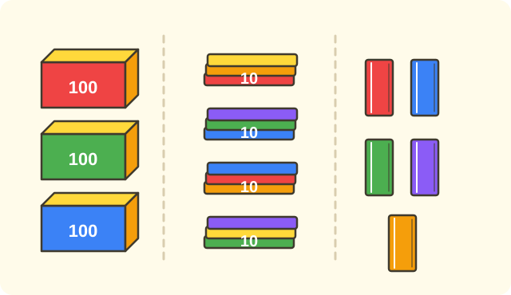

:::goals
- Read and write three-digit numbers, for example $345$ and $205$.
- Know the hundreds digit, tens digit and ones digit of a number.
- Write numbers with a $0$ correctly, for example $3$ hundreds $0$ tens $7$ ones is $307$.
:::

A library has $3$ crates of books with $100$ books in each, $4$ bundles of books with $10$ books in each, and $5$ loose books. How many books does the library have altogether?

You already know hundreds, tens and ones. This lesson shows you how to put them together into a three-digit number.

## Let's explore

We put the groups of books into three columns:

| Hundreds | Tens | Ones |
|---|---|---|
| $3$ | $4$ | $5$ |

There are $3$ hundreds, $4$ tens and $5$ ones. We write three digits side by side: the digit $3$ is in the hundreds place, the digit $4$ is in the tens place and the digit $5$ is in the ones place. The number is $345$.

We read $345$ as "three hundred and forty-five". So the library has $345$ books.

:::theorem Three-digit numbers
A three-digit number has:
- a hundreds digit (on the left), which tells how many hundreds;
- a tens digit (in the middle), which tells how many tens;
- a ones digit (on the right), which tells how many ones.

If a place has nothing in it, we write the digit $0$ in that place.
:::

We must write the $0$ to keep the other digits in the right places. For example, $3$ hundreds and $7$ ones is $307$; if we leave out the $0$, then $37$ is only $3$ tens and $7$ ones.

## Examples

We start by reading the digits of a number.

:::example The digits of 345
What are the hundreds digit, tens digit and ones digit of $345$?

**Solution.** Put the number in the table, from left to right hundreds, tens, ones:

| Hundreds | Tens | Ones |
|---|---|---|
| $3$ | $4$ | $5$ |

So the hundreds digit is $3$, the tens digit is $4$ and the ones digit is $5$.
:::

Now you go the other way: write a number from groups.

:::example Writing a number
Write the number made of $6$ hundreds, $2$ tens and $8$ ones.

**Solution.** Write the hundreds digit, then the tens digit, then the ones digit: $6$, $2$, $8$.

So the number is $628$, read "six hundred and twenty-eight".
:::

Next comes a number with a $0$.

:::example A number with a 0
Write the number made of $3$ hundreds, $0$ tens and $7$ ones.

**Solution.** There is nothing in the tens place, so we write a $0$ there: $3$, $0$, $7$.

So the number is $307$, read "three hundred and seven".
:::

Finally you use this in a problem.

:::example A pen shop
A shop has $5$ boxes of $100$ pens, $3$ bundles of $10$ pens and $6$ loose pens. How many pens does the shop have?

**Solution.** There are $5$ hundreds, $3$ tens and $6$ ones. Write the digits: $5$, $3$, $6$.

So the shop has $536$ pens.
:::

:::warning Mistakes to watch out for
- **Leaving out the $0$.** Wrong: "$3$ hundreds $7$ ones is $37$". Why it is wrong: $37$ has only $3$ tens. Right: $3$ hundreds $0$ tens $7$ ones is $307$.
- **Writing the digits in the wrong order.** Wrong: "$4$ hundreds $3$ tens $5$ ones is $435$ or $453$, either will do". Why it is wrong: swapping digits gives a different number. Right: only $435$.
- **Mixing up the place of a digit.** Wrong: "the digit $5$ in $450$ is $5$ ones". Why it is wrong: the $5$ is in the tens place. Right: the digit $5$ in $450$ is $5$ tens.
:::

## Key terms

:::terms
- three-digit number | số có ba chữ số
- digit | chữ số
- hundreds place | hàng trăm
- tens place | hàng chục
- ones place | hàng đơn vị
- read a number | đọc số
- write a number | viết số
:::

## Summary

- A three-digit number has a hundreds digit, a tens digit and a ones digit (from left to right).
- $3$ hundreds $4$ tens $5$ ones is $345$, read three hundred and forty-five.
- If a place has nothing in it, write the digit $0$.
- Swapping the digits gives a different number.

## Practice

Each exercise comes with what you need and how to start. Try it yourself first, then open the solution.

:::exercise
Look at the number $482$. Find:

a) the hundreds digit.

b) the tens digit.

c) the ones digit.

::hint
**What you need:** from left to right the places are hundreds, tens, ones.

**Steps:**
1. Put the number in a hundreds, tens, ones table.
2. Read each digit.

::solution
The number $482$ has the digit $4$ in the hundreds place, $8$ in the tens place and $2$ in the ones place.

**Answer.** a) $4$; b) $8$; c) $2$.
:::

:::exercise
Write the number.

a) $5$ hundreds, $3$ tens, $6$ ones.

b) $9$ hundreds, $1$ ten, $4$ ones.

::hint
**What you need:** write the hundreds, tens and ones digits in turn.

**Steps:**
1. Take the number of hundreds, tens and ones.
2. Write the three digits side by side.

::solution
a) Digits: $5$, $3$, $6$. b) Digits: $9$, $1$, $4$.

**Answer.** a) $536$; b) $914$.
:::

:::exercise
Remember the last lesson. Which of the numbers $60, 300, 90, 700$ have three digits? Write $>$, $<$ or $=$: $300\;\square\;700$.

::hint
**What you need:** multiples of 100 have three digits; compare the hundreds.

**Steps:**
1. Count the digits of each number.
2. Compare $3$ hundreds and $7$ hundreds.

::solution
$300$ and $700$ have three digits; $60$ and $90$ have two digits. $3$ hundreds is less than $7$ hundreds.

**Answer.** $300$, $700$; $300<700$.
:::

:::exercise
How many hundreds, tens and ones does each number have?

a) $705$.

b) $250$.

::hint
**What you need:** a digit $0$ means that place is empty.

**Steps:**
1. Read each digit from left to right.
2. Write the hundreds, tens and ones.

::solution
a) $705$: $7$ hundreds, $0$ tens, $5$ ones. b) $250$: $2$ hundreds, $5$ tens, $0$ ones.

**Answer.** a) $7$ hundreds $0$ tens $5$ ones; b) $2$ hundreds $5$ tens $0$ ones.
:::

:::exercise
To write "two hundred and six", which of $26$, $206$, $260$ do you choose? Why?

::hint
**What you need:** "and six" with no tens means the tens place is empty.

**Steps:**
1. How many hundreds are there?
2. Is there anything in the tens place? How many ones?

::solution
There are $2$ hundreds, $0$ tens and $6$ ones. Write the digits $2$, $0$, $6$.

**Answer.** $206$.
:::

:::exercise
Mai writes "$4$ hundreds $5$ ones is $45$". What is wrong with what Mai writes? Correct it.

::hint
**What you need:** if the tens place is empty, write a $0$.

**Steps:**
1. How many tens does $45$ have?
2. Write the number again with three digits.

::solution
$45$ is $4$ tens $5$ ones. The right number has $4$ hundreds, $0$ tens and $5$ ones.

**Answer.** $405$.
:::

:::exercise
There are $3$ boxes of $100$ marbles, $4$ bags of $10$ marbles and $7$ loose marbles. How many marbles are there altogether?

::hint
**What you need:** put the hundreds, tens and ones together into one number.

**Steps:**
1. What do we know? $3$ hundreds, $4$ tens, $7$ ones. What is asked? The number of marbles.
2. Write the number and give the answer with its unit.

::solution
Digits: $3$, $4$, $7$. The number of marbles is $347$.

**Answer.** $347$ marbles.
:::

:::exercise Challenge
Use the three digits $2$, $5$, $8$, each exactly once, to make the largest and the smallest three-digit number.

::hint
**What you need:** the bigger the hundreds digit, the bigger the number.

**Steps:**
1. Largest: put the biggest digit in the hundreds place, then the tens place.
2. Smallest: do the opposite.

::solution
Largest: hundreds $8$, tens $5$, ones $2$, which is $852$. Smallest: hundreds $2$, tens $5$, ones $8$, which is $258$.

**Check.** $258<852$. Correct.

**Answer.** The largest is $852$ and the smallest is $258$.
:::

## Mini test

:::quiz
::mc
The tens digit of $527$ is
A. $5$.
B. $2$.
C. $7$.
D. $527$.
::key B
From left to right: $5$ in the hundreds place, $2$ in the tens place, $7$ in the ones place. Option A is the hundreds digit.

::mc
The number made of $4$ hundreds, $0$ tens and $6$ ones is
A. $46$.
B. $460$.
C. $406$.
D. $640$.
::key C
The tens place is empty, so we write $0$: $406$. Option A leaves out the $0$.

::mc
Which of these is a three-digit number?
A. $99$.
B. $9$.
C. $10$.
D. $100$.
::key D
$100$ has the three digits $1$, $0$, $0$. The others have fewer digits.

::mc
The number $318$ is made of
A. $3$ hundreds $1$ ten $8$ ones.
B. $8$ hundreds $1$ ten $3$ ones.
C. $3$ tens $1$ hundred $8$ ones.
D. $31$ hundreds $8$ ones.
::key A
From left to right: $3$ hundreds, $1$ ten, $8$ ones. Option B reads the order backwards.

::tf
Look at the number $645$.
a) The hundreds digit is $6$.
b) The tens digit is $5$.
c) The ones digit is $5$.
d) $645$ is a three-digit number.
::key T F T T
a) True. b) False: the tens digit is $4$. c) True. d) True.

::sa
Which digit is the tens digit of $982$?
::key 8
The number $982$ has $9$ hundreds, $8$ tens and $2$ ones.

::sa
Write the number made of $5$ hundreds, $0$ tens and $9$ ones.
::key 509
Digits: $5$, $0$, $9$.
:::
