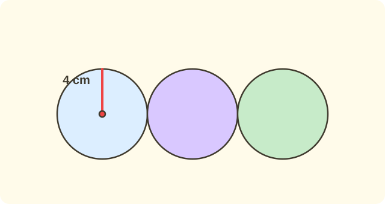

:::goals
- Recognise a circle, its centre, radius and diameter.
- Know that all radii of a circle are equal and the diameter is double the radius.
- Work out the radius from the diameter (and the other way round) and draw a circle with compasses.
:::

Nam draws a circle with compasses. He puts the sharp point at a point $O$ and opens the compasses to $3$ cm. How many centimetres is the diameter of the circle he draws?

To answer that, we first need names for the parts of a circle. Once you know the names and how the parts are linked, you can find the diameter with one short calculation.

## Let's explore

Watch what happens when we draw with compasses. The sharp point stays still at $O$ and the pencil turns all the way round. So every point on the line is the same distance from $O$, equal to the opening of the compasses.

:::diagram A circle with centre O: radii OA, OC and diameter AB
alt: A circle with centre O and radius 3; the line AB lies across the circle through O with both ends on the circle; the line OC goes from O up to the point C on the circle
point O 0,0 below
point A 3,0 right
point B -3,0 left
point C 0,3 above
circle O 3
segment A B
segment O C
:::

Let's look at the picture and name each part:

- Point $O$, where the sharp point stays still, is the **centre** of the circle.
- A line segment from the centre $O$ to a point on the circle (such as $OA$, $OB$, $OC$) is called a **radius**.
- The line segment $AB$ passes through the centre $O$ and has both ends on the circle. It is called a **diameter**.

Look closely: the diameter $AB$ is made of two radii, $OA$ and $OB$, end to end. So the diameter is double the radius. The centre $O$ sits exactly in the middle, so it is the midpoint of the diameter $AB$.

:::theorem Radius and diameter
In a circle:

- All radii are equal.
- The diameter is double the radius: diameter $=$ radius $\times2$.
- The radius is half the diameter: radius $=$ diameter $\div2$.
:::

Why is this true? Every point on the circle is the same distance from the centre, equal to the opening of the compasses, so all radii are equal. And the diameter is two radii end to end, so it is double the radius.

Back to Nam's question. With the compasses open to $3$ cm, the radius is $3$ cm, so the diameter is $3\times2=6$ cm.

## Examples

Let's start by naming line segments.

:::example Naming
In a circle with centre $O$, the points $A$, $B$, $C$ are on the circle and $O$ is on the line segment $AB$. Name the segments $OA$, $AB$ and $OC$.

**Solution.** $OA$ joins the centre to a point on the circle, so $OA$ is a radius. $AB$ passes through the centre and has both ends on the circle, so $AB$ is a diameter. $OC$ joins the centre to the point $C$ on the circle, so $OC$ is a radius.

So $OA$ and $OC$ are radii; $AB$ is a diameter.
:::

If we know the radius, how do we find the diameter? We double it, as in this example.

:::example From radius to diameter
A circle has radius $5$ cm. Find the diameter.

**Solution.** The diameter is double the radius, so we multiply the radius by $2$:
$$5\times2=10\ \text{(cm)}.$$
**Check.** $10\div2=5$. Correct.

So the diameter is $10$ cm.
:::

And if we know the diameter? We go the other way and take half.

:::example From diameter to radius
A circle has diameter $14$ cm. Find the radius.

**Solution.** The radius is half the diameter, so we divide the diameter by $2$:
$$14\div2=7\ \text{(cm)}.$$
**Check.** $7\times2=14$. Correct.

So the radius is $7$ cm.
:::

Circles are everywhere, on a dinner plate for example. Try this problem.

:::example A plate
A round plate has radius $9$ cm. How many centimetres is the diameter of the plate?

**Solution.** The diameter is double the radius, so the diameter is:
$$9\times2=18\ \text{(cm)}.$$
**Check.** $18\div2=9$. Correct.

So the diameter of the plate is $18$ cm.
:::

Finally, back to the compasses: how far should we open them?

:::example Drawing a circle
To draw a circle with diameter $8$ cm, how many centimetres should you open the compasses?

**Solution.** The opening of the compasses is the radius. The radius is half the diameter:
$$8\div2=4\ \text{(cm)}.$$
**Check.** $4\times2=8$. Correct.

So you open the compasses to $4$ cm.
:::

:::warning Mistakes to watch out for
- **Mixing up radius and diameter.** This is an easy mistake to make. Wrong: a circle with radius $5$ cm has diameter $5$ cm too. Why it is wrong: the diameter is made of two radii. Right: the diameter is $5\times2=10$ cm.
- **Thinking any segment joining two points on the circle is a diameter.** Wrong: the segment $AC$ joins two points on the circle, so it is a diameter. Why it is wrong: a diameter must pass through the centre $O$. Right: only a segment joining two points on the circle and passing through the centre is a diameter.
- **Forgetting to halve or double.** Wrong: diameter $14$ cm means radius $14$ cm. Why it is wrong: the radius is only half. Ask yourself: the radius should be shorter than the diameter, so does the answer make sense? Right: $14\div2=7$ cm.
- **Forgetting the unit.** Wrong: "Answer: $10$". A number always needs its unit. Right: "Answer: $10$ cm".
:::

## Key terms

:::terms
- circle | hình tròn
- centre | tâm
- radius | bán kính
- diameter | đường kính
- circumference (the curve of the circle) | đường tròn
- compasses | com-pa
- opening of the compasses | độ mở com-pa
- double | gấp đôi
:::

## Summary

- Point $O$ is the centre; every point on the circle is the same distance from $O$.
- A radius joins the centre to a point on the circle; all radii are equal.
- A diameter passes through the centre with both ends on the circle; the centre is its midpoint.
- Diameter $=$ radius $\times2$; radius $=$ diameter $\div2$.
- The opening of the compasses is the radius; write the unit in the answer.

So Nam's question has an answer: the opening of the compasses is the radius, and the diameter is double it. Try a few questions in the practice section to remember it.

## Practice

Each exercise gives you what you need to remember and a hint to get started. Try it yourself first, look at the hint if you are stuck, and open the solution only when you have finished. A wrong answer is not a problem; putting it right is how you learn.

:::exercise
In a circle with centre $O$, the points $A$ and $B$ are on the circle and $O$ is on the line segment $AB$.

a) What is $OA$?

b) What is $AB$?

c) How does $OB$ compare with $OA$?

::hint
**What you need:** a radius joins the centre to a point on the circle; a diameter passes through the centre; all radii are equal.

**Steps:**
1. Is one end of the segment the centre?
2. Does it pass through the centre with both ends on the circle?

::solution
In the circle with centre $O$, the points $A$ and $B$ are on the circle and $O$ is on the line segment $AB$.

a) $OA$ is a line segment joining the centre $O$ to the point $A$ on the circle, so $OA$ is a radius.

b) $AB$ is a line segment that passes through the centre $O$ and has both ends $A$ and $B$ on the circle, so $AB$ is a diameter.

c) $OB$ also joins the centre $O$ to the point $B$ on the circle, so $OB$ is a radius too. All radii of a circle are equal, hence $OB=OA$.

So $OA$ is a radius, $AB$ is a diameter, and $OB=OA$.

**Answer.** a) A radius; b) a diameter; c) equal.
:::

:::exercise
Find the diameter of a circle with radius:

a) $4$ cm.

b) $6$ cm.

c) $10$ cm.

::hint
**What you need:** diameter $=$ radius $\times2$.

**Steps:**
1. Take the radius.
2. Multiply by $2$ and write the unit.

::solution
In a circle, the diameter is twice as long as the radius, so to find the diameter we multiply the radius by $2$.

a) A circle with radius $4$ cm has diameter $4\times2=8$ (cm).

b) A circle with radius $6$ cm has diameter $6\times2=12$ (cm).

c) A circle with radius $10$ cm has diameter $10\times2=20$ (cm).

So these circles have diameters $8$ cm, $12$ cm and $20$ cm respectively.

**Answer.** a) $8$ cm; b) $12$ cm; c) $20$ cm.
:::

:::exercise
Remember the last lesson on midpoints. The centre $O$ is the midpoint of the diameter $AB$. Given $AB=18$ cm, find $OA$ and $OB$.

::hint
**What you need:** a midpoint splits a segment into two equal parts; $OA=AB\div2$.

**Steps:**
1. $O$ is the midpoint of $AB$.
2. Divide $AB$ by $2$.

::solution
The centre $O$ is the midpoint of the diameter $AB$, so $O$ divides $AB$ into two equal parts.

We have
$$OA=AB\div2=18\div2=9\ (\text{cm}).$$

Since $O$ is the midpoint of $AB$, we get $OB=OA=9$ cm.

Check: $OA+OB=9+9=18$ (cm), which equals $AB$. Correct.

So $OA=9$ cm and $OB=9$ cm.

**Answer.** $OA=9$ cm and $OB=9$ cm.
:::

:::exercise
Find the radius of a circle with diameter:

a) $12$ cm.

b) $20$ cm.

c) $30$ cm.

::hint
**What you need:** radius $=$ diameter $\div2$.

**Steps:**
1. Take the diameter.
2. Divide by $2$ and write the unit.

::solution
In a circle, the radius is half of the diameter, so to find the radius we divide the diameter by $2$.

a) A circle with diameter $12$ cm has radius $12\div2=6$ (cm).

b) A circle with diameter $20$ cm has radius $20\div2=10$ (cm).

c) A circle with diameter $30$ cm has radius $30\div2=15$ (cm).

So these circles have radii $6$ cm, $10$ cm and $15$ cm respectively.

**Answer.** a) $6$ cm; b) $10$ cm; c) $15$ cm.
:::

:::exercise
True or false? Why?

a) All radii of a circle are equal.

b) A line segment joining any two points on the circle is a diameter.

c) The diameter is twice as long as the radius.

::hint
**What you need:** a diameter passes through the centre and is made of two radii.

**Steps:**
1. Recall what each segment is.
2. Look for an example that shows a statement is false.

::solution
a) **True.** Every point on the circle is the same distance from the centre, so all radii of a circle are equal.

b) **False.** A segment joining two points on the circle that does not pass through the centre is not a diameter. A diameter must pass through the centre.

c) **True.** The diameter is made of two radii placed end to end (on the two sides of the centre), so the diameter is twice as long as the radius.

So statements a) and c) are true; statement b) is false.

**Answer.** a) True; b) false; c) true.
:::

:::exercise
Lan says: "A circle with diameter $10$ cm has radius $20$ cm". Where did Lan go wrong? Correct it.

::hint
**What you need:** radius $=$ diameter $\div2$.

**Steps:**
1. Can a radius be longer than the diameter?
2. Use the right operation.

::solution
In a circle, the radius is half of the diameter, so to find the radius we must divide the diameter by $2$.

Lan multiplied by $2$ ($10\times2=20$) instead of dividing by $2$, so Lan used the wrong operation. Lan's answer also makes no sense: a radius of $20$ cm gives a diameter of $20\times2=40$ (cm), which is not $10$ cm.

Correcting it:
$$10\div2=5\ (\text{cm}).$$

Check: $5\times2=10$. Correct.

So Lan used the wrong operation; the radius of the circle is $5$ cm.

**Answer.** Lan used the wrong operation; the radius is $5$ cm.
:::

:::exercise
a) A wheel has radius $35$ cm. How many centimetres is the diameter of the wheel?

b) To draw a circle with diameter $10$ cm, how many centimetres do you open the compasses?

::hint
**What you need:** diameter $=$ radius $\times2$; the opening of the compasses is the radius.

**Steps:**
1. Are we given the radius or the diameter?
2. Multiply or divide by $2$ and write the answer with its unit.

::solution
a) The diameter is twice the radius, so the diameter of the wheel is
$$35\times2=70\ (\text{cm}).$$

b) When we draw a circle with compasses, the opening of the compasses equals the radius of the circle. A circle with diameter $10$ cm has radius
$$10\div2=5\ (\text{cm}).$$

So the diameter of the wheel is $70$ cm, and we open the compasses $5$ cm.

**Answer.** a) $70$ cm; b) $5$ cm.
:::

:::exercise Challenge
Three equal circles, each with radius $4$ cm, are placed in a row so that neighbouring circles touch. How many centimetres long is the row (from the left edge of the first circle to the right edge of the last)?

::hint
**What you need:** the width of one circle is its diameter.

**Steps:**
1. Work out the diameter of each circle.
2. The row is $3$ diameters end to end.

::solution
Solution

The diameter of each circle is:
$$4\times2=8\ (\text{cm}).$$

The three equal circles are in a row and neighbouring circles touch, so the length of the row is the sum of three diameters. The row is:
$$8\times3=24\ (\text{cm})\ \text{long}.$$

Check: the row is $6$ radii long, so $4\times6=24$ (cm). Correct.

So the row is $24$ cm long.

**Answer.** $24$ cm.
:::

## Mini test

:::quiz
::mc TH
A circle has radius $7$ cm. The diameter of the circle is
A. $14$ cm.
B. $7$ cm.
C. $3$ cm.
D. $49$ cm.
::key A
The diameter is double the radius: $7\times2=14$ cm. Option B is the mistake of mixing up radius and diameter.

::mc TH
A circle has diameter $18$ cm. The radius of the circle is
A. $36$ cm.
B. $9$ cm.
C. $18$ cm.
D. $8$ cm.
::key B
The radius is half the diameter: $18\div2=9$ cm. Option A is the mistake of doubling.

::mc NB
In a circle with centre $O$, the points $A$, $B$, $C$ are on the circle and $O$ is on the segment $AB$. Which segment is a diameter?
A. $OA$.
B. $OC$.
C. $AB$.
D. $AC$.
::key C
Only $AB$ passes through the centre with both ends on the circle. $OA$ and $OC$ are radii, and $AC$ does not pass through the centre.

::mc TH
To draw a circle of radius $6$ cm, you open the compasses to
A. $3$ cm.
B. $6$ cm.
C. $12$ cm.
D. $36$ cm.
::key B
The opening of the compasses is the radius, that is $6$ cm. Option C is the mistake of using the diameter.

::tf TH NB TH NB
A circle with centre $O$ has diameter $AB=20$ cm.
a) The radius of the circle is $10$ cm.
b) $OA=OB$.
c) $O$ is the midpoint of $AB$.
d) The radius is longer than the diameter.
::key T T T F
a) True: $20\div2=10$. b) True: two radii are equal. c) True: $O$ is between $A$ and $B$ and $OA=OB$. d) False: the radius is only half of the diameter.

::sa TH
A circle has radius $15$ cm. Find the diameter (unit: cm).
::key 30
$15\times2=30$ (cm).

::sa TH
A circle has diameter $26$ cm. Find the radius (unit: cm).
::key 13
$26\div2=13$ (cm).
:::
