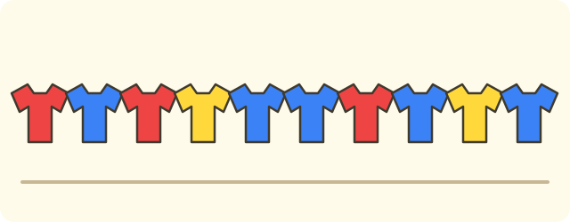
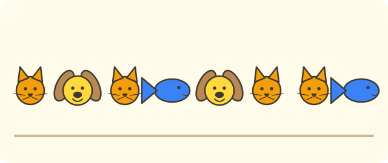

:::goals
- Collect data by asking or by looking.
- Sort data into groups and count it with tally marks.
- Put data in a table and read the table to answer questions.
:::

Your teacher asks $12$ children in your group: "Which fruit do you like best: orange, banana or apple?" They answer one by one: orange, banana, orange, apple, banana, banana, orange, apple, orange, banana, apple, orange. How many children like oranges best?

You could count along the list. But with a long list it is easy to miss one or count one twice. This lesson shows you a tidier way to record and count.

## Let's explore

We take small steps with the list of answers above.

**Step 1: collect.** We asked each child and wrote down the answer. Each answer is one piece of **data**.

**Step 2: sort.** We put the answers into three groups: orange, banana, apple.

**Step 3: count with tally marks.** Read the answers one at a time. For each answer, draw one stroke $/$ in the row of that fruit. After $5$ strokes, start a new group. You read the list only once.

| Fruit | Tally marks | Number of children |
|---|---|---|
| Orange | ///// | $5$ |
| Banana | //// | $4$ |
| Apple | /// | $3$ |

So $5$ children like oranges best. Check: $5+4+3=12$, which is the number of children we asked.

:::theorem Three steps for working with data
1. **Collect:** ask or look, and write down each piece of data.
2. **Sort:** put the data into groups.
3. **Record in a table:** count each group with tally marks, then write the numbers in a **data table**.

Finally, add up the numbers in the table. The total must equal the number of times you asked or looked.
:::

This last check helps you find out if you missed something or counted something twice.

## Examples

We start by making a table from a short list.

:::example Colours of shirts
Mai wrote down the shirt colours of $10$ children: red, blue, red, yellow, blue, blue, red, blue, yellow, blue. Make a data table.

**Solution.** We read the list once and draw a stroke in the row of the right colour:

| Colour | Tally marks | Number of children |
|---|---|---|
| Red | /// | $3$ |
| Blue | ///// | $5$ |
| Yellow | // | $2$ |

Check: $3+5+2=10$, the number of children Mai wrote down. So the table is right.
:::

Once we have a table, we only need to look at it to answer questions.

:::example Favourite sports
The table shows how many children in Class 3A chose each sport:

| Sport | Football | Badminton | Swimming | Chess |
|---|---|---|---|---|
| Number of children | $9$ | $6$ | $4$ | $5$ |

a) Which sport did the most children choose?
b) How many more children chose football than swimming?
c) How many children are in Class 3A?

**Solution.** a) Compare $9$, $6$, $4$, $5$. The biggest number is $9$, so football was chosen by the most children.

b) "How many more" means we subtract:
$$9-4=5\ \text{(children)}.$$

c) Each child chose exactly one sport, so we add all the numbers:
$$9+6+4+5=24\ \text{(children)}.$$

So football is the most popular, $5$ more children chose football than swimming, and there are $24$ children in the class.
:::

A table can also record data over time.

:::example Selling exercise books
A shop sold these numbers of exercise books in four days:

| Day | Monday | Tuesday | Wednesday | Thursday |
|---|---|---|---|---|
| Books sold | $15$ | $20$ | $18$ | $12$ |

How many books did the shop sell in all four days? On which day did it sell the fewest?

**Solution.** To find the number in all four days, we add the four numbers:
$$15+20+18+12=65\ \text{(books)}.$$

The smallest number in the table is $12$, for Thursday.

So the shop sold $65$ books in the four days, and sold the fewest on Thursday.
:::

Sometimes a box in the table is empty. We use the total to find it.

:::example The missing box
There are $30$ children in the class and each chose one colour. The number who chose yellow is missing:

| Colour | Blue | Red | Yellow |
|---|---|---|---|
| Number of children | $12$ | $9$ | ? |

**Solution.** The numbers must add up to $30$. The children we know about are $12+9=21$. The number who chose yellow is what is left:
$$30-21=9\ \text{(children)}.$$

Check: $12+9+9=30$. So $9$ children chose yellow.
:::

:::warning Mistakes to watch out for
- **Missing or double counting.** Wrong: writing orange $6$ children when there are only $5$ answers "orange". Why it is wrong: you counted one answer twice. Right: draw a stroke as you read each answer, then add up to check the total.
- **Not comparing with the total.** Wrong: not adding up the numbers in the table. Why it is wrong: you cannot tell whether the table is correct. Right: add the numbers and compare with the number of children asked.
- **No unit in the answer.** Wrong: "Answer: $24$". Right: "Answer: $24$ children".
:::

## Key terms

:::terms
- data | số liệu
- collect data | thu thập số liệu
- sort (classify) | phân loại
- tally mark | vạch kiểm đếm
- data table | bảng số liệu
- total | tổng
- most | nhiều nhất
- least | ít nhất
:::

## Summary

- Work in three steps: **collect**, **sort**, **record in a table**.
- Count with tally marks: one stroke for each piece of data, a new group after $5$ strokes.
- Reading a table: the biggest number is the "most", the smallest is the "least"; "how many more" means subtract.
- Add the numbers in the table to check: the total must equal the number of times you asked.

## Practice

Each exercise comes with what you need and how to start. Try it yourself first, then open the solution.

:::exercise
You wrote down the animals children like: cat, dog, cat, fish, dog, cat, cat, fish. Make a data table (with a column of tally marks).

::hint
**What you need:** sort first, then count with tally marks, one stroke for each piece of data.

**Steps:**
1. How many kinds of animal are there?
2. Read each animal and draw a stroke in its row.
3. Add up to check.

::solution
| Animal | Tally marks | Number of children |
|---|---|---|
| Cat | //// | $4$ |
| Dog | // | $2$ |
| Fish | // | $2$ |

Check: $4+2+2=8$, the number of children you wrote down.

**Answer.** Cat $4$, dog $2$, fish $2$.
:::

:::exercise
The table shows how the children in Class 3B travel to school:

| Way of travelling | Walk | Bicycle | Bus | Motorbike (parent) |
|---|---|---|---|---|
| Number of children | $7$ | $11$ | $5$ | $9$ |

a) Which way has the most children? Which has the fewest?
b) How many children are in Class 3B?

::hint
**What you need:** compare the numbers in the table; add all the numbers to get the number of children in the class.

**Steps:**
1. Find the biggest and the smallest number.
2. Add the four numbers.

::solution
a) The biggest number is $11$ (bicycle) and the smallest is $5$ (bus).

b) $7+11+5+9=32$ (children).

**Answer.** a) Bicycle is the most, bus is the fewest. b) $32$ children.
:::

:::exercise
A class has $28$ children and each joins one club. The number who joined art is missing:

| Club | Singing | Dancing | Art |
|---|---|---|---|
| Number of children | $11$ | $8$ | ? |

::hint
**What you need:** the numbers in the table add up to the number of children in the class.

**Steps:**
1. Add the two numbers you know.
2. Subtract the result from $28$.

::solution
$11+8=19$. The number who joined art is $28-19=9$ (children).

**Check.** $11+8+9=28$.

**Answer.** $9$ children.
:::

:::exercise
A farm collects these numbers of eggs in four days:

| Day | Monday | Tuesday | Wednesday | Thursday |
|---|---|---|---|---|
| Number of eggs | $24$ | $30$ | $27$ | $21$ |

a) How many eggs are collected in all four days?
b) How many more eggs are collected on the best day than on the worst day?

::hint
**What you need:** "in all" means add; "how many more" means subtract.

**Steps:**
1. Add the four numbers.
2. Find the biggest and smallest numbers, then subtract.

::solution
a) $24+30=54$; $54+27=81$; $81+21=102$ (eggs).

b) The biggest number is $30$ and the smallest is $21$. We have $30-21=9$ (eggs).

**Answer.** a) $102$ eggs. b) $9$ eggs.
:::

:::exercise
A table records which ice cream children like:

| Ice cream | Strawberry | Chocolate | Vanilla |
|---|---|---|---|
| Number of children | $8$ | $12$ | $6$ |

Binh says: "There are $30$ children in our class and each chose one ice cream." Is Binh right? Why?

::hint
**What you need:** the numbers in the table add up to the number of children asked.

**Steps:**
1. What do we know? Three numbers in the table.
2. Add the three numbers and compare with $30$.

::solution
$8+12+6=26$. Since $26\ne30$, there are not $30$ children in the table.

**Answer.** Binh is not right: the table has only $26$ children, so $4$ are missing.
:::

:::exercise
Lan asked $9$ children for their colour: blue, red, blue, yellow, red, blue, yellow, blue, red. Lan wrote the table: blue $5$, red $3$, yellow $2$. Where is Lan's table wrong? Correct it.

::hint
**What you need:** add the numbers in the table and compare with the number of children asked.

**Steps:**
1. Add $5+3+2$ and compare with $9$.
2. Count each colour in the list again.

::solution
$5+3+2=10$, but Lan asked only $9$ children, so the table is wrong. Counting again: blue is $4$ (the 1st, 3rd, 6th and 8th children), red is $3$, yellow is $2$. We have $4+3+2=9$.

**Answer.** Lan counted one blue too many; the correct table is blue $4$, red $3$, yellow $2$.
:::

:::exercise
Remember the last lesson (dividing a five-digit number by a one-digit number).

a) Work out $12\,640\div4$.
b) A shop sells $12\,640$ exercise books in $4$ weeks, the same number each week. Put the number of books for each week in a table.

::hint
**What you need:** divide place by place, starting with the ten thousands.

**Steps:**
1. Divide $12$ thousands by $4$, then divide the remaining places.
2. Each week has the same number of books.

::solution
a) $12\,640\div4=3\,160$.

b)

| Week | One | Two | Three | Four |
|---|---|---|---|---|
| Number of books | $3\,160$ | $3\,160$ | $3\,160$ | $3\,160$ |

**Check.** $3\,160\times4=12\,640$.

**Answer.** a) $3\,160$. b) $3\,160$ books each week.
:::

:::exercise Challenge
A class has $36$ children and each chooses one of three sports: football, badminton, swimming. $15$ children choose football. The number who choose badminton is $5$ fewer than the number who choose football. How many children choose swimming?

::hint
**What you need:** "fewer" means subtract; the three sports add up to $36$.

**Steps:**
1. Find the number who choose badminton.
2. Subtract the football and badminton numbers from $36$.

::solution
Badminton: $15-5=10$ (children). Football and badminton together: $15+10=25$ (children). Swimming: $36-25=11$ (children).

**Check.** $15+10+11=36$.

**Answer.** $11$ children.
:::

## Mini test

:::quiz
::mc
The list is: orange, apple, orange, orange, apple, banana. How many oranges are there?
A. $2$.
B. $6$.
C. $4$.
D. $3$.
::key D
Orange appears in places $1$, $3$ and $4$, so there are $3$ oranges. Option B counts the whole list.

::mc
A table shows: football $8$ children, chess $5$ children, swimming $7$ children. Which sport did the fewest children choose?
A. Chess.
B. Football.
C. Swimming.
D. All three are equal.
::key A
The smallest of $8$, $5$, $7$ is $5$, which is chess. Option B picks the biggest number.

::mc
With the table in the last question, how many children are there in all?
A. $13$.
B. $20$.
C. $15$.
D. $21$.
::key B
$8+5+7=20$. Option A adds only the first two numbers, and option C adds only football and swimming.

::mc
Group One plants $16$ trees and Group Two plants $13$ trees. How many more trees does Group One plant than Group Two?
A. $29$ trees.
B. $2$ trees.
C. $3$ trees.
D. $4$ trees.
::key C
"How many more" means subtract: $16-13=3$. Option A adds by mistake.

::tf
A class of $25$ children chose flowers: rose $10$ children, daisy $7$ children, orchid $8$ children.
a) Roses were chosen by the most children.
b) The total number of children in the table is $25$.
c) More children chose daisies than orchids.
d) $3$ more children chose roses than daisies.
::key T T F T
a) True: $10$ is the biggest number. b) True: $10+7+8=25$. c) False: $7<8$. d) True: $10-7=3$.

::sa
Three groups fold paper cranes: Group One $14$, Group Two $11$, Group Three $12$. How many cranes do the three groups fold in all?
::key 37
$14+11+12=37$ (cranes).

::sa
A class has $32$ children and each chooses one game: tug of war $14$ children, skipping $10$ children, and the rest play chess. How many children play chess?
::key 8
$32-14-10=8$ (children).
:::
