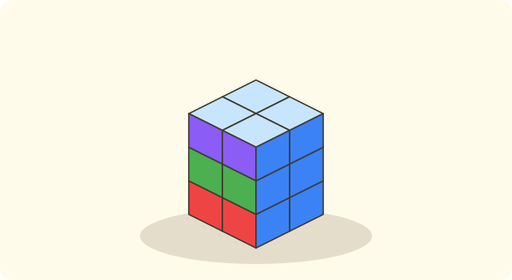
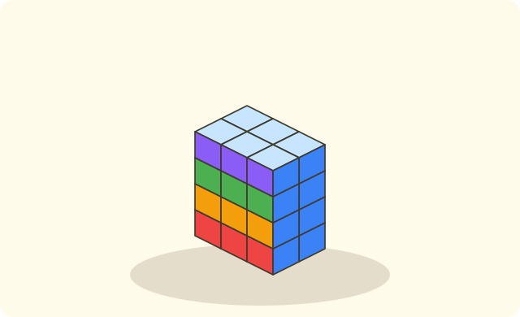

:::goals
- Recognise a cube and a cuboid.
- Say the number of faces, vertices and edges of each solid and the shape of its faces.
- Solve simple problems about faces and about stacking blocks.
:::

Nam has a dice and a box of chalk. Both have flat faces, but they are not the same shape. How are they different?

To find out, pick up each object, count its faces and see what shape the faces are.

## Let's explore

Look at the dice: it has $6$ faces, each face is a square, and all the faces are the same size. It is a **cube**.

Look at the box of chalk: it also has $6$ faces, but each face is a rectangle. It is a **cuboid**.

:::diagram A cube
alt: A cube ABCD.A'B'C'D' drawn in oblique style, with the hidden edges dashed
point A 0,0 below-left
point B 3,0 below-right
point C 4.2,1.4 right
point D 1.2,1.4 above-left
point A' 0,3 left
point B' 3,3 above
point C' 4.2,4.4 above-right
point D' 1.2,4.4 above
segment A B
segment B C
segment C D dashed
segment D A dashed
segment A' B'
segment B' C'
segment C' D'
segment D' A'
segment A A'
segment B B'
segment C C'
segment D D' dashed
:::

In the picture you can count $8$ vertices. Each line segment is an edge, and there are $12$ edges.

:::theorem Two kinds of solid
- **Cube:** $6$ faces, all equal squares; $8$ vertices; $12$ equal edges.
- **Cuboid:** $6$ faces that are rectangles; $8$ vertices; $12$ edges. Opposite faces are equal.
:::

The two solids are alike in the number of faces, vertices and edges. They differ in the shape of their faces.

## Examples

We start by counting the parts of a cube.

:::example Counting faces, vertices and edges
How many faces, vertices and edges does a cube have?

**Solution.** Count on the picture or on a dice: there are $6$ faces, $8$ vertices and $12$ edges.

So a cube has $6$ faces, $8$ vertices and $12$ edges.
:::

Now name the solids for some everyday objects.

:::example Naming everyday objects
What solid is each object: a dice, a brick, a Rubik's cube?

**Solution.** Look at the faces of each object. The dice and the Rubik's cube have faces that are equal squares. The brick has faces that are rectangles.

So the dice and the Rubik's cube are cubes; the brick is a cuboid.
:::

Opposite faces of a cuboid are equal. We use this to find sizes.

:::example Opposite faces
A cuboid has a base that is a rectangle $6$ cm long and $3$ cm wide. What shape and size is the top, which is opposite the base?

**Solution.** The top is opposite the base, so it is equal to the base.

So the top is a rectangle $6$ cm long and $3$ cm wide.
:::

Finally, a problem about stacking blocks.

:::example Stacking blocks
Nam stacks small cubes in $3$ layers, with $4$ cubes in each layer. How many cubes does Nam use altogether?

**Solution.** There are $3$ layers of $4$ cubes, so we multiply:
$$4\times3=12\ \text{(cubes)}.$$

So Nam uses $12$ cubes.
:::

:::warning Mistakes to watch out for
- **Mixing up a flat shape and a solid.** Wrong: "a cube is a square". Why it is wrong: a square is a flat shape, while a cube has $6$ faces that are squares. Right: every face of a cube is a square.
- **Mixing up vertices and edges.** Wrong: a cube has $12$ vertices. Why it is wrong: $12$ is the number of edges. Right: it has $8$ vertices and $12$ edges.
- **No unit.** Wrong: "Answer: $12$". Right: "Answer: $12$ cubes".
:::

## Key terms

:::terms
- cube | khối lập phương
- cuboid | khối hộp chữ nhật
- face | mặt
- vertex (corner) | đỉnh
- edge | cạnh
- opposite faces | mặt đối diện
- dice | xúc xắc
:::

## Summary

- A cube and a cuboid both have $6$ faces, $8$ vertices and $12$ edges.
- The faces of a cube are equal squares.
- The faces of a cuboid are rectangles; opposite faces are equal.
- $n$ layers with $m$ blocks in each layer make $m\times n$ blocks.

## Practice

Each exercise comes with what you need and how to start. Try it yourself first, then open the solution.

:::exercise
Fill in the blanks: a cube has $\ldots$ faces, $\ldots$ vertices and $\ldots$ edges.

::hint
**What you need:** a cube has $6$ faces, $8$ vertices and $12$ edges.

**Steps:**
1. Picture a dice.
2. Fill in the numbers in the order faces, vertices, edges.

::solution
A cube has $6$ faces, $8$ vertices and $12$ edges.

**Answer.** $6$; $8$; $12$.
:::

:::exercise
What solid is each object: a) a dice; b) a box of chalk; c) a Rubik's cube?

::hint
**What you need:** equal square faces make a cube; rectangular faces make a cuboid.

**Steps:**
1. Look at the faces of the object.
2. Are they equal squares?

::solution
a) A cube. b) A cuboid. c) A cube.

**Answer.** a) Cube; b) Cuboid; c) Cube.
:::

:::exercise
A cube has an edge of $7$ cm. How long is the side of each square face, in centimetres?

::hint
**What you need:** the edges of a cube are all equal, and each face is a square.

**Steps:**
1. The side of a face is also an edge of the cube.
2. Write the answer with its unit.

::solution
The side of a face is also an edge of the cube, so it is $7$ cm long.

**Answer.** $7$ cm.
:::

:::exercise
A cuboid has a base that is a rectangle $8$ cm long and $5$ cm wide. How long and how wide is the opposite face, in centimetres?

::hint
**What you need:** opposite faces of a cuboid are equal.

**Steps:**
1. Which face is opposite the base?
2. If two faces are equal, what about their sizes?

::solution
The top is equal to the base, so it is $8$ cm long and $5$ cm wide.

**Answer.** $8$ cm long, $5$ cm wide.
:::

:::exercise
An stacks small cubes in $4$ layers, with $6$ cubes in each layer. How many cubes does An use altogether?

::hint
**What you need:** $4$ layers of $6$ cubes: use multiplication.

**Steps:**
1. What do we know? $4$ layers, $6$ cubes in each. What is asked? The total number of cubes.
2. Work out $6\times4$ and write the unit.

::solution
The number of cubes An uses is:
$$6\times4=24\ \text{(cubes)}.$$

**Answer.** $24$ cubes.
:::

:::exercise
Binh has $20$ small cubes and stacks them equally in $4$ layers. How many cubes are in each layer?

::hint
**What you need:** share $20$ cubes equally between $4$ layers: use division.

**Steps:**
1. What do we know? $20$ cubes, $4$ equal layers.
2. Work out $20\div4$.

::solution
The number of cubes in each layer is:
$$20\div4=5\ \text{(cubes)}.$$

**Check.** $5\times4=20$. Correct.

**Answer.** $5$ cubes.
:::

:::exercise
Remember the last lesson: each face of a cube is a square with a side of $3$ cm. What is the total length of the four sides of one face, in centimetres?

::hint
**What you need:** a square has $4$ equal sides; the total length of its four sides is the side times $4$.

**Steps:**
1. What shape is the face, and how many sides does it have?
2. Work out $3\times4$.

::solution
$3\times4=12$ (cm).

**Answer.** $12$ cm.
:::

:::exercise Challenge
A dice has $6$ faces, and the dots on two opposite faces always add up to $7$. How many dots are there on all $6$ faces together?

::hint
**What you need:** the $6$ faces split into pairs of opposite faces.

**Steps:**
1. How many pairs of opposite faces are there?
2. Each pair has $7$ dots.

::solution
The $6$ faces split into $3$ pairs of opposite faces. Each pair has $7$ dots, so the total is $7\times3=21$.

**Check.** $1+2+3+4+5+6=21$. Correct.

**Answer.** $21$ dots.
:::

## Mini test

:::quiz
::mc
How many faces does a cube have?
A. $4$.
B. $6$.
C. $8$.
D. $12$.
::key B
A cube has $6$ faces. Option C is the number of vertices and option D is the number of edges.

::mc
What shape is each face of a cube?
A. A triangle.
B. A rectangle with two different sides.
C. A square.
D. A circle.
::key C
All the faces of a cube are equal squares. Option B is the face of a cuboid.

::mc
A cuboid has a base that is a rectangle $9$ cm long and $4$ cm wide. The opposite face is
A. $9$ cm long and $4$ cm wide.
B. $9$ cm long and $9$ cm wide.
C. $4$ cm long and $4$ cm wide.
D. $13$ cm long and $4$ cm wide.
::key A
Opposite faces are equal, so the top is also $9$ cm long and $4$ cm wide. Option D adds the two numbers by mistake.

::mc
Small blocks are stacked in $3$ layers with $5$ blocks in each layer. How many blocks are there altogether?
A. $8$.
B. $15$.
C. $53$.
D. $10$.
::key B
$5\times3=15$ (blocks). Option A adds $5+3$ by mistake.

::tf
Look at a cube.
a) It has $6$ faces.
b) Each face is a square.
c) It has $6$ vertices.
d) It has $12$ edges.
::key T T F T
a) True. b) True: all the faces are squares. c) False: it has $8$ vertices. d) True: it has $12$ edges.

::sa
How many vertices does a cube have?
::key 8
A cube has $8$ vertices.

::sa
Small cubes are stacked in $3$ layers with $9$ cubes in each layer. How many cubes are there altogether?
::key 27
$9\times3=27$ (cubes).
:::
