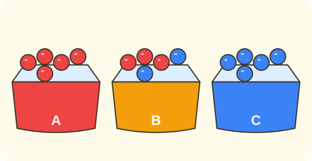

:::goals
- Tell whether an event is certain, possible or impossible.
- Give a reason by looking at what is in the box.
- Record the results of a trial in a data table.
:::

Mai has a closed box with only $5$ red marbles inside. Mai shuts her eyes and takes out one marble. Can Mai get a blue marble? Is Mai certain to get a red marble?

This lesson helps you answer questions like these, just by looking at what is in the box.

## Let's explore

There are three boxes. Each time, we shut our eyes and take out one marble.

- **Box A:** $5$ red marbles.
- **Box B:** $3$ red marbles and $2$ blue marbles.
- **Box C:** $5$ blue marbles.

**Box A.** There are only red marbles. However we pick, we get a red marble. We say: getting a red marble is **certain**. Getting a blue marble is **impossible**.

**Box B.** There are red and blue marbles. This time we might get red, another time we might get blue. We say: getting a red marble is **possible**, and getting a blue marble is also **possible**.

**Box C.** There are only blue marbles. Getting a blue marble is **certain**, and getting a red marble is **impossible**.

:::theorem Three levels of likelihood
- **Certain:** the event always happens.
- **Impossible:** the event never happens.
- **Possible:** the event sometimes happens and sometimes does not.

To decide which level it is, look at what is in the box.
:::

This works because you know everything in the box. If the thing you want is not there, it is impossible. If everything in the box is that thing, it is certain.

## Examples

We start with a box that holds only one kind of ball.

:::example A box of yellow balls
A box has $6$ yellow balls. Shut your eyes and take out one. Say how likely each event is:
a) you take a yellow ball;
b) you take a green ball.

**Solution.** There are only yellow balls in the box.

a) Every ball you take out is yellow, so this event is **certain**.

b) There is no green ball in the box, so this event is **impossible**.
:::

Now the box has two kinds of sweets.

:::example A bag of sweets
A bag has $4$ orange sweets and $2$ strawberry sweets. Shut your eyes and take out one. Say how likely each event is:
a) you take an orange sweet;
b) you take a strawberry sweet;
c) you take a lemon sweet.

**Solution.** The bag has both orange and strawberry sweets, but no lemon sweets.

a) You might take an orange sweet, so this event is **possible**.

b) You might take a strawberry sweet, so this event is also **possible**.

c) There are no lemon sweets, so this event is **impossible**.
:::

We can also ask about numbers on cards.

:::example Number cards
A box has $3$ cards with the numbers $1$, $2$, $3$. Shut your eyes and take out one card. Say how likely each event is:
a) you take the card with $5$;
b) you take a card with a number less than $4$;
c) you take the card with $2$.

**Solution.** The numbers you can take are $1$, $2$, $3$.

a) There is no card with $5$, so it is **impossible**.

b) All three numbers $1$, $2$, $3$ are less than $4$, so it is **certain**.

c) The card with $2$ is in the box, but so are other cards, so it is **possible**.
:::

You meet these questions in everyday life too.

:::example Everyday events
Say whether each event is certain, possible or impossible:
a) The Sun rises in the morning.
b) You walk from home to school in $1$ second.
c) It rains tomorrow.

**Solution.** We think about whether the event always happens, never happens, or sometimes happens.

a) The Sun rises every morning, so it is **certain**.

b) Nobody can walk that fast, so it is **impossible**.

c) Some days it rains and some days it does not, so it is **possible**.
:::

Finally, we try it for real and record the results in a data table, as in the last lesson.

:::example A trial with marbles
Box B has $3$ red and $2$ blue marbles. Nam takes out one marble, writes down its colour, puts it back, and does this $10$ times. The results are: red, blue, red, red, blue, red, blue, red, red, blue. Make a data table.

**Solution.** We read the list once and draw a stroke in the row of the right colour:

| Colour | Tally marks | Number of times |
|---|---|---|
| Red | ////// | $6$ |
| Blue | //// | $4$ |

Check: $6+4=10$ times. Both colours appeared, which fits "possible to get red, possible to get blue".
:::

:::warning Mistakes to watch out for
- **Mixing up "possible" and "certain".** Wrong: a box has $1$ red and $9$ blue marbles, and you say "you are certain to get blue". Why it is wrong: the red marble is still in the box, so you might get red. Right: getting blue is possible.
- **Mixing up "very few" and "impossible".** Wrong: a box has $1$ red marble, and you say "you cannot get red". Why it is wrong: the red marble is in the box. Right: getting red is possible.
- **Not looking in the box.** Wrong: answering without checking what is inside. Right: always check what is in the box before you answer.
:::

## Key terms

:::terms
- chance (likelihood) | khả năng
- event | sự kiện
- certain | chắc chắn
- possible (might happen) | có thể
- impossible | không thể
- box | hộp
- trial (experiment) | thử nghiệm
- data table | bảng số liệu
:::

## Summary

- **Certain:** always happens. **Impossible:** never happens. **Possible:** sometimes happens, sometimes does not.
- Look at what is in the box: if the thing you want is not there, it is impossible; if everything is that thing, it is certain.
- If the box holds several kinds, each kind is possible to take out, even if there are only a few of that kind.
- Record the results of a trial with tally marks and a data table.

## Practice

Each exercise comes with what you need and how to start. Try it yourself first, then open the solution.

:::exercise
A box has $5$ blue marbles. Shut your eyes and take out one. Say how likely each event is:
a) you take a blue marble;
b) you take a red marble.

::hint
**What you need:** look at what is in the box.

**Steps:**
1. Which colours are in the box?
2. Is the colour you want in the box?

::solution
a) There are only blue marbles, so taking a blue marble is **certain**.

b) There is no red marble, so taking a red marble is **impossible**.

**Answer.** a) Certain. b) Impossible.
:::

:::exercise
A bag has $3$ orange sweets and $3$ strawberry sweets. Shut your eyes and take out one. Say how likely each event is:
a) you take an orange sweet;
b) you take a strawberry sweet;
c) you take a lemon sweet.

::hint
**What you need:** if several kinds are in the bag, each kind is possible; if a kind is not in the bag, it is impossible.

**Steps:**
1. Which sweets are in the bag?
2. Look at parts a), b), c) one by one.

::solution
a) Possible. b) Possible. c) There is no lemon sweet in the bag, so it is impossible.

**Answer.** a) Possible. b) Possible. c) Impossible.
:::

:::exercise
Say whether each event is certain, possible or impossible:
a) A week has $7$ days.
b) A cat flies to the Moon.
c) It is sunny tomorrow.

::hint
**What you need:** always happens means certain; never happens means impossible; sometimes happens means possible.

**Steps:**
1. Think: does the event always happen?
2. Choose one of the three levels.

::solution
a) Every week has $7$ days: certain. b) Impossible. c) Some days are sunny and some are not: possible.

**Answer.** a) Certain. b) Impossible. c) Possible.
:::

:::exercise
A box has $4$ cards with the numbers $2$, $4$, $6$, $8$. Shut your eyes and take out one. Say how likely each event is:
a) you take a card with an even number;
b) you take the card with $5$;
c) you take a card with a number greater than $5$.

::hint
**What you need:** write down the numbers you could take, then look at each part.

**Steps:**
1. The numbers in the box are $2$, $4$, $6$, $8$.
2. Which numbers fit each part?

::solution
a) All four numbers are even: **certain**.

b) There is no $5$: **impossible**.

c) The numbers $6$ and $8$ are greater than $5$, but $2$ and $4$ are not: **possible**.

**Answer.** a) Certain. b) Impossible. c) Possible.
:::

:::exercise
A box has $1$ red marble and $9$ blue marbles. Nam says: "If I shut my eyes and take one, I am certain to get blue." Is Nam right? Why?

::hint
**What you need:** "certain" means it always happens.

**Steps:**
1. What do we know? The box has $1$ red marble and $9$ blue marbles.
2. Could you ever get the red marble?

::solution
The red marble is still in the box, so you might get red.

**Answer.** Nam is not right: getting blue is only **possible**.
:::

:::exercise
Lan says: "A box has $4$ blue marbles and $1$ red marble. You cannot get red because there is so little red." Where is Lan wrong? Correct it.

::hint
**What you need:** if it is in the box, you might take it out, even if there is only one.

**Steps:**
1. Is there a red marble in the box?
2. Choose the right level.

::solution
There is $1$ red marble in the box, so getting red can happen.

**Answer.** Lan is wrong: getting red is **possible**, not impossible.
:::

:::exercise
Remember the last lesson (data tables). Mai takes a marble from a box, writes down its colour, puts it back, and does this $12$ times: red, blue, red, red, blue, red, blue, red, red, blue, red, blue.

a) Make a data table (with tally marks).
b) Are there both colours in the box? Why?

::hint
**What you need:** count with tally marks, then add to check the total.

**Steps:**
1. Read the list once and draw a stroke in the row of the right colour.
2. Add the two numbers and compare with $12$.

::solution
a)

| Colour | Tally marks | Number of times |
|---|---|---|
| Red | /////// | $7$ |
| Blue | ///// | $5$ |

Check: $7+5=12$.

b) Both red and blue marbles were taken out, so the box has both colours.

**Answer.** a) Red $7$ times, blue $5$ times. b) Yes, both colours.
:::

:::exercise Challenge
A box has $3$ red marbles and $5$ blue marbles.

a) How many blue marbles must you take out so that you are certain to get a red marble?
b) If you keep the $5$ blue marbles, how many red marbles must you take out so that getting a red marble is impossible?

::hint
**What you need:** certain means only that colour is in the box; impossible means that colour is not in the box.

**Steps:**
1. In part a), which marbles must be left in the box?
2. In part b), which marbles must be gone?

::solution
a) You must take out all $5$ blue marbles, and then only $3$ red marbles are left.

b) You must take out all $3$ red marbles, and then only $5$ blue marbles are left.

**Answer.** a) $5$ blue marbles. b) $3$ red marbles.
:::

## Mini test

:::quiz
::mc
A box has $6$ yellow marbles. Shut your eyes and take out one. Getting a yellow marble is
A. impossible.
B. possible.
C. certain.
D. not known.
::key C
There are only yellow marbles, so every marble you take out is yellow. Option B forgets that there is no other colour in the box.

::mc
A box has $3$ red marbles and $2$ blue marbles. Take out one. Getting a blue marble is
A. certain.
B. impossible.
C. always happens.
D. possible.
::key D
The box has both red and blue marbles, so getting blue is possible. Option A mixes up "possible" and "certain".

::mc
A box has $3$ cards with the numbers $1$, $2$, $3$. Take out one. Getting the card with $7$ is
A. possible.
B. impossible.
C. certain.
D. not known.
::key B
There is no card with $7$ in the box. Option A comes from not looking in the box.

::mc
Which event is certain?
A. It rains tomorrow.
B. Tuesday comes after Monday.
C. A cat can fly.
D. You win the chess game this afternoon.
::key B
Tuesday always comes after Monday. A and D are possible, and C is impossible.

::tf
A box has $4$ blue marbles and $1$ red marble. Take out one.
a) It is possible to get a red marble.
b) You are certain to get a blue marble.
c) It is impossible to get a yellow marble.
d) You are certain to get a red or a blue marble.
::key T F T T
a) True: the red marble is in the box. b) False: the red marble might still be taken out. c) True: there is no yellow marble. d) True: every marble in the box is red or blue.

::sa
A box has $5$ red marbles and $3$ blue marbles. Take out one. How many different colours might you get?
::key 2
The box has red and blue marbles, so you might get $2$ colours.

::sa
A box has $5$ red marbles and $3$ blue marbles. How many blue marbles must you take out so that you are certain to get a red marble?
::key 3
You must take out all $3$ blue marbles so that only red marbles are left.
:::
