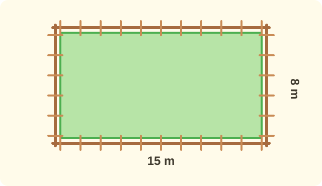
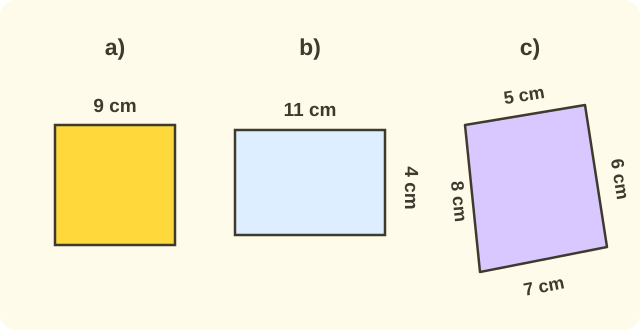
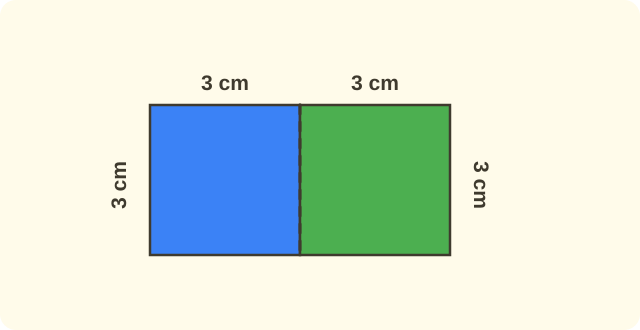

:::goals
- Understand that the perimeter of a shape is the distance all the way round it.
- Find the perimeter of a triangle or a quadrilateral by adding the lengths of its sides.
- Find the perimeter of a rectangle or a square with a quick method.
- Solve word problems about perimeter.
:::

Mai has a rectangular card, $8$ cm long and $5$ cm wide. She wants to stick glittery string along the edge of the card, exactly once round. How long must the string be, in centimetres?

It may sound as if you need a brand-new method, but you do not. You already know how to measure lengths in centimetres and how to add numbers. That is all you need for Mai's string. What is new is one name and one shorter way to add.

## Let's explore

Before we get to the card, let's try a simpler shape: a triangle. An ant walks once round the edge of triangle $ABC$, starting at $A$ and coming back to $A$.

:::diagram An ant walks once round triangle $ABC$
alt: Triangle ABC with side AB 4 cm long, side BC 5 cm long and side CA 3 cm long
point A 0,0 below-left
point B 4,0 below-right
point C 0,3 above
polygon A B C
label 2,-0.5 "4 cm"
label 2.5,1.9 "5 cm"
label -0.6,1.5 "3 cm"
:::

Follow the ant and note each part of the walk:

- The first part, from $A$ to $B$, is $4$ cm long.
- The second part, from $B$ to $C$, is $5$ cm long.
- The third part, from $C$ back to $A$, is $3$ cm long.

The whole walk is $4+5+3=12$ cm. The distance all the way round a shape has a name: the **perimeter**. This is the perimeter of the triangle.

:::definition Perimeter
The **perimeter** of a shape is the distance all the way round its edge.

To find the perimeter of a triangle or a quadrilateral, add the lengths of all the sides. The lengths must be in the same unit.
:::

Why must we add *all* the sides? The ant has to walk along every side to get back to the start. If you miss one, the walk is not complete. This is where many people slip, so count the sides before you add.

## A quick method for rectangles and squares

Now back to Mai's card. Is there a shorter way to add? Notice that a rectangle has two long sides that are equal and two short sides that are equal.

:::diagram Mai's card: a rectangle 8 cm long and 5 cm wide
alt: A rectangle with two long sides of 8 cm and two short sides of 5 cm
point A 0,0 below-left
point B 4,0 below-right
point C 4,2.5 above-right
point D 0,2.5 above-left
polygon A B C D
label 2,-0.45 "8 cm"
label 2,2.95 "8 cm"
label -0.6,1.25 "5 cm"
label 4.6,1.25 "5 cm"
:::

First, simply add all four sides: $8+5+8+5=26$ cm. In this sum there are two long sides and two short sides, so we can make two pairs of "long and short".

One pair is $8+5=13$ cm, and there are two such pairs. Why multiply by two? Because the pair "long and short" appears exactly twice. So $(8+5)\times2=13\times2=26$ cm. Mai's string must be $26$ cm long.

A square is even tidier, because all four sides are equal. If one side is $6$ cm, the walk round is $6+6+6+6=24$ cm, which is $6\times4=24$ cm. Four copies of the same side: multiplying is quickest.

:::theorem Perimeter of a rectangle and of a square
- Rectangle: **perimeter = (length + width) × 2**.
- Square: **perimeter = side length × 4**.
:::

Do not worry if you cannot remember these two rules straight away. They are just shorter ways of adding, and there is nothing new in them. If you forget, add all the sides: it always gives the perimeter.

## Examples

We begin with a triangle: three sides, so three lengths to add.

:::example Perimeter of a triangle
Triangle $DEF$ has $DE=5$ cm, $EF=6$ cm and $FD=7$ cm. Find the perimeter of triangle $DEF$.

**Solution.** The perimeter is the total length of the three sides, so we add the three lengths:
$$5+6+7=18\ \text{(cm)}.$$
So the perimeter of triangle $DEF$ is $18$ cm.

**Check.** $5+6=11$, then $11+7=18$. It matches.
:::

A quadrilateral has one more side, so we add four numbers instead of three. The method is just the same.

:::example Perimeter of a quadrilateral
Quadrilateral $MNPQ$ has $MN=4$ cm, $NP=6$ cm, $PQ=5$ cm and $QM=7$ cm. Find the perimeter.

**Solution.** We add the lengths of all four sides:
$$4+6+5+7=22\ \text{(cm)}.$$
So the perimeter of quadrilateral $MNPQ$ is $22$ cm.
:::

For a rectangle, we use the shorter way we just found. Remember why we multiply by two: there are two pairs of equal sides.

:::example Perimeter of a rectangle
A rectangle has length $9$ cm and width $4$ cm. Find its perimeter.

**Solution.** A rectangle has two pairs of equal sides, so we add the length and the width, then multiply by $2$:
$$(9+4)\times2=13\times2=26\ \text{(cm)}.$$
So the perimeter of the rectangle is $26$ cm.

**Check.** Add all four sides: $9+4+9+4=26$. It matches.
:::

A square is even easier, because we only need one side.

:::example Perimeter of a square
A square has side length $7$ cm. Find its perimeter.

**Solution.** A square has four equal sides, so we multiply the side length by $4$:
$$7\times4=28\ \text{(cm)}.$$
So the perimeter of the square is $28$ cm.

**Check.** $7+7=14$, then $14+14=28$. It matches.
:::

Perimeter is useful in many places, for example when building a fence. Let's try one.

:::example Building a fence
Mr Hung puts a fence round a rectangular garden that is $15$ m long and $8$ m wide. How long is the fence?

**Solution.** "Round the garden" means going once all the way round its edge, so we find the perimeter:
$$(15+8)\times2=23\times2=46\ \text{(m)}.$$
So the fence is $46$ m long.
:::

:::warning Mistakes to watch out for
- **Adding only one pair of sides.** Wrong: the perimeter of a rectangle $9$ cm long and $4$ cm wide is $9+4=13$ cm. Why it is wrong: you have only gone halfway round. Right: $(9+4)\times2=26$ cm.
- **Multiplying a square's side by 2.** Wrong: the perimeter of a square with side $7$ cm is $7\times2=14$ cm. Why it is wrong: a square has $4$ sides, not $2$. Right: $7\times4=28$ cm.
- **Forgetting the unit.** Wrong: "Answer: $26$". Why it is wrong: a number on its own does not say it is a length. Right: "Answer: $26$ cm".
:::

## Key terms

:::terms
- perimeter | chu vi
- side | cạnh
- triangle | hình tam giác
- quadrilateral | hình tứ giác
- rectangle | hình chữ nhật
- square | hình vuông
- length | chiều dài
- width | chiều rộng
- centimetre | xăng-ti-mét
- metre | mét
:::

## Summary

- The perimeter of a shape is the distance all the way round its edge.
- Perimeter of a triangle or quadrilateral: add the lengths of all the sides.
- Perimeter of a rectangle $=$ (length $+$ width) $\times\,2$. Perimeter of a square $=$ side $\times\,4$.
- You can check by adding all the sides, and remember to write the unit in the answer.
Back to Mai's string: going once all the way round the card is finding the perimeter. Practise a few questions below until it feels natural.

## Practice

Each exercise comes with what you need and a hint to get started. Try it yourself first. If you get stuck, read the hint, and only then open the solution to compare.

:::exercise
Find the perimeter:

a) A triangle with sides $3$ cm, $4$ cm and $6$ cm.

b) A quadrilateral with sides $2$ cm, $3$ cm, $4$ cm and $5$ cm.

::hint
**What you need:** the perimeter of a triangle or a quadrilateral is the total length of its sides.

**Steps:**
1. Write the addition of all the sides.
2. Add step by step and write the unit, cm.

::solution
Solution

The perimeter of a shape is the sum of the lengths of its sides.

a) The perimeter of the triangle is:
$$3+4+6=13\ \text{(cm)}.$$

b) The perimeter of the quadrilateral is:
$$2+3+4+5=14\ \text{(cm)}.$$

So the perimeter of the triangle is $13$ cm and the perimeter of the quadrilateral is $14$ cm.

**Answer.** a) $13$ cm; b) $14$ cm.
:::

:::exercise
Find the perimeter:

a) A rectangle with length $12$ cm and width $5$ cm.

b) A square with side $9$ cm.

::hint
**What you need:** perimeter of a rectangle $=$ (length $+$ width) $\times\,2$; perimeter of a square $=$ side $\times\,4$.

**Steps:**
1. Part a): add the length and the width, then multiply by $2$.
2. Part b): multiply the side by $4$.

::solution
Solution

a) To find the perimeter of a rectangle, we add the length and the width (in the same unit) and then multiply by $2$. The perimeter of the rectangle is:
$$(12+5)\times2=17\times2=34\ \text{(cm)}.$$

b) A square has $4$ equal sides, so to find its perimeter we multiply the length of one side by $4$. The perimeter of the square is:
$$9\times4=36\ \text{(cm)}.$$

So the perimeter of the rectangle is $34$ cm and the perimeter of the square is $36$ cm.

**Answer.** a) $34$ cm; b) $36$ cm.
:::

:::exercise
Remember the last lesson (rounding to the nearest ten).

a) Round $38$ to the nearest ten.

b) A square has a side of about $38$ m. Estimate its perimeter by multiplying the rounded number from part a) by $4$.

::hint
**What you need:** when rounding to the nearest ten, a ones digit of $5$ or more means you round up.

**Steps:**
1. Look at the ones digit of $38$.
2. Multiply the round number you found by $4$.

::solution
Solution

a) The ones digit of $38$ is $8$. Since $8$ is more than $5$, we round up to the nearest ten:
$$38\approx40.$$

b) A square has $4$ equal sides. We multiply the rounded number from part a) by $4$ to estimate the perimeter:
$$40\times4=160\ \text{(m)}.$$

*Check.* $38\times4=152$, which is close to $160$. The estimate is sensible.

So $38$ rounded to the nearest ten is $40$, and the perimeter of the square is about $160$ m.

**Answer.** a) $40$; b) about $160$ m.
:::

:::exercise
a) An ant walks once round the edge of a square table top with side $6$ cm. How many centimetres does the ant walk?

b) Binh bends a piece of wire into a triangle with sides $8$ cm, $9$ cm and $10$ cm. How many centimetres of wire does he use?

::hint
**What you need:** going "once round" a shape means finding its perimeter.

**Steps:**
1. What do we know? What is asked? Which shape is it?
2. Choose the right way to find the perimeter, then work it out.
3. Check by adding all the sides.

::solution
Solution

a) The ant walks once round the edge of the table top, so the distance it walks is the perimeter of the square. A square has $4$ equal sides, so the distance is:
$$6\times4=24\ \text{(cm)}.$$

b) The wire is bent into a triangle, so its length equals the perimeter of the triangle. The length of the wire is:
$$8+9+10=27\ \text{(cm)}.$$

So the ant walks $24$ cm and the wire is $27$ cm long.

**Answer.** a) $24$ cm; b) $27$ cm.
:::

:::exercise
Find the perimeter of each shape below in the quickest way. Why did you choose that way?

a) A square with side $9$ cm.

b) A rectangle $11$ cm long and $4$ cm wide.

c) A quadrilateral with sides $5$ cm, $6$ cm, $7$ cm and $8$ cm.

::hint
**What you need:** square: multiply by $4$; rectangle: add the two measurements, then multiply by $2$; other shapes: add the sides.

**Steps:**
1. Are all the sides equal? Are there two pairs of equal sides?
2. Choose the matching method.

::solution
Solution

We choose the quickest way by looking at the sides of each shape.

a) A square has four equal sides, so we multiply one side by $4$:
$$9\times4=36\ \text{(cm)}.$$

b) A rectangle has two pairs of equal sides (two long sides and two short sides), so we add the length and the width and multiply by $2$:
$$(11+4)\times2=15\times2=30\ \text{(cm)}.$$

c) The four sides of the quadrilateral are all different, so we must add all four:
$$5+6+7+8=26\ \text{(cm)}.$$

So the perimeter of the square is $36$ cm, the perimeter of the rectangle is $30$ cm and the perimeter of the quadrilateral is $26$ cm.

**Answer.** a) $36$ cm; b) $30$ cm; c) $26$ cm.
:::

:::exercise
Find the mistake in each friend's working and correct it.

a) Binh: "A rectangle is $10$ cm long and $3$ cm wide. The perimeter is $10+3=13$ (cm)."

b) Cuc: "A square has side $5$ cm. The perimeter is $5\times2=10$ (cm)."

::hint
**What you need:** a rectangle has four sides (two pairs of equal sides); a square has four equal sides.

**Steps:**
1. Count how many sides the working has used.
2. Do it again so that you go all the way round.

::solution
a) Binh has added only the length and the width, which are two sides next to each other, so he has gone only halfway round the shape. The rectangle has two more sides. The correct working is:
$$(10+3)\times2=13\times2=26\ \text{(cm)}.$$

b) Cuc multiplied by $2$, but a square has $4$ equal sides, so she must multiply by $4$. The correct working is:
$$5\times4=20\ \text{(cm)}.$$

So Binh forgot to multiply by $2$ and the correct perimeter is $26$ cm; Cuc multiplied by $2$ by mistake and the correct perimeter is $20$ cm.

**Answer.** a) $26$ cm; b) $20$ cm.
:::

:::exercise
A vegetable garden is a rectangle $20$ m long and $9$ m wide. Mr An builds a fence round the garden.

a) If the fence goes all the way round, how many metres long is it?

b) He leaves a gate $2$ m wide with no fence. How many metres long is the fence now?

::hint
**What you need:** a fence round the garden goes once all the way round, so we use the perimeter.

**Steps:**
1. What do we know? What is asked?
2. Part a): find the perimeter of the rectangle.
3. Part b): take away the gap for the gate.

::solution
Solution

a) A fence that goes all the way round is as long as the perimeter of the rectangular garden. The fence is:
$$(20+9)\times2=29\times2=58\ \text{(m)}.$$

b) Mr An leaves a gate $2$ m wide with no fence, so the fence is $2$ m shorter than the closed fence. The fence is:
$$58-2=56\ \text{(m)}.$$

So a fence all the way round is $58$ m long, and with the gate left open the fence is $56$ m long.

**Answer.** a) $58$ m; b) $56$ m.
:::

:::exercise Challenge
Put two squares, each with side $3$ cm, side by side to make one rectangle.

a) Find the perimeter of the rectangle.

b) Find the total perimeter of the two separate squares. Why is this total bigger than the perimeter of the rectangle?

::hint
**What you need:** when two squares are put side by side, they share one side.

**Steps:**
1. How long is the rectangle compared with one square? How wide is it?
2. Find the perimeter of each square, add them, then compare.

::solution
Solution

a) Two squares with side $3$ cm put side by side make a rectangle with length $3+3=6$ (cm) and width $3$ cm. The perimeter of the rectangle is:
$$(6+3)\times2=9\times2=18\ \text{(cm)}.$$

b) Each square has perimeter $3\times4=12$ (cm). The total perimeter of the two separate squares is:
$$12+12=24\ \text{(cm)}.$$

This total is bigger than the perimeter of the rectangle because, when we join the squares, the shared side, $3$ cm long, is hidden inside and is no longer part of the perimeter of the rectangle. Each square loses $3$ cm, so
$$24-3-3=18\ \text{(cm)},$$
which is exactly the perimeter of the rectangle in part a).

So the perimeter of the rectangle is $18$ cm, the total perimeter of the two separate squares is $24$ cm, and the total is bigger because the shared side is hidden.

**Answer.** a) $18$ cm; b) $24$ cm.
:::

## Mini test

:::quiz
::mc TH
The perimeter of a triangle with sides $4$ cm, $5$ cm and $7$ cm is
A. $9$ cm.
B. $11$ cm.
C. $12$ cm.
D. $16$ cm.
::key D
$4+5+7=16$. Options A, B and C add only two sides ($4+5$, $4+7$, $5+7$), so a side is missing.

::mc TH
A rectangle has length $9$ cm and width $6$ cm. Its perimeter is
A. $15$ cm.
B. $30$ cm.
C. $24$ cm.
D. $54$ cm.
::key B
$(9+6)\times2=15\times2=30$. Option A forgets to multiply by $2$; option C is $9+6+9$, with a side missing; option D multiplies the two measurements together.

::mc TH
The perimeter of a square with side $8$ cm is
A. $16$ cm.
B. $24$ cm.
C. $32$ cm.
D. $64$ cm.
::key C
$8\times4=32$. Option A multiplies by $2$, option B multiplies by $3$, and option D is $8\times8$.

::mc VD
A plot of land is a rectangle $12$ m long and $7$ m wide. Mr Tu stretches wire once round the plot. The wire is
A. $19$ m long.
B. $38$ m long.
C. $31$ m long.
D. $84$ m long.
::key B
Once round is the perimeter: $(12+7)\times2=19\times2=38$ m. Option A forgets to multiply by $2$; option C is $12+7+12$, with a side missing.

::tf NB NB TH TH
Rectangle $ABCD$ has $AB=10$ cm and $BC=4$ cm.
a) $CD=10$ cm.
b) $AD=4$ cm.
c) The perimeter is $14$ cm.
d) The perimeter is $28$ cm.
::key T T F T
a) True: opposite sides are equal. b) True: $AD$ and $BC$ are opposite sides. c) False: $14$ is only $10+4$, not yet multiplied by $2$. d) True: $(10+4)\times2=28$.

::sa TH
A square has side $6$ cm. What is its perimeter in centimetres?
::key 24
$6\times4=24$ (cm).

::sa TH
A rectangle is $13$ m long and $8$ m wide. What is its perimeter in metres?
::key 42
$(13+8)\times2=21\times2=42$ (m).
:::
