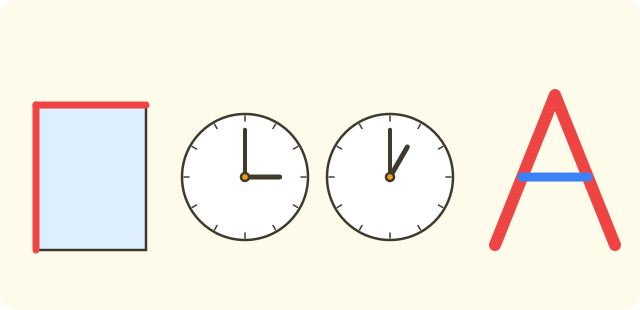
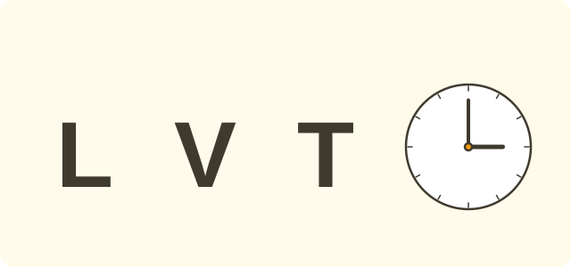
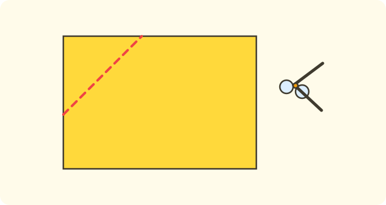

:::goals
- Recognise an angle, its vertex and its two sides.
- Use a set square to test whether an angle is a right angle.
- Find right angles and other angles in pictures and in objects around you.
:::

The corner of a book, the corner of a sheet of paper and the corner of a window all have the same shape. How can you be sure that an angle is a "right angle"?

This lesson teaches you to name angles and to use a set square to test for a right angle.

## Let's explore

The two blades of scissors, the two hands of a clock or two sticks joined at one point make an **angle**. The shared point is the **vertex** of the angle, and the two lines are its two **sides**.

The picture below shows the angle with vertex $O$ and sides $OA$ and $OB$. At the vertex $O$ there is a small square mark: this is a **right angle**.

:::diagram A right angle with vertex O and sides OA and OB
alt: An angle with vertex O, side OA lying flat and side OB standing upright, with a small square mark at O showing that this is a right angle
point O 0,0 below-left
point A 4,0 below-right
point B 0,4 above-left
segment O A
segment O B
right A O B
:::

The next picture is also an angle with vertex $O$, but its sides $OC$ and $OD$ open in a different way. It looks smaller than a right angle; this is an angle that is **not a right angle**.

:::diagram An angle that is not a right angle, vertex O, sides OC and OD
alt: An angle with vertex O, side OC lying flat and side OD leaning upwards; this angle is not a right angle
point O 0,0 below-left
point C 4,0 below-right
point D 3,3 above-right
segment O C
segment O D
angle C O D
:::

Do not just judge by eye. We use a **set square**, which has one right angle, to test:

1. Put the right-angled corner of the set square on the vertex of the angle to test.
2. Line up one side of the set square with one side of the angle.
3. Look at the other side of the set square: if it lines up with the other side of the angle, the angle is a right angle.

:::theorem Right angles and other angles
An angle has a vertex and two sides. An angle is a **right angle** when it fits the corner of a set square exactly: both sides line up with both sides of the set square. If a side of the set square sticks out or falls inside, the angle is **not a right angle**.

The lengths of the two sides do not change whether the angle is a right angle.
:::

For example, an angle with sides $3$ cm long and an angle with sides $6$ cm long are both right angles if they fit the set square.

## Examples

We start by naming the vertex and sides of an angle.

:::example Vertex and sides
An angle has vertex $E$ and sides $ED$ and $EF$. State the vertex and the sides.

**Solution.** The vertex is the point shared by the two sides, so the vertex is $E$. The two sides are $ED$ and $EF$.

So the angle has vertex $E$ and sides $ED$ and $EF$.
:::

Now use a set square to test.

:::example Using a set square
Lan puts a set square on an angle and sees that the other side of the set square lines up with the other side of the angle. Nam puts a set square on a different angle and sees that the other side of the set square sticks out of the angle. Which angle is a right angle?

**Solution.** An angle is a right angle when both sides line up with the set square. Lan's angle fits the set square, and Nam's angle leaves a gap.

So Lan's angle is a right angle, and Nam's angle is not.
:::

Next, find right angles around you.

:::example Right angles around you
Which of these has a right angle: a corner of a rectangular sheet of paper, the two hands of a clock at exactly $3$ o'clock, the two hands of a clock at exactly $1$ o'clock, a roof shaped like the letter A?

**Solution.** Test each one with a set square.

- A corner of a rectangular sheet fits the set square: a right angle.
- The clock hands at exactly $3$ o'clock fit the set square: a right angle.
- The clock hands at exactly $1$ o'clock are closer together than the set square: not a right angle.
- The two sides of an A-shaped roof are closer together than the set square: not a right angle.

So the corner of the sheet and the clock hands at $3$ o'clock are right angles.
:::

Now draw a right angle yourself.

:::example Drawing a right angle
Draw a right angle with vertex $O$ using a set square.

**Solution.** Follow these steps:

1. Mark a point $O$ and put the right-angled corner of the set square on $O$.
2. Draw a line segment $OA$ along one side of the set square.
3. Draw a line segment $OB$ along the other side of the set square.

So the angle with vertex $O$ and sides $OA$ and $OB$ is a right angle.
:::

Finally, find right angles in letters.

:::example Letters
Of the neatly written letters $L$ and $V$, which has a right angle?

**Solution.** The two strokes of the letter $L$ meet at a right angle. The two strokes of the letter $V$ come together at less than a right angle.

So the letter $L$ has a right angle and the letter $V$ does not.
:::

:::warning Mistakes to watch out for
- **Thinking longer sides mean a bigger angle.** Wrong: the angle with sides $6$ cm is bigger than the angle with sides $3$ cm. Why it is wrong: the size of an angle does not depend on the length of its sides. Right: two right angles are always the same, however long the sides are.
- **Judging only by eye.** Wrong: "It looks like a right angle, so it is one". Why it is wrong: the eye is easily fooled by an angle that is nearly right. Right: test it with a set square.
- **Putting the set square in the wrong place.** Wrong: placing the right-angled corner somewhere else. Why it is wrong: the corner of the set square must sit on the vertex of the angle to test. Right: put the corner on the vertex, then line up one side with one side.
- **Mixing up the vertex.** Wrong: the angle with vertex $O$ and sides $OA$ and $OB$ has vertex $A$. Why it is wrong: the vertex is the point shared by both sides. Right: the vertex is $O$.
:::

## Key terms

:::terms
- angle | góc
- vertex | đỉnh
- side | cạnh
- right angle | góc vuông
- angle that is not a right angle | góc không vuông
- set square | ê-ke
- check | kiểm tra
- match exactly | trùng nhau
:::

## Summary

- An angle has one vertex and two sides; the vertex is the point shared by both sides.
- Use a set square to test for a right angle: both sides of the angle must line up with both sides of the set square.
- An angle that does not fit the set square is not a right angle.
- The length of the sides does not change whether an angle is a right angle.
- Do not judge by eye alone; use a set square.

## Practice

Each exercise comes with what you need and how to start. Try it yourself first, then open the solution.

:::exercise
An angle has vertex $K$ and sides $KA$ and $KB$.

a) Which point is the vertex?

b) What are the two sides?

c) Which point is shared by both sides?

::hint
**What you need:** the vertex is the point shared by the two sides.

**Steps:**
1. Which point do $KA$ and $KB$ both have?
2. That point is the vertex.

::solution
a) The vertex is $K$.

b) The sides are $KA$ and $KB$.

c) The point shared by both sides is $K$.

**Answer.** a) $K$; b) $KA$, $KB$; c) $K$.
:::

:::exercise
You put a set square on three angles. Is each angle a right angle or not?

a) The other side of the set square lines up with the other side of the angle.

b) The other side of the set square sticks out of the angle, leaving a gap.

c) The other side of the angle falls inside the corner of the set square.

::hint
**What you need:** a right angle fits the corner of the set square exactly.

**Steps:**
1. Do both sides of the angle line up with both sides of the set square?
2. If there is a gap or it falls inside, it is not a right angle.

::solution
a) They line up: a right angle.

b) A gap: not a right angle.

c) It falls inside: not a right angle.

**Answer.** a) Right angle; b) not a right angle; c) not a right angle.
:::

:::exercise
Remember the last lesson on circles. A circle with centre $O$ has radius $4$ cm. The points $A$ and $B$ are on the circle. The angle with vertex $O$ and sides $OA$ and $OB$ has two sides. How many centimetres long is each side?

::hint
**What you need:** all radii of a circle are equal.

**Steps:**
1. What kind of segments are $OA$ and $OB$?
2. Use the radius given.

::solution
$OA$ and $OB$ are both radii, so each side is $4$ cm long. The two sides of the angle are equal.

**Answer.** $OA=4$ cm and $OB=4$ cm.
:::

:::exercise
Which of these has a right angle?

a) A corner of a book.

b) The two hands of a clock at exactly $1$ o'clock.

c) A corner of a blackboard.

d) A roof shaped like the letter A.

::hint
**What you need:** use a set square to test for a right angle.

**Steps:**
1. Imagine putting a set square in each corner.
2. Choose the ones that fit the set square.

::solution
a) The corner of a book fits the set square: a right angle.

b) The clock hands at $1$ o'clock are close together: not a right angle.

c) The corner of a blackboard fits the set square: a right angle.

d) The A-shaped roof is closer together: not a right angle.

**Answer.** The corner of a book and the corner of a blackboard.
:::

:::exercise
Two right angles: one has sides $3$ cm long and the other has sides $6$ cm long. Are the two angles "equal"? Why?

::hint
**What you need:** right angles are tested with a set square; the length of the sides does not change the angle.

**Steps:**
1. Do both angles fit the set square?
2. Does the length of the sides affect whether an angle is right?

::solution
Both are right angles, so they are equal. The length of the sides does not change whether an angle is a right angle.

**Answer.** Equal, because both are right angles.
:::

:::exercise
Nam says: "This angle looks like a right angle, so it is a right angle". What is wrong with what Nam says? What would you do?

::hint
**What you need:** use a set square to test for a right angle.

**Steps:**
1. Can the eye be fooled?
2. Which tool makes sure?

::solution
Nam only used his eyes, which can be fooled by an angle that is nearly right. You use a set square: put its corner on the vertex, line up one side with one side, then see whether the other side lines up too.

**Answer.** It must be tested with a set square.
:::

:::exercise
a) Of the letters $L$, $V$ and $T$, which have a right angle?

b) What kind of angle do the clock hands make at exactly $3$ o'clock?

::hint
**What you need:** a right angle fits a set square.

**Steps:**
1. Imagine putting a set square where two strokes meet.
2. Decide using the set square.

::solution
a) The letters $L$ and $T$ have two strokes meeting at a right angle; the letter $V$ does not.

b) The clock hands at exactly $3$ o'clock make a right angle.

**Answer.** a) $L$, $T$; b) a right angle.
:::

:::exercise Challenge
A rectangular sheet of paper has $4$ right angles. You cut off one corner with a single straight cut (the cut does not pass through any other corner). How many right angles does the sheet have left?

::hint
**What you need:** cutting off a corner removes one right angle from the sheet.

**Steps:**
1. Count the $4$ right angles at the start.
2. One corner is cut off; two new corners appear along the cut but they are not right angles.

::solution
At the start there are $4$ right angles. Cutting off one corner removes $1$ right angle, leaving $4-1=3$ right angles. The two new corners along the cut are not right angles.

**Answer.** $3$ right angles.
:::

## Mini test

:::quiz
::mc
Which tool is used to test for a right angle?
A. A ruler.
B. A set square.
C. Compasses.
D. A pair of scales.
::key B
A set square has a right angle to compare with the angle being tested. Option A is the mistake of using a ruler, which measures length.

::mc
An angle has vertex $O$ and sides $OA$ and $OB$. The vertex of the angle is
A. $A$.
B. $B$.
C. $O$.
D. $AB$.
::key C
The vertex is the point shared by the sides $OA$ and $OB$, that is $O$.

::mc
Which of these has a right angle?
A. The two clock hands at $1$ o'clock.
B. A roof shaped like the letter A.
C. A corner of a book.
D. The letter $V$.
::key C
The corner of a book fits the set square. The other options are closer together than a right angle.

::mc
Which statement is true?
A. An angle with longer sides is bigger.
B. Two right angles are always equal, even if their sides have different lengths.
C. A right angle always has sides $3$ cm long.
D. Every angle is a right angle.
::key B
The length of the sides does not change whether an angle is a right angle. Option A is a mistake people often make by eye.

::tf
You use a set square to test the angle with vertex $O$.
a) If both sides of the angle line up with both sides of the set square, it is a right angle.
b) If a side of the set square leaves a gap, the angle is not a right angle.
c) Looking by eye is enough to be sure it is a right angle.
d) The lengths of the two sides decide whether the angle is a right angle.
::key T T F F
a) True: fitting the set square means a right angle. b) True: a gap means it is not a right angle. c) False: the eye is easily fooled. d) False: the length of the sides does not decide.

::sa
How many right angles does a neatly written letter $L$ have?
::key 1
The two strokes of the letter $L$ meet at one right angle.

::sa
A rectangular sheet of paper has $4$ right angles. One corner is cut off with a single straight cut. How many right angles are left?
::key 3
Cutting off one right angle leaves $4-1=3$ right angles.
:::
