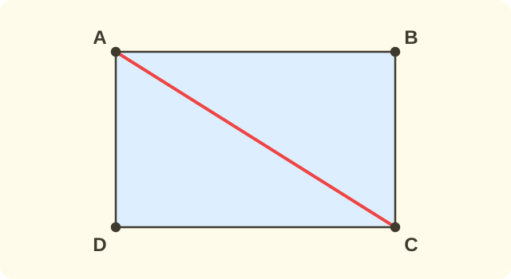

:::goals
- Recognise triangles and quadrilaterals by their number of vertices and sides.
- Recognise rectangles and squares and say what is special about their angles and sides.
- Find the side lengths of a rectangle or a square when you know some of them.
:::

Lan cuts coloured paper into shapes. Some have $3$ sides, some have $4$ sides, and some have $4$ right angles. How can she tell which shape is which? Let's help her name them.

The method is simple. Count the vertices, count the sides, and use a set square to check whether an angle is a right angle. With those checks you can name any of these shapes.

## Let's explore

Pick up a shape and count how many vertices and how many sides it has:

- A shape with $3$ vertices and $3$ sides is a **triangle**.
- A shape with $4$ vertices and $4$ sides is a **quadrilateral**.
The names help you remember: "tri" means three and "quad" means four.

Among the quadrilaterals, two come up again and again: the rectangle and the square. We look at rectangle $ABCD$ first.

:::diagram Rectangle ABCD
alt: Rectangle ABCD with four right angles; the long sides AB and CD have one tick each to show they are equal, and the short sides BC and AD have two ticks each
point A 0,0 below-left
point B 4,0 below-right
point C 4,3 above-right
point D 0,3 above-left
polygon A B C D
right D A B
right A B C
right B C D
right C D A
mark A B 1
mark C D 1
mark B C 2
mark A D 2
:::

Try a set square in each corner: all $4$ angles are right angles. What about the sides? The opposite sides $AB$ and $CD$ are equal, and the opposite sides $BC$ and $AD$ are equal too.

Square $MNPQ$ goes one step further: all $4$ sides are equal, not just the opposite ones.

:::diagram Square MNPQ
alt: Square MNPQ with four right angles and four sides with the same tick, so they are all equal
point M 0,0 below-left
point N 3,0 below-right
point P 3,3 above-right
point Q 0,3 above-left
polygon M N P Q
right Q M N
right M N P
right N P Q
right P Q M
mark M N 1
mark N P 1
mark P Q 1
mark Q M 1
:::

:::theorem How to recognise the shapes
- **Triangle:** $3$ vertices, $3$ sides.
- **Quadrilateral:** $4$ vertices, $4$ sides.
- **Rectangle:** $4$ right angles, opposite sides equal.
- **Square:** $4$ right angles, $4$ equal sides.
:::

You can check this yourself with a sheet of paper. Take a paper rectangle and fold it in half so that two opposite sides meet: they lie exactly on top of each other.

## Examples

First, we use opposite sides to find the lengths of the sides of a rectangle.

:::example Sides of a rectangle
Rectangle $ABCD$ has $AB=4$ cm and $BC=3$ cm. Find $CD$ and $AD$.

**Solution.** Opposite sides of a rectangle are equal. $CD$ is opposite $AB$, and $AD$ is opposite $BC$:

$$CD=AB=4\ \text{cm},\qquad AD=BC=3\ \text{cm}.$$

So $CD=4$ cm and $AD=3$ cm.
:::

Now we go the other way: we are given the features and have to say which shape it is.

:::example Naming a shape
A shape has $4$ vertices, $4$ right angles and $4$ sides that are each $5$ cm long. What shape is it?

**Solution.** It has $4$ right angles and $4$ equal sides, so it is a square.

So it is a square with sides of $5$ cm.
:::

A square has $4$ equal sides. So instead of adding the same number four times, we can multiply.

:::example Total length of the four sides
Square $MNPQ$ has sides of $5$ cm. What is the total length of the four sides, in centimetres?

**Solution.** All four sides are $5$ cm, so we multiply $5$ by $4$:
$$5\times4=20\ \text{(cm)}.$$

So the four sides are $20$ cm long altogether.
:::

One more question: if we draw a straight line inside a rectangle, what shapes do we get?

:::example Cutting a rectangle
Join the opposite vertices $A$ and $C$ of rectangle $ABCD$. Into how many triangles is the rectangle divided?

**Solution.** The line $AC$ cuts the rectangle into two shapes, each with $3$ vertices and $3$ sides. They are triangle $ABC$ and triangle $ACD$.

So the rectangle is divided into $2$ triangles.
:::

:::warning Mistakes to watch out for
- **Calling a rectangle with unequal sides a square.** A lot of students mix this up. A shape with two sides of $6$ cm and two sides of $2$ cm is not a square, because a square needs $4$ equal sides. It is a rectangle.
- **Mixing up opposite sides.** Suppose $ABCD$ is a rectangle and $AB=4$ cm. Writing $BC=4$ cm is wrong, because $BC$ is not opposite $AB$. The right answer is $CD=4$ cm. Find the opposite side before you write.
- **No unit.** Writing "Answer: $20$" is not enough. Write "Answer: $20$ cm".
Don't worry if you slip the first time. Count and check step by step, and it will get easier.
:::

## Key terms

:::terms
- triangle | hình tam giác
- quadrilateral | hình tứ giác
- vertex (corner) | đỉnh
- side | cạnh
- right angle | góc vuông
- rectangle | hình chữ nhật
- square | hình vuông
- opposite sides | cạnh đối diện
:::

## Summary

- A triangle has $3$ vertices and $3$ sides; a quadrilateral has $4$ vertices and $4$ sides.
- A rectangle has $4$ right angles; opposite sides are equal.
- A square has $4$ right angles and $4$ equal sides.
- The total length of the four sides of a square with side $a$ is $a\times4$.
Back to Lan's question: count the vertices, count the sides, check for right angles and compare the sides, and you can name each shape. A little practice will make it feel natural.

## Practice

Every exercise has the key idea and a hint to get you started. Have a go on your own first, use the hint if you get stuck, and open the solution last to check.

:::exercise
Fill in the blanks: a triangle has $\ldots$ vertices and $\ldots$ sides; a quadrilateral has $\ldots$ vertices and $\ldots$ sides.

::hint
**What you need:** the number of vertices equals the number of sides; a triangle has $3$, a quadrilateral has $4$.

**Steps:**
1. Remember the names: "tri" means three, "quad" means four.
2. Fill in the number for each shape.

::solution
We recall the features of each shape.

A triangle has $3$ vertices and $3$ sides.

A quadrilateral has $4$ vertices and $4$ sides.

So the numbers to write, in order, are $3$; $3$; $4$; $4$.

**Answer.** $3$; $3$; $4$; $4$.
:::

:::exercise
Rectangle $ABCD$ has $AB=7$ cm and $BC=2$ cm. Find $CD$ and $AD$.

::hint
**What you need:** opposite sides of a rectangle are equal.

**Steps:**
1. Which side is $CD$ opposite?
2. Which side is $AD$ opposite?

::solution
In a rectangle, opposite sides are equal.

Side $CD$ is opposite side $AB$, so
$$CD=AB=7\ \text{(cm)}.$$

Side $AD$ is opposite side $BC$, so
$$AD=BC=2\ \text{(cm)}.$$

So $CD=7$ cm and $AD=2$ cm.

**Answer.** $CD=7$ cm, $AD=2$ cm.
:::

:::exercise
Square $EFGH$ has a side of $6$ cm. How long is each of the other sides, in centimetres?

::hint
**What you need:** a square has $4$ equal sides.

**Steps:**
1. What do we know? One side is $6$ cm.
2. How are the other sides related to it?

::solution
A square has four equal sides.

Square $EFGH$ has one side of $6$ cm, so each of the other sides is also $6$ cm.

So each of the other sides of square $EFGH$ is $6$ cm long.

**Answer.** $6$ cm.
:::

:::exercise
What shape is each of these?
a) A shape with $4$ right angles and $4$ equal sides.
b) A shape with $3$ vertices.
c) A shape with $4$ right angles, two sides of $8$ cm and two sides of $3$ cm.

::hint
**What you need:** count vertices, look at right angles and compare the sides.

**Steps:**
1. Part a: are the sides equal?
2. Part c: are all four sides equal?

::solution
a) A shape with $4$ right angles and $4$ equal sides is a square.

b) A shape with $3$ vertices has $3$ sides, so it is a triangle.

c) The shape has $4$ right angles, two sides of $8$ cm and two sides of $3$ cm. Since $8\ne3$, the sides are not all equal, so it is not a square. A shape with $4$ right angles whose sides are not all equal is a rectangle.

So the shapes are a square, a triangle and a rectangle, in that order.

**Answer.** a) Square; b) Triangle; c) Rectangle.
:::

:::exercise
Mr Hoa makes a square frame from $4$ wooden strips, each $5$ dm long. How long are all the strips together, in decimetres?

::hint
**What you need:** $4$ equal strips: multiply the length of one strip by $4$.

**Steps:**
1. What do we know? $4$ strips of $5$ dm. What is asked? The total length.
2. Work out $5\times4$ and write the unit.

::solution
Solution

The square frame is made from $4$ wooden strips, each $5$ dm long, so the total length of the strips is:
$$5\times4=20\ \text{(dm)}$$

So all the strips together are $20$ dm long.

**Answer.** $20$ dm.
:::

:::exercise
Find the missing number: a square with a side of $9$ cm has four sides with a total length of $\ldots$ cm.

::hint
**What you need:** the total length of the four sides of a square is the side times $4$.

**Steps:**
1. Use the $9$ times table or the $4$ times table.
2. Work out $9\times4$.

::solution
A square has four equal sides, each $9$ cm long, so the total length of the four sides is:
$$9\times4=36\ \text{(cm)}$$

So the four sides of the square have a total length of $36$ cm.

**Answer.** $36$ cm.
:::

:::exercise
Remember the last lesson: how many right angles does rectangle $ABCD$ have? A triangle $MNP$ has exactly one right angle. How many of its angles are not right angles?

::hint
**What you need:** a rectangle has $4$ right angles; a triangle has $3$ angles.

**Steps:**
1. A rectangle has $4$ angles, and all of them are right angles.
2. A triangle has $3$ angles; take away the right angle.

::solution
Rectangle $ABCD$ has $4$ right angles.

Triangle $MNP$ has $3$ angles, and exactly $1$ of them is a right angle. The number of angles that are not right angles is:
$$3-1=2\ \text{(angles)}$$

So rectangle $ABCD$ has $4$ right angles; triangle $MNP$ has $2$ angles that are not right angles.

**Answer.** $4$ right angles; $2$ angles that are not right angles.
:::

:::exercise Challenge
Put two squares with sides of $3$ cm side by side, sharing one side, to make a rectangle. How long are the sides of this rectangle, in centimetres?

::hint
**What you need:** a rectangle has two equal long sides and two equal short sides.

**Steps:**
1. Draw the two squares next to each other.
2. A long side is made of how many square sides? A short side?

::solution
Solution

A long side of the rectangle is made of two sides of the squares, so its length is:
$$3+3=6\ \text{(cm)}$$

A short side of the rectangle is one side of a square, so it is $3$ cm long.

Check: the new shape has $4$ right angles and equal opposite sides ($6$ cm and $6$ cm; $3$ cm and $3$ cm). Correct.

So the sides of the rectangle are $6$ cm and $3$ cm.

**Answer.** $6$ cm and $3$ cm.
:::

## Mini test

:::quiz
::mc NB
Which shape has $4$ right angles and $4$ equal sides?
A. A triangle.
B. A rectangle whose length is different from its width.
C. A square.
D. A shape with $3$ vertices.
::key C
Only a square has $4$ right angles and $4$ equal sides. Option B has sides that are not equal.

::mc TH
Rectangle $ABCD$ has $AB=8$ cm and $BC=5$ cm. The length of $CD$ is
A. $5$ cm.
B. $8$ cm.
C. $13$ cm.
D. $3$ cm.
::key B
$CD$ is opposite $AB$, so $CD=8$ cm. Option A is the length of $BC$, and option C adds two sides by mistake.

::mc NB
How many vertices does a quadrilateral have?
A. $3$.
B. $4$.
C. $5$.
D. $2$.
::key B
A quadrilateral has $4$ vertices and $4$ sides. Option A is the number of vertices of a triangle.

::mc TH
Nam makes a square from $4$ sticks, each $6$ cm long. The total length of the sticks is
A. $10$ cm.
B. $12$ cm.
C. $24$ cm.
D. $6$ cm.
::key C
$6\times4=24$ (cm). Option B is $6\times2$, which leaves out two sticks.

::tf NB NB TH TH
Square $MNPQ$ has a side of $4$ cm.
a) It has $4$ right angles.
b) $NP=4$ cm.
c) $NP$ is longer than $MN$.
d) The total length of the four sides is $16$ cm.
::key T T F T
a) True: a square has $4$ right angles. b) True: all $4$ sides are equal. c) False: $NP=MN=4$ cm. d) True: $4\times4=16$ (cm).

::sa TH
Rectangle $EFGH$ has $EF=9$ cm and $FG=4$ cm. How long is $HG$, in centimetres?
::key 9
$HG$ is opposite $EF$, so $HG=EF=9$ cm.

::sa TH
A square piece of card has a side of $7$ cm. What is the total length of its four sides, in centimetres?
::key 28
$7\times4=28$ (cm).
:::
