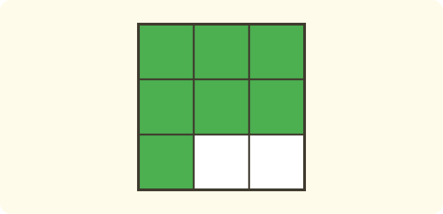

:::goals
- Know that the quotient of two whole numbers ($a\div b$, $b\neq0$) can be written as the fraction $\dfrac{a}{b}$.
- Write a whole number as a fraction.
- Solve sharing problems whose answer is a fraction.
:::

A teacher shares $3$ cakes equally among $4$ children. What part of a cake does each child get? There are fewer cakes than children, so nobody gets a whole cake. How much do they get, then?

You know that $12\div4=3$, a division that works out exactly. But $3\div4$ does not divide exactly, and we need a new kind of number to write the answer. That number is the fraction you have just learned. With it, even a division that does not work out exactly has an answer we can write down.

## Let's explore

We share step by step, just as the teacher would.

- Cut each cake into $4$ equal pieces. Each piece is $\dfrac{1}{4}$ of a cake.
- Each child takes $1$ piece from the first cake, $1$ piece from the second cake and $1$ piece from the third cake.
- So each child has $3$ pieces, and each piece is $\dfrac{1}{4}$ of a cake.
Cut equally and share equally, and every child gets the same amount.

Each child gets $\dfrac{3}{4}$ of a cake. Notice that $3\div4=\dfrac{3}{4}$. Division and fractions are two ways of writing the same thing.

:::graph On the number line: 3 ÷ 4 is the point 3/4, between 0 and 1
alt: A number line from 0 to 1 cut into 4 equal parts, with the points 0, 3/4 and 1 marked
x: -0.1..1.1
y: -0.15..0.15
segment: (0, 0) (1, 0)
point: (0, 0) "0" below
point: (0.75, 0) "3/4" below
point: (1, 0) "1" below
:::

:::theorem Fractions and division
The quotient of a whole number $a$ divided by a whole number $b$ (not $0$) can be written as the fraction with numerator $a$ and denominator $b$:
$$a\div b=\frac{a}{b}.$$
:::

Why is this true? Sharing $a$ cakes equally among $b$ children gives each child $a$ pieces, and each piece is $\dfrac{1}{b}$ of a cake. Put them together and each child has $\dfrac{a}{b}$ of a cake.

## Examples

We start with a division where the number being divided is smaller than the divisor.

:::example Sharing cakes
Share $2$ cakes equally among $5$ children. What part of a cake does each child get?

**Solution.** Divide the number of cakes by the number of children, and write the quotient as a fraction:
$$2\div5=\frac{2}{5}.$$
So each child gets $\dfrac{2}{5}$ of a cake.
:::

What if the number being divided is larger than the divisor? Then the numerator is larger than the denominator. That is still fine, so don't let it worry you.

:::example Sharing ribbon
Share $5$ m of ribbon equally among $4$ children. How many metres does each child get?

**Solution.** Divide $5$ by $4$ and write the quotient as a fraction:
$$5\div4=\frac{5}{4}\ \text{(m)}.$$
So each child gets $\dfrac{5}{4}$ m. On the number line, $\dfrac{5}{4}$ lies one quarter past the point $1$.
:::

Whole numbers can be written as fractions too. Let's see how.

:::example Writing a whole number as a fraction
Write the number $6$ and the number $1$ as fractions.

**Solution.** $6$ divided by $1$ is $6$, so:
$$6=6\div1=\frac{6}{1}.$$
$8$ divided by $8$ is $1$, so $1=\dfrac{8}{8}$. We can write $1$ with any denominator (not $0$) by making the numerator equal to the denominator.

**Check.** $\dfrac{6}{1}$ is $6$ parts, and each part is a whole one: that makes $6$ wholes. Correct.
:::

We can also go the other way: look at a fraction and read it as a division.

:::example A fraction is a division
A rope $9$ m long is cut into $4$ equal pieces. How long is each piece? Which division has the fraction $\dfrac{9}{4}$ as its quotient?

**Solution.** Cutting the rope into $4$ equal pieces means dividing $9$ by $4$:
$$9\div4=\frac{9}{4}\ \text{(m)}.$$
So each piece is $\dfrac{9}{4}$ m long, and the fraction $\dfrac{9}{4}$ is the quotient of $9\div4$.
:::

:::warning Mistakes to watch out for
- **Writing it the wrong way round.** Wrong: $2\div3=\dfrac{3}{2}$. Why it is wrong: the number being divided is the numerator and the divisor is the denominator. Right: $2\div3=\dfrac{2}{3}$.
- **Dividing by $0$.** Wrong: $5\div0=\dfrac{5}{0}$. Why it is wrong: we cannot divide by $0$, and the denominator cannot be $0$. Right: the divisor must not be $0$.
- **Thinking the quotient is always a whole number.** Wrong: $3\div4$ has no quotient. Why it is wrong: the quotient is the fraction $\dfrac{3}{4}$. Right: $3\div4=\dfrac{3}{4}$.
:::

## Key terms

:::terms
- division | phép chia
- quotient | thương
- dividend | số bị chia
- divisor | số chia
- whole number | số tự nhiên
- share equally | chia đều
- fraction | phân số
:::

## Summary

- $a\div b=\dfrac{a}{b}$ with $b\neq0$: the dividend is the numerator and the divisor is the denominator.
- Example: $3\div4=\dfrac{3}{4}$.
- A fraction can have a numerator larger than its denominator, for example $5\div4=\dfrac{5}{4}$.
- A whole number $a$ can be written as $\dfrac{a}{1}$; the number $1$ can be written as $\dfrac{b}{b}$.
- We never divide by $0$.
Back to the cakes: when a division does not come out exactly, the answer is not lost. It sits right there in the fraction. Remember the dividend goes on top and the divisor underneath. Try the practice section to make it feel natural.

## Practice

Each exercise comes with what you need to remember and a hint to get started. Try it yourself first, and open the solution only when you are stuck. A mistake is not a problem: that is when you learn the most.

:::exercise
Write the quotient of $3\div5$ as a fraction.

::hint
**What you need:** $a\div b=\dfrac{a}{b}$.

**Steps:**
1. The dividend is the numerator.
2. The divisor is the denominator.

::solution
The quotient of a whole number divided by a non-zero whole number can be written as a fraction, where the numerator is the dividend and the denominator is the divisor.

In the division $3\div5$, the dividend is $3$ and the divisor is $5$, so
$$3\div5=\frac{3}{5}.$$

So the quotient of $3\div5$ written as a fraction is $\dfrac{3}{5}$.

**Answer.** $\dfrac{3}{5}$.
:::

:::exercise
Share $4$ cakes equally among $6$ children. What part of a cake does each child get?

::hint
**What you need:** sharing equally means dividing; write the quotient as a fraction.

**Steps:**
1. What do we know? What is asked?
2. Write the division, then the fraction.

::solution
Solution

Sharing $4$ cakes equally among $6$ children, the part of a cake each child gets is:
$$4\div6=\frac{4}{6}\ \text{(of a cake)}$$

So each child gets $\dfrac{4}{6}$ of a cake.

**Answer.** $\dfrac{4}{6}$ of a cake.
:::

:::exercise
Remember the last lesson: a shape is cut into $9$ equal parts and $7$ parts are coloured. Write the fraction for the coloured part, then write that fraction as a division.

::hint
**What you need:** the numerator is the number of coloured parts, the denominator is the number of equal parts; $\dfrac{a}{b}=a\div b$.

**Steps:**
1. Write the fraction.
2. Write the division whose dividend is the numerator.

::solution
The shape is cut into $9$ equal parts, so the denominator is $9$. Seven parts are coloured, so the numerator is $7$. The fraction for the coloured part is $\dfrac{7}{9}$.

A fraction can be written as a division: the numerator is the dividend and the denominator is the divisor. Therefore
$$\frac{7}{9}=7\div9.$$

So the fraction for the coloured part is $\dfrac{7}{9}$ and $\dfrac{7}{9}=7\div9$.

**Answer.** $\dfrac{7}{9}=7\div9$.
:::

:::exercise
Write each whole number as a fraction with denominator $1$: a) $5$; b) $12$. Write the number $1$ as a fraction with denominator $6$.

::hint
**What you need:** $a=\dfrac{a}{1}$; $1=\dfrac{b}{b}$.

**Steps:**
1. Put $1$ under the whole number.
2. For the number $1$, make the numerator equal to the denominator.

::solution
Every whole number can be written as a fraction with denominator $1$: the numerator is the number itself, because dividing a number by $1$ gives the same number.

a) We have $5=5\div1$, so
$$5=\frac{5}{1}.$$

b) We have $12=12\div1$, so
$$12=\frac{12}{1}.$$

Writing the number $1$ as a fraction with denominator $6$, the numerator is also $6$, because $6\div6=1$. Therefore
$$1=\frac{6}{6}.$$

So $5=\dfrac{5}{1}$; $12=\dfrac{12}{1}$; $1=\dfrac{6}{6}$.

**Answer.** $\dfrac{5}{1}$; $\dfrac{12}{1}$; $\dfrac{6}{6}$.
:::

:::exercise
Why can we not write $5\div0$ as a fraction?

::hint
**What you need:** the divisor is the denominator; dividing by $0$ has no meaning.

**Steps:**
1. What is the divisor of $5\div0$?
2. Can the denominator be that number?

::solution
To write the quotient of $5\div0$ as a fraction, the divisor $0$ would have to become the denominator, giving the fraction $\dfrac{5}{0}$.

The denominator of a fraction tells us how many equal parts the whole is cut into. We cannot share $5$ into $0$ equal parts, so there is no fraction $\dfrac{5}{0}$.

So we cannot write $5\div0$ as a fraction because the denominator cannot be $0$.

**Answer.** Because the denominator cannot be $0$.
:::

:::exercise
Ha wrote: "$2\div3=\dfrac{3}{2}$." Where did Ha go wrong? Write it correctly.

::hint
**What you need:** $a\div b=\dfrac{a}{b}$: the dividend goes on top.

**Steps:**
1. Which number is the dividend?
2. Does the dividend go in the numerator or the denominator?

::solution
When we write a division as a fraction, the dividend is the numerator and the divisor is the denominator.

In the division $2\div3$, the dividend is $2$, so $2$ is the numerator, and the divisor is $3$, so $3$ is the denominator. Ha wrote the numerator and the denominator the wrong way round, so $2\div3=\dfrac{3}{2}$ is wrong.

Writing it correctly:
$$2\div3=\frac{2}{3}.$$

So Ha wrote the numerator and denominator the wrong way round; the correct form is $2\div3=\dfrac{2}{3}$.

**Answer.** $\dfrac{2}{3}$.
:::

:::exercise
Write the answer to each problem as a fraction:
a) Share $2$ litres of water equally into $3$ bottles. How many litres in each bottle?
b) Share $3$ litres of water equally into $2$ bottles. How many litres in each bottle?
c) Share $6$ litres of water equally into $6$ bottles. How many litres in each bottle?

::hint
**What you need:** litres divided by the number of bottles.

**Steps:**
1. Write the division for each part.
2. Write the quotient as a fraction.

::solution
Solution

a) Sharing $2$ litres of water equally into $3$ bottles, the number of litres in each bottle is:
$$2\div3=\frac{2}{3}\ \text{(litres)}$$

b) Sharing $3$ litres of water equally into $2$ bottles, the number of litres in each bottle is:
$$3\div2=\frac{3}{2}\ \text{(litres)}$$

c) Sharing $6$ litres of water equally into $6$ bottles, the number of litres in each bottle is:
$$6\div6=\frac{6}{6}=1\ \text{(litre)}$$

So each bottle holds $\dfrac{2}{3}$ litre in part a), $\dfrac{3}{2}$ litres in part b) and $1$ litre in part c).

**Answer.** a) $\dfrac{2}{3}$ litre; b) $\dfrac{3}{2}$ litres; c) $1$ litre.
:::

:::exercise Challenge
Find the number that goes in place of $?$:
a) $4\div9=\dfrac{?}{9}$.
b) $12\div?=\dfrac{12}{5}$.
c) $7\div4=\dfrac{?}{4}$.

::hint
**What you need:** $a\div b=\dfrac{a}{b}$; match the dividend with the numerator and the divisor with the denominator.

**Steps:**
1. The dividend is the numerator.
2. The divisor is the denominator.

::solution
We recall that $a\div b=\dfrac{a}{b}$: the dividend is the numerator and the divisor is the denominator.

a) In $4\div9=\dfrac{?}{9}$, the dividend is $4$, so the numerator is $4$. So $?=4$.

b) In $12\div?=\dfrac{12}{5}$, the denominator is $5$, so the divisor is $5$. So $?=5$.

c) In $7\div4=\dfrac{?}{4}$, the dividend is $7$, so the numerator is $7$. So $?=7$.

*Check.* $4\div9=\dfrac{4}{9}$; $12\div5=\dfrac{12}{5}$; $7\div4=\dfrac{7}{4}$. Correct.

So the numbers to write in are $4$, $5$ and $7$ in that order.

**Answer.** a) $4$; b) $5$; c) $7$.
:::

## Mini test

:::quiz
::mc NB
The quotient of $5\div8$ written as a fraction is
A. $\dfrac{8}{5}$.
B. $5+8$.
C. $\dfrac{5}{8}$.
D. $13$.
::key C
The dividend $5$ is the numerator and the divisor $8$ is the denominator. Option A is the mistake of writing it the wrong way round.

::mc TH
Share $3$ m of string equally among $4$ children. Each child gets
A. $\dfrac{4}{3}$ m.
B. $3$ m.
C. $\dfrac{1}{4}$ m.
D. $\dfrac{3}{4}$ m.
::key D
$3\div4=\dfrac{3}{4}$. Option A is the wrong way round.

::mc NB
The number $7$ written as a fraction is
A. $\dfrac{7}{1}$.
B. $\dfrac{1}{7}$.
C. $\dfrac{7}{7}$.
D. $\dfrac{0}{7}$.
::key A
$7\div1=7$, so $7=\dfrac{7}{1}$. Option C equals $1$, not $7$.

::mc NB
The fraction $\dfrac{9}{4}$ is the quotient of the division
A. $4\div9$.
B. $9\div4$.
C. $9+4$.
D. $9-4$.
::key B
The numerator is the dividend and the denominator is the divisor, so $\dfrac{9}{4}=9\div4$.

::tf NB TH TH TH
Look at these divisions and fractions.
a) $3\div5=\dfrac{3}{5}$.
b) $5\div3=\dfrac{3}{5}$.
c) $\dfrac{8}{8}=1$.
d) We can write $5\div0$ as the fraction $\dfrac{5}{0}$.
::key T F T F
a) True. b) False: $5\div3=\dfrac{5}{3}$. c) True: $8\div8=1$. d) False: we never divide by $0$.

::sa TH
We know $12\div?=\dfrac{12}{5}$. What number goes in place of $?$?
::key 5
The divisor is the denominator, so $?=5$.

::sa NB
Which number is equal to the fraction $\dfrac{10}{10}$?
::key 1
$10\div10=1$.
:::
