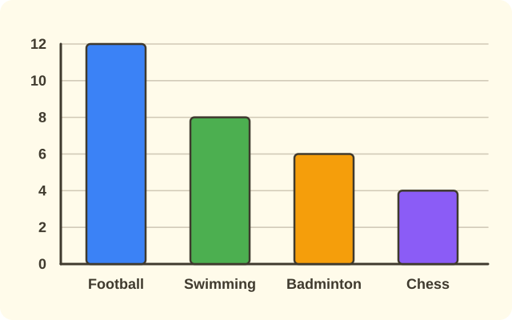
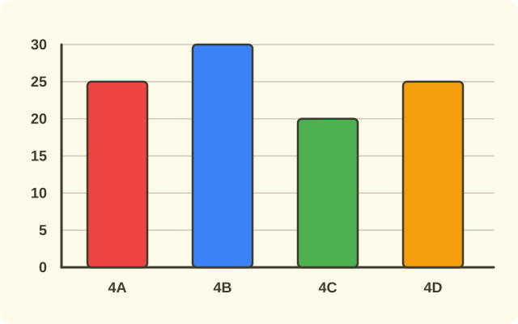

:::goals
- Know the parts of a bar chart: bars, the horizontal axis and the vertical axis.
- Read the value of each bar and find the tallest and shortest bar.
- Compare bars by subtracting, and work out a total and a mean from a chart.
:::

The class library records how many books children borrow each day of the week, and draws a bar chart. On which day did children borrow the most books? On which day the fewest?

You already know how to read a list of data. A bar chart lets you see that data as bars of different heights.

## Let's explore

Look at the chart below.

:::diagram Books borrowed each day of the week
alt: A bar chart with five bars for Monday to Friday, of heights 6, 10, 8, 12 and 4; the vertical axis shows 2, 4, up to 12
point P1 1,0 ""
point P2 2,0 ""
point P3 2,6 ""
point P4 1,6 ""
point P5 3,0 ""
point P6 4,0 ""
point P7 4,10 ""
point P8 3,10 ""
point P9 5,0 ""
point P10 6,0 ""
point P11 6,8 ""
point P12 5,8 ""
point P13 7,0 ""
point P14 8,0 ""
point P15 8,12 ""
point P16 7,12 ""
point P17 9,0 ""
point P18 10,0 ""
point P19 10,4 ""
point P20 9,4 ""
polygon P1 P2 P3 P4
polygon P5 P6 P7 P8
polygon P9 P10 P11 P12
polygon P13 P14 P15 P16
polygon P17 P18 P19 P20
grid
label 1.5,-0.8 "Mon"
label 1.5,6.6 "6"
label 3.5,-0.8 "Tue"
label 3.5,10.6 "10"
label 5.5,-0.8 "Wed"
label 5.5,8.6 "8"
label 7.5,-0.8 "Thu"
label 7.5,12.6 "12"
label 9.5,-0.8 "Fri"
label 9.5,4.6 "4"
label 0.3,2 "2"
label 0.3,4 "4"
label 0.3,6 "6"
label 0.3,8 "8"
label 0.3,10 "10"
label 0.3,12 "12"
:::

- The bars stand side by side. Each bar is one day: Mon is Monday, Tue is Tuesday, and so on.
- On top of each bar is the number of books. The Monday bar shows $6$.
- The left edge shows the numbers $2, 4, 6, \ldots, 12$. These count the books.

The taller the bar, the more books. The Thursday bar is the tallest and shows $12$. The Friday bar is the shortest and shows $4$. So Thursday had the most borrowed and Friday the fewest.

:::definition Bar chart
A **bar chart** uses bars of equal width to show data. The **horizontal axis** shows the things we compare (for example the days). The **vertical axis** shows the data values. The taller the bar, the bigger the value.
:::

To read a bar chart, do three things: read the title and the two axes to see what the chart is about; check how many units each mark stands for; then look at the top of a bar to read its value.

## Examples

We start by reading the value of each bar.

:::example Reading the chart
Use the chart above. a) How many books were borrowed on Tuesday? b) Which day had the most, and how many books? c) Which day had the fewest?

**Solution.** We look at the number on top of each bar:

a) The Tuesday bar shows $10$, so $10$ books were borrowed.

b) The tallest bar is Thursday, showing $12$. So Thursday had the most, $12$ books.

c) The shortest bar is Friday. So Friday had the fewest, $4$ books.
:::

Now we compare two bars by subtracting.

:::example Comparing two bars
How many more books were borrowed on Thursday than on Monday?

**Solution.** Thursday had $12$ books and Monday had $6$ books. To find how many more, subtract the smaller number from the larger:
$$12-6=6\ \text{(books)}.$$
So $6$ more books were borrowed on Thursday than on Monday.
:::

We can also add the bars and find the mean.

:::example The whole week
How many books were borrowed in the whole week? On average, how many books were borrowed each day?

**Solution.** Add the books for all five days:
$$6+10+8+12+4=40\ \text{(books)}.$$
The mean per day is the total divided by the number of days:
$$40\div5=8\ \text{(books)}.$$
So $40$ books were borrowed in the week, and $8$ a day on average.
:::

Finally, we find the bars that fit a condition.

:::example More than $7$ books
On which days were more than $7$ books borrowed?

**Solution.** We compare the number on top of each bar with $7$: Monday $6<7$; Tuesday $10>7$; Wednesday $8>7$; Thursday $12>7$; Friday $4<7$.

So more than $7$ books were borrowed on Tuesday, Wednesday and Thursday.
:::

:::warning Mistakes to watch out for
- **Reading the wrong bar.** Wrong: looking at the Wednesday bar but reading the Tuesday number. Why it is wrong: each bar belongs to exactly one day. Right: read the number on top of that day's bar.
- **Adding instead of subtracting to compare.** Wrong: Thursday has $12+6=18$ more than Monday. Why it is wrong: "how many more" is the difference of two numbers. Right: $12-6=6$.
- **Missing a bar when finding a total.** Wrong: $6+10+8+12=36$. Why it is wrong: the Friday bar was left out. Right: $6+10+8+12+4=40$.
:::

## Key terms

:::terms
- bar chart | biểu đồ cột
- bar | cột
- horizontal axis | trục ngang
- vertical axis | trục dọc
- scale mark | vạch chia
- compare | so sánh
- data value | số liệu
:::

## Summary

- A bar chart uses bars to show data; a taller bar means a bigger value.
- The horizontal axis shows the things compared; the vertical axis shows the values.
- Read the value on top of each bar.
- To find how many more: subtract the smaller from the larger.
- Total: add all the bars; mean: divide the total by the number of bars.

## Practice

The exercises below use the chart in the lesson (books borrowed: Mon $6$, Tue $10$, Wed $8$, Thu $12$, Fri $4$) or describe a chart in words. Try each one yourself first, then open the solution.

:::exercise
On which day were the fewest books borrowed, and how many?

::hint
**What you need:** the shortest bar is the smallest value.

**Steps:**
1. Find the shortest bar.
2. Read the number on top of it.

::solution
The shortest bar is Friday, showing $4$.

**Answer.** Friday, $4$ books.
:::

:::exercise
How many more books were borrowed on Tuesday than on Friday?

::hint
**What you need:** to find how many more, subtract the smaller from the larger.

**Steps:**
1. Read the number of books on the two days.
2. Subtract the smaller from the larger.

::solution
$10-4=6$ (books).

**Answer.** $6$ books.
:::

:::exercise
Remember the last lesson: write the list of data for the chart in order from Monday to Friday, then put it in order from smallest to largest.

::hint
**What you need:** write the list in the order given; when putting in order, write every number.

**Steps:**
1. Read the number on top of each bar from left to right.
2. Put the numbers in order from smallest to largest.

::solution
The list is $6, 10, 8, 12, 4$. In order from smallest to largest: $4, 6, 8, 10, 12$.

**Answer.** $6, 10, 8, 12, 4$; in order: $4, 6, 8, 10, 12$.
:::

:::exercise
On which day were exactly twice as many books borrowed as on Friday?

::hint
**What you need:** twice as many means multiply by $2$.

**Steps:**
1. Work out Friday's number times $2$.
2. Find the day with that number.

::solution
Friday had $4$ books, and twice that is $4\times2=8$ books. The bar showing $8$ is Wednesday.

**Answer.** Wednesday.
:::

:::exercise
A bar chart shows how many children like each sport: the football bar is $12$ tall, swimming $8$, badminton $6$ and chess $4$. To find how many children were asked in all, which calculation do we do? Why? Work it out.

::hint
**What you need:** each bar is the number of children for one sport; each child chooses only one sport.

**Steps:**
1. Ask: does "in all" mean putting together or comparing?
2. Add the numbers on top of the bars.

::solution
We add, because the total number of children is the children for all four sports put together: $12+8+6+4=30$ (children).

**Answer.** Addition; $30$ children.
:::

:::exercise
Ha said: "Thursday had $12$ books and Friday had $4$ books, so Thursday had $12+4=16$ more books than Friday." Where did Ha go wrong? Do it correctly.

::hint
**What you need:** "how many more" is the difference of two numbers.

**Steps:**
1. Look at which operation Ha used.
2. Redo it with the correct operation.

::solution
Ha added, but we must subtract: $12-4=8$ (books).

**Answer.** $8$ books.
:::

:::exercise
A bar chart shows the trees planted by four classes, with each mark standing for $5$ trees: class $4$A is $5$ marks tall, class $4$B is $6$ marks, class $4$C is $4$ marks and class $4$D is $5$ marks.
a) How many trees did each class plant?
b) How many more trees did the best class plant than the lowest?
c) On average, how many trees did each class plant?

::hint
**What you need:** the number of trees is the number of marks times $5$.

**Steps:**
1. Multiply each bar's marks by $5$.
2. Subtract the least from the greatest.
3. Add the four numbers and divide by $4$.

::solution
a) $4$A: $5\times5=25$; $4$B: $6\times5=30$; $4$C: $4\times5=20$; $4$D: $25$ (trees). b) $30-20=10$ (trees). c) $(25+30+20+25)\div4=100\div4=25$ (trees).

**Answer.** a) $25$, $30$, $20$, $25$ trees; b) $10$ trees; c) $25$ trees.
:::

:::exercise Challenge
A chart has three bars A, B and C. Bar C is $5$ tall. Bar B is $3$ taller than bar C. Bar A is $4$ taller than bar B. Find the height of each bar and the total height of the three bars.

::hint
**What you need:** taller by some amount means add that amount.

**Steps:**
1. Find bar B from bar C.
2. Find bar A from bar B.
3. Add the three bars.

::solution
Bar B: $5+3=8$. Bar A: $8+4=12$. Total: $12+8+5=25$.

**Check.** $12-8=4$ and $8-5=3$. Correct.

**Answer.** A is $12$, B is $8$, C is $5$; total $25$.
:::

## Mini test

These questions use the chart of books borrowed in the lesson (Mon $6$, Tue $10$, Wed $8$, Thu $12$, Fri $4$).

:::quiz
::mc
The tallest bar in a bar chart shows
A. the least value.
B. the greatest value.
C. the first value.
D. the total of the values.
::key B
The taller the bar, the greater the value. Option C is the mistake of choosing the left-most bar.

::mc
How many books were borrowed on Wednesday?
A. $6$ books.
B. $10$ books.
C. $8$ books.
D. $12$ books.
::key C
The Wednesday bar shows $8$. Option B is the number for Tuesday, next to it.

::mc
How many more books were borrowed on Thursday than on Monday?
A. $18$ books.
B. $8$ books.
C. $12$ books.
D. $6$ books.
::key D
$12-6=6$. Option A adds $12+6$, using addition by mistake.

::mc
How many books were borrowed in the whole week?
A. $40$ books.
B. $8$ books.
C. $12$ books.
D. $36$ books.
::key A
$6+10+8+12+4=40$. Option D leaves out the Friday bar, and B is the mean per day.

::tf
Look at the chart of books borrowed.
a) $10$ books were borrowed on Tuesday.
b) Friday had the fewest books borrowed.
c) There were $3$ days with more than $8$ books borrowed.
d) In the four days from Monday to Thursday, $36$ books were borrowed.
::key T T F T
a) True. b) True: the Friday bar is the shortest. c) False: only Tuesday ($10$) and Thursday ($12$) are more than $8$, which is $2$ days. d) True: $6+10+8+12=36$.

::sa
How many more books were borrowed on Tuesday than on Friday?
::key 6
$10-4=6$.

::sa
On average, how many books were borrowed each day of the week?
::key 8
$(6+10+8+12+4)\div5=40\div5=8$.
:::
