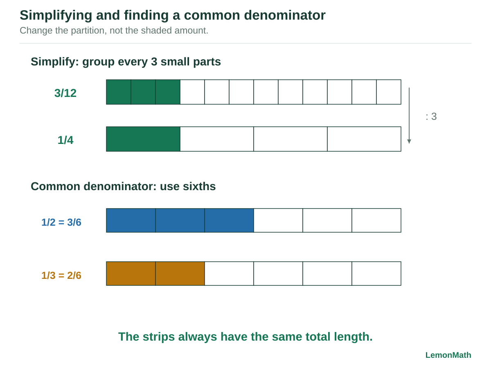

:::goals
- Know the basic property of fractions: multiplying or dividing the numerator and denominator by the same number gives an equivalent fraction.
- Simplify a fraction to its simplest form and recognise a fraction in its simplest form.
- Write two fractions over a common denominator, including when one denominator divides by the other.
- Solve word problems by simplifying or by using a common denominator.
:::

Mum cuts a cake into $12$ equal pieces. An eats $3$ pieces, which is $\dfrac{3}{12}$ of the cake. Binh eats $\dfrac{1}{4}$ of the cake.

Did they eat the same amount, or did one of them eat more? The two fractions have different numerators and denominators, so it is hard to see at once. This lesson teaches two techniques for comparing and working with fractions like these: **simplifying** and **writing over a common denominator**.

## Simplifying fractions

### Let's explore

Cut the cake into $12$ equal pieces; An eats $3$ pieces. If you join every $3$ neighbouring pieces into $1$ big piece, the cake has $12\div3=4$ big pieces and An eats $3\div3=1$ big piece. So:
$$\dfrac{3}{12}=\dfrac{3\div3}{12\div3}=\dfrac{1}{4}.$$

Notice: dividing the numerator and denominator by the same number $3$ does not change the value of the fraction. The other way round, multiplying the numerator and denominator by the same number does not change the value either: $\dfrac{1}{4}=\dfrac{1\times3}{4\times3}=\dfrac{3}{12}$.

:::theorem The basic property of fractions
When the numerator and denominator of a fraction are both multiplied by the same natural number other than $0$, we get a fraction equal to the original.

When the numerator and denominator of a fraction are both divided by the same natural number other than $0$ (both being divisible by that number), we get a fraction equal to the original.
:::

Why is it true? Multiplying the numerator and denominator by $3$ means cutting every piece of the cake into $3$ smaller pieces and taking $3$ times as many small pieces. The amount of cake taken stays the same.

Dividing the numerator and denominator of a fraction by a number greater than $1$ to get a simpler fraction is called **simplifying the fraction**.

:::definition A fraction in its simplest form
A fraction whose numerator and denominator are not both divisible by any natural number greater than $1$ is said to be **in its simplest form**. A fraction in its simplest form cannot be simplified any further.
:::

To simplify, find a number greater than $1$ that divides both the numerator and the denominator, then divide both by it. Use the divisibility tests for $2$, $3$, $5$ and $9$ that you have learned to find such a number. Repeat until the fraction is in its simplest form.

**Connection.** This lesson uses times tables, division and the divisibility tests. It prepares you for comparing fractions and for adding and subtracting fractions.

:::example Simplifying step by step
Simplify the fraction $\dfrac{18}{24}$ to its simplest form.

**Solution.** Both $18$ and $24$ are divisible by $2$. Divide the numerator and denominator by $2$:
$$\dfrac{18}{24}=\dfrac{18\div2}{24\div2}=\dfrac{9}{12}.$$
Both $9$ and $12$ are divisible by $3$. Divide both by $3$:
$$\dfrac{9}{12}=\dfrac{9\div3}{12\div3}=\dfrac{3}{4}.$$
The numerator $3$ and the denominator $4$ are not both divisible by any number greater than $1$, so $\dfrac{3}{4}$ is in its simplest form.

So $\dfrac{18}{24}=\dfrac{3}{4}$.
:::

Now let's check whether a fraction is already in its simplest form.

:::example Recognising a fraction in its simplest form
Which of the fractions $\dfrac{7}{15}$ and $\dfrac{12}{18}$ is in its simplest form?

**Solution.** For $\dfrac{7}{15}$: the number $7$ is divisible only by $1$ and $7$, and $15$ is not divisible by $7$. So $\dfrac{7}{15}$ cannot be simplified; it is in its simplest form.

For $\dfrac{12}{18}$: both $12$ and $18$ are divisible by $6$, so $\dfrac{12}{18}=\dfrac{2}{3}$. This fraction can be simplified, so it is not in its simplest form.

So $\dfrac{7}{15}$ is in its simplest form.
:::

When you find a large common divisor, you can simplify faster.

:::example Simplifying in one step
Simplify the fraction $\dfrac{45}{60}$ to its simplest form.

**Solution.** Both $45$ and $60$ are divisible by $15$. Divide the numerator and denominator by $15$:
$$\dfrac{45}{60}=\dfrac{45\div15}{60\div15}=\dfrac{3}{4}.$$
So $\dfrac{45}{60}=\dfrac{3}{4}$.
:::

## Finding a common denominator

### Let's explore

Look at the fractions $\dfrac{1}{2}$ and $\dfrac{1}{3}$, which have different denominators. To work with them, change both to the same denominator. The number $6$ is divisible by both $2$ and $3$, so:
$$\dfrac{1}{2}=\dfrac{1\times3}{2\times3}=\dfrac{3}{6},\qquad \dfrac{1}{3}=\dfrac{1\times2}{3\times2}=\dfrac{2}{6}.$$

The fractions $\dfrac{3}{6}$ and $\dfrac{2}{6}$ have the same denominator $6$ and are equal to the original fractions. Doing this is called **writing the fractions over a common denominator**, and $6$ is the **common denominator**.

:::theorem Writing two fractions over a common denominator
To write two fractions $\dfrac{a}{b}$ and $\dfrac{c}{d}$ over a common denominator:
1. Multiply the numerator and denominator of the first fraction by the denominator of the second: $\dfrac{a\times d}{b\times d}$.
2. Multiply the numerator and denominator of the second fraction by the denominator of the first: $\dfrac{c\times b}{d\times b}$.

If the denominator of one fraction is divisible by the denominator of the other, we only need to change one fraction and keep the other as it is.
:::

Why does this work? By the basic property, multiplying the numerator and denominator by the same number does not change the value of the fraction. The method above makes both denominators equal to $b\times d$.

Let's write two fractions with different denominators, neither dividing the other, over a common denominator.

:::example Writing two fractions over a common denominator
Write the fractions $\dfrac{2}{3}$ and $\dfrac{3}{5}$ over a common denominator.

**Solution.** We take the common denominator $3\times5=15$:
$$\dfrac{2}{3}=\dfrac{2\times5}{3\times5}=\dfrac{10}{15},\qquad \dfrac{3}{5}=\dfrac{3\times3}{5\times3}=\dfrac{9}{15}.$$
So $\dfrac{2}{3}$ and $\dfrac{3}{5}$ become $\dfrac{10}{15}$ and $\dfrac{9}{15}$.
:::

When one denominator divides by the other, the work is simpler.

:::example One denominator divisible by the other
Write the fractions $\dfrac{5}{6}$ and $\dfrac{1}{3}$ over a common denominator.

**Solution.** The denominator $6$ is divisible by $3$, so we take the common denominator $6$ and keep $\dfrac{5}{6}$. Change $\dfrac{1}{3}$:
$$\dfrac{1}{3}=\dfrac{1\times2}{3\times2}=\dfrac{2}{6}.$$
So the two fractions are $\dfrac{5}{6}$ and $\dfrac{2}{6}$.
:::

Sometimes there is a common denominator smaller than the product of the two denominators.

:::example Choosing a smaller common denominator
Write the fractions $\dfrac{3}{4}$ and $\dfrac{5}{6}$ over a common denominator.

**Solution.** By the method above, the common denominator is $4\times6=24$:
$$\dfrac{3}{4}=\dfrac{3\times6}{4\times6}=\dfrac{18}{24},\qquad \dfrac{5}{6}=\dfrac{5\times4}{6\times4}=\dfrac{20}{24}.$$
But $12$ is divisible by both $4$ and $6$, so we can also use the smaller common denominator $12$:
$$\dfrac{3}{4}=\dfrac{3\times3}{4\times3}=\dfrac{9}{12},\qquad \dfrac{5}{6}=\dfrac{5\times2}{6\times2}=\dfrac{10}{12}.$$
So we can write them as $\dfrac{9}{12}$ and $\dfrac{10}{12}$; smaller numbers are easier to work with.
:::

Now back to An's and Binh's cake.

:::example Who ate more?
An ate $\dfrac{3}{12}$ of the cake and Binh ate $\dfrac{1}{4}$ of the cake. Did they eat the same amount?

**Understand.** An ate $\dfrac{3}{12}$ of the cake and Binh ate $\dfrac{1}{4}$. We need to see whether the two fractions are equal.

**Plan.** Simplify $\dfrac{3}{12}$ and compare with $\dfrac{1}{4}$, or write both over a common denominator and compare the numerators.

**Solve.** Method 1 (simplifying): $\dfrac{3}{12}=\dfrac{3\div3}{12\div3}=\dfrac{1}{4}$.

Method 2 (common denominator): since $12$ is divisible by $4$, keep $\dfrac{3}{12}$ and change $\dfrac{1}{4}=\dfrac{1\times3}{4\times3}=\dfrac{3}{12}$.

Both methods give $\dfrac{3}{12}=\dfrac{1}{4}$.

**Answer:** they ate the same amount.

**Look back.** Two methods give the same conclusion, so we trust the result. What if Binh had eaten $\dfrac{1}{3}$ of the cake? Since $\dfrac{1}{3}=\dfrac{4}{12}$ and $4>3$, Binh would have eaten more than An.
:::

:::warning Mistakes to watch out for
- **Adding the same number to the numerator and denominator.** Wrong: $\dfrac{3}{5}=\dfrac{4}{6}$. Why it is wrong: the basic property only allows **multiplying** or **dividing** both numbers, not adding. Right: $\dfrac{3}{5}=\dfrac{6}{10}$ (multiply both by $2$).
- **Not simplifying all the way.** Wrong: $\dfrac{12}{18}=\dfrac{6}{9}$ and stop. Why it is wrong: $6$ and $9$ are still both divisible by $3$. Right: $\dfrac{12}{18}=\dfrac{2}{3}$.
- **Multiplying only the denominator.** Wrong: writing $\dfrac{2}{3}$ and $\dfrac{3}{5}$ as $\dfrac{2}{15}$ and $\dfrac{3}{15}$. Why it is wrong: the numerator and denominator must both be multiplied for the value to stay the same. Right: $\dfrac{10}{15}$ and $\dfrac{9}{15}$.
:::

## Key terms

:::terms
- fraction | phân số
- numerator | tử số
- denominator | mẫu số
- equivalent fractions | phân số bằng nhau
- simplify a fraction | rút gọn phân số
- fraction in its simplest form | phân số tối giản
- write over a common denominator | quy đồng mẫu số
- common denominator | mẫu số chung
- divisible | chia hết
:::

## Summary

- Multiplying or dividing the numerator and denominator by the same number other than $0$ gives an equivalent fraction.
- To **simplify** a fraction: divide the numerator and denominator by a common divisor greater than $1$, and continue until the fraction is in its **simplest form**.
- To write two fractions over a **common denominator**: multiply the numerator and denominator of each fraction by the denominator of the other.
- If one denominator is divisible by the other, only one fraction needs changing.
- Two fractions are equal when simplifying or using a common denominator gives the same result.

## Practice

Each exercise comes with what you need and how to start. Try it yourself first, then open the solution.

:::exercise
Simplify the fraction $\dfrac{10}{25}$.

::hint
**What you need:** divide the numerator and denominator by a common divisor greater than $1$.

**Steps:**
1. Which number divides both $10$ and $25$?
2. Divide both by it and check whether the fraction is in its simplest form.

::solution
To simplify a fraction, we look for a whole number greater than $1$ that divides both the numerator and the denominator. Both $10$ and $25$ are divisible by $5$.

Dividing the numerator and the denominator by $5$, we get
$$\frac{10}{25}=\frac{10\div5}{25\div5}=\frac{2}{5}.$$

For the fraction $\dfrac{2}{5}$, the numbers $2$ and $5$ have no common divisor greater than $1$, so it cannot be simplified further.

So $\dfrac{10}{25}$ simplifies to $\dfrac{2}{5}$.

**Answer.** $\dfrac{2}{5}$.
:::

:::exercise
Simplify the fraction $\dfrac{36}{48}$ to its simplest form.

::hint
**What you need:** you can simplify several times, or divide once by a large common divisor.

**Steps:**
1. Both $36$ and $48$ are divisible by $12$.
2. Divide both by $12$.

::solution
We look for the greatest number that divides both $36$ and $48$. We have $36=12\times3$ and $48=12\times4$, so both numbers are divisible by $12$.

Dividing the numerator and the denominator by $12$, we get
$$\frac{36}{48}=\frac{36\div12}{48\div12}=\frac{3}{4}.$$

For the fraction $\dfrac{3}{4}$, the numbers $3$ and $4$ have no common divisor greater than $1$, so it is in its simplest form.

So $\dfrac{36}{48}$ in its simplest form is $\dfrac{3}{4}$.

**Answer.** $\dfrac{3}{4}$.
:::

:::exercise
Which of the fractions $\dfrac{4}{9}$, $\dfrac{6}{14}$, $\dfrac{15}{22}$, $\dfrac{18}{27}$ are in their simplest form?

::hint
**What you need:** a fraction in its simplest form cannot be simplified.

**Steps:**
1. For each fraction, see whether the numerator and denominator are both divisible by a number greater than $1$.
2. Try simplifying the even fractions and those whose digit sums are divisible by $3$ or $9$.

::solution
A fraction is in its simplest form when its numerator and denominator have no common divisor greater than $1$. We check each fraction.

- $\dfrac{4}{9}$: $4$ and $9$ have no common divisor greater than $1$, so it is in its simplest form.
- $\dfrac{6}{14}$: both $6$ and $14$ are divisible by $2$, so $\dfrac{6}{14}=\dfrac{6\div2}{14\div2}=\dfrac{3}{7}$; it can be simplified.
- $\dfrac{15}{22}$: $15$ and $22$ have no common divisor greater than $1$, so it is in its simplest form.
- $\dfrac{18}{27}$: both $18$ and $27$ are divisible by $9$, so $\dfrac{18}{27}=\dfrac{18\div9}{27\div9}=\dfrac{2}{3}$; it can be simplified.

So the fractions in their simplest form are $\dfrac{4}{9}$ and $\dfrac{15}{22}$.

**Answer.** $\dfrac{4}{9}$ and $\dfrac{15}{22}$.
:::

:::exercise
Simplify the fraction $\dfrac{120}{180}$.

::hint
**What you need:** you can divide both by $10$ first.

**Steps:**
1. Divide the numerator and denominator by $10$.
2. Keep simplifying until the fraction is in its simplest form.

::solution
Both the numerator and the denominator end in the digit $0$, so both are divisible by $10$. Dividing both by $10$, we get
$$\frac{120}{180}=\frac{12}{18}.$$

Both $12$ and $18$ are divisible by $6$. Dividing both by $6$, we get
$$\frac{12}{18}=\frac{12\div6}{18\div6}=\frac{2}{3}.$$

For the fraction $\dfrac{2}{3}$, the numbers $2$ and $3$ have no common divisor greater than $1$, so it is in its simplest form.

So $\dfrac{120}{180}$ simplifies to $\dfrac{2}{3}$.

**Answer.** $\dfrac{2}{3}$.
:::

:::exercise
Write the fractions $\dfrac{3}{4}$ and $\dfrac{2}{7}$ over a common denominator.

::hint
**What you need:** multiply the numerator and denominator of each fraction by the denominator of the other.

**Steps:**
1. The common denominator is $4\times7$.
2. Multiply the numerator and denominator of $\dfrac{3}{4}$ by $7$, and those of $\dfrac{2}{7}$ by $4$.

::solution
To write two fractions over a common denominator, we choose a denominator that both denominators divide into. Here we choose the common denominator $4\times7=28$.

Multiply the numerator and the denominator of the first fraction by $7$ (the denominator of the second fraction):
$$\frac{3}{4}=\frac{3\times7}{4\times7}=\frac{21}{28}.$$

Multiply the numerator and the denominator of the second fraction by $4$ (the denominator of the first fraction):
$$\frac{2}{7}=\frac{2\times4}{7\times4}=\frac{8}{28}.$$

So over a common denominator, $\dfrac{3}{4}$ and $\dfrac{2}{7}$ become $\dfrac{21}{28}$ and $\dfrac{8}{28}$.

**Answer.** $\dfrac{21}{28}$ and $\dfrac{8}{28}$.
:::

:::exercise
Write the fractions $\dfrac{7}{12}$ and $\dfrac{5}{6}$ over a common denominator.

::hint
**What you need:** if one denominator is divisible by the other, change only one fraction.

**Steps:**
1. Is $12$ divisible by $6$?
2. Keep $\dfrac{7}{12}$ and change $\dfrac{5}{6}$.

::solution
We compare the two denominators $12$ and $6$. Since $12\div6=2$, the number $12$ is divisible by $6$, so we choose $12$ as the common denominator.

The fraction $\dfrac{7}{12}$ already has denominator $12$, so we keep it.

Multiplying the numerator and the denominator of $\dfrac{5}{6}$ by $2$, we get
$$\frac{5}{6}=\frac{5\times2}{6\times2}=\frac{10}{12}.$$

So over a common denominator, $\dfrac{7}{12}$ and $\dfrac{5}{6}$ become $\dfrac{7}{12}$ and $\dfrac{10}{12}$.

**Answer.** $\dfrac{7}{12}$ and $\dfrac{10}{12}$.
:::

:::exercise
A class has $40$ students, of whom $15$ like football. Write the fraction of the class who like football, then simplify it.

::hint
**What you need:** the fraction of the class has numerator the number who like football and denominator the number of students in the class.

**Steps:**
1. What do we know? What is asked?
2. Write the fraction $\dfrac{15}{40}$ and simplify it.

::solution
Solution

The class has $40$ students, of whom $15$ like football. The fraction of the class who like football is:
$$\frac{15}{40}.$$

Both $15$ and $40$ are divisible by $5$. Dividing the numerator and the denominator by $5$, we get:
$$\frac{15}{40}=\frac{15\div5}{40\div5}=\frac{3}{8}.$$

For the fraction $\dfrac{3}{8}$, the numbers $3$ and $8$ have no common divisor greater than $1$, so it is in its simplest form.

So the students who like football make up $\dfrac{15}{40}$ of the class, which simplifies to $\dfrac{3}{8}$.

**Answer.** $\dfrac{15}{40}=\dfrac{3}{8}$.
:::

:::exercise
A strip of paper is divided into $8$ equal parts and $6$ parts are coloured. Another strip of the same length is divided into $12$ equal parts. How many parts must be coloured to give a fraction equal to that of the first strip?

::hint
**What you need:** simplify $\dfrac{6}{8}$, then change it to denominator $12$.

**Steps:**
1. Simplify $\dfrac{6}{8}$.
2. Find the equal fraction with denominator $12$.

::solution
Solution

The fraction showing the coloured part of the first strip is $\dfrac{6}{8}$. We simplify it by dividing the numerator and the denominator by $2$:
$$\frac{6}{8}=\frac{6\div2}{8\div2}=\frac{3}{4}.$$

The second strip is divided into $12$ equal parts. Since $12=4\times3$, we multiply the numerator and the denominator of $\dfrac{3}{4}$ by $3$:
$$\frac{3}{4}=\frac{3\times3}{4\times3}=\frac{9}{12}.$$

So $9$ parts of the second strip must be coloured to give a fraction equal to that of the first strip.

**Answer.** $9$ parts must be coloured.
:::

:::exercise
Remember the lesson on multiplying and dividing by $10$, $100$, $1\,000$. Simplify the fraction $\dfrac{2\,400}{3\,600}$ to its simplest form.

::hint
**What you need:** dividing the numerator and denominator by $100$ removes two zeros from each number.

**Steps:**
1. Divide both by $100$.
2. Keep simplifying.

::solution
Both the numerator and the denominator end in two zeros. Dividing both by $100$, we get
$$\frac{2\,400}{3\,600}=\frac{24}{36}.$$

Both $24$ and $36$ are divisible by $12$. Dividing the numerator and the denominator by $12$, we get
$$\frac{24}{36}=\frac{24\div12}{36\div12}=\frac{2}{3}.$$

For the fraction $\dfrac{2}{3}$, the numbers $2$ and $3$ have no common divisor greater than $1$, so it is in its simplest form.

So $\dfrac{2\,400}{3\,600}$ in its simplest form is $\dfrac{2}{3}$.

**Answer.** $\dfrac{2}{3}$.
:::

:::exercise Challenge
Find the fraction equal to $\dfrac{3}{7}$ whose numerator and denominator add up to $50$.

::hint
**What you need:** a fraction equal to $\dfrac{3}{7}$ has the form $\dfrac{3\times k}{7\times k}$.

**Steps:**
1. The numerator and denominator add up to how many times $k$?
2. Find $k$, then find the fraction.

::solution
Solution

A fraction equal to $\dfrac{3}{7}$ has the form $\dfrac{3\times k}{7\times k}$, where $k$ is a whole number greater than $0$. The sum of the numerator and the denominator is:
$$3\times k+7\times k=10\times k.$$

By the problem, this sum is $50$, so $10\times k=50$. It follows that
$$k=50\div10=5.$$

The fraction we need is:
$$\frac{3\times5}{7\times5}=\frac{15}{35}.$$

*Check.* We have $15+35=50$ and $\dfrac{15}{35}=\dfrac{15\div5}{35\div5}=\dfrac{3}{7}$. The result is correct.

So the required fraction is $\dfrac{15}{35}$.

**Answer.** $\dfrac{15}{35}$.
:::

## Mini test

:::quiz
::mc TH
Simplifying $\dfrac{18}{24}$ to its simplest form gives
A. $\dfrac{3}{4}$.
B. $\dfrac{6}{8}$.
C. $\dfrac{9}{12}$.
D. $\dfrac{2}{3}$.
::key A
$\dfrac{18}{24}=\dfrac{18\div6}{24\div6}=\dfrac{3}{4}$. Options C and B can still be simplified; option D is not equal to $\dfrac{18}{24}$.

::mc NB
Which of these fractions is in its simplest form?
A. $\dfrac{6}{9}$.
B. $\dfrac{7}{15}$.
C. $\dfrac{12}{18}$.
D. $\dfrac{10}{15}$.
::key B
$7$ and $15$ have no common divisor greater than $1$. The other three can all be simplified (by $3$, $5$ and $6$).

::mc TH
Writing $\dfrac{2}{3}$ and $\dfrac{3}{5}$ over a common denominator gives
A. $\dfrac{2}{15}$ and $\dfrac{3}{15}$.
B. $\dfrac{6}{15}$ and $\dfrac{15}{15}$.
C. $\dfrac{10}{15}$ and $\dfrac{9}{15}$.
D. $\dfrac{10}{8}$ and $\dfrac{9}{8}$.
::key C
$\dfrac{2}{3}=\dfrac{2\times5}{3\times5}=\dfrac{10}{15}$ and $\dfrac{3}{5}=\dfrac{3\times3}{5\times3}=\dfrac{9}{15}$. Option A multiplies only the denominators.

::mc TH
Which fraction is equal to $\dfrac{3}{5}$?
A. $\dfrac{5}{3}$.
B. $\dfrac{4}{6}$.
C. $\dfrac{3}{10}$.
D. $\dfrac{12}{20}$.
::key D
$\dfrac{3}{5}=\dfrac{3\times4}{5\times4}=\dfrac{12}{20}$. Option B adds $1$ to both the numerator and denominator, which is wrong.

::tf TH TH TH NB
Look at the fraction $\dfrac{4}{6}$.
a) $\dfrac{4}{6}=\dfrac{2}{3}$.
b) $\dfrac{4}{6}$ is in its simplest form.
c) $\dfrac{4}{6}=\dfrac{8}{12}$.
d) Dividing the numerator and denominator of $\dfrac{4}{6}$ by $2$ gives $\dfrac{2}{3}$.
::key T F T T
a) True: divide both by $2$. b) False: $4$ and $6$ are both divisible by $2$. c) True: multiply both by $2$. d) True: $4\div2=2$ and $6\div2=3$.

::sa TH
Find $x$ if $\dfrac{3}{5}=\dfrac{x}{20}$.
::key 12
Since $20=5\times4$, $x=3\times4=12$.

::sa VD
Simplify $\dfrac{24}{36}$ to its simplest form, then work out the sum of the numerator and denominator of that fraction.
::key 5
$\dfrac{24}{36}=\dfrac{2}{3}$ and $2+3=5$.
:::
