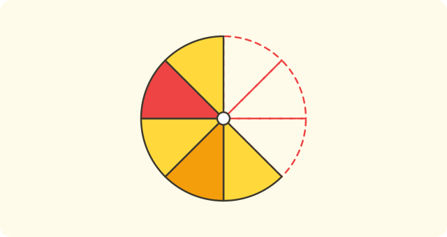
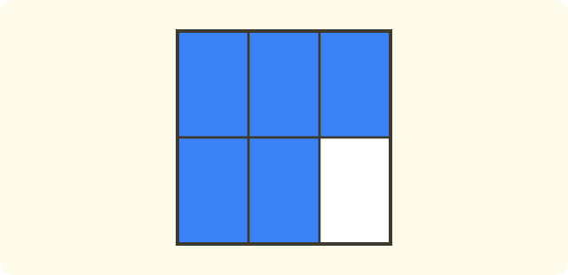
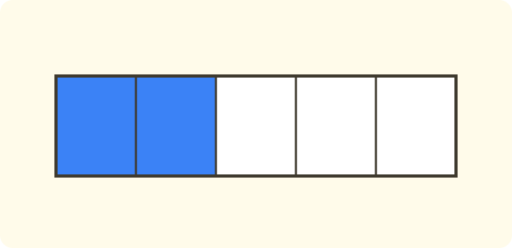
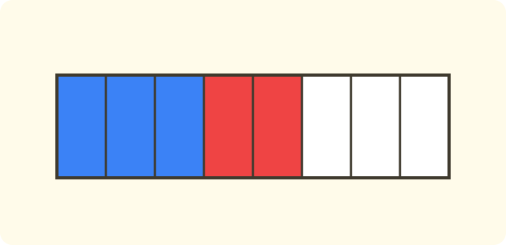

:::goals
- Understand that a fraction shows one or more of the equal parts of a whole.
- Read and write fractions, and name the numerator and denominator.
- Show fractions with shapes and on a number line.
:::

A pizza is cut into $4$ equal slices. Lan eats $1$ slice and Nam eats $3$ slices. What part of the pizza does each child eat? Can we write it as a number?

Whole numbers cannot write "one quarter" or "three quarters". This lesson shows you a new kind of number for writing parts of a whole.

## Let's explore

We go step by step.

- The pizza is cut into $4$ **equal** slices. The number $4$ tells us how many equal parts the pizza has.
- Lan eats $1$ slice. We write the part Lan eats as $\dfrac{1}{4}$, read "one quarter".
- Nam eats $3$ slices. We write $\dfrac{3}{4}$, read "three quarters".
- Together they eat all $4$ slices, which is the whole pizza. We write $\dfrac{4}{4}=1$.

We can also put fractions on a number line. The stretch from $0$ to $1$ is cut into $4$ equal parts, and each part is $\dfrac{1}{4}$.

:::graph A number line: the stretch from 0 to 1 cut into 4 equal parts
alt: A number line from 0 to 1 cut into 4 equal parts, with the points 0, 1/4, 2/4, 3/4 and 1 marked
x: -0.1..1.1
y: -0.15..0.15
segment: (0, 0) (1, 0)
point: (0, 0) "0" below
point: (0.25, 0) "1/4" below
point: (0.5, 0) "2/4" below
point: (0.75, 0) "3/4" below
point: (1, 0) "1" below
:::

:::definition Fraction
Cut a whole into $b$ equal parts and take $a$ of them. The part taken is written $\dfrac{a}{b}$ and is called a **fraction**.

The number $a$ on top is the **numerator**. The number $b$ underneath is the **denominator**. The denominator is never $0$.
:::

The denominator tells us how many equal parts the whole is cut into. The numerator tells us how many parts we take.

## Examples

We start by writing a fraction for a shape.

:::example Writing a fraction from a picture
A cake is cut into $8$ equal pieces. Mai eats $3$ pieces. Write the fraction that shows the part of the cake Mai ate.

**Solution.** The whole is cut into $8$ equal parts, so the denominator is $8$. Mai takes $3$ parts, so the numerator is $3$:
$$\frac{3}{8}.$$
So Mai ate $\dfrac{3}{8}$ of the cake.
:::

Now you read a fraction and name its numerator and denominator.

:::example Reading a fraction
Read the fraction $\dfrac{5}{6}$, then name its numerator and denominator. Write the fraction "seven ninths".

**Solution.** The fraction $\dfrac{5}{6}$ is read "five sixths". The numerator is $5$ (on top) and the denominator is $6$ (underneath). The fraction "seven ninths" has numerator $7$ and denominator $9$:
$$\frac{7}{9}.$$
:::

We can also write a fraction for the part that is left.

:::example The part left over
A square is cut into $6$ equal parts and $5$ parts are coloured in. Write the fraction for the coloured part and the fraction for the part that is not coloured.

**Solution.** The denominator stays $6$ because the whole is cut into $6$ parts. The coloured part is $5$ parts, and the part not coloured is $6-5=1$ part:
$$\frac{5}{6}\ \text{(coloured)},\qquad \frac{1}{6}\ \text{(not coloured)}.$$
**Check.** $5$ parts and $1$ part make $6$ parts, the whole square: $\dfrac{5}{6}$ and $\dfrac{1}{6}$ together make the whole.
:::

Finally, we mark a fraction on a number line.

:::example A fraction on a number line
On a number line, the stretch from $0$ to $1$ is cut into $4$ equal parts. Which point shows $\dfrac{3}{4}$?

**Solution.** The denominator $4$ tells us to cut the stretch into $4$ parts. From $0$ we move through $3$ parts, passing $\dfrac{1}{4}$, $\dfrac{2}{4}$, $\dfrac{3}{4}$. The third point after $0$ shows $\dfrac{3}{4}$, which is one part before the point $1$.
:::

:::warning Mistakes to watch out for
- **Parts that are not equal.** Wrong: cutting a cake into $4$ pieces of different sizes and calling each piece $\dfrac{1}{4}$. Why it is wrong: a fraction works only when the parts are equal. Right: cut it into $4$ equal pieces.
- **Writing the numerator and denominator the wrong way round.** Wrong: $3$ parts eaten out of $4$ written as $\dfrac{4}{3}$. Why it is wrong: the denominator is the number of parts in the whole. Right: $\dfrac{3}{4}$.
- **A denominator of $0$.** Wrong: $\dfrac{5}{0}$. Why it is wrong: we cannot cut a whole into $0$ parts. Right: the denominator is a number that is not $0$.
:::

## Key terms

:::terms
- fraction | phân số
- numerator | tử số
- denominator | mẫu số
- equal parts | phần bằng nhau
- one quarter | một phần tư
- number line | trục số
- whole | cái nguyên
:::

## Summary

- The fraction $\dfrac{a}{b}$: a whole cut into $b$ equal parts, with $a$ parts taken.
- The numerator $a$ is on top and the denominator $b$ underneath; the denominator is not $0$.
- The parts must be equal.
- Example: $\dfrac{3}{4}$ is read "three quarters".
- A fraction can be shown with a shape or as a point on a number line.

## Practice

Each exercise comes with what you need and how to start. Try it yourself first, then open the solution.

:::exercise
A rectangle is cut into $5$ equal parts and $2$ parts are coloured in. Write the fraction for the coloured part.

::hint
**What you need:** the denominator is the number of equal parts and the numerator is the number of coloured parts.

**Steps:**
1. What do we know? What is asked?
2. Write the numerator and the denominator.

::solution
Cut into $5$ parts with $2$ coloured, so the fraction is $\dfrac{2}{5}$.

**Answer.** $\dfrac{2}{5}$.
:::

:::exercise
Write these fractions: a) four sevenths; b) two fifths; c) eleven twelfths.

::hint
**What you need:** when you read "a over b", write $\dfrac{a}{b}$.

**Steps:**
1. The first number you say is the numerator.
2. The number in the name of the part is the denominator.

::solution
a) $\dfrac{4}{7}$; b) $\dfrac{2}{5}$; c) $\dfrac{11}{12}$.

**Answer.** $\dfrac{4}{7}$, $\dfrac{2}{5}$, $\dfrac{11}{12}$.
:::

:::exercise
Remember the last lesson (how many times an event happens): a coin is tossed $10$ times and heads comes up $6$ times. Write the fraction showing the heads out of all the tosses.

::hint
**What you need:** the number of tosses is the denominator and the number of heads is the numerator.

**Steps:**
1. How many tosses were there?
2. How many heads were there?

::solution
There were $6$ heads in $10$ tosses, so the fraction is $\dfrac{6}{10}$.

**Answer.** $\dfrac{6}{10}$.
:::

:::exercise
Read the fractions $\dfrac{7}{10}$ and $\dfrac{3}{8}$, then name the numerator and the denominator of each.

::hint
**What you need:** the numerator is on top and the denominator is underneath.

**Steps:**
1. Say the numerator, then the name of the part.
2. Point to each number.

::solution
$\dfrac{7}{10}$ is "seven tenths": numerator $7$, denominator $10$. $\dfrac{3}{8}$ is "three eighths": numerator $3$, denominator $8$.

**Answer.** See the solution.
:::

:::exercise
A cake is cut into $4$ pieces of different sizes and Lan eats $1$ piece. Can we say Lan ate $\dfrac{1}{4}$ of the cake? Why?

::hint
**What you need:** a fraction works only when the parts are equal.

**Steps:**
1. Are the parts equal?
2. Compare with the meaning of a fraction.

::solution
No. The parts are not equal, so the piece Lan ate is not necessarily a quarter of the cake.

**Answer.** No, because the parts are not equal.
:::

:::exercise
Nam wrote: "The cake is cut into $4$ parts and $3$ are eaten, so the fraction is $\dfrac{4}{3}$." Where did Nam go wrong? Write it correctly.

::hint
**What you need:** the denominator is the number of equal parts in the whole.

**Steps:**
1. How many parts does the whole cake have?
2. How many parts were eaten?

::solution
Nam wrote the numerator and denominator the wrong way round. The whole cake has $4$ parts so the denominator is $4$, and $3$ parts were eaten so the numerator is $3$: $\dfrac{3}{4}$.

**Answer.** $\dfrac{3}{4}$.
:::

:::exercise
A bar of chocolate has $12$ equal squares. Mai eats $5$ squares and Nam eats $4$ squares.
a) Write the fraction for the part Mai ate.
b) Write the fraction for the part Nam ate.
c) Write the fraction for the part left.

::hint
**What you need:** the denominator is $12$; the numerator is the number of squares.

**Steps:**
1. Write a) and b).
2. Find how many squares are left, then write the fraction.

::solution
a) $\dfrac{5}{12}$. b) $\dfrac{4}{12}$. c) The squares left are $12-5-4=3$, so $\dfrac{3}{12}$.

**Answer.** a) $\dfrac{5}{12}$; b) $\dfrac{4}{12}$; c) $\dfrac{3}{12}$.
:::

:::exercise Challenge
A paper strip is cut into $8$ equal parts. You colour $3$ parts blue and $2$ parts red, and leave the rest white. Write the fraction for each colour and the fraction for the part that is coloured (both colours together).

::hint
**What you need:** the denominator is always $8$; find the white parts by subtracting.

**Steps:**
1. Write the fractions for blue and red.
2. Find the white parts: $8-3-2$.
3. Find the coloured parts: $3+2$.

::solution
Blue: $\dfrac{3}{8}$; red: $\dfrac{2}{8}$; white: $8-3-2=3$ parts, so $\dfrac{3}{8}$. The coloured part is $3+2=5$ parts, which is $\dfrac{5}{8}$.

**Check.** $3+2+3=8$ parts. Correct.

**Answer.** Blue $\dfrac{3}{8}$, red $\dfrac{2}{8}$, white $\dfrac{3}{8}$; coloured $\dfrac{5}{8}$.
:::

## Mini test

:::quiz
::mc
The denominator of the fraction $\dfrac{3}{5}$ is
A. $5$.
B. $3$.
C. $8$.
D. $15$.
::key A
The denominator is the number underneath, $5$. Option B is the numerator, and C is the sum of the two numbers.

::mc
A cake is cut into $6$ equal pieces and $1$ piece is eaten. The fraction for the part eaten is
A. $\dfrac{6}{1}$.
B. $\dfrac{1}{6}$.
C. $\dfrac{1}{5}$.
D. $\dfrac{5}{6}$.
::key B
The whole cake has $6$ pieces and $1$ is eaten, so $\dfrac{1}{6}$. Option A is the wrong way round, and D is the part not eaten.

::mc
The fraction "seven tenths" is written
A. $\dfrac{10}{7}$.
B. $7+10$.
C. $\dfrac{7}{10}$.
D. $17$.
::key C
Numerator $7$, denominator $10$. Option A swaps the numerator and denominator.

::mc
A shape is cut into $8$ equal parts and $5$ parts are coloured. The fraction for the part not coloured is
A. $\dfrac{5}{8}$.
B. $\dfrac{3}{5}$.
C. $\dfrac{8}{3}$.
D. $\dfrac{3}{8}$.
::key D
The part not coloured is $8-5=3$ parts, so $\dfrac{3}{8}$. Option A is the coloured part.

::tf
Look at the fraction $\dfrac{5}{9}$.
a) The numerator is $5$.
b) The denominator is $9$.
c) It is read "nine fifths".
d) It can show $5$ parts of a shape cut into $9$ equal parts.
::key T T F T
a) True. b) True. c) False: it is read "five ninths". d) True.

::sa
A cake is cut into $12$ equal pieces and Mai eats $5$ pieces. How many pieces are left?
::key 7
$12-5=7$ pieces.

::sa
What is the denominator of the fraction $\dfrac{3}{8}$?
::key 8
The denominator is the number underneath, $8$.
:::
