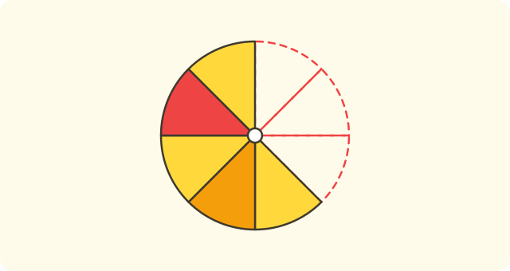
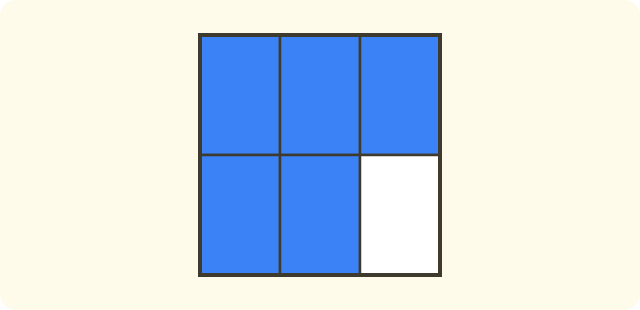
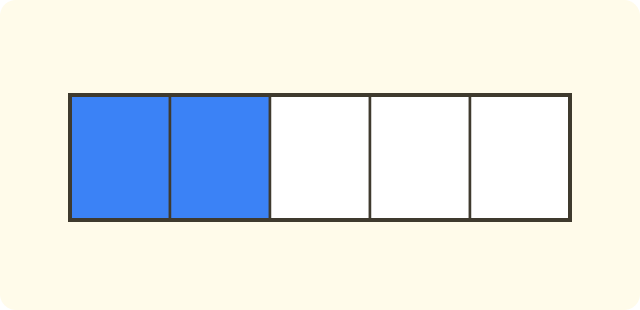
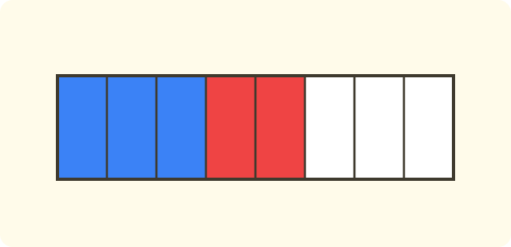

:::goals
- Understand that a fraction shows one or more of the equal parts of a whole.
- Read and write fractions, and name the numerator and denominator.
- Show fractions with shapes and on a number line.
:::

Think about sharing a pizza. This one is cut into $4$ equal slices. Lan eats $1$ slice and Nam eats $3$ slices. What part of the pizza does each child eat? Can we write that part as a number?

Whole numbers cannot write "one quarter" or "three quarters". They count whole pizzas well, but a part of a pizza has no number yet. This lesson gives you a new kind of number for writing parts of a whole, so we can say exactly how much each child ate.

## Let's explore

We go step by step, with Lan and Nam's pizza.

- The pizza is cut into $4$ **equal** slices. The number $4$ tells us how many equal parts the pizza has.
- Lan eats $1$ slice. We write the part Lan eats as $\dfrac{1}{4}$, read "one quarter".
- Nam eats $3$ slices. We write $\dfrac{3}{4}$, read "three quarters".
- Together they eat all $4$ slices, which is the whole pizza. We write $\dfrac{4}{4}=1$.

All four lines are about the same pizza. Only the number of slices we take changes.

We can also put fractions on a number line. The stretch from $0$ to $1$ is cut into $4$ equal parts, and each part is $\dfrac{1}{4}$. This stretch is our whole, just as the pizza was.

:::graph A number line: the stretch from 0 to 1 cut into 4 equal parts
alt: A number line from 0 to 1 cut into 4 equal parts, with the points 0, 1/4, 2/4, 3/4 and 1 marked
x: -0.1..1.1
y: -0.15..0.15
segment: (0, 0) (1, 0)
point: (0, 0) "0" below
point: (0.25, 0) "1/4" below
point: (0.5, 0) "2/4" below
point: (0.75, 0) "3/4" below
point: (1, 0) "1" below
:::

:::definition Fraction
Cut a whole into $b$ equal parts and take $a$ of them. The part taken is written $\dfrac{a}{b}$ and is called a **fraction**.

The number $a$ on top is the **numerator**. The number $b$ underneath is the **denominator**. The denominator is never $0$.
:::

There are two things to remember. The denominator tells us how many equal parts the whole is cut into. The numerator tells us how many parts we take. The number underneath counts the slices in the whole pizza, and the number on top counts the slices we take.

## Examples

We start by writing a fraction for a shape. Count all the parts, then the parts taken.

:::example Writing a fraction from a picture
A cake is cut into $8$ equal pieces. Mai eats $3$ pieces. Write the fraction that shows the part of the cake Mai ate.

**Solution.** The whole is cut into $8$ equal parts, so the denominator is $8$. Mai takes $3$ parts, so the numerator is $3$:
$$\frac{3}{8}.$$
So Mai ate $\dfrac{3}{8}$ of the cake.
:::

Now you read a fraction and name its numerator and denominator. Don't worry if the words feel strange at first. Say them aloud a few times and they will stick.

:::example Reading a fraction
Read the fraction $\dfrac{5}{6}$, then name its numerator and denominator. Write the fraction "seven ninths".

**Solution.** The fraction $\dfrac{5}{6}$ is read "five sixths". The numerator is $5$ (on top) and the denominator is $6$ (underneath). The fraction "seven ninths" has numerator $7$ and denominator $9$:
$$\frac{7}{9}.$$
:::

We can also write a fraction for the part that is left. What is left is a part of the whole too.

:::example The part left over
A square is cut into $6$ equal parts and $5$ parts are coloured in. Write the fraction for the coloured part and the fraction for the part that is not coloured.

**Solution.** The denominator stays $6$ because the whole is cut into $6$ parts. The coloured part is $5$ parts, and the part not coloured is $6-5=1$ part:
$$\frac{5}{6}\ \text{(coloured)},\qquad \frac{1}{6}\ \text{(not coloured)}.$$
**Check.** $5$ parts and $1$ part make $6$ parts, the whole square: $\dfrac{5}{6}$ and $\dfrac{1}{6}$ together make the whole.
:::

Finally, we mark a fraction on a number line, counting the parts one by one from the start.

:::example A fraction on a number line
On a number line, the stretch from $0$ to $1$ is cut into $4$ equal parts. Which point shows $\dfrac{3}{4}$?

**Solution.** The denominator $4$ tells us to cut the stretch into $4$ parts. From $0$ we move through $3$ parts, passing $\dfrac{1}{4}$, $\dfrac{2}{4}$, $\dfrac{3}{4}$. The third point after $0$ shows $\dfrac{3}{4}$, which is one part before the point $1$.
:::

:::warning Mistakes to watch out for
- **Parts that are not equal.** Wrong: cutting a cake into $4$ pieces of different sizes and calling each piece $\dfrac{1}{4}$. Why it is wrong: a fraction works only when the parts are equal. Right: cut it into $4$ equal pieces.
- **Writing the numerator and denominator the wrong way round.** Wrong: $3$ parts eaten out of $4$ written as $\dfrac{4}{3}$. Why it is wrong: the denominator is the number of parts in the whole. Right: $\dfrac{3}{4}$.
- **A denominator of $0$.** Wrong: $\dfrac{5}{0}$. Why it is wrong: we cannot cut a whole into $0$ parts. Right: the denominator is a number that is not $0$.

Many pupils turn the numerator and denominator upside down. Ask yourself: which number counts the whole pizza, and which counts the slices taken?
:::

## Key terms

:::terms
- fraction | phân số
- numerator | tử số
- denominator | mẫu số
- equal parts | phần bằng nhau
- one quarter | một phần tư
- number line | trục số
- whole | cái nguyên
:::

## Summary

- The fraction $\dfrac{a}{b}$: a whole cut into $b$ equal parts, with $a$ parts taken.
- The numerator $a$ is on top and the denominator $b$ underneath; the denominator is not $0$.
- The parts must be equal.
- Example: $\dfrac{3}{4}$ is read "three quarters".
- A fraction can be shown with a shape or as a point on a number line.

Back to the pizza: Lan eats one quarter, Nam eats three quarters, and together they eat the whole pizza. Remember that the denominator counts the parts of the whole and the numerator counts the parts taken. Try the practice questions to get used to reading and writing fractions.

## Practice

Each exercise comes with what you need and how to start. Try it yourself first, then open the solution. Getting one wrong is fine, because a mistake usually shows you exactly what to remember.

:::exercise
A rectangle is cut into $5$ equal parts and $2$ parts are coloured in. Write the fraction for the coloured part.

::hint
**What you need:** the denominator is the number of equal parts and the numerator is the number of coloured parts.

**Steps:**
1. What do we know? What is asked?
2. Write the numerator and the denominator.

::solution
The rectangle is cut into $5$ equal parts, so the denominator is $5$ (the whole shape has $5$ parts).

$2$ parts are coloured in, so the numerator is $2$.

So the fraction for the coloured part is $\dfrac{2}{5}$.

**Answer.** $\dfrac{2}{5}$.
:::

:::exercise
Write these fractions: a) four sevenths; b) two fifths; c) eleven twelfths.

::hint
**What you need:** when you read "a over b", write $\dfrac{a}{b}$.

**Steps:**
1. The first number you say is the numerator.
2. The number in the name of the part is the denominator.

::solution
In a fraction, the numerator is on top and the denominator is at the bottom; we say the numerator first, then the denominator.

a) "Four sevenths": the numerator is $4$ and the denominator is $7$, so we write $\dfrac{4}{7}$.

b) "Two fifths": the numerator is $2$ and the denominator is $5$, so we write $\dfrac{2}{5}$.

c) "Eleven twelfths": the numerator is $11$ and the denominator is $12$, so we write $\dfrac{11}{12}$.

So the fractions are $\dfrac{4}{7}$, $\dfrac{2}{5}$ and $\dfrac{11}{12}$.

**Answer.** $\dfrac{4}{7}$, $\dfrac{2}{5}$, $\dfrac{11}{12}$.
:::

:::exercise
Remember the last lesson (how many times an event happens): a coin is tossed $10$ times and heads comes up $6$ times. Write the fraction showing the heads out of all the tosses.

::hint
**What you need:** the number of tosses is the denominator and the number of heads is the numerator.

**Steps:**
1. How many tosses were there?
2. How many heads were there?

::solution
The coin is tossed $10$ times in all, so the denominator is $10$.

Heads comes up $6$ times, so the numerator is $6$.

So the fraction showing the heads out of all the tosses is $\dfrac{6}{10}$.

**Answer.** $\dfrac{6}{10}$.
:::

:::exercise
Read the fractions $\dfrac{7}{10}$ and $\dfrac{3}{8}$, then name the numerator and the denominator of each.

::hint
**What you need:** the numerator is on top and the denominator is underneath.

**Steps:**
1. Say the numerator, then the name of the part.
2. Point to each number.

::solution
In a fraction, the number above the line is the numerator and the number below the line is the denominator.

The fraction $\dfrac{7}{10}$ is read "seven tenths": the numerator is $7$ and the denominator is $10$.

The fraction $\dfrac{3}{8}$ is read "three eighths": the numerator is $3$ and the denominator is $8$.

So $\dfrac{7}{10}$ has numerator $7$ and denominator $10$; $\dfrac{3}{8}$ has numerator $3$ and denominator $8$.

**Answer.** See the solution.
:::

:::exercise
A cake is cut into $4$ pieces of different sizes and Lan eats $1$ piece. Can we say Lan ate $\dfrac{1}{4}$ of the cake? Why?

::hint
**What you need:** a fraction works only when the parts are equal.

**Steps:**
1. Are the parts equal?
2. Compare with the meaning of a fraction.

::solution
To say that a piece of the cake is $\dfrac{1}{4}$, the cake must be cut into $4$ equal parts.

Here the cake is cut into $4$ pieces of different sizes, so the parts are not equal. The piece Lan ate may be bigger or smaller than a quarter of the cake, so it is not necessarily $\dfrac{1}{4}$.

So we cannot say that Lan ate $\dfrac{1}{4}$ of the cake, because the parts are not equal.

**Answer.** No, because the parts are not equal.
:::

:::exercise
Nam wrote: "The cake is cut into $4$ parts and $3$ are eaten, so the fraction is $\dfrac{4}{3}$." Where did Nam go wrong? Write it correctly.

::hint
**What you need:** the denominator is the number of equal parts in the whole.

**Steps:**
1. How many parts does the whole cake have?
2. How many parts were eaten?

::solution
Nam wrote the numerator and the denominator the wrong way round. The denominator tells us how many equal parts the whole cake is cut into, and the numerator tells us how many parts were eaten. Also, $\dfrac{4}{3}$ has a numerator greater than its denominator, so it is greater than $1$, while the part eaten is less than the whole cake.

Written correctly: the whole cake has $4$ parts, so the denominator is $4$; $3$ parts were eaten, so the numerator is $3$. The correct fraction is $\dfrac{3}{4}$.

So Nam went wrong by writing the numerator and denominator the wrong way round; the correct fraction for the part eaten is $\dfrac{3}{4}$.

**Answer.** $\dfrac{3}{4}$.
:::

:::exercise
A bar of chocolate has $12$ equal squares. Mai eats $5$ squares and Nam eats $4$ squares.
a) Write the fraction for the part Mai ate.
b) Write the fraction for the part Nam ate.
c) Write the fraction for the part left.

::hint
**What you need:** the denominator is $12$; the numerator is the number of squares.

**Steps:**
1. Write a) and b).
2. Find how many squares are left, then write the fraction.

::solution
The bar of chocolate has $12$ equal squares, so the denominator of every fraction below is $12$.

a) Mai eats $5$ squares, so the part Mai ate is $\dfrac{5}{12}$ of the bar.

b) Nam eats $4$ squares, so the part Nam ate is $\dfrac{4}{12}$ of the bar.

c) The number of squares left is:
$$12-5-4=3\ \text{(squares)}.$$
So the part left is $\dfrac{3}{12}$ of the bar.

Check: $5+4+3=12$ squares, which is the number of squares in the whole bar.

So the part Mai ate is $\dfrac{5}{12}$, the part Nam ate is $\dfrac{4}{12}$ and the part left is $\dfrac{3}{12}$.

**Answer.** a) $\dfrac{5}{12}$; b) $\dfrac{4}{12}$; c) $\dfrac{3}{12}$.
:::

:::exercise Challenge
A paper strip is cut into $8$ equal parts. You colour $3$ parts blue and $2$ parts red, and leave the rest white. Write the fraction for each colour and the fraction for the part that is coloured (both colours together).

::hint
**What you need:** the denominator is always $8$; find the white parts by subtracting.

**Steps:**
1. Write the fractions for blue and red.
2. Find the white parts: $8-3-2$.
3. Find the coloured parts: $3+2$.

::solution
The strip is cut into $8$ equal parts, so the denominator of every fraction below is $8$.

The blue part has $3$ parts, so it is $\dfrac{3}{8}$ of the strip.

The red part has $2$ parts, so it is $\dfrac{2}{8}$ of the strip.

The number of white parts is:
$$8-3-2=3\ \text{(parts)},$$
so the white part is $\dfrac{3}{8}$ of the strip.

The number of coloured parts (both colours together) is:
$$3+2=5\ \text{(parts)},$$
so the coloured part is $\dfrac{5}{8}$ of the strip.

Check: $3+2+3=8$ parts, which is the number of parts in the whole strip.

So blue is $\dfrac{3}{8}$, red is $\dfrac{2}{8}$, white is $\dfrac{3}{8}$ and the coloured part is $\dfrac{5}{8}$.

**Answer.** Blue $\dfrac{3}{8}$, red $\dfrac{2}{8}$, white $\dfrac{3}{8}$; coloured $\dfrac{5}{8}$.
:::

## Mini test

:::quiz
::mc NB
The denominator of the fraction $\dfrac{3}{5}$ is
A. $5$.
B. $3$.
C. $8$.
D. $15$.
::key A
The denominator is the number underneath, $5$. Option B is the numerator, and C is the sum of the two numbers.

::mc TH
A cake is cut into $6$ equal pieces and $1$ piece is eaten. The fraction for the part eaten is
A. $\dfrac{6}{1}$.
B. $\dfrac{1}{6}$.
C. $\dfrac{1}{5}$.
D. $\dfrac{5}{6}$.
::key B
The whole cake has $6$ pieces and $1$ is eaten, so $\dfrac{1}{6}$. Option A is the wrong way round, and D is the part not eaten.

::mc NB
The fraction "seven tenths" is written
A. $\dfrac{10}{7}$.
B. $7+10$.
C. $\dfrac{7}{10}$.
D. $17$.
::key C
Numerator $7$, denominator $10$. Option A swaps the numerator and denominator.

::mc TH
A shape is cut into $8$ equal parts and $5$ parts are coloured. The fraction for the part not coloured is
A. $\dfrac{5}{8}$.
B. $\dfrac{3}{5}$.
C. $\dfrac{8}{3}$.
D. $\dfrac{3}{8}$.
::key D
The part not coloured is $8-5=3$ parts, so $\dfrac{3}{8}$. Option A is the coloured part.

::tf NB NB NB TH
Look at the fraction $\dfrac{5}{9}$.
a) The numerator is $5$.
b) The denominator is $9$.
c) It is read "nine fifths".
d) It can show $5$ parts of a shape cut into $9$ equal parts.
::key T T F T
a) True. b) True. c) False: it is read "five ninths". d) True.

::sa TH
A cake is cut into $12$ equal pieces and Mai eats $5$ pieces. How many pieces are left?
::key 7
$12-5=7$ pieces.

::sa NB
What is the denominator of the fraction $\dfrac{3}{8}$?
::key 8
The denominator is the number underneath, $8$.
:::
