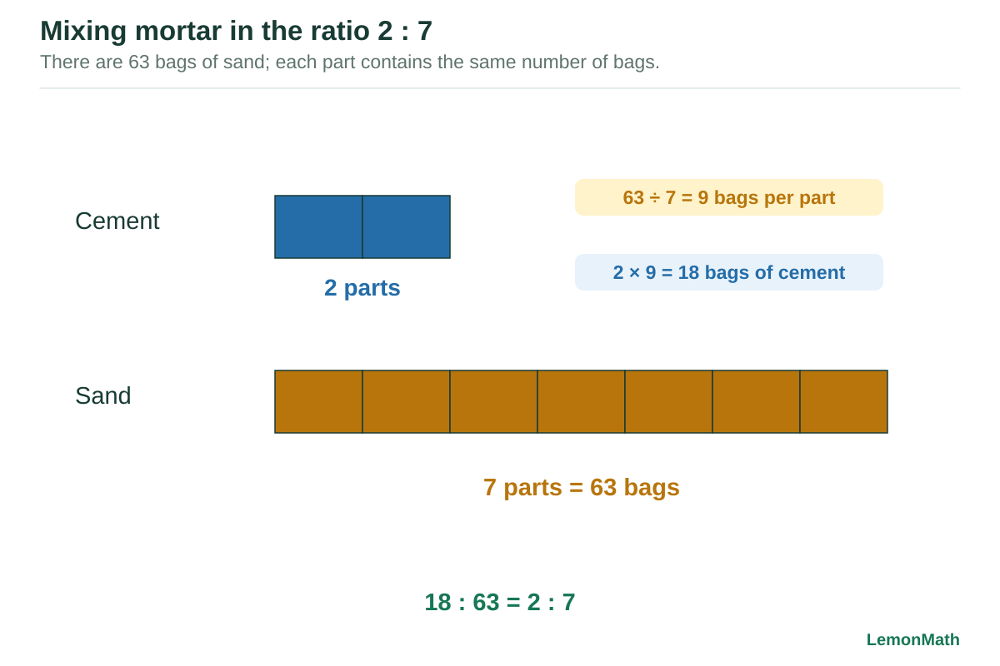

:::goals
- Recognise a proportion, name its outer and inner terms, and use cross-multiplication to find a missing number.
- Form four proportions from one product equation.
- Use the properties of a chain of equal ratios (sum, difference, three ratios) to find numbers when their sum or difference is known.
- Solve real problems about mixing, building and sharing money in a given ratio.
:::

Suppose Mr Hùng is about to plaster a wall and mixes his mortar the way builders usually do: for every $2$ bags of cement he uses $7$ bags of sand, so cement and sand are in the ratio $2:7$. Today he has already brought $63$ bags of sand. How many bags of cement does he need for the mix to be right?

You met ratios in Year 6. This lesson takes one more step. When two ratios are equal, there is a neat way to find the missing number. And when several ratios are equal at once, you can share a sum of money or a batch of mortar exactly in the ratio you are given, without trying numbers one by one.

## Proportions

### Explore: what do two equal ratios have in common?

Compare the ratios $\dfrac27$ and $\dfrac6{21}$. Dividing the top and bottom of $\dfrac6{21}$ by $3$ gives $\dfrac27$, so the two ratios are equal. Now look at the products: $2\cdot21=42$ and $7\cdot6=42$, which are equal too.

That could be a coincidence, so try another pair: $\dfrac35=\dfrac{12}{20}$. We have $3\cdot20=60$ and $5\cdot12=60$. Equal again. This pattern holds for every pair of equal ratios, and we will see why in a moment.

:::definition Proportion
A proportion is an equation stating that two ratios are equal:
$$\frac ab=\frac cd\qquad(b\neq0,\ d\neq0).$$
It can also be written $a:b=c:d$. The numbers $a$ and $d$ are the **outer terms** (the two at the ends), and $b$ and $c$ are the **inner terms** (the two in the middle).
:::

:::theorem Properties of a proportion
- If $\dfrac ab=\dfrac cd$ then $ad=bc$ (the product of the outer terms equals the product of the inner terms).
- Conversely, if $ad=bc$ and $a$, $b$, $c$, $d$ are all non-zero, then we have four proportions
$$\frac ab=\frac cd,\qquad \frac ac=\frac bd,\qquad \frac db=\frac ca,\qquad \frac dc=\frac ba.$$
:::

**Why?** Multiply both sides of $\dfrac ab=\dfrac cd$ by $bd$ (which is non-zero) to get $ad=cb$. Conversely, from $ad=bc$, divide both sides by $bd$ to get $\dfrac ab=\dfrac cd$; divide by $cd$ to get $\dfrac ac=\dfrac bd$; divide by $ab$ to get $\dfrac db=\dfrac ca$; divide by $ac$ to get $\dfrac dc=\dfrac ba$. So "cross-multiplying" really means multiplying both sides by the product of the two denominators.

:::example Recognising proportions
Can each of the following pairs of ratios form a proportion?

a) $\dfrac23$ and $\dfrac{14}{21}$.

b) $\dfrac49$ and $\dfrac6{15}$.

c) $1.2:1.8$ and $2:3$.

**Solution.** We check whether the cross-products are equal.

a) We have $2\cdot21=42$ and $3\cdot14=42$. The products are equal, so $\dfrac23=\dfrac{14}{21}$ and they form a proportion.

b) We have $4\cdot15=60$ and $9\cdot6=54$. The products are different, so they do not form a proportion.

c) We have $1.2:1.8=\dfrac{1.2}{1.8}$ and $2:3=\dfrac23$. Since $1.2\cdot3=3.6$ and $1.8\cdot2=3.6$, we have $\dfrac{1.2}{1.8}=\dfrac23$ and they form a proportion.

So the pairs in a) and c) form proportions, and the pair in b) does not.
:::

Once we have cross-multiplication, finding a missing number in a proportion is just solving a linear equation.

:::example Finding a missing number
Find $x$, given that:

a) $\dfrac x6=\dfrac{14}{21}$.

b) $\dfrac9{x+1}=\dfrac35$.

**Solution.** a) By the property of a proportion, we have $21x=6\cdot14=84$. Hence $x=84\div21=4$.

b) Condition: $x\neq-1$. By the property of a proportion, we have $3(x+1)=9\cdot5=45$. Hence $x+1=15$, so $x=14$. This value satisfies the condition.

So a) $x=4$; b) $x=14$.
:::

:::example Forming proportions from a product equation
From the equation $6\cdot15=9\cdot10$, form proportions.

**Solution.** We have $6\cdot15=90$ and $9\cdot10=90$, so the equation is true. Take $a=6$, $b=9$, $c=10$, $d=15$; then $ad=bc$. By the property of a proportion, we have four proportions:

$$\frac69=\frac{10}{15},\qquad \frac6{10}=\frac9{15},\qquad \frac{15}9=\frac{10}6,\qquad \frac{15}{10}=\frac96.$$

Check by simplifying: in the four equations the ratios are equal to $\dfrac23$, $\dfrac35$, $\dfrac53$ and $\dfrac32$ respectively (on both sides each time). So we have formed the four proportions above.
:::

Now we answer Mr Hùng's question, going through all four steps of solving a problem.

:::example Mixing mortar
Suppose the mortar recipe says that cement and sand are in the ratio $2:7$. Mr Hùng already has $63$ bags of sand. How many bags of cement does he need?

**Solution.**

*Understand.* Every $2$ bags of cement go with $7$ bags of sand. We know there are $63$ bags of sand and need the matching number of bags of cement.

*Plan.* In every batch, the ratio of bags of cement to bags of sand must equal $\dfrac27$. Let the number of bags of cement be $x$, form a proportion and cross-multiply.

*Solve.* Let $x$ be the number of bags of cement needed ($x>0$). From the problem we have
$$\frac x{63}=\frac27.$$
By the property of a proportion, we have $7x=63\cdot2=126$. Hence $x=126\div7=18$. So Mr Hùng needs $18$ bags of cement.

*Look back.* Check: $\dfrac{18}{63}=\dfrac27$ (divide top and bottom by $9$). Is there another way? Yes: $63$ bags of sand make $9$ groups of $7$ bags, and each group needs $2$ bags of cement, so he needs $9\cdot2=18$ bags. Both methods agree, but cross-multiplication also works when the numbers do not divide so neatly. What if he has only $20$ bags of cement? Then $\dfrac{20}y=\dfrac27$, so $2y=140$ and $y=70$: he needs $70$ bags of sand.

:::

## Properties of a chain of equal ratios

### Explore: add the tops, add the bottoms

Take two equal ratios $\dfrac23=\dfrac69$. Add the numerators and add the denominators: $\dfrac{2+6}{3+9}=\dfrac8{12}=\dfrac23$. Subtract: $\dfrac{6-2}{9-3}=\dfrac46=\dfrac23$. Both new ratios are still equal to $\dfrac23$. This is exactly what we need: it turns two ratios containing two unknowns into one ratio whose numerator and denominator we both know.

:::theorem Properties of a chain of equal ratios
From $\dfrac ab=\dfrac cd$ we get
$$\frac ab=\frac cd=\frac{a+c}{b+d}=\frac{a-c}{b-d}$$
(provided that all the denominators are non-zero). Extending to three ratios: from $\dfrac ab=\dfrac cd=\dfrac ef$ we get $\dfrac ab=\dfrac cd=\dfrac ef=\dfrac{a+c+e}{b+d+f}$ (with $b+d+f\neq0$).
:::

The chain $\dfrac a2=\dfrac b3=\dfrac c5$ is also written briefly as $a:b:c=2:3:5$.

**Why?** Let $k=\dfrac ab=\dfrac cd$. Then $a=bk$ and $c=dk$, so $a+c=(b+d)k$ and $a-c=(b-d)k$. Dividing both sides by $b+d$ (or $b-d$) gives $\dfrac{a+c}{b+d}=k$ and $\dfrac{a-c}{b-d}=k$. With three ratios we do exactly the same. This trick of "letting $k$ be the common ratio" is very useful, and the next lesson on proportional quantities will use it again.

:::example Knowing the sum, knowing the difference
Find two numbers $x$ and $y$, given that:

a) $\dfrac x3=\dfrac y5$ and $x+y=48$.

b) $\dfrac x4=\dfrac y7$ and $y-x=21$.

**Solution.** a) By the property of a chain of equal ratios, we have
$$\frac x3=\frac y5=\frac{x+y}{3+5}=\frac{48}8=6.$$
Hence $x=3\cdot6=18$ and $y=5\cdot6=30$. We see that $18+30=48$, as required.

b) The numerator is $y-x$, so the denominator must be $7-4$. We have
$$\frac x4=\frac y7=\frac{y-x}{7-4}=\frac{21}3=7.$$
Hence $x=4\cdot7=28$ and $y=7\cdot7=49$. We see that $49-28=21$, as required.

So a) $x=18$, $y=30$; b) $x=28$, $y=49$.
:::

:::example Sharing profit by investment
Hà, Hùng and Lan put money into a fish farm: $20$ million đồng, $30$ million đồng and $50$ million đồng respectively. At the end of the year the group makes a profit of $20$ million đồng, shared in proportion to the money each invested. How much profit does each person receive?

**Solution.** Let the profits of Hà, Hùng and Lan be $a$, $b$ and $c$ (million đồng). Since the profit is shared in proportion to the investment,
$$\frac a{20}=\frac b{30}=\frac c{50}\quad\text{and}\quad a+b+c=20.$$
By the property of a chain of equal ratios, we have
$$\frac a{20}=\frac b{30}=\frac c{50}=\frac{a+b+c}{20+30+50}=\frac{20}{100}=\frac15.$$
Hence $a=20\cdot\dfrac15=4$, $b=30\cdot\dfrac15=6$ and $c=50\cdot\dfrac15=10$. We see that $4+6+10=20$ (satisfied).

So Hà receives $4$ million đồng, Hùng receives $6$ million đồng and Lan receives $10$ million đồng.
:::

:::warning Common mistakes
- **Cross-multiplying the wrong terms.** Wrong: from $\dfrac3x=\dfrac{12}{20}$ writing $x=\dfrac{3\cdot12}{20}=1.8$. Why it is wrong: the cross-products are $3\cdot20$ and $12\cdot x$, not $3\cdot12$. Right: $12x=3\cdot20=60$, so $x=5$.
- **Adding the same number to the top and bottom.** Wrong: "$\dfrac23=\dfrac45$ because $2+2=4$ and $3+2=5$". Why it is wrong: $2\cdot5=10$ but $3\cdot4=12$. Right: to keep a ratio unchanged, multiply (or divide) the top and bottom by the same non-zero number, for example $\dfrac23=\dfrac46$.
- **Subtracting in different orders.** Wrong: from $\dfrac x3=\dfrac y5$ writing $\dfrac x3=\dfrac y5=\dfrac{x-y}{5-3}$. Why it is wrong: if the numerator is $x-y$ then the denominator must be $3-5$, so the two differences must be taken in the same order. Right: $\dfrac{x-y}{3-5}$ or $\dfrac{y-x}{5-3}$.
:::

**Connections.** Proportions build on the ratios and fractions you learnt in Year 6, and finding a missing number comes down to a linear equation. In turn, the properties of a chain of equal ratios are the foundation for the next lesson on direct and inverse proportion. As for Mr Hùng, he needs $18$ bags of cement; all you need to remember is that in a proportion the cross-products are always equal.

## Key terms

:::terms
- ratio | tỉ số
- proportion | tỉ lệ thức
- outer terms | ngoại tỉ
- inner terms | trung tỉ
- cross-multiplication property | tính chất nhân chéo
- chain of equal ratios | dãy tỉ số bằng nhau
- constant of proportionality | hệ số tỉ lệ
- sharing in a given ratio | chia theo tỉ lệ
:::

## Summary

- A proportion is an equation $\dfrac ab=\dfrac cd$ ($b\neq0$, $d\neq0$); $a$ and $d$ are the outer terms, $b$ and $c$ are the inner terms.
- If $\dfrac ab=\dfrac cd$ then $ad=bc$. Conversely, from $ad=bc$ (all non-zero) we can form four proportions.
- $\dfrac ab=\dfrac cd=\dfrac{a+c}{b+d}=\dfrac{a-c}{b-d}$, and with three ratios: $\dfrac ab=\dfrac cd=\dfrac ef=\dfrac{a+c+e}{b+d+f}$.
- Use the sum when the sum is known, use the difference when the difference is known, and take the numerator and denominator in the same order.
- Real problems: define the unknowns, form the chain of ratios, apply the property, then check.

## Practice

Each exercise comes with what you need and some steps to start. Try it yourself first, then open the solution.

:::exercise
Can each of the following pairs of ratios form a proportion?

a) $\dfrac{15}{21}$ and $\dfrac{25}{35}$.

b) $\dfrac7{12}$ and $\dfrac{21}{35}$.

c) $1.5:2.5$ and $3:5$.

::hint
**What you need:** two ratios form a proportion when their cross-products are equal.

**Steps:**
1. a) Work out $15\cdot35$ and $21\cdot25$.
2. b) Work out $7\cdot35$ and $12\cdot21$.
3. c) Write $1.5:2.5=\dfrac{1.5}{2.5}$, then work out $1.5\cdot5$ and $2.5\cdot3$.

::solution
a) We have $15\cdot35=525$ and $21\cdot25=525$. The products are equal, so they form a proportion.

b) We have $7\cdot35=245$ and $12\cdot21=252$. The products are different, so they do not form a proportion.

c) We have $1.5\cdot5=7.5$ and $2.5\cdot3=7.5$. The products are equal, so they form a proportion.

So the pairs in a) and c) form proportions, and the pair in b) does not.

**Answer.** a) yes; b) no; c) yes.
:::

:::exercise
Find $x$, given that:

a) $\dfrac x9=\dfrac{16}{12}$.

b) $\dfrac{x+3}8=\dfrac54$.

c) $0.4:x=1.6:6$.

::hint
**What you need:** from $\dfrac ab=\dfrac cd$ we get $ad=bc$.

**Steps:**
1. a) Cross-multiply: $12x=9\cdot16$.
2. b) Cross-multiply: $4(x+3)=8\cdot5$, then move $3$ to the right-hand side.
3. c) Write $\dfrac{0.4}x=\dfrac{1.6}6$ and cross-multiply: $1.6x=0.4\cdot6$.

::solution
a) By the property of a proportion, we have $12x=9\cdot16=144$. Hence $x=144\div12=12$.

b) By the property of a proportion, we have $4(x+3)=8\cdot5=40$. Hence $x+3=10$, so $x=7$.

c) Condition: $x\neq0$. We have $\dfrac{0.4}x=\dfrac{1.6}6$, so $1.6x=0.4\cdot6=2.4$. Hence $x=2.4\div1.6=1.5$. This value satisfies the condition.

So a) $x=12$; b) $x=7$; c) $x=1.5$.

**Answer.** a) $12$; b) $7$; c) $1.5$.
:::

:::exercise
Find two numbers $x$ and $y$, given that $\dfrac x5=\dfrac y7$ and $x+y=60$.

::hint
**What you need:** $\dfrac x5=\dfrac y7=\dfrac{x+y}{5+7}$.

**Steps:**
1. Work out $\dfrac{x+y}{5+7}=\dfrac{60}{12}$.
2. Use that value to find $x$ and $y$.

::solution
By the property of a chain of equal ratios, we have
$$\frac x5=\frac y7=\frac{x+y}{5+7}=\frac{60}{12}=5.$$
Hence $x=5\cdot5=25$ and $y=7\cdot5=35$. We see that $25+35=60$ (satisfied).

So $x=25$ and $y=35$.

**Answer.** $x=25$, $y=35$.
:::

:::exercise
Find three numbers $a$, $b$, $c$, given that $\dfrac a3=\dfrac b4=\dfrac c6$ and $a+b+c=65$.

::hint
**What you need:** with three equal ratios, $\dfrac a3=\dfrac b4=\dfrac c6=\dfrac{a+b+c}{3+4+6}$.

**Steps:**
1. Add the denominators: $3+4+6=13$.
2. Work out $\dfrac{65}{13}$, then multiply by $3$, $4$ and $6$.

::solution
By the property of a chain of equal ratios, we have
$$\frac a3=\frac b4=\frac c6=\frac{a+b+c}{3+4+6}=\frac{65}{13}=5.$$
Hence $a=3\cdot5=15$, $b=4\cdot5=20$ and $c=6\cdot5=30$. We see that $15+20+30=65$ (satisfied).

So $a=15$, $b=20$, $c=30$.

**Answer.** $a=15$, $b=20$, $c=30$.
:::

:::exercise
A team has three workers who work for $6$ days, $8$ days and $10$ days respectively. The client gives the whole team a bonus of $12$ million đồng, shared in proportion to the number of days worked. How much bonus does each worker receive?

::hint
**What you need:** each worker's bonus is in proportion to the number of days that worker worked.

**Steps:**
1. Let the three bonuses be $x$, $y$, $z$ and write $\dfrac x6=\dfrac y8=\dfrac z{10}$.
2. Add the denominators: $6+8+10=24$, then use $x+y+z=12$.

::solution
Let the bonuses of the three workers be $x$, $y$, $z$ (million đồng). From the problem we have
$$\frac x6=\frac y8=\frac z{10}\quad\text{and}\quad x+y+z=12.$$
By the property of a chain of equal ratios, we have
$$\frac x6=\frac y8=\frac z{10}=\frac{x+y+z}{6+8+10}=\frac{12}{24}=\frac12.$$
Hence $x=6\cdot\dfrac12=3$, $y=8\cdot\dfrac12=4$ and $z=10\cdot\dfrac12=5$. We see that $3+4+5=12$ (satisfied).

So the three workers receive $3$ million đồng, $4$ million đồng and $5$ million đồng respectively.

**Answer.** $3$; $4$; $5$ (million đồng).
:::

:::exercise
Suppose a type of concrete is mixed from cement, sand and gravel in the ratio $1:2:4$ by mass. To make $1\,400$ kg of the mixture, how many kilograms of each material are needed?

::hint
**What you need:** the ratio $1:2:4$ means $\dfrac x1=\dfrac y2=\dfrac z4$, where $x$, $y$, $z$ are the masses of the three materials.

**Steps:**
1. Form the chain of ratios and use $x+y+z=1\,400$.
2. Add the denominators: $1+2+4=7$.

::solution
Let the masses of cement, sand and gravel be $x$, $y$, $z$ (kg). From the problem we have
$$\frac x1=\frac y2=\frac z4\quad\text{and}\quad x+y+z=1\,400.$$
By the property of a chain of equal ratios, we have
$$\frac x1=\frac y2=\frac z4=\frac{x+y+z}{1+2+4}=\frac{1\,400}{7}=200.$$
Hence $x=200$, $y=2\cdot200=400$ and $z=4\cdot200=800$. We see that $200+400+800=1\,400$ (satisfied).

So we need $200$ kg of cement, $400$ kg of sand and $800$ kg of gravel.

**Answer.** $200$ kg; $400$ kg; $800$ kg.
:::

:::exercise
A triangular garden has perimeter $36$ m, and the lengths of its three sides are in proportion to $3$, $4$, $5$. Find the length of each side.

::hint
**What you need:** the perimeter is the sum of the three sides.

**Steps:**
1. Let the sides be $a$, $b$, $c$ and write $\dfrac a3=\dfrac b4=\dfrac c5$.
2. Use $a+b+c=36$ and $3+4+5=12$.

::solution
Let the lengths of the three sides be $a$, $b$, $c$ (m). From the problem we have
$$\frac a3=\frac b4=\frac c5\quad\text{and}\quad a+b+c=36.$$
By the property of a chain of equal ratios, we have
$$\frac a3=\frac b4=\frac c5=\frac{a+b+c}{3+4+5}=\frac{36}{12}=3.$$
Hence $a=3\cdot3=9$, $b=4\cdot3=12$ and $c=5\cdot3=15$. We see that $9+12+15=36$ (satisfied).

So the three sides of the garden are $9$ m, $12$ m and $15$ m long.

**Answer.** $9$ m; $12$ m; $15$ m.
:::

:::exercise
Given $\dfrac ab=\dfrac cd$ ($b\neq0$, $d\neq0$), prove that $\dfrac{a+b}b=\dfrac{c+d}d$.

::hint
**What you need:** adding fractions with the same denominator, $\dfrac{a+b}b=\dfrac ab+\dfrac bb=\dfrac ab+1$.

**Steps:**
1. Split the left-hand side into $\dfrac ab+1$.
2. Split the right-hand side into $\dfrac cd+1$, then use the given equation.

::solution
We transform each side of the equality to be proved.

Since $b\neq0$,
$$\frac{a+b}{b}=\frac ab+\frac bb=\frac ab+1.$$

Since $d\neq0$,
$$\frac{c+d}{d}=\frac cd+\frac dd=\frac cd+1.$$

By the hypothesis, $\dfrac ab=\dfrac cd$. Adding $1$ to both sides, we get $\dfrac ab+1=\dfrac cd+1$.

Hence $\dfrac{a+b}{b}=\dfrac{c+d}{d}$.

So $\dfrac{a+b}{b}=\dfrac{c+d}{d}$.

**Answer.** $\dfrac{a+b}b=\dfrac{c+d}d$.
:::

:::exercise Challenge
Find three numbers $x$, $y$, $z$, given that $\dfrac x2=\dfrac y3$, $\dfrac y4=\dfrac z5$ and $x+y+z=70$.

::hint
**What you need:** to use the property of a chain of equal ratios, both proportions must show the same denominator under $y$.

**Steps:**
1. Divide both sides of $\dfrac x2=\dfrac y3$ by $4$ to make the denominator under $y$ equal to $12$.
2. Divide both sides of $\dfrac y4=\dfrac z5$ by $3$ to make the denominator under $y$ equal to $12$.

::solution
Dividing both sides of $\dfrac x2=\dfrac y3$ by $4$, we get $\dfrac x8=\dfrac y{12}$.

Dividing both sides of $\dfrac y4=\dfrac z5$ by $3$, we get $\dfrac y{12}=\dfrac z{15}$.

Hence $\dfrac x8=\dfrac y{12}=\dfrac z{15}$. By the property of a chain of equal ratios, we have
$$\frac x8=\frac y{12}=\frac z{15}=\frac{x+y+z}{8+12+15}=\frac{70}{35}=2.$$
Hence $x=8\cdot2=16$, $y=12\cdot2=24$ and $z=15\cdot2=30$. We see that $\dfrac{16}2=\dfrac{24}3=8$ and $\dfrac{24}4=\dfrac{30}5=6$, as required.

So $x=16$, $y=24$, $z=30$.

**Answer.** $x=16$, $y=24$, $z=30$.
:::

## Mini test

:::quiz
::mc NB
Which of the following equations is a proportion?
A. $\dfrac25=\dfrac49$.
B. $\dfrac12=\dfrac35$.
C. $\dfrac34=\dfrac9{12}$.
D. $\dfrac56=\dfrac{10}{13}$.
::key C
$3\cdot12=36=4\cdot9$, so B is correct. In A, B and D the cross-products are not equal ($18\neq20$; $5\neq6$; $65\neq60$).

::mc TH
Find $x$, given that $\dfrac6x=\dfrac9{15}$.
A. $3.6$.
B. $22.5$.
C. $9$.
D. $10$.
::key D
$9x=6\cdot15=90$, so $x=10$. A comes from cross-multiplying the wrong terms ($6\cdot9\div15$), B is $15\cdot9\div6$, and C takes the wrong numerator.

::mc VD
Given $\dfrac x3=\dfrac y7$ and $x+y=40$, the value of $x$ is
A. $12$.
B. $28$.
C. $4$.
D. $10$.
::key A
$\dfrac x3=\dfrac y7=\dfrac{40}{10}=4$, so $x=12$. B is the value of $y$, C is the common ratio $4$, and D is the sum $3+7$.

::mc VD
Given $\dfrac a2=\dfrac b3=\dfrac c4$ and $a+b+c=36$, the value of $c$ is
A. $8$.
B. $16$.
C. $12$.
D. $4$.
::key B
$\dfrac a2=\dfrac b3=\dfrac c4=\dfrac{36}9=4$, so $c=16$. A and C are the values of $a$ and $b$; D is the common ratio $4$.

::tf TH TH VD VD
Given $\dfrac x4=\dfrac y9$ and $y-x=15$. Decide whether each statement is true or false.
a) We have $\dfrac x4=\dfrac y9=\dfrac{y-x}{4-9}$.
b) We have $\dfrac x4=\dfrac y9=\dfrac{y-x}{9-4}=3$.
c) $x=12$.
d) $y=24$.
::key F T T F
a) False: if the numerator is $y-x$ then the denominator must be $9-4$. b) True: $\dfrac{15}5=3$. c) True: $x=4\cdot3=12$. d) False: $y=9\cdot3=27$.

::sa VD
Given $\dfrac x5=\dfrac y3$ and $x+y=24$, find $x$.
::key 15
$\dfrac x5=\dfrac y3=\dfrac{24}8=3$, so $x=5\cdot3=15$.

::sa VD
Find $x$, given that $\dfrac{0.6}x=\dfrac{1.2}5$ (give your answer as a decimal).
::key 2.5
$1.2x=0.6\cdot5=3$, so $x=3\div1.2=2.5$.
:::
