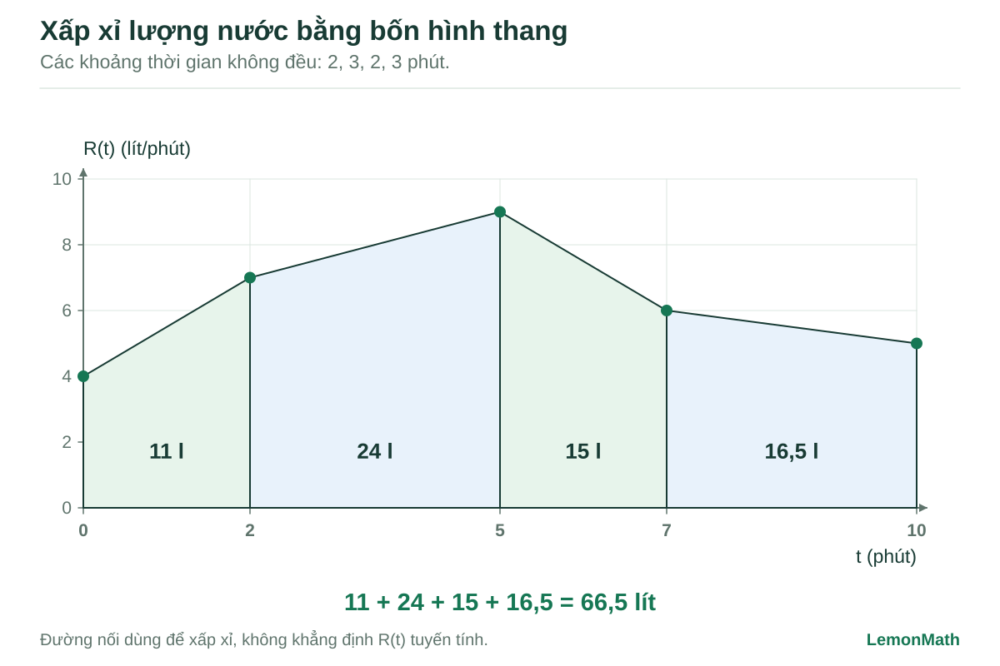

:::goals
- Xấp xỉ tích phân xác định bằng tổng trái, tổng phải, tổng điểm giữa và tổng hình thang, kể cả từ bảng số có khoảng không đều.
- Xác định một giá trị xấp xỉ là lớn hơn hay nhỏ hơn giá trị thật.
- Hiểu $\displaystyle\int_a^b r(t)\,dt$ là lượng thay đổi ròng của một đại lượng, kèm đơn vị.
- Dùng định lí cơ bản của giải tích để tính tích phân và lấy đạo hàm của hàm tích luỹ.
- Khảo sát $g(x)=\displaystyle\int_a^x f(t)\,dt$ từ đồ thị của $f$.
:::

Một chiếc bể đang được rót nước vào, và bạn chỉ biết nước chảy nhanh chậm thế nào ở từng lúc. Làm sao biết đến cuối trong bể có bao nhiêu nước? Đó là câu hỏi ngược với đạo hàm, và là chuyện của Unit 6: thay vì hỏi "đại lượng thay đổi nhanh đến mức nào?", ta hỏi "đã tích luỹ được bao nhiêu?". Ý tưởng này có mặt khắp đề AP. Gần như phần tự luận nào cũng mở đầu bằng một tốc độ cho dưới dạng bảng hoặc công thức, rồi hỏi một tổng Riemann, một lượng thay đổi toàn phần hay giá trị của đại lượng ở thời điểm sau. Bài này trình bày phần cốt lõi của unit; bài tiếp theo về kĩ thuật tính tích phân sẽ nói về phép đổi biến và các cách tìm nguyên hàm khác.

## Tổng Riemann từ bảng số

Làm sao biết nước đã chảy vào bể bao nhiêu khi ta chỉ có vài số đo? Ta chia thời gian thành những khoảng nhỏ, coi trong mỗi khoảng tốc độ gần như không đổi, rồi cộng lại. Đó là ý của tổng Riemann. Để xấp xỉ $\displaystyle\int_a^b f(x)\,dx$, chia $[a,b]$ thành các khoảng nhỏ rồi cộng các tích (độ rộng) × (chiều cao). Chiều cao lấy ở đầu mút trái, đầu mút phải hoặc điểm giữa; **tổng hình thang** lấy trung bình chiều cao bên trái và bên phải. Các khoảng nhỏ không cần bằng nhau, và đây là chỗ nhiều bạn hay quên: bảng số trong đề AP thường có các mốc thời gian không đều.

:::example Nước chảy vào bể
Nước chảy vào một bể với tốc độ $R(t)$ lít mỗi phút. Bảng dưới cho một số giá trị.

| $t$ (phút) | $0$ | $2$ | $5$ | $7$ | $10$ |
|---|---|---|---|---|---|
| $R(t)$ (lít mỗi phút) | $4$ | $7$ | $9$ | $6$ | $5$ |

Dùng tổng hình thang với bốn khoảng trong bảng để xấp xỉ $\displaystyle\int_0^{10}R(t)\,dt$, rồi giải thích ý nghĩa của nó.

**Lời giải.** Độ rộng các khoảng là $2$, $3$, $2$, $3$.
$$2\cdot\frac{4+7}{2}+3\cdot\frac{7+9}{2}+2\cdot\frac{9+6}{2}+3\cdot\frac{6+5}{2}=11+24+15+16{,}5=66{,}5.$$
Khoảng $66{,}5$ lít nước chảy vào bể trong $10$ phút đầu. Để so sánh, tổng trái bằng $65$ và tổng phải bằng $68$.

:::

:::example Lớn hơn hay nhỏ hơn?
Hàm số $f$ đồng biến trên $[0,4]$. Gọi $L$ và $R$ là tổng Riemann trái và phải với bốn khoảng bằng nhau. Khẳng định nào chắc chắn đúng?
A. $L<\displaystyle\int_0^4 f(x)\,dx<R$
B. $R<\displaystyle\int_0^4 f(x)\,dx<L$
C. Cả hai tổng đều lớn hơn tích phân.
D. Cả hai tổng đều nhỏ hơn tích phân.

**Lời giải.** Trên mỗi khoảng nhỏ của một hàm đồng biến, chiều cao bên trái là giá trị nhỏ nhất và chiều cao bên phải là giá trị lớn nhất: đáp án **A**. Với hình thang, tính lồi lõm quyết định: nếu $f$ lõm lên (concave up) thì mỗi dây cung nằm trên đồ thị và tổng hình thang lớn hơn giá trị thật; nếu $f$ lõm xuống thì tổng hình thang nhỏ hơn.
:::

## Định lí cơ bản của giải tích

:::theorem Định lí cơ bản của giải tích
**Phần 1.** Nếu $f$ liên tục thì $\dfrac{d}{dx}\displaystyle\int_a^x f(t)\,dt=f(x)$. Kết hợp quy tắc chuỗi: $\dfrac{d}{dx}\displaystyle\int_a^{u(x)}f(t)\,dt=f\big(u(x)\big)\cdot u'(x)$.

**Phần 2.** Nếu $F'=f$ và $f$ liên tục trên $[a,b]$ thì $\displaystyle\int_a^b f(x)\,dx=F(b)-F(a)$.
:::

:::note Các nguyên hàm cần thuộc lòng
$$\int x^n\,dx=\frac{x^{n+1}}{n+1}+C\ (n\ne-1),\quad\int\frac1x\,dx=\ln|x|+C,$$
$$\int e^x\,dx=e^x+C,\quad\int\cos x\,dx=\sin x+C,\quad\int\sin x\,dx=-\cos x+C,$$
$$\int\sec^2x\,dx=\tan x+C,\quad\int\frac{dx}{1+x^2}=\arctan x+C.$$
:::

:::example Tính tích phân bằng Phần 2
Tích phân $\displaystyle\int_1^3\left(3x^2-2x\right)dx$ bằng
A. $16$
B. $20$
C. $18$
D. $26$

**Lời giải.** Một nguyên hàm là $x^3-x^2$. Tích phân bằng $(27-9)-(1-1)=18$: đáp án **C**.
:::

:::example Lấy đạo hàm bằng Phần 1
Cho $g(x)=\displaystyle\int_0^{x^2}\sin t\,dt$. Tìm $g'(x)$.

**Lời giải.** Cận trên là $u=x^2$, nên $g'(x)=\sin\left(x^2\right)\cdot2x=2x\sin\left(x^2\right)$. Không cần tính tích phân trước.
:::

## Hàm tích luỹ đọc từ đồ thị

:::graph Đồ thị của $f$ trên $[0,6]$, gồm ba đoạn thẳng
alt: Một đoạn nằm ngang ở độ cao 2 từ x = 0 đến 2, rồi một đoạn đi xuống tới -2 tại x = 4, cắt trục hoành tại 3, rồi một đoạn đi lên về 0 tại x = 6
x: -0.5..6.5
y: -2.5..2.5
plot: 2 ; 0..2
plot: 6 - 2x ; 2..4
plot: x - 6 ; 4..6
fill: 2 ; 0 ; 0..2
fill: 6 - 2x ; 0 ; 2..4
fill: x - 6 ; 0 ; 4..6
point: (3, 0) "3" above-right
:::

:::example Đọc diện tích thành giá trị của g
Đồ thị của $f$ cho ở trên. Đặt $g(x)=\displaystyle\int_0^x f(t)\,dt$.

a) Tính $g(2)$, $g(3)$, $g(4)$ và $g(6)$.
b) Trên $[0,6]$, $g$ đạt giá trị lớn nhất tại $x$ nào? Giải thích.

**Lời giải.** a) Phần diện tích phía trên trục hoành mang dấu dương, phía dưới mang dấu âm. $g(2)=4$ (hình chữ nhật). $g(3)=4+1=5$ (tam giác diện tích $1$). $g(4)=5-1=4$. $g(6)=4-2=2$.

b) $g'(x)=f(x)$, chỉ đổi dấu từ dương sang âm tại $x=3$. Các ứng viên: $g(0)=0$, $g(3)=5$, $g(6)=2$. Giá trị lớn nhất là $5$, đạt tại $x=3$.
:::

## Lượng thay đổi ròng và tổng quãng đường

Đây là ý cốt lõi của unit: tích phân của một tốc độ cho ta biết đại lượng đã thay đổi bao nhiêu. Nếu $r$ là tốc độ thay đổi của đại lượng $Q$ thì $\displaystyle\int_a^b r(t)\,dt=Q(b)-Q(a)$ là **lượng thay đổi ròng**, và vì thế $Q(b)=Q(a)+\displaystyle\int_a^b r(t)\,dt$: lượng lúc sau bằng lượng lúc đầu cộng với phần đã thêm vào. Với một hạt có vận tốc $v$, cần phân biệt hai điều: $\displaystyle\int_a^b v(t)\,dt$ là độ dời, còn $\displaystyle\int_a^b|v(t)|\,dt$ là tổng quãng đường. Vì sao lại khác nhau? Vì khi hạt đi lùi, vận tốc âm làm độ dời giảm đi, còn quãng đường thì vẫn tăng.

:::example Độ dời và quãng đường
Một hạt có vận tốc $v(t)=t-2$ mét mỗi giây, $0\le t\le5$. Tìm độ dời và tổng quãng đường hạt đi được.

**Lời giải.** Độ dời: $\displaystyle\int_0^5(t-2)\,dt=\left[\frac{t^2}{2}-2t\right]_0^5=12{,}5-10=2{,}5$ mét.

Quãng đường: $v<0$ trên $(0,2)$ và $v>0$ trên $(2,5)$, nên quãng đường bằng $\left|\displaystyle\int_0^2(t-2)\,dt\right|+\displaystyle\int_2^5(t-2)\,dt=2+4{,}5=6{,}5$ mét.
:::

:::warning Những cái bẫy thường gặp
- **Coi các khoảng bằng nhau.** Bảng có $t=0, 2, 5, 7, 10$ thì độ rộng là $2, 3, 2, 3$, nên hãy trừ từng cặp mốc liền nhau chứ đừng chia đều.
- **Quên lượng ban đầu.** "Lúc $t=10$ trong bể có bao nhiêu nước?" nghĩa là lượng ban đầu cộng với tích phân, vì bể có thể đã có nước từ trước.
- **Diện tích dưới trục hoành.** Mang dấu âm trong $\displaystyle\int f$, nhưng mang dấu dương khi tính tổng quãng đường.
- **Dùng Phần 1 mà quên quy tắc chuỗi.** $\dfrac{d}{dx}\displaystyle\int_0^{x^2}f(t)\,dt=f\left(x^2\right)\cdot2x$, không phải $f\left(x^2\right)$. Cận trên là một biểu thức chứ không phải chính biến, nên phải nhân thêm đạo hàm của cận ấy.
- **Đơn vị.** Nếu $R$ tính bằng lít mỗi phút và $t$ tính bằng phút thì $\displaystyle\int R\,dt$ tính bằng lít.
:::

:::tip Ở phần được dùng máy tính
Khi tốc độ cho bằng công thức trong phần được dùng máy tính, hãy viết tích phân kèm cận trước, ví dụ $\displaystyle\int_0^{10}R(t)\,dt$, rồi mới ghi giá trị chính xác đến ba chữ số thập phân. Riêng việc viết đúng tích phân đã được một điểm. Nhớ lại câu hỏi đầu bài: đã tích luỹ được bao nhiêu? Câu trả lời luôn là tích phân của tốc độ, kèm đơn vị đúng. Bạn hãy luyện tập ở phần bên dưới để việc viết cận và đơn vị thành thói quen.
:::

:::terms
- Riemann sum | tổng Riemann
- left / right / midpoint sum | tổng trái / phải / điểm giữa
- trapezoidal sum | tổng hình thang
- definite integral | tích phân xác định
- accumulation function | hàm tích luỹ
- fundamental theorem of calculus | định lí cơ bản của giải tích
- net change | biến thiên toàn phần (lượng thay đổi ròng)
- antiderivative | nguyên hàm
:::

## Bài tập tương tự

:::exercise Tự luận
Với $f(x)=x^2$ trên $[0,3]$, tính tổng Riemann trái và phải với ba khoảng bằng nhau, rồi so sánh với giá trị đúng của $\displaystyle\int_0^3x^2\,dx$.

::hint
**Cần nhớ:** độ rộng $1$; chiều cao tại $0, 1, 2$ (trái) hoặc $1, 2, 3$ (phải).

**Các bước:**
1. Trái: $0+1+4$. Phải: $1+4+9$.
2. Giá trị đúng: $\left[\dfrac{x^3}{3}\right]_0^3$.

::solution
Chia đoạn $[0; 3]$ thành ba khoảng bằng nhau, mỗi khoảng có độ rộng $\Delta x=\dfrac{3-0}{3}=1$, đó là $[0; 1]$, $[1; 2]$, $[2; 3]$.

Tổng Riemann trái dùng giá trị của $f$ tại đầu mút trái $x=0$, $1$, $2$ của các khoảng:
$$L_3=1\cdot\left[f(0)+f(1)+f(2)\right]=0+1+4=5.$$

Tổng Riemann phải dùng giá trị của $f$ tại đầu mút phải $x=1$, $2$, $3$:
$$R_3=1\cdot\left[f(1)+f(2)+f(3)\right]=1+4+9=14.$$

Giá trị đúng của tích phân là
$$\int_0^3x^2\,dx=\left.\frac{x^3}{3}\right|_0^3=\frac{27}{3}-0=9.$$

Hàm số $f(x)=x^2$ đồng biến trên $[0; 3]$ nên trên mỗi khoảng, giá trị tại đầu mút trái nhỏ nhất và giá trị tại đầu mút phải lớn nhất. Do đó tổng trái nhỏ hơn giá trị đúng và tổng phải lớn hơn giá trị đúng, và quả thật $5<9<14$.

Vậy tổng Riemann trái bằng $5$, tổng Riemann phải bằng $14$ và giá trị đúng bằng $9$; kết quả $5<9<14$ phù hợp với hàm đồng biến.

**Đáp số.** Tổng trái $5$; tổng phải $14$; giá trị đúng $9$.
:::

:::exercise Trắc nghiệm
Tích phân $\displaystyle\int_0^{\pi}\sin x\,dx$ bằng
A. $0$
B. $-2$
C. $1$
D. $2$

::hint
**Cần nhớ:** một nguyên hàm của $\sin x$ là $-\cos x$.

**Các bước:**
1. $-\cos\pi-(-\cos0)$.

::solution
Một nguyên hàm của $\sin x$ là $-\cos x$. Theo công thức Newton–Leibniz, ta có
$$\int_0^{\pi}\sin x\,dx=\Big[-\cos x\Big]_0^{\pi}=-\cos\pi-(-\cos0)=-(-1)+1=2.$$

Vậy chọn **D**.

**Đáp số.** D.
:::

:::exercise Tự luận
Cho $F(x)=\displaystyle\int_1^x\left(t^3+1\right)dt$. Tính $F'(2)$ và $F(1)$.

::hint
**Cần nhớ:** Phần 1 của định lí cơ bản, và tích phân từ $1$ đến $1$.

::solution
Hàm số $t^3+1$ liên tục trên $\mathbb{R}$ nên theo định lí cơ bản của giải tích, $F(x)=\displaystyle\int_1^x\left(t^3+1\right)dt$ có đạo hàm
$$F'(x)=x^3+1.$$

Thay $x=2$, ta được $F'(2)=2^3+1=9$.

Với $x=1$, hai cận của tích phân trùng nhau nên khoảng lấy tích phân có độ rộng bằng không:
$$F(1)=\int_1^1\left(t^3+1\right)dt=0.$$

Vậy $F'(2)=9$ và $F(1)=0$.

**Đáp số.** $F'(2)=9$; $F(1)=0$.
:::

:::exercise Trắc nghiệm
Nếu $\displaystyle\int_0^5f(x)\,dx=7$ và $\displaystyle\int_0^2f(x)\,dx=3$ thì $\displaystyle\int_2^5\big(2f(x)+1\big)\,dx$ bằng
A. $8$
B. $11$
C. $9$
D. $14$

::hint
**Cần nhớ:** tính cộng theo khoảng và tính tuyến tính của tích phân.

**Các bước:**
1. $\displaystyle\int_2^5f=7-3=4$.
2. $\displaystyle\int_2^51\,dx=3$.

::solution
Theo tính chất cộng của tích phân, $\displaystyle\int_0^5f(x)\,dx=\int_0^2f(x)\,dx+\int_2^5f(x)\,dx$. Do đó
$$\int_2^5f(x)\,dx=7-3=4.$$

Theo tính chất tuyến tính của tích phân, ta có
$$\int_2^5\big(2f(x)+1\big)\,dx=2\int_2^5f(x)\,dx+\int_2^5 1\,dx=2\cdot4+(5-2)=8+3=11.$$

Vậy chọn **B**.

*Nhận xét.* Phương án A quên số hạng $+1$ (số hạng này đóng góp $\displaystyle\int_2^51\,dx=3$ vào kết quả).

**Đáp số.** B.
:::

:::exercise Tự luận
Xấp xỉ $\displaystyle\int_0^4x^2\,dx$ bằng tổng điểm giữa với hai khoảng bằng nhau. Giá trị xấp xỉ lớn hơn hay nhỏ hơn giá trị thật?

::hint
**Cần nhớ:** điểm giữa là $1$ và $3$, độ rộng $2$.

**Các bước:**
1. $2\left(1^2+3^2\right)$.
2. Giá trị đúng: $\dfrac{64}{3}$.

::solution
Chia $[0; 4]$ thành hai khoảng bằng nhau $[0; 2]$ và $[2; 4]$, mỗi khoảng có độ rộng $\Delta x=2$. Điểm giữa của hai khoảng là $x=1$ và $x=3$.

Tổng điểm giữa là
$$M=2\left[f(1)+f(3)\right]=2\left(1^2+3^2\right)=2(1+9)=20.$$

Giá trị đúng của tích phân là
$$\int_0^4x^2\,dx=\left.\frac{x^3}{3}\right|_0^4=\frac{64}{3}\approx21{,}33.$$

Vì $20<\dfrac{64}{3}$ nên giá trị xấp xỉ nhỏ hơn giá trị thật.

Giải thích: hàm $f(x)=x^2$ lõm lên (vì $f''(x)=2>0$). Trên mỗi khoảng, tiếp tuyến tại điểm giữa nằm dưới đồ thị, và diện tích hình thang dưới tiếp tuyến đó bằng diện tích hình chữ nhật điểm giữa. Vì vậy với hàm lõm lên, tổng điểm giữa luôn nhỏ hơn giá trị thật.

Vậy giá trị xấp xỉ bằng $20$, và nó nhỏ hơn giá trị thật $\dfrac{64}{3}$.

**Đáp số.** $20$; nhỏ hơn giá trị thật.
:::

## Bài tập vận dụng

:::exercise Bể vừa chảy vào vừa chảy ra
Lúc $t=0$, bể chứa $50$ lít nước. Nước chảy vào với tốc độ $E(t)=4t$ lít mỗi phút và chảy ra đều $10$ lít mỗi phút, với $0\le t\le8$.
a) Lúc $t=8$ trong bể có bao nhiêu nước?
b) Lượng nước ít nhất vào lúc nào và bằng bao nhiêu? Giải thích.

::hint
**Cần nhớ:** lượng nước $=50+\displaystyle\int_0^t(4s-10)\,ds$; giá trị nhỏ nhất đạt tại chỗ tốc độ ròng đổi dấu từ âm sang dương.

**Các bước:**
1. $\displaystyle\int_0^8(4t-10)\,dt=\left[2t^2-10t\right]_0^8$.
2. $4t-10=0$ khi $t=2{,}5$.

::solution
Gọi $A(t)$ (lít) là lượng nước trong bể tại thời điểm $t$ (phút), $0\le t\le8$. Tốc độ thay đổi ròng của lượng nước là
$$A'(t)=E(t)-10=4t-10\ \text{(lít mỗi phút)},\quad A(0)=50.$$

a) Ta có
$$A(8)=A(0)+\int_0^8(4t-10)\,dt=50+\Big[2t^2-10t\Big]_0^8=50+(128-80)=98.$$
Vậy lúc $t=8$ trong bể có $98$ lít nước.

b) Giải $A'(t)=0$: $4t-10=0$, suy ra $t=2{,}5$ (thuộc $[0; 8]$). Ta có $A'(t)<0$ khi $0\le t<2{,}5$ và $A'(t)>0$ khi $2{,}5<t\le8$, nên $A'$ đổi dấu từ âm sang dương tại $t=2{,}5$.

Giá trị nhỏ nhất của $A$ trên $[0; 8]$ đạt tại điểm tới hạn hoặc tại hai đầu mút. Ta so sánh:
- $A(0)=50$;
- $A(2{,}5)=50+\Big[2t^2-10t\Big]_0^{2{,}5}=50+(12{,}5-25)=37{,}5$;
- $A(8)=98$.

Vì $37{,}5<50<98$ nên lượng nước ít nhất là $37{,}5$ lít, đạt lúc $t=2{,}5$ phút.

Vậy lúc $t=8$ trong bể có $98$ lít nước; lượng nước ít nhất là $37{,}5$ lít, vào lúc $t=2{,}5$ phút.

**Đáp số.** a) $98$ lít; b) $37{,}5$ lít lúc $t=2{,}5$ phút.
:::

:::exercise Vị trí từ vận tốc
Một hạt có vận tốc $v(t)=3t^2-12t$ mét mỗi giây, $0\le t\le5$, và $x(0)=4$.
a) Tính $x(5)$.
b) Tính tổng quãng đường hạt đi được.

::hint
**Cần nhớ:** $x(5)=x(0)+\displaystyle\int_0^5v(t)\,dt$; $v<0$ trên $(0,4)$.

**Các bước:**
1. Nguyên hàm: $t^3-6t^2$.
2. Tách quãng đường tại $t=4$.

::solution
Vị trí của hạt thoả mãn $x'(t)=v(t)$ và $x(0)=4$.

a) Ta có
$$x(5)=x(0)+\int_0^5v(t)\,dt=4+\int_0^5\left(3t^2-12t\right)dt=4+\Big[t^3-6t^2\Big]_0^5=4+(125-150)=4-25=-21.$$
Vậy $x(5)=-21$ (mét).

b) Tổng quãng đường là $\displaystyle\int_0^5|v(t)|\,dt$. Ta xét dấu của $v(t)=3t(t-4)$: $v(t)=0$ khi $t=0$ hoặc $t=4$; $v(t)<0$ khi $0<t<4$ và $v(t)>0$ khi $4<t\le5$. Do đó hạt đi theo chiều âm trong $4$ giây đầu rồi đổi chiều.

Ta tính
$$\int_0^4v\,dt=\Big[t^3-6t^2\Big]_0^4=64-96=-32,\qquad\int_4^5v\,dt=\int_0^5v\,dt-\int_0^4v\,dt=-25-(-32)=7.$$

Quãng đường là
$$\int_0^5|v|\,dt=-\int_0^4v\,dt+\int_4^5v\,dt=32+7=39\ \text{(mét)}.$$

Vậy $x(5)=-21$ mét và tổng quãng đường hạt đi được là $39$ mét.

**Đáp số.** a) $-21$ mét; b) $39$ mét.
:::

:::exercise Hai cận đều thay đổi
Cho $F(x)=\displaystyle\int_x^{2x}t^2\,dt$. Tìm $F'(x)$ bằng hai cách: dùng định lí cơ bản, và tính tích phân trước.

::hint
**Cần nhớ:** $\displaystyle\int_x^{2x}=\int_0^{2x}-\int_0^x$.

**Các bước:**
1. Định lí cơ bản: $(2x)^2\cdot2-x^2$.
2. Tính trực tiếp: $F(x)=\dfrac{(2x)^3-x^3}{3}$.

::solution
Cách 1: dùng định lí cơ bản của giải tích. Đặt $G(u)=\displaystyle\int_0^ut^2\,dt$. Vì $t^2$ liên tục nên $G'(u)=u^2$. Ta có
$$F(x)=\int_x^{2x}t^2\,dt=G(2x)-G(x).$$

Lấy đạo hàm, áp dụng quy tắc đạo hàm hàm hợp cho $G(2x)$, ta được
$$F'(x)=2G'(2x)-G'(x)=2(2x)^2-x^2=8x^2-x^2=7x^2.$$

Cách 2: tính tích phân trước. Ta có
$$F(x)=\left.\frac{t^3}{3}\right|_x^{2x}=\frac{(2x)^3}{3}-\frac{x^3}{3}=\frac{8x^3-x^3}{3}=\frac{7x^3}{3}.$$

Suy ra $F'(x)=\dfrac{7\cdot3x^2}{3}=7x^2$.

Vậy cả hai cách đều cho cùng kết quả $F'(x)=7x^2$.

**Đáp số.** $F'(x)=7x^2$.
:::

:::exercise Thử thách
Vận tốc của một ô tô, tính bằng mét mỗi giây, được ghi lại sau mỗi $10$ giây.

| $t$ (giây) | $0$ | $10$ | $20$ | $30$ | $40$ |
|---|---|---|---|---|---|
| $v(t)$ (mét mỗi giây) | $0$ | $8$ | $14$ | $18$ | $20$ |

Dùng tổng hình thang để ước lượng quãng đường ô tô đi được trong $40$ giây. Nếu đồ thị của $v$ lõm xuống thì giá trị ước lượng lớn hơn hay nhỏ hơn giá trị thật?

::hint
**Cần nhớ:** bốn hình thang có độ rộng $10$; vị trí của dây cung so với một đồ thị lõm xuống.

::solution
Các giá trị $v(t)$ được ghi lại sau mỗi $10$ giây nên mỗi hình thang có độ rộng $\Delta t=10$. Quãng đường đi được là $\displaystyle\int_0^{40}v(t)\,dt$. Tổng hình thang ước lượng nó bằng tổng diện tích bốn hình thang:
$$\begin{aligned}T&=10\cdot\frac{0+8}{2}+10\cdot\frac{8+14}{2}+10\cdot\frac{14+18}{2}+10\cdot\frac{18+20}{2}\\&=40+110+160+190=500.\end{aligned}$$

Vậy quãng đường ước lượng là $500$ mét.

Nếu đồ thị của $v$ lõm xuống thì trên mỗi khoảng, dây cung nối hai điểm ghi nhận được nằm dưới đồ thị. Do đó mỗi hình thang có diện tích nhỏ hơn diện tích dưới đồ thị tương ứng.

Vậy ước lượng $500$ mét nhỏ hơn giá trị thật.

**Đáp số.** $500$ mét; nhỏ hơn giá trị thật.
:::

:::quiz
::mc TH
Tích phân $\displaystyle\int_1^4\frac{1}{\sqrt x}\,dx$ bằng
A. $1$
B. $2$
C. $4$
D. $\dfrac32$
::key B
Một nguyên hàm là $2\sqrt x$: $2(2)-2(1)=2$.

::mc TH
$\dfrac{d}{dx}\displaystyle\int_0^{3x}e^{t^2}\,dt$ bằng
A. $e^{9x^2}$
B. $3e^{3x^2}$
C. $3e^{9x^2}$
D. $6xe^{9x^2}$
::key C
Phần 1 của định lí cơ bản kết hợp quy tắc chuỗi: $e^{(3x)^2}\cdot3$.

::mc TH
Nếu $f$ nghịch biến trên $[a,b]$ thì tổng Riemann phải của $\displaystyle\int_a^bf(x)\,dx$
A. bằng tích phân
B. lớn hơn tích phân
C. có thể lớn hơn hoặc nhỏ hơn
D. nhỏ hơn tích phân
::key D
Với hàm nghịch biến, đầu mút phải cho chiều cao nhỏ nhất trên mỗi khoảng.

::mc TH
Tích phân $\displaystyle\int_{-2}^{2}\left(x^3+1\right)dx$ bằng
A. $4$
B. $0$
C. $8$
D. $2$
::key A
$x^3$ là hàm lẻ nên tích phân trên $[-2,2]$ bằng $0$; tích phân của $1$ bằng $4$.

::tf NB TH TH VD
Cho $g(x)=\displaystyle\int_1^x(t-2)\,dt$.
a) $g(1)=0$.
b) $g'(3)=1$.
c) $g$ đạt cực tiểu tại $x=2$.
d) $g(3)=2$.
::key T T T F
a) Đúng: khoảng có độ rộng bằng không. b) Đúng: $g'(x)=x-2$. c) Đúng: $g'$ đổi dấu từ âm sang dương tại $x=2$. d) Sai: $g(3)=\left[\dfrac{t^2}{2}-2t\right]_1^3=-1{,}5-(-1{,}5)=0$.

::sa TH
Tính $\displaystyle\int_0^2\left(3x^2+1\right)dx$.
::key 10
$\left[x^3+x\right]_0^2=8+2=10$.

::sa TH
Hàm số $f$ có $f(0)=1$, $f(1)=3$ và $f(2)=7$. Tính tổng hình thang của $\displaystyle\int_0^2f(x)\,dx$ với hai khoảng.
::key 7
$1\cdot\dfrac{1+3}{2}+1\cdot\dfrac{3+7}{2}=2+5=7$.
:::
