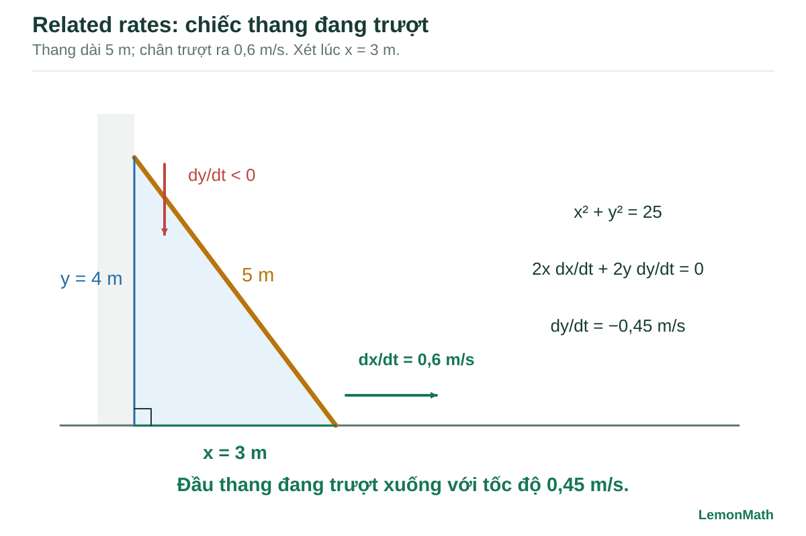

:::goals
- Giải thích ý nghĩa của đạo hàm trong ngữ cảnh, có đơn vị đúng và cụm "tại thời điểm t".
- Phân tích chuyển động thẳng: vận tốc, gia tốc, nhanh dần hay chậm dần, tổng quãng đường.
- Giải bài toán tốc độ liên quan bằng cách lấy đạo hàm một phương trình theo thời gian.
- Ước lượng giá trị bằng tiếp tuyến và tính giới hạn dạng $\dfrac00$, $\dfrac{\infty}{\infty}$ bằng quy tắc L'Hôpital.
:::

Cốc trà vừa rót thì nóng, rồi nguội dần. Nhưng nguội nhanh hay chậm, và nhanh đến mức nào ngay lúc này? Đó là một câu hỏi về đạo hàm, và Unit 4 là nơi giải tích gặp đời sống như thế. Đây cũng là một trong những unit xuất hiện rõ nhất ở phần tự luận: gần như năm nào cũng có ít nhất một câu yêu cầu giải thích ý nghĩa của đạo hàm trong một bối cảnh, xác định hạt đang nhanh dần hay chậm dần, hoặc ước lượng một giá trị bằng tiếp tuyến. Phần toán không nặng; điểm số được quyết định bởi câu chữ rõ ràng và đơn vị đúng.

## Đạo hàm là tốc độ thay đổi

Đạo hàm trả lời một câu hỏi: ngay lúc này, đại lượng đang thay đổi nhanh đến đâu? Nếu $Q(t)$ đo một đại lượng tại thời điểm $t$ thì $Q'(a)$ là tốc độ thay đổi tức thời của $Q$ tại $t=a$. Đơn vị của nó là "đơn vị của $Q$ trên một đơn vị của $t$". Một lời giải thích đầy đủ trả lời ba câu hỏi: cái gì đang thay đổi, tại thời điểm nào, và nhanh đến mức nào (kèm chiều: tăng hay giảm).

:::example Giải thích ý nghĩa của đạo hàm
Nhiệt độ của một cốc trà là $W(t)$ độ C, sau $t$ phút kể từ lúc rót. Phát biểu nào giải thích đúng nhất ý nghĩa của $W'(10)=-2{,}5$?
A. Nhiệt độ của trà là $-2{,}5$ độ C sau $10$ phút.
B. Trà nguội đi $2{,}5$ độ C trong $10$ phút đầu.
C. Tại thời điểm $10$ phút, nhiệt độ của trà đang giảm với tốc độ $2{,}5$ độ C mỗi phút.
D. Trà cần thêm $2{,}5$ phút để nguội đi $10$ độ C.

**Lời giải.** $W'(10)$ là tốc độ tức thời tại thời điểm $t=10$, đơn vị độ C mỗi phút, và mang dấu âm nên nhiệt độ đang giảm: đáp án **C**. Phương án A mô tả $W(10)$; phương án B mô tả mức thay đổi trung bình trên một khoảng.
:::

## Chuyển động thẳng

Giờ ta để một hạt chạy trên một đường thẳng. Biết vị trí $x(t)$ là ta biết mọi thứ về chuyển động: vận tốc là cách vị trí đổi, $v(t)=x'(t)$; gia tốc là cách vận tốc đổi, $a(t)=v'(t)=x''(t)$; còn tốc độ là độ lớn của vận tốc, $|v(t)|$.

- Hạt đi sang phải khi $v>0$, sang trái khi $v<0$, và đổi chiều tại nơi $v$ đổi dấu. Muốn biết hạt quay đầu ở đâu, hãy tìm nơi vận tốc bằng không và đổi dấu.
- Hạt **nhanh dần** khi $v$ và $a$ cùng dấu, **chậm dần** khi chúng trái dấu. Gia tốc cùng chiều chuyển động thì đẩy hạt đi nhanh hơn; ngược chiều thì kéo hạt chậm lại.
- Tổng quãng đường bằng tổng quãng đường của từng chặng giữa các điểm đổi chiều, vì lúc quay đầu hạt đi ngược trở lại.

:::example Đọc chuyển động
Một hạt chuyển động trên trục $x$ với vị trí $x(t)=t^3-6t^2+9t$, $t\ge0$.

a) Khi nào hạt đi sang trái?
b) Tại $t=2{,}5$ hạt đang nhanh dần hay chậm dần?
c) Tính tổng quãng đường hạt đi được từ $t=0$ đến $t=4$.

**Lời giải.** a) $v(t)=3t^2-12t+9=3(t-1)(t-3)$, âm khi $1<t<3$: hạt đi sang trái trên khoảng này.

b) $v(2{,}5)=3(1{,}5)(-0{,}5)=-2{,}25$ và $a(t)=6t-12$, nên $a(2{,}5)=3$. Vận tốc và gia tốc trái dấu: hạt đang **chậm dần**.

c) Hạt đổi chiều tại $t=1$ và $t=3$. Vị trí: $x(0)=0$, $x(1)=4$, $x(3)=0$, $x(4)=4$. Quãng đường $=4+4+4=12$.
:::

## Tốc độ liên quan

Quả bóng phồng lên thì thể tích và bán kính cùng tăng, nhưng không tăng nhanh như nhau. Hai đại lượng ấy gắn với nhau bằng một công thức, nên tốc độ của cái này kéo theo tốc độ của cái kia. Khi hai đại lượng liên hệ với nhau bằng một phương trình và cùng thay đổi theo thời gian, hãy lấy đạo hàm phương trình đó theo $t$. Trình tự chắc chắn: vẽ hình và đặt tên, viết phương trình đúng ở mọi thời điểm, lấy đạo hàm theo $t$, và chỉ sau đó mới thay các giá trị tại thời điểm được hỏi. Vì sao phải thay số sau cùng? Vì nếu thay sớm, một đại lượng đang thay đổi sẽ biến thành hằng số, và đạo hàm của nó biến mất.

:::example Quả bóng bay
Người ta bơm khí vào một quả bóng hình cầu với tốc độ $100$ xăng-ti-mét khối mỗi giây. Bán kính tăng nhanh đến mức nào khi bán kính bằng $5$ xăng-ti-mét?

**Lời giải.** $V=\dfrac43\pi r^3$, nên $\dfrac{dV}{dt}=4\pi r^2\dfrac{dr}{dt}$. Thay số: $100=4\pi(25)\dfrac{dr}{dt}$, suy ra $\dfrac{dr}{dt}=\dfrac1\pi\approx0{,}318$ xăng-ti-mét mỗi giây.
:::

:::example Chiếc thang trượt
Một chiếc thang dài $5$ mét dựa vào tường. Chân thang trượt ra xa tường với tốc độ $0{,}6$ mét mỗi giây. Đầu thang trượt xuống nhanh đến mức nào khi chân thang cách tường $3$ mét?

**Lời giải.** Gọi $x$ là khoảng cách từ tường đến chân thang, $y$ là độ cao đầu thang: $x^2+y^2=25$, nên $2x\dfrac{dx}{dt}+2y\dfrac{dy}{dt}=0$. Khi $x=3$ thì $y=4$: $3(0{,}6)+4\dfrac{dy}{dt}=0$, nên $\dfrac{dy}{dt}=-0{,}45$. Đầu thang trượt xuống với tốc độ $0{,}45$ mét mỗi giây. Dấu âm nghĩa là $y$ đang giảm; hãy nói rõ điều đó bằng lời.

:::

## Xấp xỉ tuyến tính và quy tắc L'Hôpital

Nhìn thật gần vào một điểm trên đồ thị, đường cong trông gần như thẳng. Vì thế gần $x=a$, ta có thể thay đường cong bằng tiếp tuyến của nó: $f(x)\approx f(a)+f'(a)(x-a)$. Ước lượng này lệch về phía nào thì tuỳ độ lõm. Nếu $f$ lõm lên gần $a$, tiếp tuyến nằm dưới đồ thị và giá trị ước lượng **nhỏ hơn** giá trị thật; nếu lõm xuống, giá trị ước lượng **lớn hơn** giá trị thật.

:::example Ước lượng căn bậc hai
Dùng tiếp tuyến của $f(x)=\sqrt x$ tại $x=4$, giá trị xấp xỉ của $\sqrt{4{,}1}$ là
A. $2{,}05$
B. $2{,}0025$
C. $2{,}025$
D. $2{,}25$

**Lời giải.** $f(4)=2$ và $f'(x)=\dfrac{1}{2\sqrt x}$, nên $f'(4)=\dfrac14$. Khi đó $\sqrt{4{,}1}\approx2+\dfrac14(0{,}1)=2{,}025$: đáp án **C**. Vì $\sqrt x$ lõm xuống nên giá trị này hơi lớn hơn giá trị thật.
:::

:::theorem Quy tắc L'Hôpital
Nếu $\lim f(x)$ và $\lim g(x)$ cùng bằng $0$, hoặc cùng là $\pm\infty$, và $\lim\dfrac{f'(x)}{g'(x)}$ tồn tại, thì $\lim\dfrac{f(x)}{g(x)}=\lim\dfrac{f'(x)}{g'(x)}$. Ở phần tự luận, hãy chỉ ra giới hạn có dạng $\dfrac00$ (hoặc $\dfrac\infty\infty$) trước khi dùng quy tắc.
:::

:::example Dùng quy tắc hai lần
$\displaystyle\lim_{x\to0}\frac{1-\cos x}{x^2}$ bằng
A. $0$
B. $\dfrac12$
C. $1$
D. Giới hạn không tồn tại.

**Lời giải.** Dạng $\dfrac00$. Quy tắc L'Hôpital cho $\displaystyle\lim_{x\to0}\frac{\sin x}{2x}$, vẫn là $\dfrac00$; dùng thêm một lần được $\displaystyle\lim_{x\to0}\frac{\cos x}{2}=\frac12$: đáp án **B**.
:::

:::warning Những cái bẫy thường gặp
- **Thiếu đơn vị hoặc thời điểm.** Chỗ này nhiều bạn hay mất điểm. "Tốc độ là $-3$" không được điểm; "tại $t=5$ phút, thể tích đang giảm với tốc độ $3$ lít mỗi phút" mới được điểm.
- **Nhanh dần nghĩa là $a>0$.** Sai: phải so sánh dấu của $v$ và $a$. Hạt vẫn có thể đang chậm dần dù gia tốc dương, nếu vận tốc âm.
- **Thay số quá sớm** trong bài tốc độ liên quan. Lấy đạo hàm trước, thay số sau, vì thay sớm thì đại lượng đang thay đổi bị biến thành hằng số.
- **Độ dời không phải quãng đường.** Trong ví dụ chuyển động, $x(4)-x(0)=4$ nhưng hạt đã đi $12$. Độ dời chỉ so điểm đầu với điểm cuối, còn quãng đường tính cả chặng đi lẫn chặng về.
- **L'Hôpital không phải quy tắc thương.** Lấy đạo hàm riêng tử và riêng mẫu, chứ không lấy đạo hàm của cả phân số.
:::

:::tip Mẫu câu trả lời
Gặp câu "giải thích ý nghĩa", bạn không cần nghĩ cách diễn đạt từ đầu. Chỉ cần điền vào mẫu sau: "Tại $t=$ ___ (đơn vị), ___ đang tăng/giảm với tốc độ ___ (đơn vị) mỗi (đơn vị)." Giám khảo AP tìm đúng những mảnh này, nên điền đủ là được điểm. Khi làm bài bằng tiếng Anh: "At $t=$ ___, the ___ is increasing/decreasing at a rate of ___ per ___." Luyện vài lần, bạn sẽ thấy mẫu câu này dùng được cho gần mọi bối cảnh.
:::

:::terms
- tốc độ thay đổi | rate of change
- vận tốc | velocity
- gia tốc | acceleration
- tốc độ (độ lớn vận tốc) | speed
- tổng quãng đường đi được | total distance traveled
- tốc độ liên quan | related rates
- xấp xỉ tuyến tính địa phương | local linearization
- quy tắc L'Hôpital | L'Hôpital's rule
:::

## Bài tập tương tự

:::exercise Trắc nghiệm
Một hạt chuyển động trên một đường thẳng với vận tốc $v(t)=t^2-4t+3$, $t\ge0$. Hạt đi sang trái trên khoảng nào?
A. $0<t<1$
B. $1<t<3$
C. $t>3$
D. $0<t<2$

::hint
**Cần nhớ:** hạt đi sang trái khi $v(t)<0$.

**Các bước:**
1. Phân tích: $v(t)=(t-1)(t-3)$.
2. Lập bảng xét dấu.

::solution
Hạt đi sang trái khi vận tốc $v(t)<0$.

Phân tích vận tốc thành nhân tử: $v(t)=t^2-4t+3=(t-1)(t-3)$, có hai nghiệm $t=1$ và $t=3$.

Vì hệ số của $t^2$ dương nên $v(t)<0$ khi $t$ nằm giữa hai nghiệm, tức là $1<t<3$; còn $v(t)>0$ khi $0\le t<1$ hoặc $t>3$.

Vậy hạt đi sang trái trên khoảng $1<t<3$. Vậy chọn **B**.

**Đáp số.** B.
:::

:::exercise Tự luận
Bán kính của một vết dầu loang hình tròn tăng $2$ xăng-ti-mét mỗi giây. Diện tích tăng nhanh đến mức nào khi bán kính bằng $10$ xăng-ti-mét?

::hint
**Cần nhớ:** lấy đạo hàm $A=\pi r^2$ theo $t$.

**Các bước:**
1. $\dfrac{dA}{dt}=2\pi r\dfrac{dr}{dt}$.
2. Thay $r=10$ và $\dfrac{dr}{dt}=2$.

::solution
Gọi $r$ (xăng-ti-mét) là bán kính và $A$ (xăng-ti-mét vuông) là diện tích của vết dầu tại thời điểm $t$ (giây). Ta có $A=\pi r^2$ và $\dfrac{dr}{dt}=2$ xăng-ti-mét mỗi giây.

Lấy đạo hàm hai vế theo $t$ (quy tắc đạo hàm hàm hợp):
$$\frac{dA}{dt}=2\pi r\,\frac{dr}{dt}.$$

Thay $r=10$ và $\dfrac{dr}{dt}=2$, ta được
$$\frac{dA}{dt}=2\pi(10)(2)=40\pi\approx125{,}7.$$

Vậy khi bán kính bằng $10$ xăng-ti-mét, diện tích vết dầu tăng với tốc độ $40\pi\approx125{,}7$ xăng-ti-mét vuông mỗi giây.

**Đáp số.** $40\pi\approx125{,}7$ xăng-ti-mét vuông mỗi giây.
:::

:::exercise Trắc nghiệm
$\displaystyle\lim_{x\to0}\frac{e^x-1-x}{x^2}$ bằng
A. $0$
B. $1$
C. $2$
D. $\dfrac12$

::hint
**Cần nhớ:** dùng quy tắc L'Hôpital khi vẫn còn dạng $\dfrac00$.

**Các bước:**
1. Lần thứ nhất: $\dfrac{e^x-1}{2x}$, vẫn là $\dfrac00$.
2. Dùng thêm một lần.

::solution
Khi $x\to0$, tử số $e^x-1-x\to e^0-1-0=0$ và mẫu số $x^2\to0$, nên giới hạn có dạng $\dfrac00$. Ta áp dụng quy tắc L'Hôpital.

Lần thứ nhất:
$$\lim_{x\to0}\frac{e^x-1-x}{x^2}=\lim_{x\to0}\frac{e^x-1}{2x}.$$

Giới hạn mới vẫn có dạng $\dfrac00$ (tử $\to e^0-1=0$, mẫu $\to0$), nên ta áp dụng quy tắc L'Hôpital lần thứ hai:
$$\lim_{x\to0}\frac{e^x-1}{2x}=\lim_{x\to0}\frac{e^x}{2}=\frac{e^0}{2}=\frac12.$$

Vậy giới hạn bằng $\dfrac12$, nên chọn **D**.

**Đáp số.** D.
:::

:::exercise Tự luận
Hàm số có đạo hàm $f$ thoả mãn $f(3)=2$ và $f'(3)=4$. Dùng tiếp tuyến tại $x=3$ để ước lượng $f(2{,}9)$.

::hint
**Cần nhớ:** $f(x)\approx f(3)+f'(3)(x-3)$.

**Các bước:**
1. $x-3=-0{,}1$.

::solution
Phương trình tiếp tuyến của đồ thị $f$ tại $x=3$ là
$$L(x)=f(3)+f'(3)(x-3)=2+4(x-3).$$

Vì $2{,}9$ gần $3$ nên ta dùng $f(2{,}9)\approx L(2{,}9)$, với $2{,}9-3=-0{,}1$:
$$f(2{,}9)\approx2+4(-0{,}1)=2-0{,}4=1{,}6.$$

Vậy $f(2{,}9)\approx1{,}6$.

**Đáp số.** $1{,}6$.
:::

:::exercise Tự luận
Một quần thể vi khuẩn có $P(t)$ nghìn con sau $t$ giờ kể từ khi bắt đầu thí nghiệm. Giải thích ý nghĩa của $P'(4)=1{,}5$ trong ngữ cảnh.

::hint
**Cần nhớ:** theo mẫu câu: thời điểm, đại lượng, chiều thay đổi, tốc độ kèm đơn vị.

::solution
Hàm $P(t)$ cho số vi khuẩn (đơn vị: nghìn con) sau $t$ giờ, nên đạo hàm $P'(t)$ cho tốc độ thay đổi tức thời của số vi khuẩn theo thời gian, với đơn vị là nghìn con mỗi giờ.

Ta có $P'(4)=1{,}5>0$, nên tại thời điểm $t=4$ giờ số vi khuẩn đang tăng.

Vậy tại thời điểm $t=4$ giờ, số vi khuẩn đang tăng với tốc độ $1{,}5$ nghìn con mỗi giờ.

**Đáp số.** Tại thời điểm $t=4$ giờ, số vi khuẩn đang tăng với tốc độ $1{,}5$ nghìn con mỗi giờ.
:::

## Bài tập vận dụng

:::exercise Đổ nước vào bể hình nón
Người ta đổ nước với tốc độ $2$ mét khối mỗi phút vào một bể hình nón đặt ngược (đỉnh ở dưới), bán kính đáy $3$ mét và chiều cao $6$ mét. Mực nước dâng nhanh đến mức nào khi nước sâu $4$ mét?

::hint
**Cần nhớ:** dùng tam giác đồng dạng để khử $r$: $\dfrac rh=\dfrac36$, nên $r=\dfrac h2$.

**Các bước:**
1. $V=\dfrac13\pi r^2h=\dfrac{\pi h^3}{12}$.
2. $\dfrac{dV}{dt}=\dfrac{\pi h^2}{4}\dfrac{dh}{dt}$; thay $h=4$.

::solution
Gọi $h$ (mét) là độ sâu của nước, $r$ (mét) là bán kính mặt nước và $V$ (mét khối) là thể tích nước trong bể tại thời điểm $t$ (phút). Ta có $\dfrac{dV}{dt}=2$ mét khối mỗi phút.

Nước trong bể có hình nón đồng dạng với bể (đỉnh ở dưới), nên
$$\frac{r}{h}=\frac{3}{6}\ \Rightarrow\ r=\frac h2.$$

Thể tích nước là
$$V=\frac13\pi r^2h=\frac13\pi\left(\frac h2\right)^2h=\frac{\pi h^3}{12}.$$

Lấy đạo hàm hai vế theo $t$ (quy tắc đạo hàm hàm hợp):
$$\frac{dV}{dt}=\frac{\pi h^2}{4}\,\frac{dh}{dt}.$$

Thay $\dfrac{dV}{dt}=2$ và $h=4$, ta được
$$2=\frac{\pi(16)}{4}\,\frac{dh}{dt}=4\pi\,\frac{dh}{dt}\ \Rightarrow\ \frac{dh}{dt}=\frac{1}{2\pi}\approx0{,}159.$$

Vậy khi nước sâu $4$ mét, mực nước dâng với tốc độ $\dfrac{1}{2\pi}\approx0{,}159$ mét mỗi phút.

**Đáp số.** $\dfrac{1}{2\pi}\approx0{,}159$ mét mỗi phút.
:::

:::exercise Một câu chuyển động đầy đủ
Một hạt chuyển động trên trục $x$ với $x(t)=2t^3-9t^2+12t$, $0\le t\le3$.
a) Khi nào hạt đi sang trái?
b) Tại $t=1{,}2$ hạt nhanh dần hay chậm dần?
c) Tính tổng quãng đường đi được trên $0\le t\le3$.

::hint
**Cần nhớ:** $v=6t^2-18t+12=6(t-1)(t-2)$ và $a=12t-18$.

**Các bước:**
1. Bảng xét dấu của $v$.
2. So sánh dấu của $v(1{,}2)$ và $a(1{,}2)$.
3. Vị trí tại $t=0, 1, 2, 3$.

::solution
Vận tốc của hạt là $v(t)=x'(t)=6t^2-18t+12=6(t-1)(t-2)$, và gia tốc là $a(t)=v'(t)=12t-18$.

a) Hạt đi sang trái khi $v(t)<0$. Vì $v(t)=6(t-1)(t-2)$ có hệ số của $t^2$ dương nên $v(t)<0$ khi $t$ nằm giữa hai nghiệm $1$ và $2$. Vậy hạt đi sang trái khi $1<t<2$.

b) Tại $t=1{,}2$:
$$v(1{,}2)=6(0{,}2)(-0{,}8)=-0{,}96,\qquad a(1{,}2)=12(1{,}2)-18=-3{,}6.$$
Vì $v(1{,}2)$ và $a(1{,}2)$ cùng dấu (cùng âm) nên tốc độ $|v|$ đang tăng. Vậy tại $t=1{,}2$ hạt đang nhanh dần.

c) Hạt đổi chiều tại $t=1$ và $t=2$ (các thời điểm $v$ đổi dấu), nên ta tính vị trí tại các mốc $t=0,1,2,3$:
$$x(0)=0,\quad x(1)=2-9+12=5,\quad x(2)=16-36+24=4,\quad x(3)=54-81+36=9.$$
Tổng quãng đường là tổng độ dời trên từng đoạn mà hạt đi một chiều:
$$|x(1)-x(0)|+|x(2)-x(1)|+|x(3)-x(2)|=5+1+5=11.$$

Vậy hạt đi sang trái khi $1<t<2$; tại $t=1{,}2$ hạt nhanh dần; tổng quãng đường đi được trên $0\le t\le3$ là $11$.

**Đáp số.** a) $1<t<2$; b) nhanh dần; c) $11$.
:::

:::exercise Hai chiếc xe
Xe A chạy về hướng bắc từ một ngã tư với vận tốc $60$ ki-lô-mét mỗi giờ, xe B chạy về hướng đông từ cùng ngã tư với vận tốc $80$ ki-lô-mét mỗi giờ, hai xe xuất phát cùng lúc. Sau nửa giờ, khoảng cách giữa hai xe tăng nhanh đến mức nào?

::hint
**Cần nhớ:** $z^2=x^2+y^2$, lấy đạo hàm theo $t$.

**Các bước:**
1. Sau $0{,}5$ giờ: $y=30$, $x=40$, $z=50$.
2. $z\dfrac{dz}{dt}=x\dfrac{dx}{dt}+y\dfrac{dy}{dt}$.

::solution
Gọi $y$ (ki-lô-mét) là quãng đường xe A đã đi về hướng bắc, $x$ (ki-lô-mét) là quãng đường xe B đã đi về hướng đông và $z$ (ki-lô-mét) là khoảng cách giữa hai xe tại thời điểm $t$ (giờ). Ta có $\dfrac{dy}{dt}=60$ và $\dfrac{dx}{dt}=80$.

Hai xe đi theo hai hướng vuông góc nên theo định lí Pythagore,
$$z^2=x^2+y^2.$$

Lấy đạo hàm hai vế theo $t$:
$$2z\,\frac{dz}{dt}=2x\,\frac{dx}{dt}+2y\,\frac{dy}{dt}\ \Rightarrow\ z\,\frac{dz}{dt}=x\,\frac{dx}{dt}+y\,\frac{dy}{dt}.$$

Sau nửa giờ ($t=0{,}5$): $x=80\cdot0{,}5=40$, $y=60\cdot0{,}5=30$ và $z=\sqrt{40^2+30^2}=50$.

Thay vào, ta được
$$50\,\frac{dz}{dt}=40(80)+30(60)=5000\ \Rightarrow\ \frac{dz}{dt}=100.$$

Kiểm tra: $z=\sqrt{(80t)^2+(60t)^2}=100t$ nên $\dfrac{dz}{dt}=100$.

Vậy sau nửa giờ, khoảng cách giữa hai xe tăng với tốc độ $100$ ki-lô-mét mỗi giờ.

**Đáp số.** $100$ ki-lô-mét mỗi giờ.
:::

:::exercise Thử thách
Hàm số $f$ có đạo hàm cấp hai, $f(1)=3$, $f'(1)=2$ và $f''(x)>0$ với mọi $x$. Ước lượng $f(1{,}2)$ bằng tiếp tuyến tại $x=1$ và cho biết giá trị ước lượng lớn hơn hay nhỏ hơn giá trị thật.

::hint
**Cần nhớ:** tiếp tuyến và ý nghĩa của tính lõm.

**Các bước:**
1. $f(1{,}2)\approx3+2(0{,}2)$.
2. Lõm lên: tiếp tuyến nằm ở đâu so với đồ thị?

::solution
Phương trình tiếp tuyến của đồ thị $f$ tại $x=1$ là
$$L(x)=f(1)+f'(1)(x-1)=3+2(x-1).$$

Ước lượng bằng tiếp tuyến, với $1{,}2-1=0{,}2$:
$$f(1{,}2)\approx L(1{,}2)=3+2(0{,}2)=3{,}4.$$

Vì $f''(x)>0$ với mọi $x$ nên đồ thị của $f$ lõm lên (lõm hướng lên trên) trên toàn bộ trục số, và do đó đồ thị nằm phía trên mọi tiếp tuyến của nó. Đặc biệt, tại $x=1{,}2$ ta có $f(1{,}2)>L(1{,}2)=3{,}4$.

Vậy giá trị ước lượng $3{,}4$ nhỏ hơn giá trị thật của $f(1{,}2)$.

**Đáp số.** $f(1{,}2)\approx3{,}4$; giá trị ước lượng nhỏ hơn giá trị thật.
:::

:::quiz
::mc TH
Một hạt có vị trí $s(t)=t^2-6t$. Vận tốc của hạt tại $t=4$ là
A. $2$
B. $-8$
C. $4$
D. $-2$
::key A
$v(t)=2t-6$, nên $v(4)=2$. Phương án B là vị trí $s(4)$.

::mc TH
Tại $t=2$, một hạt có $v(2)=-3$ và $a(2)=-1$. Tại thời điểm này hạt
A. đi sang phải và nhanh dần
B. đi sang trái và chậm dần
C. đi sang trái và nhanh dần
D. đi sang phải và chậm dần
::key C
$v<0$ nghĩa là đi sang trái; $v$ và $a$ cùng dấu nên hạt nhanh dần.

::mc TH
$\displaystyle\lim_{x\to0}\frac{\tan 2x}{x}$ bằng
A. $0$
B. $\dfrac12$
C. $1$
D. $2$
::key D
L'Hôpital: $\dfrac{2\sec^2 2x}{1}\to2$.

::mc VD
Dùng tiếp tuyến của $y=\sqrt[3]{x}$ tại $x=8$, giá trị ước lượng của $\sqrt[3]{8{,}3}$ là
A. $2{,}1$
B. $2{,}025$
C. $2{,}0125$
D. $2{,}25$
::key B
$y'=\dfrac{1}{3x^{2/3}}=\dfrac1{12}$ tại $x=8$, nên $\sqrt[3]{8{,}3}\approx2+\dfrac{0{,}3}{12}=2{,}025$.

::tf VD TH TH TH
Cạnh của một hình vuông tăng $3$ xăng-ti-mét mỗi giây.
a) Khi cạnh bằng $5$ xăng-ti-mét, diện tích tăng $30$ xăng-ti-mét vuông mỗi giây.
b) Chu vi tăng $3$ xăng-ti-mét mỗi giây.
c) Diện tích tăng với tốc độ không đổi.
d) Khi cạnh tăng gấp đôi, tốc độ tăng của diện tích cũng tăng gấp đôi.
::key Đ S S Đ
a) Đúng: $\dfrac{dA}{dt}=2s\dfrac{ds}{dt}=30$. b) Sai: $P=4s$, nên là $12$ xăng-ti-mét mỗi giây. c) Sai: $\dfrac{dA}{dt}=6s$ phụ thuộc $s$. d) Đúng.

::sa VD
Bán kính của một hình cầu tăng $0{,}5$ xăng-ti-mét mỗi giây. Thể tích tăng nhanh đến mức nào khi bán kính bằng $3$ xăng-ti-mét? Làm tròn đến một chữ số thập phân.
::key 56,5
$\dfrac{dV}{dt}=4\pi r^2\dfrac{dr}{dt}=4\pi(9)(0{,}5)=18\pi\approx56{,}5$ xăng-ti-mét khối mỗi giây.

::sa VD
Một hạt có vị trí $x(t)=t^2-4t$, $0\le t\le5$. Tính tổng quãng đường hạt đi được.
::key 13
Hạt đổi chiều tại $t=2$: $x(0)=0$, $x(2)=-4$, $x(5)=5$. Quãng đường $=4+9=13$.
:::
