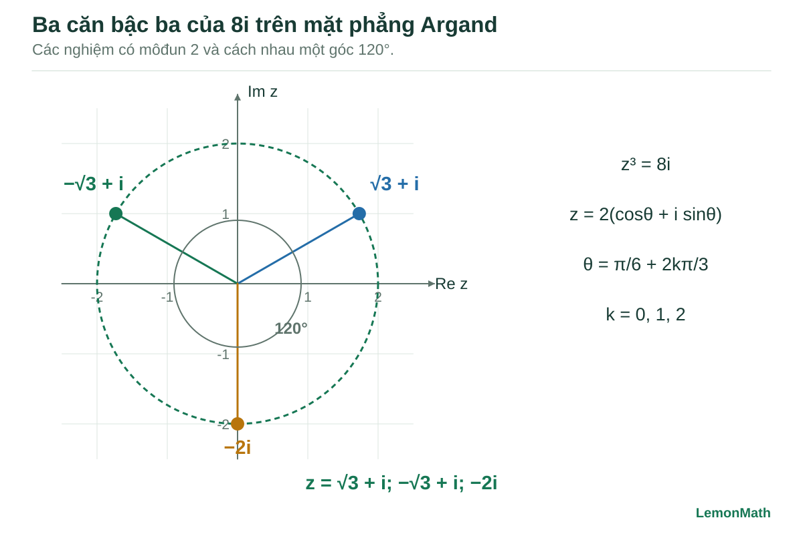

:::goals
- Tính toán với số phức dạng đại số, kể cả phép chia và số phức liên hợp.
- Chuyển đổi giữa dạng đại số, dạng lượng giác và dạng mũ (Euler), dùng định lí De Moivre.
- Tìm các căn bậc $n$ của một số phức và các nghiệm phức của đa thức hệ số thực.
- Viết chứng minh quy nạp, chứng minh phản chứng, và bác bỏ một mệnh đề bằng phản ví dụ.
:::

Các nội dung HL này có ở cả Paper 1 và Paper 2, thường trong các câu dài ở Section B, nơi một bài toán số phức có thể dẫn tới một đẳng thức lượng giác hay một chứng minh. Điểm chung của chúng là đòi bạn viết gọn gàng: acgumen tính bằng radian, liệt kê đủ các căn, và mỗi lần làm quy nạp đều viết đầy đủ cấu trúc hình thức của chứng minh. Quen với nếp viết này từ sớm sẽ giúp bạn đỡ mất điểm vì những chỗ nhỏ.

## Số phức dạng đại số

Số phức có dạng $z=a+bi$, với $i^2=-1$. Mỗi số phức có một người bạn đồng hành. **Số phức liên hợp (conjugate)** của nó là $z^*=a-bi$, tức là đổi dấu phần ảo. Còn **môđun (modulus)** là $|z|=\sqrt{a^2+b^2}$, cho biết số phức ấy cách gốc bao xa. Vì sao ta cần số phức liên hợp? Vì nhân một số phức với số liên hợp của nó thì phần ảo biến mất. Đó cũng là mẹo của phép chia: nhân cả tử và mẫu với số phức liên hợp của mẫu, và mẫu trở thành số thực.

:::example Tích và thương
Cho $z=3+4i$ và $w=1-2i$. Tính $zw$, $\dfrac zw$ và $|z|$. [5 marks]

**Lời giải.** $zw=3-6i+4i-8i^2=11-2i$.

$\dfrac zw=\dfrac{(3+4i)(1+2i)}{(1-2i)(1+2i)}=\dfrac{3+6i+4i+8i^2}{5}=\dfrac{-5+10i}{5}=-1+2i$.

$|z|=\sqrt{9+16}=5$.
:::

## Dạng lượng giác và dạng mũ

$$z=r(\cos\theta+i\sin\theta)=r\operatorname{cis}\theta=re^{i\theta},$$
trong đó $r=|z|$ là độ dài và $\theta=\arg z$ là góc, thường lấy trong $-\pi<\theta\le\pi$. Vì sao dạng này đáng dùng? Vì với nó, phép nhân trở nên rất gọn: nhân các môđun và cộng các acgumen. Từ đó có **định lí De Moivre**, cho ta $\left(re^{i\theta}\right)^n=r^ne^{in\theta}$: muốn luỹ thừa một số phức, ta luỹ thừa môđun và nhân acgumen với số mũ.

:::example Luỹ thừa bằng De Moivre
Cho $z=1+i\sqrt3$.
(a) Viết $z$ dưới dạng $re^{i\theta}$. [2 marks]
(b) Từ đó tính $z^6$. [2 marks]

**Lời giải.** (a) $r=\sqrt{1+3}=2$ và $\theta=\arctan\sqrt3=\dfrac\pi3$ (góc phần tư thứ nhất), nên $z=2e^{i\pi/3}$.

(b) $z^6=2^6e^{2\pi i}=64$.
:::

## Căn của số phức và nghiệm của đa thức

Phương trình bậc hai có hai nghiệm; còn phương trình $z^n=re^{i\theta}$ có $n$ nghiệm phân biệt, và ta viết ra được tất cả chúng:
$$z=r^{1/n}e^{i(\theta+2k\pi)/n},\quad k=0,1,\dots,n-1.$$
Nếu vẽ các nghiệm lên mặt phẳng phức, bạn sẽ thấy chúng nằm trên đường tròn bán kính $r^{1/n}$ và cách đều nhau, giống các đỉnh của một đa giác đều. Với đa thức **hệ số thực**, các nghiệm không thực luôn đi thành từng cặp liên hợp. Chẳng hạn, nếu $2+i$ là nghiệm thì $2-i$ cũng là nghiệm. Bạn sẽ dùng điều này ngay trong ví dụ thứ hai bên dưới.

:::example Căn bậc ba
Giải $z^3=8i$, viết đáp số dưới dạng $a+bi$. [6 marks]

**Lời giải.** $8i=8e^{i\pi/2}$, nên $z=2e^{i(\pi/6+2k\pi/3)}$ với $k=0,1,2$:

$k=0$: $2e^{i\pi/6}=\sqrt3+i$. $k=1$: $2e^{i5\pi/6}=-\sqrt3+i$. $k=2$: $2e^{i3\pi/2}=-2i$.

:::

:::example Phương trình bậc ba có nghiệm phức
Biết $2+i$ là nghiệm của $z^3-5z^2+9z-5=0$. Tìm các nghiệm còn lại. [5 marks]

**Lời giải.** Các hệ số đều thực nên $2-i$ cũng là nghiệm, và $(z-2-i)(z-2+i)=z^2-4z+5$ là một nhân tử. Chia đa thức: $z^3-5z^2+9z-5=\left(z^2-4z+5\right)(z-1)$. Các nghiệm là $2+i$, $2-i$ và $1$.
:::

## Chứng minh quy nạp

:::note Bốn phần người chấm tìm kiếm
1. **Bước cơ sở:** kiểm tra mệnh đề đúng với giá trị đầu tiên, thường là $n=1$.
2. **Giả thiết quy nạp:** giả sử mệnh đề đúng với $n=k$. Đây mới chỉ là giả sử, chưa phải điều đã được chứng minh.
3. **Bước quy nạp:** dùng giả thiết để chứng minh mệnh đề cũng đúng với $n=k+1$.
4. **Kết luận:** viết thành một câu hoàn chỉnh: "Vì mệnh đề đúng với $n=1$, và đúng với $n=k+1$ mỗi khi nó đúng với $n=k$, nên theo nguyên lí quy nạp, mệnh đề đúng với mọi $n\in\mathbb{Z}^+$."

Bạn có thể hình dung như một hàng quân domino: bước cơ sở đẩy quân đầu tiên, bước quy nạp bảo đảm quân nào đổ thì quân kế tiếp cũng đổ. Thiếu phần nào thì hàng không đổ hết, nên hãy viết đủ cả bốn phần mỗi lần.
:::

:::example Một tổng bằng quy nạp
Chứng minh bằng quy nạp rằng $\displaystyle\sum_{r=1}^{n}r(r+1)=\frac{n(n+1)(n+2)}{3}$ với mọi $n\in\mathbb{Z}^+$. [7 marks]

**Lời giải.** **Cơ sở:** với $n=1$, VT $=1\cdot2=2$ và VP $=\dfrac{1\cdot2\cdot3}{3}=2$.

**Giả thiết:** giả sử $\displaystyle\sum_{r=1}^{k}r(r+1)=\frac{k(k+1)(k+2)}{3}$.

**Bước quy nạp:** $\displaystyle\sum_{r=1}^{k+1}r(r+1)=\frac{k(k+1)(k+2)}{3}+(k+1)(k+2)=\frac{(k+1)(k+2)(k+3)}{3}$, đúng là công thức với $n=k+1$.

**Kết luận:** đúng với $n=1$, và đúng với $n=k+1$ mỗi khi đúng với $n=k$, nên đúng với mọi $n\in\mathbb{Z}^+$ theo nguyên lí quy nạp.
:::

## Phản chứng và phản ví dụ

Có hai cách lập luận bạn nên có sẵn trong tay. Cách thứ nhất là **phản chứng (contradiction)**: giả sử mệnh đề sai, rồi lần theo lập luận cho tới khi gặp một điều vô lí. Khi đó giả sử ban đầu không thể đúng, nghĩa là mệnh đề đúng. Cách thứ hai dành cho lúc ta muốn bác bỏ một mệnh đề: chỉ cần tìm được một **phản ví dụ (counterexample)** là đủ, vì một trường hợp sai đã làm sụp cả mệnh đề "với mọi".

:::example Một phản ví dụ
Chứng tỏ mệnh đề "$n^2+n+41$ là số nguyên tố với mọi số nguyên dương $n$" là sai. [2 marks]

**Lời giải.** Với $n=40$: $40^2+40+41=1681=41^2$, không phải số nguyên tố. (Biểu thức cho số nguyên tố với $n$ từ $1$ đến $39$, đó là lí do vì sao thử vài trường hợp không phải là chứng minh.)
:::

:::warning Những cái bẫy thường gặp
- **Acgumen sai góc phần tư.** $\arctan\dfrac ba$ chỉ cho đúng góc khi $a>0$; hãy biểu diễn $z$ trên mặt phẳng phức trước rồi mới tính.
- **Thiếu nghiệm.** $z^n=w$ luôn có $n$ nghiệm; hãy liệt kê đủ, đừng dừng khi mới có vài nghiệm.
- **Quy nạp không có kết luận**, hoặc viết "giả sử đúng với mọi $n$" thay cho "với $n=k$".
- **Dùng giả thiết theo chiều ngược:** hãy xuất phát từ trường hợp $k+1$ và dùng mệnh đề $n=k$ bên trong nó.
- **Chứng minh bằng ví dụ.** Thử vài trường hợp không bao giờ chứng minh được một mệnh đề "với mọi".

Đừng lo nếu bạn từng mắc vài lỗi trong số này, nhiều bạn cũng vậy. Cách sửa là tập thói quen rà lại danh sách này sau mỗi bài.
:::

:::terms
- complex conjugate, modulus, argument | số phức liên hợp, môđun, acgumen
- Argand diagram | mặt phẳng phức (biểu đồ Argand)
- modulus-argument form, Euler form | dạng lượng giác, dạng mũ (Euler)
- De Moivre's theorem | định lí De Moivre
- roots of unity | căn bậc $n$ của đơn vị
- proof by induction | chứng minh quy nạp
- proof by contradiction | chứng minh phản chứng
- counterexample | phản ví dụ
:::

## Bài tập tương tự

:::exercise Tính toán dạng đại số
Tính $(2-i)^2$ và $\dfrac{1}{2-i}$ dưới dạng $a+bi$. [4 marks]

::hint
**Cần nhớ:** khai triển; nhân với $\dfrac{2+i}{2+i}$.

::solution
Tính $(2-i)^2$. Áp dụng hằng đẳng thức bình phương của một hiệu và $i^2=-1$:
$$(2-i)^2=4-4i+i^2=4-4i-1=3-4i.$$

Tính $\dfrac{1}{2-i}$. Nhân cả tử và mẫu với số phức liên hợp của mẫu là $2+i$:
$$\frac{1}{2-i}=\frac{2+i}{(2-i)(2+i)}=\frac{2+i}{4-i^2}=\frac{2+i}{5}.$$

Tách phần thực và phần ảo, ta được $\dfrac{1}{2-i}=\dfrac25+\dfrac15i$.

Vậy $(2-i)^2=3-4i$ và $\dfrac{1}{2-i}=\dfrac25+\dfrac15i$.

**Đáp số.** $(2-i)^2=3-4i$; $\dfrac{1}{2-i}=\dfrac25+\dfrac15i$.
:::

:::exercise Dạng mũ
Viết $-2-2i$ dưới dạng $re^{i\theta}$, $-\pi<\theta\le\pi$. [3 marks]

::hint
**Cần nhớ:** điểm này nằm ở góc phần tư thứ ba.

::solution
Đặt $z=-2-2i$ và viết $z=re^{i\theta}$ với $r>0$, $-\pi<\theta\le\pi$.

Môđun: $r=|z|=\sqrt{(-2)^2+(-2)^2}=\sqrt8=2\sqrt2$.

Argument: phần thực và phần ảo của $z$ đều âm nên điểm biểu diễn $z$ nằm ở góc phần tư thứ ba. Ta có $\tan\theta=\dfrac{-2}{-2}=1$, nên góc tham chiếu là $\dfrac\pi4$. Với $-\pi<\theta\le\pi$ và góc phần tư thứ ba, ta được
$$\theta=-\pi+\frac\pi4=-\frac{3\pi}{4}.$$

Kiểm tra: $2\sqrt2\cos\left(-\dfrac{3\pi}{4}\right)=2\sqrt2\cdot\left(-\dfrac{\sqrt2}{2}\right)=-2$ và $2\sqrt2\sin\left(-\dfrac{3\pi}{4}\right)=-2$.

Vậy $-2-2i=2\sqrt2e^{-3\pi i/4}$.

**Đáp số.** $2\sqrt2e^{-3\pi i/4}$.
:::

:::exercise Căn bậc bốn
Giải $z^4=16$. [4 marks]

::hint
**Cần nhớ:** $16=16e^{i0}$; bốn nghiệm cách nhau $\dfrac\pi2$.

::solution
Viết $z=re^{i\theta}$ với $r>0$. Vì $16=16e^{i\cdot0}$, phương trình $z^4=16$ trở thành
$$r^4e^{4i\theta}=16e^{i\cdot0}.$$

So sánh môđun: $r^4=16$, suy ra $r=2$ (vì $r>0$).

So sánh argument: $4\theta=2k\pi$ với $k\in\mathbb{Z}$, suy ra $\theta=\dfrac{k\pi}{2}$.

Do đó $z=2e^{ik\pi/2}$. Các giá trị $k=0,1,2,3$ cho bốn nghiệm phân biệt; với $k=4$ ta quay lại nghiệm của $k=0$ nên không có thêm nghiệm mới.

Tính từng nghiệm:
- $k=0$: $z=2e^{0}=2$;
- $k=1$: $z=2e^{i\pi/2}=2i$;
- $k=2$: $z=2e^{i\pi}=-2$;
- $k=3$: $z=2e^{3i\pi/2}=-2i$.

Vậy phương trình $z^4=16$ có bốn nghiệm $2$, $2i$, $-2$, $-2i$.

**Đáp số.** $2$, $2i$, $-2$, $-2i$.
:::

:::exercise So sánh phần thực và phần ảo
Tìm $z=a+bi$ sao cho $z+2z^*=6-i$. [3 marks]

::hint
**Cần nhớ:** $z+2z^*=3a-bi$; so sánh phần thực và phần ảo.

::solution
Với $z=a+bi$ ($a,b\in\mathbb{R}$), số phức liên hợp là $z^*=a-bi$.

Ta có
$$z+2z^*=(a+bi)+2(a-bi)=3a-bi.$$

Phương trình $z+2z^*=6-i$ trở thành $3a-bi=6-i$.

Hai số phức bằng nhau khi phần thực bằng nhau và phần ảo bằng nhau, nên
$$3a=6\ \text{và}\ -b=-1.$$

Suy ra $a=2$ và $b=1$.

Kiểm tra: $2+i+2(2-i)=2+i+4-2i=6-i$.

Vậy $z=2+i$.

**Đáp số.** $z=2+i$.
:::

:::exercise Chia hết bằng quy nạp
Chứng minh bằng quy nạp rằng $3^{2n}-1$ chia hết cho $8$ với mọi $n\in\mathbb{Z}^+$. [6 marks]

::hint
**Cần nhớ:** $3^{2(k+1)}-1=9\cdot3^{2k}-1=9\left(3^{2k}-1\right)+8$.

::solution
Gọi $P(n)$ là mệnh đề "$3^{2n}-1$ chia hết cho $8$". Ta chứng minh $P(n)$ đúng với mọi $n\in\mathbb{Z}^+$ bằng quy nạp.

Cơ sở: với $n=1$, ta có $3^2-1=8$, chia hết cho $8$. Vậy $P(1)$ đúng.

Giả thiết quy nạp: giả sử $P(k)$ đúng với một số nguyên dương $k$, tức là $3^{2k}-1=8m$ với $m$ nguyên.

Bước quy nạp: ta chứng minh $P(k+1)$ đúng. Ta có
$$\begin{aligned}3^{2(k+1)}-1&=3^{2k+2}-1=9\cdot3^{2k}-1\\&=9\left(3^{2k}-1\right)+8\\&=9(8m)+8=8(9m+1).\end{aligned}$$

Vì $9m+1$ là số nguyên nên $3^{2(k+1)}-1$ là bội của $8$. Vậy $P(k+1)$ đúng.

Kết luận: $P(1)$ đúng, và $P(k)$ đúng kéo theo $P(k+1)$ đúng. Theo nguyên lí quy nạp, $P(n)$ đúng với mọi $n\in\mathbb{Z}^+$.

Vậy $3^{2n}-1$ chia hết cho $8$ với mọi $n\in\mathbb{Z}^+$.

**Đáp số.** $3^{2n}-1$ chia hết cho $8$ với mọi $n\in\mathbb{Z}^+$.
:::

## Bài tập vận dụng

:::exercise Đẳng thức lượng giác từ De Moivre
Dùng định lí De Moivre với $n=3$ để chứng minh $\cos3\theta=4\cos^3\theta-3\cos\theta$. [6 marks]

::hint
**Cần nhớ:** khai triển $(\cos\theta+i\sin\theta)^3$ bằng nhị thức Newton và so sánh phần thực; dùng $\sin^2\theta=1-\cos^2\theta$.

::solution
Đặt $c=\cos\theta$ và $s=\sin\theta$ (với $\theta$ thực nên $c$, $s$ là các số thực).

Theo định lí De Moivre với $n=3$:
$$(c+is)^3=\cos3\theta+i\sin3\theta.$$

Khai triển vế trái bằng công thức nhị thức, với $i^2=-1$ và $i^3=-i$:
$$(c+is)^3=c^3+3c^2(is)+3c(is)^2+(is)^3=c^3+3ic^2s-3cs^2-is^3.$$

Phần thực của vế trái là $c^3-3cs^2$. Vì hai số phức bằng nhau thì phần thực bằng nhau, nên
$$\cos3\theta=c^3-3cs^2.$$

Thay $s^2=1-c^2$:
$$\cos3\theta=c^3-3c\left(1-c^2\right)=c^3-3c+3c^3=4c^3-3c.$$

Vậy $\cos3\theta=4\cos^3\theta-3\cos\theta$.

**Đáp số.** $\cos3\theta=4\cos^3\theta-3\cos\theta$.
:::

:::exercise Căn bậc ba của đơn vị
Cho $\omega=e^{2\pi i/3}$. Chứng minh $1+\omega+\omega^2=0$, và mô tả ba căn bậc ba của $1$ trên mặt phẳng phức. [4 marks]

::hint
**Cần nhớ:** $\omega^3=1$ và $\omega\ne1$; phân tích $\omega^3-1$.

::solution
Ta có $\omega=e^{2\pi i/3}=\cos\dfrac{2\pi}{3}+i\sin\dfrac{2\pi}{3}=-\dfrac12+\dfrac{\sqrt3}{2}i$, nên $\omega\ne1$.

Mặt khác $\omega^3=e^{2\pi i}=1$, nên $\omega^3-1=0$.

Phân tích thành nhân tử:
$$\omega^3-1=(\omega-1)\left(\omega^2+\omega+1\right)=0.$$

Vì $\omega\ne1$ nên $\omega-1\ne0$. Do đó $\omega^2+\omega+1=0$, tức là $1+\omega+\omega^2=0$.

Các căn bậc ba của $1$ là nghiệm của $z^3=1$, tức là $z=e^{2k\pi i/3}$ với $k=0,1,2$. Đó là $1$, $\omega$ và $\omega^2=e^{4\pi i/3}=-\dfrac12-\dfrac{\sqrt3}{2}i$.

Cả ba số đều có môđun bằng $1$ nên nằm trên đường tròn đơn vị. Argument của chúng là $0$, $\dfrac{2\pi}{3}$, $\dfrac{4\pi}{3}$, cách đều nhau $\dfrac{2\pi}{3}$, nên ba điểm chia đường tròn đơn vị thành ba cung bằng nhau và các dây cung nối chúng bằng nhau.

Vậy $1+\omega+\omega^2=0$, và ba căn bậc ba của $1$ là ba đỉnh của một tam giác đều nội tiếp đường tròn đơn vị trên mặt phẳng phức.

**Đáp số.** $1+\omega+\omega^2=0$; ba nghiệm $1$, $\omega$, $\omega^2$ là ba đỉnh của một tam giác đều nội tiếp đường tròn đơn vị.
:::

:::exercise Quy nạp với đạo hàm
Chứng minh bằng quy nạp rằng $\dfrac{d^n}{dx^n}\left(xe^x\right)=(x+n)e^x$ với mọi $n\in\mathbb{Z}^+$. [6 marks]

::hint
**Cần nhớ:** lấy đạo hàm $(x+k)e^x$ bằng quy tắc tích.

::solution
Gọi $P(n)$ là mệnh đề "$\dfrac{d^n}{dx^n}\left(xe^x\right)=(x+n)e^x$". Ta chứng minh $P(n)$ đúng với mọi $n\in\mathbb{Z}^+$ bằng quy nạp.

Cơ sở: với $n=1$, áp dụng quy tắc đạo hàm của một tích,
$$\frac{d}{dx}\left(xe^x\right)=1\cdot e^x+xe^x=(x+1)e^x.$$
Vậy $P(1)$ đúng.

Giả thiết quy nạp: giả sử $P(k)$ đúng với một số nguyên dương $k$, tức là
$$\frac{d^k}{dx^k}\left(xe^x\right)=(x+k)e^x.$$

Bước quy nạp: ta chứng minh $P(k+1)$ đúng. Lấy đạo hàm hai vế của giả thiết quy nạp và áp dụng quy tắc đạo hàm của một tích:
$$\begin{aligned}\frac{d^{k+1}}{dx^{k+1}}\left(xe^x\right)&=\frac{d}{dx}\big((x+k)e^x\big)\\&=1\cdot e^x+(x+k)e^x\\&=(x+k+1)e^x=\big(x+(k+1)\big)e^x.\end{aligned}$$

Đây đúng là công thức của $P(k+1)$.

Kết luận: $P(1)$ đúng, và $P(k)$ đúng kéo theo $P(k+1)$ đúng. Theo nguyên lí quy nạp, $P(n)$ đúng với mọi $n\in\mathbb{Z}^+$.

Vậy $\dfrac{d^n}{dx^n}\left(xe^x\right)=(x+n)e^x$ với mọi $n\in\mathbb{Z}^+$.

**Đáp số.** $\dfrac{d^n}{dx^n}\left(xe^x\right)=(x+n)e^x$ với mọi $n\in\mathbb{Z}^+$.
:::

:::exercise Thử thách: một logarit vô tỉ
Chứng minh bằng phản chứng rằng $\log_23$ là số vô tỉ. [5 marks]

::hint
**Cần nhớ:** giả sử $\log_23=\dfrac pq$ với $p$, $q$ nguyên dương; khi đó $2^p=3^q$.

::solution
Giả sử ngược lại rằng $\log_23$ là số hữu tỉ.

Vì $3>1$ nên $\log_23>0$. Do đó có thể viết $\log_23=\dfrac pq$ với $p,q\in\mathbb{Z}^+$.

Theo định nghĩa lôgarit, $2^{p/q}=3$. Luỹ thừa $q$ cả hai vế, ta được
$$2^p=3^q.$$

Vì $p\ge1$ nên $2^p$ là số chẵn. Mặt khác, $3$ là số lẻ nên $3^q$ (tích của $q$ thừa số lẻ) là số lẻ.

Một số không thể vừa chẵn vừa lẻ, nên $2^p=3^q$ là vô lí. Vậy giả sử ban đầu sai.

Vậy $\log_23$ là số vô tỉ.

**Đáp số.** $\log_23$ là số vô tỉ.
:::

:::quiz
::mc TH
$i^{23}$ bằng
A. $1$
B. $i$
C. $-1$
D. $-i$
::key D
$23=4\cdot5+3$, nên $i^{23}=i^3=-i$.

::mc TH
$\arg(-1+i)$ bằng
A. $\dfrac{3\pi}{4}$
B. $\dfrac{\pi}{4}$
C. $-\dfrac{\pi}{4}$
D. $\dfrac{5\pi}{4}$
::key A
Điểm $(-1,1)$ nằm ở góc phần tư thứ hai. Phương án D nằm ngoài $-\pi<\theta\le\pi$.

::mc TH
Các nghiệm của $z^2-4z+13=0$ là
A. $4\pm3i$
B. $-2\pm3i$
C. $2\pm3i$
D. $2\pm9i$
::key C
$z=\dfrac{4\pm\sqrt{16-52}}{2}=\dfrac{4\pm6i}{2}$.

::mc TH
Bước nào không thuộc chứng minh quy nạp?
A. Chứng tỏ mệnh đề đúng với $n=1$
B. Kiểm tra mệnh đề với $n=1$ đến $n=10$ rồi kết luận
C. Giả sử mệnh đề đúng với $n=k$
D. Chứng minh mệnh đề đúng với $n=k+1$
::key B
Thử các trường hợp không phải là chứng minh; ba phương án còn lại là cấu trúc của quy nạp.

::tf NB TH TH TH
Cho $z=2e^{i\pi/4}$.
a) $|z|=2$.
b) $z^2=4i$.
c) $\operatorname{Re}z=2$.
d) $z^4=16$.
::key T T F F
a) Đúng. b) Đúng: $4e^{i\pi/2}=4i$. c) Sai: $\operatorname{Re}z=2\cos\dfrac\pi4=\sqrt2$. d) Sai: $z^4=16e^{i\pi}=-16$.

::sa TH
Tính $\left|(1+i)^6\right|$.
::key 8
$|1+i|^6=\left(\sqrt2\right)^6=8$.

::sa NB
Phương trình $z^5=1$ có bao nhiêu nghiệm phân biệt?
::key 5
Phương trình $z^n=w$ với $w\ne0$ có $n$ nghiệm phân biệt.
:::
