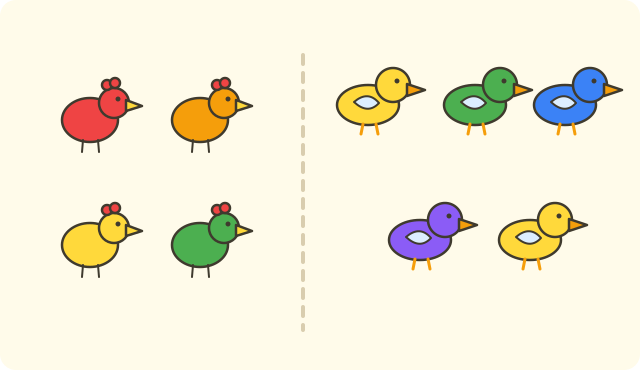

:::goals
- Hiểu phép cộng là gộp hai nhóm lại.
- Đọc và viết phép cộng trong phạm vi $10$, ví dụ $3+2=5$.
- Tính bằng cách đếm tiếp và biết đổi chỗ hai số.
- Giải bài toán có lời văn bằng một phép cộng.
:::

Lan có $3$ viên bi. Mai cho Lan thêm $2$ viên bi nữa. Hỏi Lan có tất cả bao nhiêu viên bi?

Em đã biết $5$ gồm $3$ và $2$. Bài này em học cách viết điều đó thành một phép tính.

## Cùng khám phá

Lan có $3$ viên bi. Mai cho thêm $2$ viên. Em gộp hai nhóm lại và đếm tiếp từ $3$.

- Em nói số $3$ trước: "ba".
- Em đếm thêm hai viên: "bốn, năm".
- Số cuối cùng là năm.

Vậy Lan có tất cả $5$ viên bi. Ta viết $3+2=5$ và đọc là "ba cộng hai bằng năm".

:::graph Trên tia số: từ 3 đếm thêm 2 bước đến 5
alt: Tia số có các điểm 3, 4, 5; đoạn từ 3 đến 5 cho thấy đếm thêm hai bước
x: -1..11
y: -1..1
segment: (3, 0) (5, 0)
point: (3, 0) "3" below
point: (4, 0) "4" below
point: (5, 0) "5" below
:::

:::theorem Phép cộng
1. Gộp hai nhóm lại thì làm phép cộng. Dấu cộng là $+$, dấu bằng là $=$.
2. Muốn tính $3+2$, đếm tiếp từ $3$ thêm $2$ số: được $5$.
3. Đổi chỗ hai số thì kết quả không đổi: $3+2=2+3$.
4. Cộng với $0$ thì số không đổi: $7+0=7$.
:::

Cách này đúng vì gộp nhóm $3$ và nhóm $2$ thì không mất viên bi nào, em chỉ đếm tất cả các viên.

## Ví dụ

Ta bắt đầu với một phép cộng rất nhỏ.

:::example Tính $4+1$
**Lời giải.** Em nói số đầu "bốn", rồi đếm thêm một số: "năm".

Vậy $4+1=5$.
:::

Bây giờ em đếm thêm nhiều số hơn.

:::example Tính $5+3$
**Lời giải.** Em nói số đầu "năm", rồi đếm thêm ba số: "sáu, bảy, tám".

Vậy $5+3=8$.
:::

Khi số đầu bé, em đổi chỗ cho dễ đếm.

:::example Tính $2+6$
**Lời giải.** Đổi chỗ hai số thì kết quả không đổi, nên $2+6=6+2$. Em đếm tiếp từ số lớn $6$ thêm hai số: "bảy, tám".

Vậy $2+6=8$.
:::

Cộng với $0$ thì sao?

:::example Tính $7+0$
**Lời giải.** Thêm $0$ nghĩa là không thêm gì, nên số không đổi.

Vậy $7+0=7$.
:::

Cuối cùng em giải một bài toán có lời văn.

:::example Gà và vịt
Nhà bà có $4$ con gà và $5$ con vịt. Hỏi nhà bà có tất cả bao nhiêu con gà và vịt?

**Lời giải.** "Tất cả" nghĩa là gộp hai nhóm lại, nên em làm phép cộng. Em đếm tiếp từ số lớn $5$ thêm $4$ số: "sáu, bảy, tám, chín":
$$4+5=5+4=9.$$
Vậy nhà bà có $9$ con.
:::

:::warning Những lỗi em hay gặp
- **Đếm cả số đầu thêm lần nữa.** Sai: $3+2=6$ vì đếm "ba, bốn, năm, sáu". Vì sao sai: em đếm thêm $3$ số thay vì $2$ số. Đúng: đếm thêm đúng $2$ số: bốn, năm. Vậy $3+2=5$.
- **Viết dấu bằng sai chỗ.** Sai: $3+2$ viết thành $5=3+2$ rồi quên cách đọc. Vì sao sai: dễ lẫn kết quả với phép tính. Đúng: viết phép tính trước, kết quả sau dấu $=$.
- **Bài có lời văn quên đơn vị.** Sai: "Đáp số: $9$". Đúng: "Đáp số: $9$ con".
:::

## Thuật ngữ

:::terms
- phép cộng | addition
- cộng ($+$) | plus
- bằng ($=$) | equals
- gộp | put together
- tất cả | altogether
- đổi chỗ | swap
- tia số | number line
:::

## Tóm tắt

- Gộp hai nhóm lại thì làm phép cộng: $3+2=5$.
- Đếm tiếp từ số đầu thêm đúng số lần của số thứ hai.
- Đổi chỗ hai số thì kết quả không đổi.
- Cộng với $0$ thì số không đổi.
- Bài toán hỏi "tất cả" thường là phép cộng; nhớ ghi đơn vị.

## Luyện tập

Mỗi bài có phần kiến thức và gợi ý. Em hãy tự làm trước, rồi mới bấm xem lời giải.

:::exercise
Tính $2+3$.

::hint
**Kiến thức:** đếm tiếp từ số đầu thêm số lần của số thứ hai.

**Gợi ý các bước:**
1. Nói số đầu: hai.
2. Đếm thêm ba số.

::solution
Từ $2$ đếm thêm ba số: "ba, bốn, năm".

**Đáp số.** $2+3=5$.
:::

:::exercise
Tính $6+2$.

::hint
**Kiến thức:** đếm tiếp từ số đầu thêm hai số.

**Gợi ý các bước:**
1. Nói số đầu: sáu.
2. Đếm thêm hai số.

::solution
Từ $6$ đếm thêm hai số: "bảy, tám".

**Đáp số.** $6+2=8$.
:::

:::exercise
Em hãy nhớ lại bài trước: $7$ gồm $3$ và $4$. Viết phép cộng tương ứng và tính $3+4$.

::hint
**Kiến thức:** nếu $7$ gồm $3$ và $4$ thì gộp $3$ và $4$ lại được $7$.

**Gợi ý các bước:**
1. Đếm tiếp từ $4$ thêm $3$ số.
2. Kiểm tra với số đã biết.

::solution
Từ $4$ đếm thêm ba số: "năm, sáu, bảy". Kết quả đúng bằng số $7$ đã biết.

**Đáp số.** $3+4=7$.
:::

:::exercise
Tìm số thích hợp:
a) $3+\square=5$.
b) $\square+4=6$.

::hint
**Kiến thức:** $5$ gồm $3$ và mấy? $6$ gồm mấy và $4$?

**Gợi ý các bước:**
1. Đếm từ $3$ lên $5$.
2. Đếm từ $4$ lên $6$.

::solution
a) Từ $3$ lên $5$: "bốn, năm", có $2$ số. b) Từ $4$ lên $6$: "năm, sáu", có $2$ số.

**Đáp số.** a) $2$. b) $2$.
:::

:::exercise
Nam nói: "$4+3=8$ vì em đếm bốn, năm, sáu, bảy, tám." Nam đúng không? Vì sao?

::hint
**Kiến thức:** chỉ đếm thêm đúng số lần của số thứ hai, không đếm lại số đầu.

**Gợi ý các bước:**
1. Từ $4$ cần đếm thêm mấy số?
2. Đếm lại cho đúng.

::solution
Từ $4$ chỉ cần đếm thêm $3$ số: "năm, sáu, bảy". Nam đã đếm cả số đầu thêm lần nữa.

**Đáp số.** Sai. $4+3=7$.
:::

:::exercise
Mai viết $5+0=0$. Mai sai ở đâu? Viết lại cho đúng.

::hint
**Kiến thức:** cộng với $0$ thì số không đổi.

**Gợi ý các bước:**
1. Thêm $0$ nghĩa là thêm bao nhiêu?
2. So với kết quả Mai viết.

::solution
Thêm $0$ là không thêm gì, nên số vẫn là $5$.

**Đáp số.** $5+0=5$.
:::

:::exercise
Hà có $6$ quyển vở. Mẹ mua thêm $3$ quyển vở. Hỏi Hà có tất cả bao nhiêu quyển vở?

::hint
**Kiến thức:** "tất cả" nghĩa là gộp lại: dùng phép cộng.

**Gợi ý các bước:**
1. Đề cho biết gì? Hà có $6$ quyển, mua thêm $3$ quyển. Đề hỏi gì? Tất cả bao nhiêu quyển.
2. Tính $6+3$ rồi ghi đáp số có đơn vị.

::solution
Số quyển vở có tất cả là:
$$6+3=9\ \text{(quyển)}.$$

**Kiểm tra.** Từ $6$ đếm thêm ba số: bảy, tám, chín. Đúng.

**Đáp số.** $9$ quyển vở.
:::

:::exercise Thử thách
Có $10$ bông hoa cắm vào hai lọ. Lọ đỏ có $4$ bông hoa. Hỏi lọ xanh có mấy bông hoa? Viết phép cộng đúng.

::hint
**Kiến thức:** $10$ gồm $4$ và số cần tìm; đếm từ $4$ lên $10$.

**Gợi ý các bước:**
1. Đếm từ $4$ lên $10$.
2. Viết phép cộng: $4+\square=10$.

::solution
Từ $4$ lên $10$: "năm, sáu, bảy, tám, chín, mười", có $6$ số.

**Kiểm tra.** $4+6=10$. Đúng.

**Đáp số.** Lọ xanh có $6$ bông hoa; $4+6=10$.
:::

## Kiểm tra mini

:::quiz
::mc
Kết quả của $4+3$ là
A. $6$.
B. $7$.
C. $8$.
D. $1$.
::key B
Từ $4$ đếm thêm $3$ số: năm, sáu, bảy. Phương án D là lấy $4-3$, nhầm sang phép trừ.

::mc
Kết quả của $5+0$ là
A. $0$.
B. $6$.
C. $5$.
D. $4$.
::key C
Cộng với $0$ thì số không đổi. Phương án A là lỗi nghĩ kết quả bằng $0$.

::mc
Phép tính nào có kết quả bằng $8$?
A. $5+2$.
B. $7+2$.
C. $4+3$.
D. $6+2$.
::key D
$6+2=8$. Các phép tính khác lần lượt bằng $7$, $7$, $9$.

::mc
Có $3$ con mèo và $6$ con chó. Có tất cả bao nhiêu con?
A. $9$ con.
B. $3$ con.
C. $10$ con.
D. $8$ con.
::key A
"Tất cả" là gộp lại: $3+6=9$. Phương án B chỉ lấy một nhóm.

::tf
Em xét phép cộng $2+6$.
a) $2+6=8$.
b) $6+2=8$.
c) $2+6=7$.
d) $2+6=9$.
::key Đ Đ S S
a) Đúng: đếm từ $6$ thêm hai số được $8$. b) Đúng: đổi chỗ hai số. c) Sai. d) Sai.

::sa
Tính $5+4$.
::key 9
Từ $5$ đếm thêm $4$ số: sáu, bảy, tám, chín.

::sa
Tính $7+3$.
::key 10
Từ $7$ đếm thêm $3$ số: tám, chín, mười.
:::
