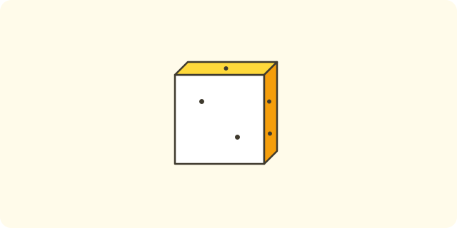
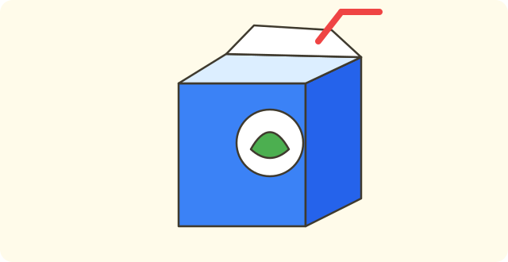
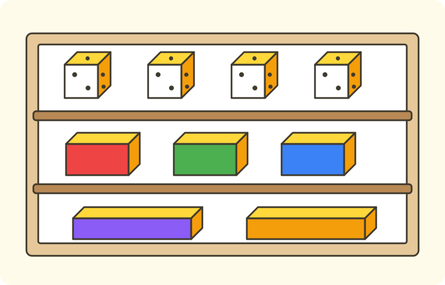
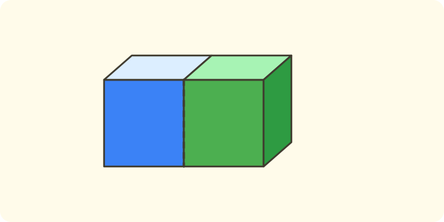

:::goals
- Nhận biết khối lập phương và khối hộp chữ nhật.
- Biết mỗi khối có $6$ mặt và gọi đúng hình dạng các mặt.
- Tìm các khối đó trong đồ vật quanh em.
:::

Em có một viên xúc xắc và một hộp phấn. Cả hai đều là khối, không phẳng như tờ giấy. Hai khối đó khác nhau ở chỗ nào, và em gọi tên chúng như thế nào?

Ở bài trước em học phép cộng và phép trừ. Bài này em làm quen với các hình khối.

## Cùng khám phá

Em cầm viên xúc xắc và sờ vào các mặt phẳng của nó.

- Viên xúc xắc có $6$ mặt.
- Mỗi mặt là một hình vuông, và các hình vuông đó bằng nhau.

Em cầm hộp phấn và sờ vào các mặt phẳng của nó.

- Hộp phấn cũng có $6$ mặt.
- Mỗi mặt là một hình chữ nhật.

:::diagram Khối lập phương
alt: Hình vẽ một khối lập phương nhìn nghiêng, các cạnh nhìn thấy vẽ nét liền, các cạnh bị khuất vẽ nét đứt
point A 0,0 ""
point B 2,0 ""
point C 2,2 ""
point D 0,2 ""
point E 1,1 ""
point F 3,1 ""
point G 3,3 ""
point H 1,3 ""
segment A B
segment B C
segment C D
segment D A
segment D H
segment C G
segment H G
segment B F
segment F G
segment A E dashed
segment E F dashed
segment E H dashed
:::

:::theorem Hai khối quen thuộc
1. Khối lập phương có $6$ mặt, mỗi mặt là hình vuông. Ví dụ: viên xúc xắc.
2. Khối hộp chữ nhật có $6$ mặt, mỗi mặt là hình chữ nhật. Ví dụ: hộp phấn, hộp sữa.
3. Hình vuông và hình chữ nhật là hình phẳng, còn khối lập phương và khối hộp chữ nhật là hình khối.
:::

Cách này đúng vì em chỉ cần nhìn các mặt: mặt vuông thì là khối lập phương, mặt chữ nhật thì là khối hộp chữ nhật.

## Ví dụ

Ta bắt đầu với một đồ vật quen thuộc.

:::example Viên xúc xắc
Viên xúc xắc có dạng khối gì?

**Lời giải.** Mọi mặt của viên xúc xắc đều là hình vuông bằng nhau.

Vậy viên xúc xắc có dạng khối lập phương.
:::

Bây giờ em gọi tên một khối khác.

:::example Hộp sữa
Một hộp sữa có $6$ mặt. Các mặt đều là hình chữ nhật. Hộp sữa có dạng khối gì?

**Lời giải.** Khối có các mặt là hình chữ nhật là khối hộp chữ nhật.

Vậy hộp sữa có dạng khối hộp chữ nhật.
:::

Tiếp theo em đếm mặt.

:::example Đếm mặt
Khối lập phương có mấy mặt?

**Lời giải.** Em đếm các mặt của viên xúc xắc: mặt trên, mặt dưới và bốn mặt xung quanh. Em đếm: "một, hai, ba, bốn, năm, sáu".

Vậy khối lập phương có $6$ mặt.
:::

Cuối cùng em đếm các khối.

:::example Xếp khối
Em có $5$ khối lập phương và $3$ khối hộp chữ nhật. Hỏi em có tất cả bao nhiêu khối?

**Lời giải.** "Tất cả" nghĩa là gộp lại, nên em làm phép cộng:
$$5+3=8\ \text{(khối)}.$$
Vậy em có $8$ khối.
:::

:::warning Những lỗi em hay gặp
- **Nhầm hình phẳng với hình khối.** Sai: hình vuông vẽ trên giấy là khối lập phương. Vì sao sai: hình vuông phẳng, không cầm nắm được như khối. Đúng: hình vuông là hình phẳng; xúc xắc là khối lập phương.
- **Nhầm khối hộp chữ nhật với khối lập phương.** Sai: hộp phấn là khối lập phương vì có $6$ mặt. Vì sao sai: các mặt của hộp phấn là hình chữ nhật, không phải hình vuông bằng nhau. Đúng: hộp phấn là khối hộp chữ nhật.
- **Đếm thiếu mặt.** Sai: khối lập phương có $4$ mặt. Vì sao sai: em quên mặt trên và mặt dưới. Đúng: có $6$ mặt.
:::

## Thuật ngữ

:::terms
- khối lập phương | cube
- khối hộp chữ nhật | cuboid
- mặt | face
- hình khối | solid shape
- hình phẳng | flat shape
- xúc xắc | dice
:::

## Tóm tắt

- Khối lập phương có $6$ mặt là hình vuông (xúc xắc).
- Khối hộp chữ nhật có $6$ mặt là hình chữ nhật (hộp phấn, hộp sữa).
- Hình vuông, hình chữ nhật là hình phẳng; khối lập phương, khối hộp chữ nhật là hình khối.

## Luyện tập

Mỗi bài có phần kiến thức và gợi ý. Em hãy tự làm trước, rồi mới bấm xem lời giải.

:::exercise
Quả xúc xắc có dạng khối gì?

::hint
**Kiến thức:** khối có các mặt là hình vuông bằng nhau là khối lập phương.

**Gợi ý các bước:**
1. Các mặt của xúc xắc là hình gì?
2. Chọn tên khối.

::solution
Các mặt của xúc xắc là hình vuông bằng nhau.

**Đáp số.** Khối lập phương.
:::

:::exercise
Hộp phấn có dạng khối gì?

::hint
**Kiến thức:** khối có các mặt là hình chữ nhật là khối hộp chữ nhật.

**Gợi ý các bước:**
1. Các mặt của hộp phấn là hình gì?
2. Chọn tên khối.

::solution
Các mặt của hộp phấn là hình chữ nhật.

**Đáp số.** Khối hộp chữ nhật.
:::

:::exercise
Em hãy nhớ lại bài trước: tính $9-5$. Rồi kiểm tra bằng phép cộng.

::hint
**Kiến thức:** đếm lùi từ $9$ năm số; kiểm tra bằng phép cộng.

**Gợi ý các bước:**
1. Đếm lùi: tám, bảy, sáu, năm, bốn.
2. Tính $\square+5$.

::solution
Đếm lùi được $4$. Kiểm tra: $4+5=9$. Đúng.

**Đáp số.** $9-5=4$.
:::

:::exercise
a) Mặt của khối lập phương là hình gì?
b) Mặt của khối hộp chữ nhật là hình gì?

::hint
**Kiến thức:** nhớ lại các mặt của xúc xắc và hộp phấn.

**Gợi ý các bước:**
1. Sờ các mặt của xúc xắc.
2. Sờ các mặt của hộp phấn.

::solution
a) Mặt của khối lập phương là hình vuông. b) Mặt của khối hộp chữ nhật là hình chữ nhật.

**Đáp số.** a) Hình vuông. b) Hình chữ nhật.
:::

:::exercise
Nam nói: "Hộp phấn là khối lập phương vì có $6$ mặt." Nam nói đúng không? Vì sao?

::hint
**Kiến thức:** các mặt của khối lập phương là hình vuông bằng nhau.

**Gợi ý các bước:**
1. Mặt hộp phấn có dài ngắn khác nhau không?
2. Chọn tên khối đúng.

::solution
Các mặt của hộp phấn là hình chữ nhật, không phải hình vuông. Nam nói sai.

**Đáp số.** Sai. Hộp phấn là khối hộp chữ nhật.
:::

:::exercise
Mai nói: "Hình vuông vẽ trên giấy là khối lập phương." Mai sai ở đâu? Nói lại cho đúng.

::hint
**Kiến thức:** hình vuông là hình phẳng, khối lập phương là hình khối.

**Gợi ý các bước:**
1. Em cầm được hình vuông vẽ trên giấy như cầm xúc xắc không?
2. Nói lại cho đúng.

::solution
Hình vuông trên giấy là hình phẳng. Khối lập phương là khối có $6$ mặt vuông, như xúc xắc.

**Đáp số.** Hình vuông là hình phẳng; xúc xắc mới là khối lập phương.
:::

:::exercise
Bảng cho biết số đồ vật trên kệ:

| Đồ vật | Xúc xắc | Hộp bánh | Hộp bút |
|---|---|---|---|
| Số lượng | $4$ | $3$ | $2$ |

a) Có bao nhiêu khối lập phương?
b) Có tất cả bao nhiêu khối hộp chữ nhật?

::hint
**Kiến thức:** xúc xắc là khối lập phương; hộp bánh và hộp bút là khối hộp chữ nhật.

**Gợi ý các bước:**
1. Tìm số xúc xắc.
2. Gộp số hộp bánh và số hộp bút.

::solution
a) Có $4$ viên xúc xắc. b) $3+2=5$.

**Đáp số.** a) $4$ khối. b) $5$ khối.
:::

:::exercise Thử thách
Em xếp hai khối lập phương cạnh nhau thành một khối dài. Khối mới có dạng khối gì? Mặt dài của khối mới là hình gì?

::hint
**Kiến thức:** hai hình vuông ghép cạnh nhau tạo thành hình chữ nhật.

**Gợi ý các bước:**
1. Ghép hai hình vuông cạnh nhau, được hình gì?
2. Chọn tên khối.

::solution
Mặt dài gồm hai hình vuông ghép lại, là hình chữ nhật. Khối mới có các mặt chữ nhật.

**Kiểm tra.** Khối giống một hộp phấn. Đúng.

**Đáp số.** Khối hộp chữ nhật; mặt dài là hình chữ nhật.
:::

## Kiểm tra mini

:::quiz
::mc
Viên xúc xắc có dạng khối
A. hộp chữ nhật.
B. lập phương.
C. không phải khối.
D. không biết.
::key B
Các mặt của xúc xắc là hình vuông bằng nhau.

::mc
Hộp bút dài có các mặt là hình chữ nhật. Hộp bút có dạng khối
A. lập phương.
B. không phải khối.
C. hộp chữ nhật.
D. không biết.
::key C
Khối có các mặt là hình chữ nhật là khối hộp chữ nhật. Phương án A là lỗi nhầm với xúc xắc.

::mc
Mỗi mặt của khối lập phương là hình
A. tròn.
B. tam giác.
C. chữ nhật.
D. vuông.
::key D
Các mặt của khối lập phương là hình vuông. Phương án C nhầm với khối hộp chữ nhật.

::mc
Đồ vật nào có dạng khối hộp chữ nhật?
A. Quả bóng.
B. Hộp bánh.
C. Viên xúc xắc.
D. Mặt đồng hồ.
::key B
Hộp bánh có các mặt là hình chữ nhật. Viên xúc xắc là khối lập phương.

::tf
Em xét các hình khối.
a) Viên xúc xắc là khối lập phương.
b) Mặt của khối lập phương là hình tròn.
c) Hộp phấn có dạng khối hộp chữ nhật.
d) Khối hộp chữ nhật có $4$ mặt.
::key Đ S Đ S
a) Đúng. b) Sai: mặt là hình vuông. c) Đúng. d) Sai: khối hộp chữ nhật có $6$ mặt.

::sa
Khối lập phương có mấy mặt?
::key 6
Em đếm: mặt trên, mặt dưới và bốn mặt xung quanh, tất cả $6$ mặt.

::sa
Em có $3$ khối lập phương và $4$ khối hộp chữ nhật. Em có tất cả bao nhiêu khối?
::key 7
Gộp lại: $3+4=7$.
:::
