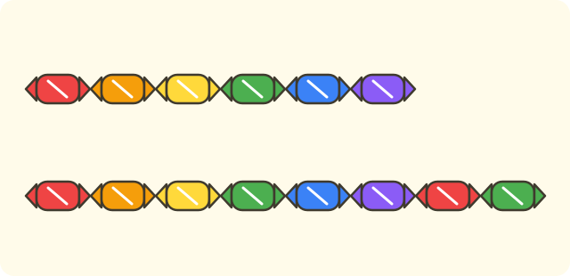

:::goals
- So sánh hai số từ $0$ đến $10$.
- Dùng đúng các dấu $>$, $<$, $=$.
- Tìm số lớn nhất, số bé nhất trong một nhóm số.
- Sắp xếp các số từ bé đến lớn.
:::

Lan có $6$ cái kẹo, Nam có $8$ cái kẹo. Ai có nhiều kẹo hơn? Em viết điều đó bằng kí hiệu như thế nào?

Ở bài trước em ghép từng cặp để biết nhóm nào nhiều hơn. Bây giờ em so sánh ngay hai số, không cần ghép.

## Cùng khám phá

Em nhìn các số xếp hàng trên tia số.

- Số đứng bên phải thì đếm sau, nên lớn hơn.
- Số đứng bên trái thì đếm trước, nên bé hơn.

Số $6$ đứng bên trái số $8$. Vậy $6$ bé hơn $8$, và $8$ lớn hơn $6$.

:::graph Trên tia số, số bên phải lớn hơn số bên trái
alt: Tia số từ 0 đến 10, đánh dấu số 6 và số 8, số 8 nằm bên phải số 6
x: -1..11
y: -1..1
segment: (0, 0) (10, 0)
point: (6, 0) "6" below
point: (8, 0) "8" below
:::

Em dùng các dấu sau. Mỗi dấu có miệng mở về phía số lớn hơn.

- $8>6$ đọc là "tám lớn hơn sáu".
- $6<8$ đọc là "sáu bé hơn tám".
- $5=5$ đọc là "năm bằng năm".

:::theorem So sánh hai số
1. Số đứng bên phải trên tia số (đếm sau) là số lớn hơn.
2. Hai số giống nhau thì bằng nhau.
3. Dấu $>$ và $<$ luôn mở miệng về phía số lớn hơn.
:::

Cách này đúng vì khi đếm, mỗi số sau hơn số trước một đồ vật. Số đếm sau có nhiều đồ vật hơn.

## Ví dụ

Ta bắt đầu với câu hỏi ở đầu bài.

:::example Kẹo của Lan và Nam
Lan có $6$ cái kẹo, Nam có $8$ cái kẹo. So sánh $8$ và $6$.

**Lời giải.** Trên tia số, $8$ đứng bên phải $6$, nên $8$ lớn hơn $6$.

Vậy $8>6$, Nam có nhiều kẹo hơn.
:::

Có khi hai số giống nhau.

:::example Hai số bằng nhau
Điền dấu thích hợp: $4 \;\square\; 4$.

**Lời giải.** Hai số giống nhau nên bằng nhau.

Vậy $4=4$.
:::

Tiếp theo, số đầu bé hơn số sau.

:::example Điền dấu
Điền dấu thích hợp: $3 \;\square\; 9$.

**Lời giải.** Trên tia số, $3$ đứng bên trái $9$, nên $3$ bé hơn $9$. Miệng dấu mở về phía số $9$.

Vậy $3<9$.
:::

Cuối cùng em sắp xếp ba số.

:::example Sắp xếp các số
Sắp xếp các số $7, 2, 9$ theo thứ tự từ bé đến lớn.

**Lời giải.** Em tìm số bé nhất trước: $2$. Trong hai số còn lại, $7$ bé hơn $9$.

Vậy thứ tự là $2, 7, 9$.

**Kiểm tra.** $2<7$ và $7<9$. Đúng.
:::

:::warning Những lỗi em hay gặp
- **Mở miệng dấu sai phía.** Sai: $4<2$. Vì sao sai: miệng dấu phải mở về số lớn hơn, mà $4$ lớn hơn $2$. Đúng: $4>2$.
- **Nghĩ số đứng trước thì lớn hơn.** Sai: $5>8$ vì $5$ đếm trước. Vì sao sai: số đếm sau mới lớn hơn. Đúng: $5<8$.
- **Quên số $0$ là bé nhất.** Sai: số bé nhất trong $0, 3, 6$ là $3$. Vì sao sai: $0$ đứng đầu hàng. Đúng: số bé nhất là $0$.
:::

## Thuật ngữ

:::terms
- lớn hơn ($>$) | greater than
- bé hơn ($<$) | less than
- bằng ($=$) | equal to
- so sánh | compare
- lớn nhất | greatest
- bé nhất | least
- sắp xếp | put in order
- tia số | number line
:::

## Tóm tắt

- Số đứng bên phải trên tia số là số lớn hơn.
- $8>6$ đọc là tám lớn hơn sáu; $6<8$ đọc là sáu bé hơn tám; $5=5$ đọc là năm bằng năm.
- Dấu $>$ và $<$ mở miệng về phía số lớn hơn.
- Muốn sắp xếp từ bé đến lớn, tìm số bé nhất trước.

## Luyện tập

Mỗi bài có phần kiến thức và gợi ý. Em hãy tự làm trước, rồi mới bấm xem lời giải.

:::exercise
Điền dấu $>$, $<$ hoặc $=$: $7 \;\square\; 5$.

::hint
**Kiến thức:** số đứng bên phải trên tia số là số lớn hơn.

**Gợi ý các bước:**
1. Số nào đếm sau, $7$ hay $5$?
2. Mở miệng dấu về số lớn hơn.

::solution
Khi đếm, số nào đếm sau thì lớn hơn. Ta đếm: $5$, $6$, $7$, nên $7$ đếm sau $5$.

Do đó $7$ lớn hơn $5$.

Vậy dấu cần điền là $>$, ta có $7>5$.

**Đáp số.** $7>5$.
:::

:::exercise
Điền dấu $>$, $<$ hoặc $=$: $2 \;\square\; 6$.

::hint
**Kiến thức:** số đứng bên trái là số bé hơn.

**Gợi ý các bước:**
1. Số nào đếm trước, $2$ hay $6$?
2. Mở miệng dấu về số lớn hơn.

::solution
Khi đếm, số nào đếm trước thì bé hơn. Ta đếm: $2$, $3$, $4$, $5$, $6$, nên $2$ đếm trước $6$.

Do đó $2$ bé hơn $6$.

Vậy dấu cần điền là $<$, ta có $2<6$.

**Đáp số.** $2<6$.
:::

:::exercise
Em hãy nhớ lại bài trước: có $4$ cái cốc và $6$ cái thìa. Ghép từng cặp rồi viết dấu so sánh số cốc và số thìa.

::hint
**Kiến thức:** nhóm hết trước là nhóm ít hơn; số ít hơn là số bé hơn.

**Gợi ý các bước:**
1. Ghép mỗi cốc với một thìa.
2. Viết số cốc, dấu, số thìa.

::solution
Ta ghép mỗi cái cốc với một cái thìa. Có $4$ cốc nên ghép được $4$ cặp.

Khi hết $4$ cốc thì còn thừa $2$ cái thìa, nên số cốc ít hơn số thìa.

Vậy số cốc bé hơn số thìa, ta viết $4<6$.

**Đáp số.** $4<6$.
:::

:::exercise
a) Số nào lớn hơn: $9$ hay $10$?
b) Số nào bé hơn: $0$ hay $3$?

::hint
**Kiến thức:** số đếm sau là số lớn hơn.

**Gợi ý các bước:**
1. Đếm: ..., chín, mười.
2. Đếm: không, một, hai, ba.

::solution
a) Ta đếm: $9$, $10$. Số $10$ đếm sau số $9$ nên $10$ lớn hơn $9$. Số lớn hơn là $10$.

b) Ta đếm: $0$, $1$, $2$, $3$. Số $0$ đếm trước số $3$ nên $0$ bé hơn $3$. Số bé hơn là $0$.

Vậy a) số lớn hơn là $10$; b) số bé hơn là $0$.

**Đáp số.** a) $10$. b) $0$.
:::

:::exercise
Bình nói: "$5>8$ vì $5$ đứng trước." Bình nói đúng không? Vì sao?

::hint
**Kiến thức:** số đếm sau mới là số lớn hơn.

**Gợi ý các bước:**
1. Trên tia số, $5$ đứng bên nào của $8$?
2. Số nào lớn hơn?

::solution
Số đứng trước, tức là đứng bên trái, thì bé hơn. Số $5$ đứng bên trái số $8$ nên $5$ bé hơn $8$, tức là $5<8$.

Bình nói $5>8$ chỉ vì $5$ đứng trước, nhưng đứng trước thì phải bé hơn, không phải lớn hơn.

Vậy Bình nói sai; đúng là $5<8$.

**Đáp số.** Sai. Đúng là $5<8$.
:::

:::exercise
Lan viết $4<2$ vì Lan nhớ "miệng dấu mở về số bé". Lan sai ở đâu? Viết lại cho đúng.

::hint
**Kiến thức:** miệng dấu mở về phía số lớn hơn.

**Gợi ý các bước:**
1. Số nào lớn hơn, $4$ hay $2$?
2. Miệng dấu phải mở về số đó.

::solution
Lan nhớ nhầm. Miệng dấu so sánh phải mở về số lớn, không phải số bé.

Ta có $4$ lớn hơn $2$, nên miệng dấu phải mở về $4$.

Vậy Lan sai ở chỗ mở miệng dấu về số bé; viết lại cho đúng là $4>2$.

**Đáp số.** $4>2$.
:::

:::exercise
Bảng cho biết số bi của bốn bạn:

| Bạn | An | Bình | Chi | Dũng |
|---|---|---|---|---|
| Số bi | $6$ | $9$ | $6$ | $3$ |

a) Ai có nhiều bi nhất?
b) Ai có ít bi nhất?
c) Hai bạn nào có số bi bằng nhau?

::hint
**Kiến thức:** tìm số lớn nhất, số bé nhất và hai số giống nhau.

**Gợi ý các bước:**
1. Đọc các số: $6, 9, 6, 3$.
2. So sánh từng số.

::solution
Số bi của An, Bình, Chi, Dũng lần lượt là $6$, $9$, $6$, $3$. Ta có $3<6<9$.

a) Số lớn nhất là $9$, của Bình. Vậy Bình có nhiều bi nhất.

b) Số bé nhất là $3$, của Dũng. Vậy Dũng có ít bi nhất.

c) An và Chi đều có $6$ viên bi, hai số này bằng nhau.

Vậy Bình có nhiều bi nhất, Dũng có ít bi nhất, An và Chi có số bi bằng nhau.

**Đáp số.** a) Bình. b) Dũng. c) An và Chi.
:::

:::exercise Thử thách
a) Tìm số thích hợp: $6<\square<8$.
b) Tìm các số thích hợp: $2<\square<5$.

::hint
**Kiến thức:** số cần tìm đứng giữa hai số đã cho trên tia số.

**Gợi ý các bước:**
1. Viết các số từ số bé đến số lớn.
2. Chọn số nằm giữa.

::solution
a) Ta đếm: $6$, $7$, $8$. Số nằm giữa $6$ và $8$ là $7$.

b) Ta đếm: $2$, $3$, $4$, $5$. Các số nằm giữa $2$ và $5$ là $3$ và $4$.

*Kiểm tra.* $6<7<8$; $2<3<5$; $2<4<5$. Đúng.

Vậy a) số cần tìm là $7$; b) các số cần tìm là $3$ và $4$.

**Đáp số.** a) $7$. b) $3$ hoặc $4$.
:::

## Kiểm tra mini

:::quiz
::mc NB
Dấu thích hợp để điền vào $7 \;\square\; 4$ là
A. $<$.
B. $>$.
C. $=$.
D. không điền được.
::key B
$7$ lớn hơn $4$ nên $7>4$. Phương án A mở miệng dấu sai phía.

::mc NB
Dấu thích hợp để điền vào $3 \;\square\; 3$ là
A. $<$.
B. $>$.
C. $=$.
D. không điền được.
::key C
Hai số giống nhau thì bằng nhau.

::mc TH
Số lớn nhất trong các số $5, 9, 2, 7$ là
A. $5$.
B. $9$.
C. $2$.
D. $7$.
::key B
$9$ đếm sau cùng. Phương án C là số bé nhất.

::mc TH
Sắp xếp $6, 2, 8$ từ bé đến lớn được
A. $2, 6, 8$.
B. $8, 6, 2$.
C. $6, 2, 8$.
D. $2, 8, 6$.
::key A
$2<6<8$. Phương án B là xếp từ lớn đến bé.

::tf NB NB TH TH
Em xét hai số $5$ và $8$.
a) $5<8$.
b) $8>5$.
c) $5>8$.
d) $5=8$.
::key Đ Đ S S
a) Đúng. b) Đúng. c) Sai: $5$ bé hơn $8$. d) Sai: hai số khác nhau.

::sa TH
Số lớn nhất trong các số $3, 10, 7$ là số nào?
::key 10
Đếm: ..., bảy, ..., mười. Số $10$ đếm sau cùng.

::sa TH
Số bé nhất trong các số $4, 0, 6$ là số nào?
::key 0
$0$ đứng đầu hàng số nên bé nhất.
:::
