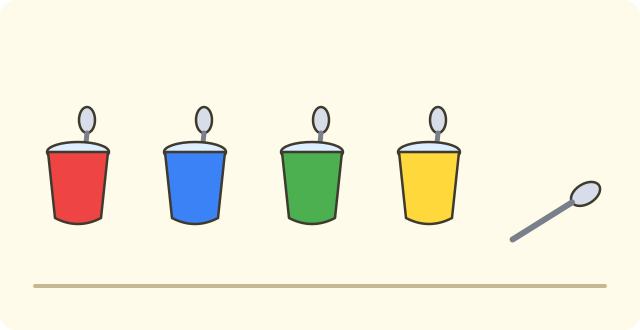
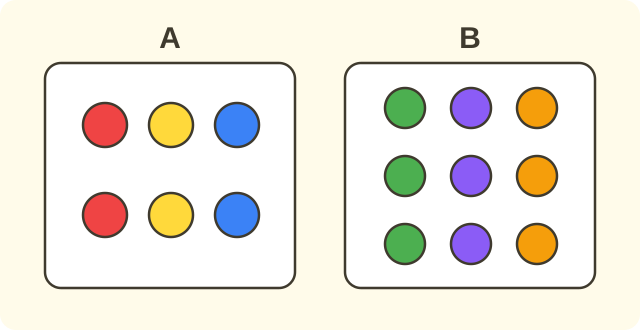

:::goals
- Ghép từng đồ vật của hai nhóm với nhau, mỗi lần một cặp.
- Nói được nhóm nào nhiều hơn, ít hơn hoặc hai nhóm bằng nhau.
- Nói được nhóm nhiều hơn thừa ra mấy đồ vật.
:::

Trên bàn có $4$ cái cốc và $5$ cái thìa. Mẹ muốn mỗi cái cốc có một cái thìa. Cốc nhiều hơn hay thìa nhiều hơn?

Em có thể đếm từng nhóm. Bài này dạy em một cách khác, không cần đếm: ghép từng cặp.

## Cùng khám phá

Em đặt mỗi cái thìa vào một cái cốc, mỗi cốc chỉ một thìa.

- Cốc thứ nhất có một thìa. Cốc thứ hai có một thìa.
- Cốc thứ ba và cốc thứ tư cũng có một thìa.
- Cả bốn cốc đều có thìa, nhưng còn thừa một cái thìa.

Thìa còn thừa, nên số thìa nhiều hơn số cốc. Cốc hết trước, nên số cốc ít hơn số thìa.

:::theorem Ghép một với một
Ghép từng đồ vật của nhóm này với từng đồ vật của nhóm kia.
1. Nhóm còn thừa đồ vật là nhóm **nhiều hơn**.
2. Nhóm hết trước là nhóm **ít hơn**.
3. Hai nhóm cùng hết một lúc thì **bằng nhau**.
:::

Cách này đúng vì mỗi cặp dùng hết một đồ vật của mỗi nhóm. Nhóm nào còn lại thì có nhiều hơn.

## Ví dụ

Ta làm lại câu hỏi ở đầu bài.

:::example Cốc và thìa
Có $4$ cái cốc và $5$ cái thìa. Nhóm nào nhiều hơn? Nhóm nào ít hơn?

**Lời giải.** Em ghép mỗi cốc với một thìa. Hết $4$ cốc thì còn thừa $1$ thìa.

Vậy thìa nhiều hơn cốc, và cốc ít hơn thìa.
:::

Bây giờ hai nhóm có thể hết cùng lúc.

:::example Bạn và mũ
Có $3$ bạn và $3$ chiếc mũ. Mỗi bạn đội một chiếc mũ. Nhóm nào nhiều hơn?

**Lời giải.** Em ghép mỗi bạn với một chiếc mũ. Không bạn nào thiếu mũ và không chiếc mũ nào thừa.

Vậy số bạn và số mũ bằng nhau.
:::

Tiếp theo em xem nhóm nhiều hơn thừa ra mấy.

:::example Hoa đỏ và hoa vàng
Trong chậu có $6$ bông hoa đỏ và $8$ bông hoa vàng. Nhóm nào nhiều hơn? Thừa ra mấy bông?

**Lời giải.** Em ghép mỗi bông hoa đỏ với một bông hoa vàng. Hết $6$ bông hoa đỏ thì còn thừa $2$ bông hoa vàng.

Vậy hoa vàng nhiều hơn hoa đỏ, và nhiều hơn $2$ bông.
:::

Cuối cùng em dùng cách ghép cho bài toán đời sống.

:::example Chim và tổ
Có $5$ con chim và $4$ cái tổ. Mỗi con chim vào một tổ. Còn con chim nào chưa có tổ không?

**Lời giải.** Em ghép mỗi tổ với một con chim. Hết $4$ tổ thì còn thừa $1$ con chim.

Vậy còn $1$ con chim chưa có tổ.
:::

:::warning Những lỗi em hay gặp
- **Nhầm đồ vật to với nhiều.** Sai: hộp to nên có nhiều bi hơn. Vì sao sai: hộp to chưa chắc có nhiều bi. Đúng: ghép hoặc đếm số bi.
- **Ghép một đồ vật hai lần.** Sai: một cái cốc nhận hai cái thìa. Vì sao sai: kết quả bị lệch. Đúng: mỗi cốc chỉ một thìa.
- **Nhầm "nhiều hơn" với "ít hơn".** Sai: nhóm còn thừa là nhóm ít hơn. Vì sao sai: nhóm còn thừa có nhiều đồ vật hơn. Đúng: nhóm còn thừa là nhóm nhiều hơn.
:::

## Thuật ngữ

:::terms
- nhiều hơn | more
- ít hơn | fewer
- bằng nhau | the same
- ghép một với một | match one to one
- nhóm | group
- thừa | left over
:::

## Tóm tắt

- Ghép một với một: mỗi đồ vật nhóm này ghép với một đồ vật nhóm kia.
- Nhóm còn thừa là nhóm nhiều hơn; nhóm hết trước là nhóm ít hơn.
- Hai nhóm cùng hết một lúc thì bằng nhau.
- Đồ vật to hơn chưa chắc là nhiều hơn.

## Luyện tập

Mỗi bài có phần kiến thức và gợi ý. Em hãy tự làm trước, rồi mới bấm xem lời giải.

:::exercise
Có $3$ cái cốc và $4$ cái thìa. Nhóm nào nhiều hơn?

::hint
**Kiến thức:** ghép từng cặp; nhóm còn thừa là nhóm nhiều hơn.

**Gợi ý các bước:**
1. Ghép mỗi cốc với một thìa.
2. Xem nhóm nào còn thừa.

::solution
Hết $3$ cốc thì còn thừa $1$ thìa.

**Đáp số.** Thìa nhiều hơn cốc.
:::

:::exercise
Có $5$ bạn và $5$ chiếc mũ. Mỗi bạn đội một chiếc mũ. Hai nhóm thế nào?

::hint
**Kiến thức:** hai nhóm cùng hết một lúc thì bằng nhau.

**Gợi ý các bước:**
1. Ghép mỗi bạn với một chiếc mũ.
2. Còn thừa gì không?

::solution
Không còn bạn hay mũ nào thừa.

**Đáp số.** Số bạn bằng số mũ.
:::

:::exercise
Em hãy nhớ lại bài trước. a) Điền số: $6, 7, \square, 9, 10$. b) Có $7$ con cá và $9$ con tôm. Nhóm nào ít hơn?

::hint
**Kiến thức:** dãy số xếp theo thứ tự đếm; ghép từng cặp để tìm nhóm hết trước.

**Gợi ý các bước:**
1. Đọc: sáu, bảy, ...
2. Ghép mỗi con cá với một con tôm.

::solution
a) Sau $7$ là $8$. b) Hết $7$ con cá thì còn thừa $2$ con tôm, nên cá hết trước.

**Đáp số.** a) $8$. b) Cá ít hơn tôm.
:::

:::exercise
Có $6$ con chim và $4$ cái tổ. Mỗi con chim vào một tổ. Còn con chim nào chưa có tổ không? Có mấy con?

::hint
**Kiến thức:** ghép mỗi tổ với một con chim; số thừa là số chim chưa có tổ.

**Gợi ý các bước:**
1. Ghép $4$ tổ với $4$ con chim.
2. Đếm số chim còn lại.

::solution
Hết $4$ tổ thì còn thừa $2$ con chim.

**Đáp số.** Còn $2$ con chim chưa có tổ.
:::

:::exercise
Hộp to có $3$ viên bi, hộp nhỏ có $5$ viên bi. Bình nói: "Hộp to nhiều bi hơn." Bình nói đúng không? Vì sao?

::hint
**Kiến thức:** nhiều hơn là về số lượng, không phải độ to của hộp.

**Gợi ý các bước:**
1. Ghép bi hộp to với bi hộp nhỏ.
2. Xem nhóm nào thừa.

::solution
Hết $3$ viên bi hộp to thì còn thừa $2$ viên bi hộp nhỏ. Hộp nhỏ nhiều bi hơn.

**Đáp số.** Sai. Hộp nhỏ nhiều bi hơn.
:::

:::exercise
Lan ghép $4$ cái bát với $4$ cái thìa rồi nói: "Bát nhiều hơn thìa." Lan sai ở đâu? Nói đúng như thế nào?

::hint
**Kiến thức:** hai nhóm cùng hết thì bằng nhau.

**Gợi ý các bước:**
1. Sau khi ghép, còn thừa gì không?
2. Chọn: nhiều hơn, ít hơn hay bằng nhau.

::solution
Ghép $4$ bát với $4$ thìa thì không thừa gì. Hai nhóm bằng nhau.

**Đáp số.** Số bát bằng số thìa.
:::

:::exercise
Bảng cho biết số kẹo của ba bạn:

| Bạn | Mai | Nam | Hà |
|---|---|---|---|
| Số kẹo | $5$ | $7$ | $5$ |

a) Ai có kẹo nhiều hơn Mai?
b) Hai bạn nào có số kẹo bằng nhau?

::hint
**Kiến thức:** ghép hoặc đếm số kẹo của từng bạn.

**Gợi ý các bước:**
1. So Mai với từng bạn.
2. Tìm hai số giống nhau.

::solution
a) Nam có $7$ kẹo, hơn Mai $2$ kẹo. b) Mai và Hà đều có $5$ kẹo.

**Đáp số.** a) Nam. b) Mai và Hà.
:::

:::exercise Thử thách
Nhóm A có $6$ hình tròn, nhóm B có $9$ hình tròn. Cần vẽ thêm mấy hình tròn vào nhóm A để hai nhóm bằng nhau?

::hint
**Kiến thức:** ghép nhóm A với nhóm B; số hình thừa của nhóm B là số cần vẽ thêm.

**Gợi ý các bước:**
1. Ghép $6$ hình của A với $6$ hình của B.
2. Đếm số hình thừa của B.

::solution
Hết $6$ hình của A thì còn thừa $3$ hình của B. Vẽ thêm $3$ hình vào A.

**Kiểm tra.** A có $6$ và $3$ hình mới, ghép hết $9$ hình của B. Đúng.

**Đáp số.** $3$ hình tròn.
:::

## Kiểm tra mini

:::quiz
::mc
Có $5$ cái cốc và $6$ cái thìa. Nhóm nào nhiều hơn?
A. Cốc.
B. Bằng nhau.
C. Thìa.
D. Không biết.
::key C
Ghép $5$ cốc với $5$ thìa thì thừa $1$ thìa, nên thìa nhiều hơn. Phương án A nhầm nhóm hết trước.

::mc
Có $4$ chiếc mũ và $4$ bạn, mỗi bạn một mũ. Hai nhóm thế nào?
A. Mũ nhiều hơn.
B. Bạn nhiều hơn.
C. Không biết.
D. Bằng nhau.
::key D
Ghép xong không thừa gì, nên hai nhóm bằng nhau.

::mc
Ghép $7$ bông hoa với $5$ cái lọ thì thừa $2$ bông hoa. Nhóm nào ít hơn?
A. Lọ.
B. Hoa.
C. Bằng nhau.
D. Không biết.
::key A
Lọ hết trước nên lọ ít hơn. Phương án B nhầm nhóm thừa.

::mc
Hộp bé có $7$ viên bi, hộp to có $4$ viên bi. Hộp nào nhiều bi hơn?
A. Hộp to.
B. Hộp bé.
C. Bằng nhau.
D. Không biết.
::key B
$7$ viên bi nhiều hơn $4$ viên bi. Phương án A nhầm hộp to với nhiều.

::tf
Có $3$ con gà và $5$ con vịt. Mỗi con gà ghép với một con vịt.
a) Vịt nhiều hơn gà.
b) Gà nhiều hơn vịt.
c) Còn thừa $2$ con vịt.
d) Gà và vịt bằng nhau.
::key Đ S Đ S
a) Đúng. b) Sai: gà hết trước. c) Đúng: ghép hết $3$ gà thì thừa $2$ vịt. d) Sai.

::sa
Có $8$ quả cam và $5$ cái đĩa, mỗi đĩa một quả cam. Thừa mấy quả cam?
::key 3
Ghép $5$ đĩa với $5$ quả cam thì còn $3$ quả cam.

::sa
Có $7$ con chim và $6$ cái tổ, mỗi tổ một con chim. Thừa mấy con chim?
::key 1
Ghép $6$ tổ với $6$ con chim thì còn $1$ con chim.
:::
