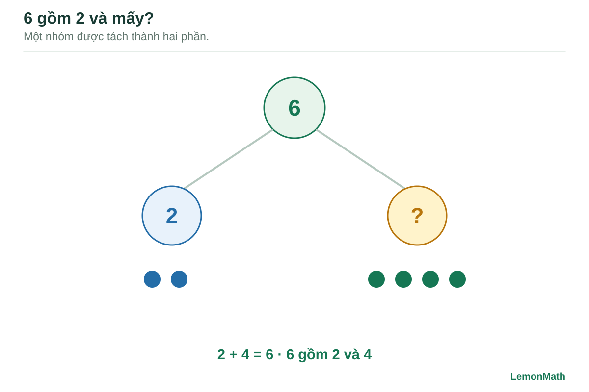

:::goals
- Biết một số gồm hai số nhỏ hơn, ví dụ $5$ gồm $2$ và $3$.
- Tìm số còn thiếu khi biết số lớn và một phần.
- Biết đổi chỗ hai phần mà số lớn không đổi.
:::

Lan có $5$ viên bi. Lan nắm $2$ viên trong tay trái, còn lại cho vào tay phải. Em thử đoán xem tay phải của Lan có mấy viên bi?

Em đã biết đếm và so sánh các số đến $10$. Nhưng nếu một phần số bi bị giấu trong tay, em có tìm ra nó không? Khi biết cách tách một số thành hai phần, em tìm được phần bi mà mình không nhìn thấy.

## Cùng khám phá

Ta thử với $5$ viên bi nhé. Em chia số bi này vào hai tay, và có nhiều cách chia. Bảng dưới đây ghi lại từng cách.

| Tay trái | Tay phải |
|---|---|
| $1$ | $4$ |
| $2$ | $3$ |
| $3$ | $2$ |
| $4$ | $1$ |

Em nhìn từng dòng. Hai tay ghép lại luôn đủ $5$ viên, dòng nào cũng vậy. Ta nói như sau: $5$ gồm $1$ và $4$; $5$ gồm $2$ và $3$; $5$ gồm $3$ và $2$; $5$ gồm $4$ và $1$.

Nhìn lại bảng, dòng có tay trái giống tay của Lan cho em đáp số: tay phải của Lan có $3$ viên bi.

:::theorem Mấy và mấy
1. Một số có thể gồm hai số nhỏ hơn. Ví dụ $5$ gồm $2$ và $3$.
2. Đổi chỗ hai phần thì số lớn không đổi: $5$ gồm $3$ và $2$.
3. Biết số lớn và một phần, em tìm phần còn lại bằng cách đếm tiếp hoặc ghép.
:::

Vì sao cách này đúng? Vì khi chia bi vào hai tay, không viên nào mất đi. Hai tay gộp lại vẫn là cả nhóm bi ban đầu. Nên dù chia thế nào, hai phần ghép lại cũng vẫn đủ số bi ấy.

## Ví dụ

Ta làm quen với nhóm nhỏ trước, là số $4$.

:::example Số 4 gồm 1 và mấy
$4$ gồm $1$ và $\square$. Tìm số còn thiếu.

**Lời giải.** Em có $4$ viên, lấy ra $1$ viên. Em đếm số viên còn lại: "một, hai, ba".

Vậy $4$ gồm $1$ và $3$.
:::

Nhóm bi lớn hơn thì cách làm có đổi không? Em thử xem nhé.

:::example Số 6 gồm 2 và mấy
$6$ gồm $2$ và $\square$. Tìm số còn thiếu.

**Lời giải.** Em đếm từ $2$ lên $6$: "ba, bốn, năm, sáu". Em đếm thêm $4$ số.

Vậy $6$ gồm $2$ và $4$.

**Kiểm tra.** $6$ gồm $4$ và $2$ (đổi chỗ). Đúng.

:::

Đôi khi em đã biết sẵn một cách tách, thì không cần đếm lại. Em chỉ việc đổi chỗ hai phần. Ta xem nó dùng thế nào.

:::example Đổi chỗ hai phần
Biết $7$ gồm $3$ và $4$. Hỏi $7$ gồm $4$ và mấy?

**Lời giải.** Đổi chỗ hai phần thì số lớn không đổi. Vậy phần còn lại của $4$ là $3$.

Vậy $7$ gồm $4$ và $3$.
:::

Còn chuyện chia kẹo vào hai đĩa thì sao? Em thử xem cách tách số giúp ích thế nào.

:::example Chia kẹo vào hai đĩa
Có $8$ cái kẹo chia vào hai đĩa. Đĩa thứ nhất có $3$ cái kẹo. Đĩa thứ hai có mấy cái kẹo?

**Lời giải.** Em cần biết $8$ gồm $3$ và mấy. Em đếm từ $3$ lên $8$: "bốn, năm, sáu, bảy, tám". Em đếm thêm $5$ số.

Vậy đĩa thứ hai có $5$ cái kẹo.
:::

:::warning Những lỗi em hay gặp
- **Hai phần không đủ cả nhóm.** Sai: $6$ gồm $4$ và $3$. Vì sao sai: ghép $4$ và $3$ lại, em được bảy chứ không phải sáu. Đúng: $6$ gồm $4$ và $2$.
- **Quên đổi chỗ vẫn đúng.** Sai: nghĩ rằng $7$ gồm $3$ và $4$ thì đúng, còn $7$ gồm $4$ và $3$ thì sai. Vì sao sai: đổi chỗ hai phần thì số lớn vẫn giữ nguyên. Đúng: cả hai cách nói đều đúng.
- **Đếm cả số đã biết.** Sai: $6$ gồm $2$ và $5$ vì đếm "hai, ba, bốn, năm, sáu". Vì sao sai: em đã đếm luôn cả số $2$. Đúng: đếm tiếp sau số $2$, được $4$ số.
Chỗ này nhiều bạn hay nhầm, nên đừng lo nếu em cũng vậy. Em đếm thật chậm và chỉ vào từng viên bi là được.
:::

## Thuật ngữ

:::terms
- gồm | is made of
- tách số | split a number
- hai phần | two parts
- mấy và mấy | number bonds
- số lớn | whole (the big number)
- đổi chỗ | swap
:::

## Tóm tắt

- Một số có thể gồm hai số nhỏ hơn: $5$ gồm $2$ và $3$.
- Đổi chỗ hai phần thì số lớn không đổi.
- Biết số lớn và một phần, em đếm tiếp từ phần đã biết lên số lớn để tìm phần còn thiếu.
- Hai phần phải ghép lại đủ cả nhóm.
Em còn nhớ câu hỏi của Lan không? Tay trái giữ phần đã biết, tay phải giữ phần còn thiếu, và hai tay ghép lại vẫn đủ số bi ban đầu. Em làm thêm vài bài để cách tách số thành thói quen nhé.

## Luyện tập

Mỗi bài tập có phần kiến thức và một gợi ý để em bắt đầu. Em thử tự làm trước, rồi hãy bấm xem lời giải. Nếu chưa ra ngay cũng đừng lo, em cứ làm từng bước một.

:::exercise
$3$ gồm $1$ và $\square$. Tìm số còn thiếu.

::hint
**Kiến thức:** đếm tiếp từ phần đã biết lên số lớn.

**Gợi ý các bước:**
1. Bắt đầu từ $1$.
2. Đếm lên tới $3$ xem thêm mấy số.

::solution
Ta đếm tiếp từ $1$ cho đến $3$: "hai, ba". Ta đếm thêm được $2$ số.

Kiểm tra: $1+2=3$. Đúng.

Vậy $3$ gồm $1$ và $2$.

**Đáp số.** $2$.
:::

:::exercise
$5$ gồm $4$ và $\square$. Tìm số còn thiếu.

::hint
**Kiến thức:** đếm tiếp từ $4$ lên $5$.

**Gợi ý các bước:**
1. Bắt đầu từ $4$.
2. Đếm lên tới $5$.

::solution
Ta đếm tiếp từ $4$ cho đến $5$: "năm". Ta đếm thêm được $1$ số.

Kiểm tra: $4+1=5$. Đúng.

Vậy $5$ gồm $4$ và $1$.

**Đáp số.** $1$.
:::

:::exercise
Em hãy nhớ lại bài trước. a) Điền dấu $>$, $<$ hoặc $=$: $6 \;\square\; 8$. b) $6$ gồm $2$ và $\square$.

::hint
**Kiến thức:** số đứng bên phải trên tia số lớn hơn; đếm tiếp để tìm phần thiếu.

**Gợi ý các bước:**
1. Số nào đếm sau, $6$ hay $8$?
2. Đếm từ $2$ lên $6$.

::solution
a) Khi đếm, số $6$ được đếm trước số $8$ nên $6$ bé hơn $8$. Ta điền dấu $<$:
$$6<8.$$

b) Ta đếm tiếp từ $2$ cho đến $6$: "ba, bốn, năm, sáu". Ta đếm thêm được $4$ số.

Kiểm tra: $2+4=6$. Đúng.

Vậy a) $6<8$; b) $6$ gồm $2$ và $4$.

**Đáp số.** a) $6<8$. b) $4$.
:::

:::exercise
a) $7$ gồm $5$ và $\square$.
b) $7$ gồm $3$ và $\square$.

::hint
**Kiến thức:** đếm tiếp từ phần đã biết lên $7$.

**Gợi ý các bước:**
1. Phần a) bắt đầu từ $5$.
2. Phần b) bắt đầu từ $3$.

::solution
a) Ta đếm tiếp từ $5$ cho đến $7$: "sáu, bảy". Ta đếm thêm được $2$ số. Kiểm tra: $5+2=7$. Đúng.

b) Ta đếm tiếp từ $3$ cho đến $7$: "bốn, năm, sáu, bảy". Ta đếm thêm được $4$ số. Kiểm tra: $3+4=7$. Đúng.

Vậy a) $7$ gồm $5$ và $2$; b) $7$ gồm $3$ và $4$.

**Đáp số.** a) $2$. b) $4$.
:::

:::exercise
Hà nói: "$6$ gồm $4$ và $3$." Hà nói đúng không? Vì sao?

::hint
**Kiến thức:** hai phần phải ghép lại đủ số lớn.

**Gợi ý các bước:**
1. Từ $4$ đếm tiếp $3$ số: năm, sáu, bảy.
2. Đếm tới số mấy?

::solution
Hà nói $6$ gồm $4$ và $3$. Ta kiểm tra bằng cách đếm tiếp $3$ số từ $4$: "năm, sáu, bảy". Đếm xong ta được $7$, không phải $6$.

Để đếm từ $4$ lên $6$: "năm, sáu", ta chỉ cần đếm thêm $2$ số. Kiểm tra: $4+2=6$. Đúng.

Vậy Hà nói sai; $6$ gồm $4$ và $2$.

**Đáp số.** Sai. $6$ gồm $4$ và $2$.
:::

:::exercise
Nam tách số $8$ thành $5$ và $2$. Nam sai ở đâu? Tách đúng như thế nào?

::hint
**Kiến thức:** hai phần phải đủ cả $8$.

**Gợi ý các bước:**
1. Đếm từ $5$ lên $8$ xem cần thêm mấy số.
2. So với số $2$ của Nam.

::solution
Nam tách $8$ thành $5$ và $2$. Ta kiểm tra: đếm tiếp $2$ số từ $5$ là "sáu, bảy", được $7$, không phải $8$.

Để đếm từ $5$ lên $8$: "sáu, bảy, tám", ta cần đếm thêm $3$ số. Kiểm tra: $5+3=8$. Đúng.

Vậy Nam sai ở chỗ chọn số $2$; tách đúng là $8$ gồm $5$ và $3$.

**Đáp số.** $8$ gồm $5$ và $3$.
:::

:::exercise
Có $9$ quả bóng chia vào hai túi. Túi đỏ có $6$ quả bóng. Túi xanh có mấy quả bóng?

::hint
**Kiến thức:** $9$ gồm $6$ và số cần tìm; đếm tiếp từ $6$ lên $9$.

**Gợi ý các bước:**
1. Đề cho biết gì? Có $9$ quả, túi đỏ có $6$.
2. Đếm từ $6$ lên $9$.

::solution
Bài giải

Túi xanh có số quả bóng là số cần đếm thêm từ $6$ để được $9$. Ta đếm tiếp từ $6$ cho đến $9$: "bảy, tám, chín". Ta đếm thêm được $3$ số.

Kiểm tra: $6+3=9$. Đúng.

Vậy túi xanh có $3$ quả bóng.

**Đáp số.** Túi xanh có $3$ quả bóng.
:::

:::exercise Thử thách
Viết tất cả các cách tách số $4$ thành hai số, cả hai số đều lớn hơn $0$ (đổi chỗ tính là cách khác).

::hint
**Kiến thức:** thử phần đầu là $1$, $2$, $3$ rồi tìm phần còn lại.

**Gợi ý các bước:**
1. Phần đầu là $1$: phần sau là mấy?
2. Làm tiếp với phần đầu là $2$ và $3$.

::solution
Bài giải

Ta tách số $4$ thành hai số đều lớn hơn $0$, lần lượt cho phần đầu là $1$, $2$, $3$.

Phần đầu là $1$: đếm tiếp từ $1$ cho đến $4$: "hai, ba, bốn", được $3$. Vậy $4$ gồm $1$ và $3$.

Phần đầu là $2$: đếm tiếp từ $2$ cho đến $4$: "ba, bốn", được $2$. Vậy $4$ gồm $2$ và $2$.

Phần đầu là $3$: đếm tiếp từ $3$ cho đến $4$: "bốn", được $1$. Vậy $4$ gồm $3$ và $1$.

Kiểm tra: $1+3=4$, $2+2=4$, $3+1=4$. Mỗi cặp ghép lại đủ $4$.

Vậy có $3$ cách tách: $4$ gồm $1$ và $3$; $2$ và $2$; $3$ và $1$.

**Đáp số.** $4$ gồm $1$ và $3$; $2$ và $2$; $3$ và $1$.
:::

## Kiểm tra mini

:::quiz
::mc NB
$5$ gồm $2$ và
A. $2$.
B. $7$.
C. $4$.
D. $3$.
::key D
Đếm từ $2$ lên $5$: "ba, bốn, năm", có $3$ số. Phương án B là lấy hai số ghép lại thay cho tìm phần thiếu.

::mc NB
$6$ gồm $4$ và
A. $2$.
B. $1$.
C. $3$.
D. $10$.
::key A
Từ $4$ lên $6$ có $2$ số. Phương án B thiếu một số.

::mc TH
Cách tách nào đúng với số $7$?
A. $5$ và $3$.
B. $3$ và $4$.
C. $6$ và $2$.
D. $4$ và $4$.
::key B
Chỉ $3$ và $4$ ghép lại đủ $7$. Các phương án A, C, D đều ghép thành $8$.

::mc NB
$8$ gồm $5$ và
A. $2$.
B. $4$.
C. $3$.
D. $13$.
::key C
Từ $5$ lên $8$ có $3$ số. Phương án A thiếu một số.

::tf NB NB TH TH
Em xét số $6$.
a) $6$ gồm $1$ và $5$.
b) $6$ gồm $2$ và $4$.
c) $6$ gồm $3$ và $4$.
d) $6$ gồm $5$ và $1$.
::key Đ Đ S Đ
a) Đúng. b) Đúng. c) Sai: $3$ và $4$ ghép thành bảy. d) Đúng: đổi chỗ hai phần của $1$ và $5$.

::sa TH
$9$ gồm $4$ và mấy?
::key 5
Từ $4$ lên $9$: "năm, sáu, bảy, tám, chín", có $5$ số.

::sa TH
$10$ gồm $7$ và mấy?
::key 3
Từ $7$ lên $10$: "tám, chín, mười", có $3$ số.
:::
