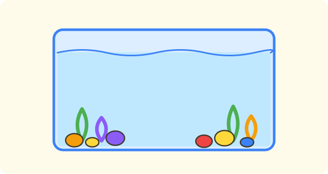

:::goals
- Đếm được từ $0$ đến $5$ và nói được có bao nhiêu đồ vật.
- Đọc và viết các số $0, 1, 2, 3, 4, 5$.
- Biết số $0$ nghĩa là không có đồ vật nào.
- Điền số còn thiếu trong dãy số từ $0$ đến $5$.
:::

Trên bàn có một đĩa kẹo. Lan đếm xong và nói: "Có $4$ cái kẹo." Lan ăn hết kẹo trên đĩa. Bây giờ trên đĩa có mấy cái kẹo, và em viết bằng số nào?

Em đã biết đếm ở trường mầm non. Bài này giúp em đọc và viết các số đó thật đẹp.

## Cùng khám phá

Em hãy đếm từng đồ vật, mỗi đồ vật đếm một lần.

- Trên cành có một con chim. Em đếm: "một". Ta viết số $1$.
- Có hai bông hoa trong lọ. Em đếm: "một, hai". Ta viết số $2$.
- Có ba quả cam trong rổ. Em đếm: "một, hai, ba". Ta viết số $3$.
- Có bốn cái kẹo trên đĩa. Ta viết số $4$.
- Có năm quả bóng bay. Ta viết số $5$.
- Trong bể không có con cá nào. Ta viết số $0$ và đọc là "không".

Vậy khi Lan ăn hết kẹo, trên đĩa có $0$ cái kẹo.

:::graph Các số từ 0 đến 5 xếp thành hàng trên tia số
alt: Tia số có các điểm 0, 1, 2, 3, 4, 5 xếp từ trái sang phải
x: -1..6
y: -1..1
segment: (0, 0) (5, 0)
point: (0, 0) "0" below
point: (1, 0) "1" below
point: (2, 0) "2" below
point: (3, 0) "3" below
point: (4, 0) "4" below
point: (5, 0) "5" below
:::

:::theorem Cách dùng các số 0, 1, 2, 3, 4, 5
1. Mỗi số cho biết có bao nhiêu đồ vật.
2. Khi đếm, em đếm theo thứ tự: không, một, hai, ba, bốn, năm.
3. Không có đồ vật nào thì viết số $0$.
4. Đếm thêm một thì được số đứng ngay sau.
:::

Cách này đúng vì mỗi lần đếm, em chỉ chạm vào một đồ vật và nói một số. Số cuối cùng em nói chính là số đồ vật.

## Ví dụ

Ta bắt đầu với một việc rất đơn giản: đếm các con chim.

:::example Đếm chim
Trên cây có ba con chim. Viết số con chim.

**Lời giải.** Em đếm: "một, hai, ba". Số cuối cùng em nói là ba.

Vậy có $3$ con chim.
:::

Bây giờ em đếm một nhóm có nhiều đồ vật hơn.

:::example Đếm bóng bay
Bạn Nam cầm năm quả bóng bay. Viết số quả bóng bay.

**Lời giải.** Em đếm từng quả: "một, hai, ba, bốn, năm". Số cuối cùng là năm.

Vậy có $5$ quả bóng bay.
:::

Có khi chẳng có đồ vật nào để đếm.

:::example Bể cá trống
Trong bể không có con cá nào. Viết số con cá.

**Lời giải.** Không có con cá nào để đếm, nên em viết số không.

Vậy có $0$ con cá.
:::

Cuối cùng em điền số còn thiếu trong dãy số.

:::example Điền số vào dãy
Điền số thích hợp vào ô trống: $0, 1, \square, 3, 4, 5$.

**Lời giải.** Em đếm theo thứ tự: không, một, ..., ba. Sau số $1$ là số hai, rồi mới đến số $3$.

Vậy số cần điền là $2$.

**Kiểm tra.** Đếm lại cả dãy: không, một, hai, ba, bốn, năm. Đúng thứ tự.
:::

:::warning Những lỗi em hay gặp
- **Đếm sót.** Sai: có $4$ quả bóng nhưng đếm "một, hai, ba, năm". Vì sao sai: em bỏ quên số bốn. Đúng: đếm "một, hai, ba, bốn", được $4$ quả.
- **Quên số $0$.** Sai: lọ không có hoa, em viết số $1$. Vì sao sai: $1$ nghĩa là có một bông hoa. Đúng: viết $0$.
- **Đếm một vật hai lần.** Sai: chạm vào một quả cam hai lần. Vì sao sai: kết quả sẽ nhiều hơn thật. Đúng: mỗi vật chỉ đếm một lần, đếm xong thì đánh dấu.
:::

## Thuật ngữ

:::terms
- số | number
- đếm | count
- không ($0$) | zero
- một ($1$) | one
- hai ($2$) | two
- ba ($3$) | three
- bốn ($4$) | four
- năm ($5$) | five
- tia số | number line
:::

## Tóm tắt

- Số cho biết có bao nhiêu đồ vật: $1, 2, 3, 4, 5$.
- Không có đồ vật nào thì viết số $0$.
- Thứ tự đếm: $0, 1, 2, 3, 4, 5$.
- Mỗi đồ vật chỉ đếm một lần; số cuối cùng em nói là kết quả.

## Luyện tập

Mỗi bài có phần kiến thức và gợi ý. Em hãy tự làm trước, rồi mới bấm xem lời giải.

:::exercise
Trong rổ có ba quả cam. Viết số quả cam.

::hint
**Kiến thức:** đếm từng quả, số cuối cùng là kết quả.

**Gợi ý các bước:**
1. Đề cho biết gì? Có ba quả cam.
2. Viết ba bằng chữ số.

::solution
Ba viết là $3$.

**Đáp số.** $3$ quả cam.
:::

:::exercise
Điền số thích hợp vào ô trống: $0, 1, 2, \square, 4, 5$.

::hint
**Kiến thức:** các số xếp theo thứ tự $0, 1, 2, 3, 4, 5$.

**Gợi ý các bước:**
1. Đọc dãy: không, một, hai, ...
2. Số nào đứng giữa $2$ và $4$?

::solution
Sau $2$ là $3$, rồi đến $4$.

**Đáp số.** $3$.
:::

:::exercise
Em đã biết đếm ở trường mầm non. Em hãy đếm các ngón tay của một bàn tay và viết số.

::hint
**Kiến thức:** đếm từng ngón, mỗi ngón một lần.

**Gợi ý các bước:**
1. Giơ một bàn tay.
2. Đếm: một, hai, ba, bốn, năm.

::solution
Đếm được năm ngón tay, viết là $5$.

**Đáp số.** $5$ ngón tay.
:::

:::exercise
Hộp bút của Mai không có cái bút nào. Viết số bút trong hộp.

::hint
**Kiến thức:** không có đồ vật nào thì viết $0$.

**Gợi ý các bước:**
1. Có cái bút nào để đếm không?
2. Chọn số cho "không có gì".

::solution
Không có cái bút nào nên em viết $0$.

**Đáp số.** $0$ cái bút.
:::

:::exercise
Lọ không có bông hoa nào. Lan viết số bông hoa là $5$. Lan viết đúng không? Vì sao?

::hint
**Kiến thức:** số $0$ nghĩa là không có gì; số $5$ nghĩa là có năm.

**Gợi ý các bước:**
1. Đề cho biết gì? Lọ không có hoa.
2. Số nào nói "không có"?

::solution
Lọ không có hoa nên số hoa là $0$. Lan viết $5$ là sai.

**Đáp số.** Sai. Phải viết $0$.
:::

:::exercise
Nam đếm bốn quả bóng và nói: "một, hai, ba, năm". Nam đếm sai ở đâu? Đếm đúng như thế nào?

::hint
**Kiến thức:** đếm đủ, đúng thứ tự: một, hai, ba, bốn.

**Gợi ý các bước:**
1. Đọc lại lời Nam đếm.
2. Tìm số bị bỏ quên.

::solution
Nam bỏ quên số bốn. Đếm đúng là: một, hai, ba, bốn.

**Đáp số.** Nam bỏ quên số $4$; đúng là $1, 2, 3, 4$.
:::

:::exercise
Trong hộp đồ dùng học tập có: $4$ bút chì, $2$ cục tẩy, $0$ thước kẻ, $5$ bút màu. Đồ vật nào không có trong hộp?

::hint
**Kiến thức:** số $0$ cho biết không có đồ vật đó.

**Gợi ý các bước:**
1. Tìm số $0$ trong danh sách.
2. Đọc tên đồ vật ở cùng chỗ.

::solution
Số $0$ đứng cạnh thước kẻ, nên hộp không có thước kẻ.

**Đáp số.** Thước kẻ.
:::

:::exercise Thử thách
Điền số thích hợp vào các ô trống (đếm ngược): $5, \square, 3, \square, 1, \square$.

::hint
**Kiến thức:** đếm ngược là đọc các số từ lớn về nhỏ.

**Gợi ý các bước:**
1. Đọc: năm, ..., ba.
2. Sau $3$ là số nào? Sau $1$ là số nào?

::solution
Đếm ngược: $5, 4, 3, 2, 1, 0$.

**Kiểm tra.** Đọc từ $0$ đến $5$: $0, 1, 2, 3, 4, 5$. Đúng.

**Đáp số.** $4$, $2$, $0$.
:::

## Kiểm tra mini

:::quiz
::mc
Có bốn quả bóng. Em viết số nào?
A. $3$.
B. $4$.
C. $5$.
D. $0$.
::key B
Bốn viết là $4$. Phương án A là lỗi đếm sót một quả.

::mc
Trong lọ không có bông hoa nào. Số bông hoa là
A. $0$.
B. $1$.
C. $5$.
D. $4$.
::key A
Không có gì thì viết $0$. Phương án B nhầm với một bông hoa.

::mc
Điền số vào dãy $0, 1, 2, \square, 4, 5$.
A. $1$.
B. $2$.
C. $3$.
D. $5$.
::key C
Sau $2$ là $3$, rồi đến $4$. Phương án B lặp lại số $2$.

::mc
Khi đếm, số nào đứng ngay sau số $4$?
A. $3$.
B. $4$.
C. $5$.
D. $0$.
::key C
Đếm thêm một sau bốn là năm, viết $5$. Phương án A là số đứng trước.

::tf
Em xét các số $0, 1, 2, 3, 4, 5$.
a) Số $3$ đọc là "ba".
b) Cành không có con chim nào thì số chim là $0$.
c) Khi đếm, số $5$ đứng trước số $4$.
d) Dãy $0, 1, 2, 3, 4, 5$ có sáu số.
::key Đ Đ S Đ
a) Đúng. b) Đúng: không có gì thì viết $0$. c) Sai: khi đếm thì $4$ đứng trước $5$. d) Đúng: không, một, hai, ba, bốn, năm là sáu số.

::sa
Đếm ngược: $5, 4, 3, \square, 1$. Số cần điền là số nào?
::key 2
Sau $3$ là $2$, rồi đến $1$.

::sa
Số đứng ngay sau số $3$ là số nào?
::key 4
Đếm: ba, bốn. Số đứng ngay sau $3$ là $4$.
:::
