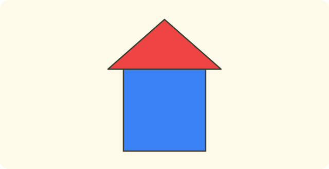
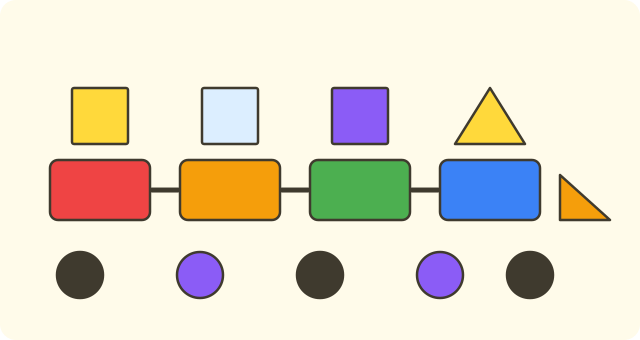
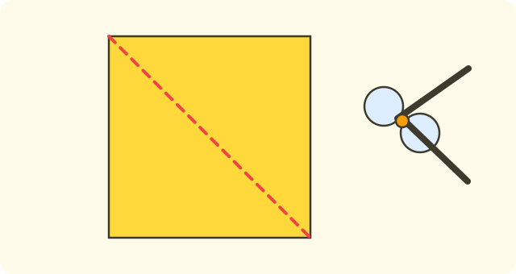

:::goals
- Nhận biết và gọi tên hình vuông, hình tròn, hình tam giác, hình chữ nhật.
- Nói được mỗi hình có mấy cạnh.
- Tìm được các hình đó trong đồ vật quanh em.
:::

Em nhìn quanh lớp: mặt đồng hồ, tờ giấy, khăn tay, biển báo giao thông. Mỗi vật có hình dạng khác nhau. Em gọi tên các hình đó như thế nào?

Ở bài trước em đã học cách tách số. Bài này em học nhận biết bốn hình quen thuộc.

## Cùng khám phá

Em nhìn bốn hình dưới đây.

:::diagram Bốn hình: hình vuông, hình chữ nhật, hình tam giác, hình tròn
alt: Bốn hình: hình vuông, hình chữ nhật, hình tam giác và hình tròn
point A 0,0 ""
point B 2,0 ""
point C 2,2 ""
point D 0,2 ""
point E 4,0 ""
point F 7,0 ""
point G 7,2 ""
point H 4,2 ""
point I 9,0 ""
point J 11,0 ""
point K 10,2 ""
point O 13,1 ""
polygon A B C D
polygon E F G H
polygon I J K
circle O 1
label 1,-0.7 "vuông"
label 5.5,-0.7 "chữ nhật"
label 10,-0.7 "tam giác"
label 13,-0.7 "tròn"
:::

Em chạm ngón tay dọc theo viền của từng hình.

- Hình vuông có $4$ cạnh, cả $4$ cạnh dài bằng nhau.
- Hình chữ nhật có $4$ cạnh: hai cạnh dài bằng nhau và hai cạnh ngắn bằng nhau.
- Hình tam giác có $3$ cạnh và $3$ góc.
- Hình tròn không có cạnh, viền tròn đều và cong.

:::theorem Bốn hình quen thuộc
1. Hình vuông: $4$ cạnh dài bằng nhau.
2. Hình chữ nhật: $4$ cạnh, hai cạnh dài bằng nhau, hai cạnh ngắn bằng nhau.
3. Hình tam giác: $3$ cạnh, $3$ góc.
4. Hình tròn: không có cạnh, không có góc.
:::

Cách này đúng vì em chỉ cần đếm cạnh và nhìn xem các cạnh dài hay ngắn là gọi được tên hình.

## Ví dụ

Ta bắt đầu với một đồ vật quen thuộc.

:::example Bánh xe
Bánh xe đạp có dạng hình gì?

**Lời giải.** Viền bánh xe cong đều, không có cạnh và không có góc.

Vậy bánh xe có dạng hình tròn.
:::

Bây giờ em gọi tên hình có cạnh.

:::example Khăn tay
Một chiếc khăn tay có $4$ cạnh, cả $4$ cạnh dài bằng nhau. Khăn có dạng hình gì?

**Lời giải.** Hình có $4$ cạnh dài bằng nhau là hình vuông.

Vậy chiếc khăn có dạng hình vuông.
:::

Tiếp theo em phân biệt hình chữ nhật.

:::example Cửa sổ
Một cửa sổ có $4$ cạnh. Hai cạnh dài bằng nhau và hai cạnh ngắn bằng nhau. Cửa sổ có dạng hình gì?

**Lời giải.** Hình có $4$ cạnh nhưng các cạnh không bằng nhau hết, chỉ có từng đôi bằng nhau, là hình chữ nhật.

Vậy cửa sổ có dạng hình chữ nhật.
:::

Cuối cùng em đếm các hình trong một hình ghép.

:::example Ngôi nhà ghép từ hình
Em ghép một ngôi nhà từ một hình vuông (thân nhà) và một hình tam giác (mái nhà). Em đã dùng mấy hình?

**Lời giải.** Em đếm: một hình vuông, một hình tam giác. Em đếm: "một, hai".

Vậy em đã dùng $2$ hình.
:::

:::warning Những lỗi em hay gặp
- **Nhầm hình chữ nhật với hình vuông.** Sai: hình có hai cạnh dài, hai cạnh ngắn là hình vuông. Vì sao sai: hình vuông có cả $4$ cạnh bằng nhau. Đúng: đó là hình chữ nhật.
- **Nói hình tam giác có $4$ cạnh.** Sai: tam giác có $4$ cạnh. Vì sao sai: tam giác chỉ có $3$ cạnh. Đúng: hình tam giác có $3$ cạnh.
- **Nói hình tròn có cạnh.** Sai: hình tròn có $1$ cạnh. Vì sao sai: viền hình tròn cong, không có cạnh thẳng. Đúng: hình tròn không có cạnh.
:::

## Thuật ngữ

:::terms
- hình vuông | square
- hình tròn | circle
- hình tam giác | triangle
- hình chữ nhật | rectangle
- cạnh | side
- góc | corner
- hình | shape
:::

## Tóm tắt

- Hình vuông có $4$ cạnh dài bằng nhau.
- Hình chữ nhật có $4$ cạnh, hai cạnh dài và hai cạnh ngắn.
- Hình tam giác có $3$ cạnh, $3$ góc.
- Hình tròn không có cạnh, không có góc.

## Luyện tập

Mỗi bài có phần kiến thức và gợi ý. Em hãy tự làm trước, rồi mới bấm xem lời giải.

:::exercise
Mặt đồng hồ treo tường có dạng hình gì?

::hint
**Kiến thức:** hình có viền cong đều, không có cạnh là hình tròn.

**Gợi ý các bước:**
1. Viền mặt đồng hồ cong hay thẳng?
2. Có cạnh và góc không?

::solution
Viền mặt đồng hồ cong đều, không có cạnh.

**Đáp số.** Hình tròn.
:::

:::exercise
Hình có $3$ cạnh là hình gì?

::hint
**Kiến thức:** đếm số cạnh để gọi tên hình.

**Gợi ý các bước:**
1. Hình vuông và hình chữ nhật có mấy cạnh?
2. Hình nào có $3$ cạnh?

::solution
Hình tam giác có $3$ cạnh.

**Đáp số.** Hình tam giác.
:::

:::exercise
Em hãy nhớ lại bài trước. a) $8$ cái bánh chia vào hai đĩa. Đĩa thứ nhất có $5$ cái bánh, $8$ gồm $5$ và $\square$. b) Hình có $4$ cạnh dài bằng nhau là hình gì?

::hint
**Kiến thức:** đếm tiếp từ $5$ lên $8$; hình vuông có $4$ cạnh bằng nhau.

**Gợi ý các bước:**
1. Đếm: sáu, bảy, tám.
2. Nhớ đặc điểm của hình vuông.

::solution
a) Từ $5$ lên $8$ có $3$ số. b) Hình có $4$ cạnh dài bằng nhau là hình vuông.

**Đáp số.** a) $3$. b) Hình vuông.
:::

:::exercise
a) Trong ba hình: hình vuông, hình tròn, hình tam giác, hình nào không có cạnh?
b) Hình chữ nhật có mấy cạnh?

::hint
**Kiến thức:** hình tròn không có cạnh; hình chữ nhật có $4$ cạnh.

**Gợi ý các bước:**
1. Hình nào có viền cong?
2. Đếm cạnh hình chữ nhật.

::solution
a) Hình tròn không có cạnh. b) Hình chữ nhật có $4$ cạnh.

**Đáp số.** a) Hình tròn. b) $4$ cạnh.
:::

:::exercise
An nói: "Tờ giấy có $4$ cạnh, hai cạnh dài, hai cạnh ngắn là hình vuông." An nói đúng không? Vì sao?

::hint
**Kiến thức:** hình vuông có cả $4$ cạnh bằng nhau.

**Gợi ý các bước:**
1. Các cạnh của tờ giấy có bằng nhau hết không?
2. Chọn tên hình đúng.

::solution
Tờ giấy có cạnh dài và cạnh ngắn, nên các cạnh không bằng nhau hết. An nói sai.

**Đáp số.** Sai. Tờ giấy là hình chữ nhật.
:::

:::exercise
Mai nói: "Hình tam giác có $4$ cạnh." Mai sai ở đâu? Nói lại cho đúng.

::hint
**Kiến thức:** hình tam giác có $3$ cạnh.

**Gợi ý các bước:**
1. Đếm cạnh hình tam giác.
2. So với số Mai nói.

::solution
Hình tam giác chỉ có $3$ cạnh, không phải $4$.

**Đáp số.** Hình tam giác có $3$ cạnh.
:::

:::exercise
Bảng cho biết số hình trong một bức tranh:

| Hình | Vuông | Tròn | Tam giác | Chữ nhật |
|---|---|---|---|---|
| Số hình | $3$ | $5$ | $2$ | $4$ |

a) Hình nào nhiều nhất?
b) Hình nào ít nhất?

::hint
**Kiến thức:** so sánh các số trong hàng "Số hình".

**Gợi ý các bước:**
1. Đọc các số: $3, 5, 2, 4$.
2. Tìm số lớn nhất và số bé nhất.

::solution
a) Số lớn nhất là $5$, ở hình tròn. b) Số bé nhất là $2$, ở hình tam giác.

**Đáp số.** a) Hình tròn. b) Hình tam giác.
:::

:::exercise Thử thách
Em cắt một tờ giấy hình vuông theo một đường thẳng nối hai góc đối diện. Em được mấy mảnh? Mỗi mảnh là hình gì?

::hint
**Kiến thức:** hình tam giác có $3$ cạnh và $3$ góc.

**Gợi ý các bước:**
1. Đường cắt chia hình vuông thành mấy phần?
2. Mỗi phần có mấy cạnh?

::solution
Đường cắt chia hình vuông thành $2$ phần. Mỗi phần có $3$ cạnh.

**Kiểm tra.** Hai mảnh ghép lại thành hình vuông ban đầu.

**Đáp số.** $2$ mảnh, mỗi mảnh là hình tam giác.
:::

## Kiểm tra mini

:::quiz
::mc
Bánh xe đạp có dạng hình
A. vuông.
B. tròn.
C. tam giác.
D. chữ nhật.
::key B
Viền bánh xe cong đều và không có cạnh. Phương án A nhầm với hình có cạnh.

::mc
Hình có $3$ cạnh là hình
A. vuông.
B. tròn.
C. tam giác.
D. chữ nhật.
::key C
Chỉ hình tam giác có $3$ cạnh.

::mc
Hình có $4$ cạnh, hai cạnh dài bằng nhau và hai cạnh ngắn bằng nhau (các cạnh không bằng nhau hết) là hình
A. vuông.
B. tròn.
C. tam giác.
D. chữ nhật.
::key D
Đó là hình chữ nhật. Phương án A nhầm vì hình vuông có cả $4$ cạnh bằng nhau.

::mc
Hình nào không có cạnh?
A. Hình vuông.
B. Hình tròn.
C. Hình tam giác.
D. Hình chữ nhật.
::key B
Viền hình tròn cong, không có cạnh.

::tf
Em xét các hình.
a) Hình vuông có $4$ cạnh dài bằng nhau.
b) Hình tam giác có $4$ cạnh.
c) Hình tròn không có cạnh.
d) Hình chữ nhật có $3$ cạnh.
::key Đ S Đ S
a) Đúng. b) Sai: tam giác có $3$ cạnh. c) Đúng. d) Sai: hình chữ nhật có $4$ cạnh.

::sa
Hình chữ nhật có mấy cạnh?
::key 4
Hình chữ nhật có hai cạnh dài và hai cạnh ngắn, tất cả $4$ cạnh.

::sa
Hình tam giác có mấy góc?
::key 3
Hình tam giác có $3$ cạnh và $3$ góc.
:::
